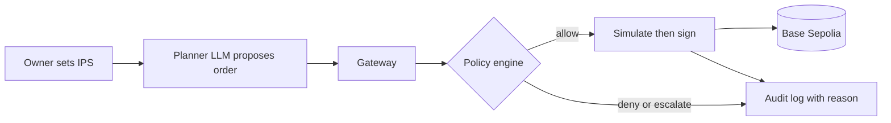

# agent-wallet

An AI wallet agent for FinTechathon 2026 (Topic F, Agent Wallet). The agent holds its own funded wallet and acts only inside an Investment Policy Statement (IPS) set by the owner. A deterministic policy engine decides every order, and an eval suite measures whether the agent complies.

> Status: scaffold. The contracts, toolchain, CI and Docker image are in place; the gateway, policy engine and signer are the next tickets. Execution is on Base Sepolia (testnet) only.

## Quick start
Requires Python 3.11 and, optionally, Docker.

```sh
python -m venv .venv
. .venv/bin/activate            # Windows: .venv\Scripts\activate
pip install -r requirements-dev.txt
make check                      # lint, tests, secret scan; needs no keys and no network
make run                        # API on http://127.0.0.1:8000 (GET /health)
```

With Docker:
```sh
cp .env.example .env            # optional; the API starts without keys
docker compose up --build       # API on http://localhost:8000
```

## Run the UI
A minimal owner console (plain HTML, CSS and JS, no build step, no external assets) is served by the API at `/ui`.

```sh
export AGENT_WALLET_OWNER_TOKEN=<a throwaway value>   # without it owner controls answer 503
uvicorn api.main:app                                  # then open http://127.0.0.1:8000/ui
```
Type the owner token into the page; it stays in memory only. Without it, Stop, Release, Approve and Reject are disabled. The audit chain check runs in the browser; authoritative verification is `python -m core.audit.verify`. Design note: [`docs/architecture/ui.md`](docs/architecture/ui.md).

## How it will work

The LLM proposes and code decides; the LLM never holds a key. More detail: `docs/architecture/overview.md`.

## Make targets
| Target | What it does |
| :--- | :--- |
| `make check` | lint, tests and secret scan (what CI runs) |
| `make test` | pytest, including contract-example validation and the signer-boundary test |
| `make lint` / `make format` | ruff |
| `make run` | local API with reload |
| `make docker-build` / `make docker-run` | image build and run |

## Configuration
Environment variable names only (see `.env.example`). Values live in `.env`, which is never committed. Testnet keys only.

| Variable | Purpose |
| :--- | :--- |
| `OPENAI_API_KEY` | Planner and Reader LLM |
| `AGENT_WALLET_PRIVATE_KEY` | Testnet agent wallet key; read only by the signer |
| `BASE_SEPOLIA_RPC_URL` | JSON-RPC endpoint (default `https://sepolia.base.org`) |
| `DB_PATH` | SQLite file for tier state and the audit log |
| `IPS_PATH` | The Investment Policy Statement file |

## Repository map
| Path | Purpose |
| :--- | :--- |
| `PLAN.md` | Goal, scope, phases, milestones, risks |
| `AGENTS.md` | Conventions for the agents that build this repo |
| `contracts/` | Data contracts v1: JSON Schemas, OpenAPI, rule codes, examples (see `contracts/README.md`) |
| `core/` | Gateway, signer, policy engine, audit log, protocol adapters |
| `api/` | FastAPI app |
| `ui/` | Static owner console served at `/ui` |
| `tests/` | pytest suite |
| `scripts/` | Repository checks (secret scan) |
| `docs/` | Competition rules, design notes, architecture notes (see `docs/README.md`) |
| `Dockerfile`, `docker-compose.yml` | Container image and one-command run |

## Submission
Deadline: 20 Oct 2026, 23:59 Beijing time. Required items and rules: `docs/competition/`.
