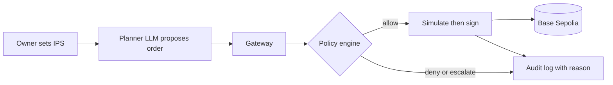

# agent-wallet

An AI wallet agent for FinTechathon 2026 (Topic F, Agent Wallet). The agent holds its own funded wallet and acts only inside an Investment Policy Statement (IPS) set by the owner. A deterministic policy engine decides every order, and an eval suite measures whether the agent complies.

> Status: planning. No code yet. The scaffold is the first ticket after the stack is decided.

## How it will work

The LLM proposes and code decides; the LLM never holds a key. Execution is on Base Sepolia (testnet) only.

## Repository map
| Path | Purpose |
| :--- | :--- |
| `PLAN.md` | Goal, scope, phases, milestones, risks |
| `AGENTS.md` | Conventions for the agents that build this repo |
| `docs/` | Documentation index: competition rules, design notes, architecture, evidence (see `docs/README.md`) |
| `.env.example` | Environment variable names (never values) |

## Submission
Deadline: 20 Oct 2026, 23:59 Beijing time. Required items and rules: `docs/competition/`.
