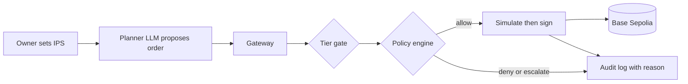

# agent-wallet

An AI wallet agent for FinTechathon 2026 (Topic F, Agent Wallet). The agent holds its own funded wallet and acts only inside an Investment Policy Statement (IPS) set by the owner. A deterministic policy engine decides every order, and an eval suite measures whether the agent complies.

> Status: a working multi-owner webapp is live on Base Sepolia (testnet only): <https://agent-wallet-6vuy.onrender.com/ui/> (Render free tier, so the first request after idle can take about a minute; Supabase Postgres behind it). Sign in with a wallet, the server creates a custodial testnet agent wallet for you, fund its gas, activate it, mint test USDC, run the LLM planner, and every decision lands in a hash-chained audit log. The policy engine, tiers, gateway, signer, audit chain, risk provider, planner and reader, API, UI and the eval harness are built and tested. Hosting and operations: [`docs/architecture/deployment.md`](docs/architecture/deployment.md).

## For judges: verify in five minutes, no keys needed
```sh
python -m venv .venv && . .venv/bin/activate     # Windows: .venv\Scriptsctivate
pip install -r requirements-dev.txt
python -m pytest -q                              # full test suite, offline
python -m evals.run                              # 46 scenarios, 27/28 rule codes; writes docs/evidence/eval-report.md
python -m core.audit.verify docs/evidence/audit-chain.jsonl   # hash chain of the live run
```
| Evidence | Where |
| :--- | :--- |
| Hosted end-to-end session (sign-in, top-up, activate, mint, planner runs, hostile run denied, audit verify) | [`docs/evidence/webapp-evidence.md`](docs/evidence/webapp-evidence.md) |
| On-chain transactions (approve and supply 1 test USDC, receipts `0x1`) | [`docs/evidence/tx_hashes.md`](docs/evidence/tx_hashes.md) |
| Planner-proposed run: two executed orders, one hostile order denied, verified chain | [`docs/evidence/runner-evidence.md`](docs/evidence/runner-evidence.md) |
| Evaluation report (offline replay) | [`docs/evidence/eval-report.md`](docs/evidence/eval-report.md) |
| Technical documentation | [`docs/technical-documentation.md`](docs/technical-documentation.md) |
| Security self-assessment and known risks | [`docs/security/self-assessment.md`](docs/security/self-assessment.md) |
| Architecture notes | [`docs/architecture/`](docs/architecture/) |

## Quick start
Requires Python 3.11 and, optionally, Docker.

```sh
python -m venv .venv
. .venv/bin/activate            # Windows: .venv\Scripts\activate
pip install -r requirements-dev.txt
make check                      # lint, tests, secret scan; needs no keys and no network
make run                        # API on http://127.0.0.1:8000 (GET /health)
```

With Docker:
```sh
cp .env.example .env            # optional; the API starts without keys
docker compose up --build       # API on http://localhost:8000
```
The container runs the API and static console at `/ui` as non-root (UID 10001). Runtime state persists in `./data:/app/data` under `AGENT_WALLET_DATA_DIR`. Repository scripts (`scripts/`, `evals/`) are not bundled into the image and run from a local checkout. Architecture note: [`docs/architecture/deployment.md`](docs/architecture/deployment.md).

## Run the UI
The webapp UI (plain HTML, CSS and JS modules, no build step, no external assets) is served by the API at `/ui`. It is built to the approved UI contract ([`docs/design/webapp/ui-contract.md`](docs/design/webapp/ui-contract.md) and its mockups): **Chat** is home once the agent is activated, then **Portfolio** (value, holdings, mint, withdraw, top up, approvals), **Activity** (every decision as plain-language step cards, with the verify-chain action) and **Rules** (read-only limits). A three-step **Setup** (Connected, Add gas, Activate) is shown until the agent is activated. There is no warning banner: testnet and custody are a header chip, one grey footer line and the Setup text.
```sh
uvicorn api.main:app                                  # then open http://127.0.0.1:8000/ui/
# no backend needed for a look around: http://127.0.0.1:8000/ui/?fixtures=1&demo=1
```
`?fixtures=1` answers every call from `ui/fixtures/*.json` and a stub wallet (a header chip says so). `&demo=1` starts signed in and funded at tier T2; `&scenario=t0` starts at T0 so Setup and Activate show; `&scenario=hostile` starts with a blocked hostile order in Activity. Without it the page is live: it talks to the session routes through `ui/api.js` (wallet sign-in, HttpOnly cookie, `X-AW-CSRF` header) and needs the API started with `AGENT_WALLET_MODE=multi`, a session secret, a keystore secret and `AGENT_WALLET_PUBLIC_ORIGIN` set to the address in the browser bar (see `docs/architecture/api.md`). Activate (raises the tier from T0 with one signature), add gas, chat, mint, run, withdraw, stop and resume, and approvals work from the page; every screen shows only the signed-in owner's own data. Previews of the rebuilt screens at 1280 px and 375 px: [`docs/previews/ui2-*.png`](docs/previews/). Design note: [`docs/architecture/ui.md`](docs/architecture/ui.md).

## How it works

Protocols plug in through one registry ([`docs/architecture/protocols.md`](docs/architecture/protocols.md)): the tx builder, planner prompt, portfolio reader and `GET /protocols` all read it. Supported protocols include Aave v3 (USDC and USDT lending, [`docs/architecture/aave-adapter.md`](docs/architecture/aave-adapter.md)) and Aave Stata (ERC-4626 static aToken vaults for USDC and USDT, [`docs/architecture/aave-stata.md`](docs/architecture/aave-stata.md)).

The LLM proposes and code decides; the LLM never holds a key. Only the gateway can reach the signer, and every outcome is written to a hash-chained log. Details: [`docs/technical-documentation.md`](docs/technical-documentation.md).

## Runner
`core.runner.runner.Runner.run_once(untrusted_text, now)` runs one cycle: the Reader extracts facts, the Planner proposes orders, the portfolio reader supplies state and ledger limits, and each order goes through `Gateway.propose`. A planner `no_action` is recorded through `Gateway.record_no_action`. The runner never imports the signer, the owner controls or the intent store. Design note: [`docs/architecture/runner.md`](docs/architecture/runner.md).

## Make targets
| Target | What it does |
| :--- | :--- |
| `make check` | lint, tests and secret scan (what CI runs) |
| `make test` | pytest, including contract-example validation and the signer-boundary test |
| `make lint` / `make format` | ruff |
| `make run` | local API with reload |
| `make docker-build` / `make docker-run` | image build and run |

## Configuration
Environment variable names only (see `.env.example`). Values live in `.env`, which is never committed. Testnet keys only.

| Variable | Purpose |
| :--- | :--- |
| `OPENAI_API_KEY` | Planner and Reader LLM |
| `AGENT_WALLET_PRIVATE_KEY` | Testnet agent wallet key; read only by the signer |
| `AGENT_WALLET_OWNER_TOKEN` | Owner token for the owner endpoints and UI; unset means they answer 503 |
| `BASE_SEPOLIA_RPC_URL` | JSON-RPC endpoint (default `https://sepolia.base.org`) |
| `AGENT_WALLET_DATA_DIR` | Directory for SQLite state files (default `.data`, `/app/data` in container) |
| `IPS_PATH` | The Investment Policy Statement file |

## Repository map
| Path | Purpose |
| :--- | :--- |
| `PLAN.md` | Goal, scope, phases, milestones, risks |
| `AGENTS.md` | Conventions for the agents that build this repo |
| `contracts/` | Data contracts v1: JSON Schemas, OpenAPI, rule codes, examples (see `contracts/README.md`) |
| `core/` | Gateway, signer, policy engine, tiers, audit log, risk provider, planner and reader, protocol adapters |
| `evals/` | Offline replay evaluation harness |
| `api/` | FastAPI app |
| `ui/` | Static webapp UI served at `/ui` |
| `tests/` | pytest suite |
| `scripts/` | Repository checks (secret scan) and the first-live-transaction script (dry run by default) |
| `docs/` | Competition rules, design notes, architecture notes (see `docs/README.md`) |
| `Dockerfile`, `docker-compose.yml` | Container image and one-command run |

## Submission
Deadline: 20 Oct 2026, 23:59 Beijing time. Required items and rules: `docs/competition/`.
