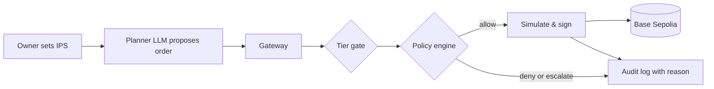

# BaKhi Wallet

<picture>
  <source media="(prefers-color-scheme: dark)" srcset="ui/assets/brand/lockup-dark.png">
  
</picture>

BaKhi Wallet (team BaKhi) is an autonomous AI wallet agent for FinTechathon 2026 (Topic F) managing on-chain assets on Base Sepolia inside an Investment Policy Statement (IPS) set by the owner. A deterministic policy engine evaluates every proposed order before any transaction is signed, ensuring the LLM never controls private keys or exceeds policy limits.

- **Hosted Demo**: <https://bakhi-wallet.eddiephung.me/chat> (Base Sepolia testnet, Render free tier)
- **Repository**: <https://github.com/thaicuong576/agent-wallet>



## Submission Deliverables
| Item | Deliverable | Path / Reference |
| :--- | :--- | :--- |
| **01** | Technical documentation | [`docs/submission/01-technical-documentation.md`](docs/submission/01-technical-documentation.md) |
| **02** | Presentation deck | [`docs/submission/02-presentation-deck.md`](docs/submission/02-presentation-deck.md) |
| **03** | Demo video script | [`docs/submission/03-demo-video-script.md`](docs/submission/03-demo-video-script.md) |
| **04** | Source code & docs | This repository: [`README.md`](README.md), [`docs/guides/deployment.md`](docs/guides/deployment.md), [`docs/guides/testing.md`](docs/guides/testing.md) |
| **05** | Security self-assessment | [`docs/submission/05-security-self-assessment.md`](docs/submission/05-security-self-assessment.md) |
| **06** | Execution evidence | [`docs/submission/06-execution-evidence.md`](docs/submission/06-execution-evidence.md) |

## Quick Start
Run locally in 5 commands without API keys (offline demo mode with fixtures needs no keys or RPC):
```sh
python -m venv .venv && . .venv/bin/activate  # Windows: .venv\Scripts\activate
pip install -r requirements-dev.txt
make check                                  # lint, tests, links, secret scan (offline)
make demo                                   # starts API server on http://127.0.0.1:8000
# Open http://127.0.0.1:8000/chat?fixtures=1&demo=1 in browser for zero-key demo
```
With keys: copy `.env.example` to `.env`, set `BASE_SEPOLIA_RPC_URL`, `OPENAI_API_KEY`, and run `make run`. See [`docs/guides/deployment.md`](docs/guides/deployment.md).

## Running Tests
```sh
make test                                   # 1,523 tests: unit, policy, gateway, storage, UI
make eval                                   # 48 replay scenarios covering 29 of the 31 rule codes
python -m core.audit.verify docs/evidence/audit-chain.jsonl  # verifies audit hash chain
```
Detailed testing guide and suite breakdowns: [`docs/guides/testing.md`](docs/guides/testing.md).

## Supported Protocols
- **Aave v3**: USDC and USDT supply & withdraw on Base Sepolia ([`docs/architecture/protocols/aave-adapter.md`](docs/architecture/protocols/aave-adapter.md))
- **Aave Stata**: ERC-4626 static yield-bearing aToken vaults for USDC/USDT ([`docs/architecture/protocols/aave-stata.md`](docs/architecture/protocols/aave-stata.md))
- **Morpho Blue**: Isolated lending markets for USDC/cbETH and USDC/WBTC ([`docs/architecture/protocols/morpho-blue.md`](docs/architecture/protocols/morpho-blue.md))
- **Uniswap v3**: DEX token swaps with quote-based minimum output protection and oracle price deviation guard ([`docs/architecture/protocols/uniswap-v3.md`](docs/architecture/protocols/uniswap-v3.md))
- Protocol registry & strategy presets (Conservative vs Diversified): [`docs/architecture/protocols/protocols.md`](docs/architecture/protocols/protocols.md), [`docs/architecture/core/presets.md`](docs/architecture/core/presets.md)
- Latency visibility & UI cache control: [`docs/architecture/webapp/timing-logs.md`](docs/architecture/webapp/timing-logs.md), [`docs/guides/deployment.md`](docs/guides/deployment.md)

## On-Chain Evidence
25 testnet transactions on Base Sepolia (chain ID 84532), each with receipt status `0x1`, across Aave v3, Aave Stata, Morpho Blue, Uniswap v3 and native ETH top-up. The full index with BaseScan links, the audit chain checks and the cases where the agent was refused is in [`docs/submission/06-execution-evidence.md`](docs/submission/06-execution-evidence.md). A few examples:

| Action | Protocol | Transaction Hash | Evidence Source |
| :--- | :--- | :--- | :--- |
| Approve 1 USDC | Aave v3 | [`0xba75...0221`](https://sepolia.basescan.org/tx/0xba75953fca67a96112ec7f11bfeeb03235629e0cc7415033ddb7a6b244630221) | [`docs/evidence/tx_hashes.md`](docs/evidence/tx_hashes.md) |
| Supply 10 USDC (planner) | Aave v3 | [`0xcc49...44ff`](https://sepolia.basescan.org/tx/0xcc49ca6da6435519fb15291b95887bbcd16f9934ce81076efff93836ed4044ff) | [`docs/evidence/webapp-evidence.md`](docs/evidence/webapp-evidence.md) |
| Swap USDC to WBTC | Uniswap v3 | [`0xe5b0...eda4`](https://sepolia.basescan.org/tx/0xe5b0dae4156a7eff167de570c59445a31c62da02d9c3e6a293088095c894eda4) | [`docs/evidence/defi-evidence-loop.md`](docs/evidence/defi-evidence-loop.md) |
| Deposit 5 USDC | Aave Stata | [`0xa61e...0221`](https://sepolia.basescan.org/tx/0xa61e6dcae14132cd74efe19bdd7fb38f16e5d34e1a825625f3745383df960221) | [`docs/evidence/defi-evidence.md`](docs/evidence/defi-evidence.md) |
| Supply USDC/WBTC market | Morpho Blue | [`0x20ef...213b`](https://sepolia.basescan.org/tx/0x20ef510012788bd10dd604a20cb004daf945381a3f14693ff2e3db9b47fc213b) | [`docs/evidence/defi-evidence-loop.md`](docs/evidence/defi-evidence-loop.md) |
| Withdraw | Morpho Blue | [`0x3f15...012f`](https://sepolia.basescan.org/tx/0x3f15f2f249897a8caf14f9816c8e4db92cda0e6128f4d72e55a54ad326c9012f) | [`docs/evidence/defi-evidence-loop.md`](docs/evidence/defi-evidence-loop.md) |

## Repository Structure

```text
.
├── api/          # FastAPI HTTP surface, auth sessions, SSE event streams, OpenAPI endpoints
├── contracts/    # Data contracts, JSON Schemas, OpenAPI specification, rule codes, strategy presets
├── core/         # Core policy, execution, and security architecture
│   ├── agent/    # Untrusted LLM Reader fact extraction and Planner proposal synthesis
│   ├── audit/    # Append-only SHA-256 hash-chained tamper-evident audit log
│   ├── gateway/  # Execution pipeline, simulation-before-signing, concurrency lock
│   ├── policy/   # Pure deterministic policy engine and IPS mathematical rule checks
│   ├── protocols/# Calldata builders and protocol adapters (Aave, Morpho, Uniswap)
│   ├── risk/     # Risk router aggregating live on-chain metrics and reference data
│   ├── runner/   # Autonomous agent loop cycle, portfolio state, ledger tracking
│   ├── signer/   # Isolated local key signer restricted exclusively to Base Sepolia
│   ├── simulate/ # RPC transaction bundle simulation (eth_call) before signing
│   ├── storage/  # Dual-backend persistence (SQLite and PostgreSQL with RLS)
│   └── tiers/    # Permission tiers (T0-T2), emergency stop, approval queue (T3 rule)
├── docs/         # Documentation index, architecture specs, guides, research, and evidence
├── evals/        # 48 offline evaluation scenarios covering 29 of the 31 rule codes
├── scripts/      # Operational scripts: checks, evidence generation, submission packaging
├── tests/        # Comprehensive pytest test suite (1,523 tests across all layers)
└── ui/           # Zero-build single-page webapp console (plain HTML, CSS, ES modules)
```

See [`docs/README.md`](docs/README.md) for the complete documentation index.

## Security Model
- **LLM proposes, code decides**: The LLM outputs structured proposals; a pure Python engine enforces rules.
- **Key isolation**: Signer private keys are restricted to the gateway and never exposed to LLMs or UI.
- **Permission tiers**: T0 (read-only), T1 (propose-only), and T2 (autonomous execution within limits).
- **Fail-closed risk router**: Stale or unreachable risk oracle data immediately blocks execution.
- **Tamper-evident audit chain**: Every action, denial, and approval is recorded in a SHA-256 hash chain.

## Known Limits
- Testnet only (Base Sepolia, chain 84532); mainnet execution and assets are strictly unsupported.
- Hosted demo uses encrypted custodial testnet wallets; production requires user-delegated accounts.
- Render free-tier instances sleep after 15 minutes of inactivity; first request may take ~50s.

## Licence & Notices
Licensed under the MIT License, see [`LICENSE`](LICENSE). Code adapted from other open-source projects is listed with its license in [`THIRD_PARTY_NOTICES.md`](THIRD_PARTY_NOTICES.md).
