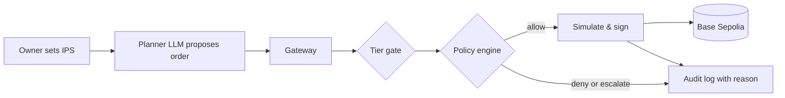

# agent-wallet

Autonomous AI wallet agent for FinTechathon 2026 (Topic F) managing on-chain assets on Base Sepolia inside an Investment Policy Statement (IPS) set by the owner. A deterministic policy engine evaluates every proposed order before any transaction is signed, ensuring the LLM never controls private keys or exceeds policy limits.

- **Hosted Demo**: <https://agent-wallet-6vuy.onrender.com/ui/> (Base Sepolia testnet, Render free tier)
- **Repository**: <https://github.com/thaicuong576/agent-wallet>



## Submission Deliverables
| Item | Deliverable | Path / Reference |
| :--- | :--- | :--- |
| **01** | Technical documentation | [`docs/submission/01-technical-documentation.md`](docs/submission/01-technical-documentation.md) |
| **02** | Presentation deck | [`docs/submission/02-presentation-deck.md`](docs/submission/02-presentation-deck.md) |
| **03** | Demo video script | [`docs/submission/03-demo-video-script.md`](docs/submission/03-demo-video-script.md) |
| **04** | Source code & docs | This repository: [`README.md`](README.md), [`docs/guides/deployment.md`](docs/guides/deployment.md), [`docs/guides/testing.md`](docs/guides/testing.md) |
| **05** | Security self-assessment | [`docs/submission/05-security-self-assessment.md`](docs/submission/05-security-self-assessment.md) |
| **06** | Execution evidence | [`docs/submission/06-execution-evidence.md`](docs/submission/06-execution-evidence.md) |

## Quick Start
Run locally in 5 commands without API keys (offline demo mode with fixtures needs no keys or RPC):
```sh
python -m venv .venv && . .venv/bin/activate  # Windows: .venv\Scripts\activate
pip install -r requirements-dev.txt
make check                                  # lint, tests, links, secret scan (offline)
make demo                                   # starts API server on http://127.0.0.1:8000
# Open http://127.0.0.1:8000/ui/?fixtures=1&demo=1 in browser for zero-key demo
```
With keys: copy `.env.example` to `.env`, set `BASE_SEPOLIA_RPC_URL`, `OPENAI_API_KEY`, and run `make run`. See [`docs/guides/deployment.md`](docs/guides/deployment.md).

## Running Tests
```sh
make test                                   # 1,482 tests: unit, policy, gateway, storage, UI
make eval                                   # 46 replay scenarios covering 27/28 rule codes
python -m core.audit.verify docs/evidence/audit-chain.jsonl  # verifies audit hash chain
```
Detailed testing guide and suite breakdowns: [`docs/guides/testing.md`](docs/guides/testing.md).

## Supported Protocols
- **Aave v3**: USDC and USDT supply & withdraw on Base Sepolia ([`docs/architecture/protocols/aave-adapter.md`](docs/architecture/protocols/aave-adapter.md))
- **Aave Stata**: ERC-4626 static yield-bearing aToken vaults for USDC/USDT ([`docs/architecture/protocols/aave-stata.md`](docs/architecture/protocols/aave-stata.md))
- **Morpho Blue**: Isolated lending markets for USDC/cbETH and USDC/WBTC ([`docs/architecture/protocols/morpho-blue.md`](docs/architecture/protocols/morpho-blue.md))
- **Uniswap v3**: DEX token swaps with oracle-based minimum output protection ([`docs/architecture/protocols/uniswap-v3.md`](docs/architecture/protocols/uniswap-v3.md))
- Protocol registry & strategy presets (Conservative vs Diversified): [`docs/architecture/protocols/protocols.md`](docs/architecture/protocols/protocols.md), [`docs/architecture/core/presets.md`](docs/architecture/core/presets.md)
- Latency visibility & UI cache control: [`docs/architecture/webapp/timing-logs.md`](docs/architecture/webapp/timing-logs.md), [`docs/guides/deployment.md`](docs/guides/deployment.md)

## On-Chain Evidence
Real testnet transactions executed on Base Sepolia (chain ID 84532):
| Action | Protocol | Transaction Hash | Evidence Source |
| :--- | :--- | :--- | :--- |
| Approve 1 USDC | Aave v3 | [`0xba75...0221`](https://sepolia.basescan.org/tx/0xba75953fca67a96112ec7f11bfeeb03235629e0cc7415033ddb7a6b244630221) | [`docs/evidence/tx_hashes.md`](docs/evidence/tx_hashes.md) |
| Supply 1 USDC | Aave v3 | [`0x7c81...f233`](https://sepolia.basescan.org/tx/0x7c81b0ad32c8213081a0e142ee50e5de72f750ad23425c9267ecb81a0ea6f233) | [`docs/evidence/tx_hashes.md`](docs/evidence/tx_hashes.md) |
| Gas Top-up | Base Sepolia | [`0xf9db...0e9a`](https://sepolia.basescan.org/tx/0xf9db01704315836598e0496a7ee9233caf5aedc25ab16eec6002bbd9d3af0e9a) | [`docs/evidence/webapp-evidence.md`](docs/evidence/webapp-evidence.md) |
| Approve 5 USDC | Stata Vault | [`0xd10c...7274`](https://sepolia.basescan.org/tx/0xd10c778b9b496a0b185a01679a59466a957883f2b01619f683fe8c0b68ca7274) | [`docs/evidence/defi-evidence.md`](docs/evidence/defi-evidence.md) |
| Supply 5 USDC | Stata Vault | [`0xa61e...0221`](https://sepolia.basescan.org/tx/0xa61e6dcae14132cd74efe19bdd7fb38f16e5d34e1a825625f3745383df960221) | [`docs/evidence/defi-evidence.md`](docs/evidence/defi-evidence.md) |
| Approve 5 USDC | Morpho Blue | [`0x03de...2ecc`](https://sepolia.basescan.org/tx/0x03dec0e246b5d355731020567f94a2aed72a11490bdd6a2060b44fe63c282ecc) | [`docs/evidence/defi-evidence.md`](docs/evidence/defi-evidence.md) |
| Supply 10 USDC (Planner) | Aave v3 | [`0xcc49...44ff`](https://sepolia.basescan.org/tx/0xcc49ca6da6435519fb15291b95887bbcd16f9934ce81076efff93836ed4044ff) | [`docs/evidence/webapp-evidence.md`](docs/evidence/webapp-evidence.md) |

## Repository Structure

```text
.
├── api/          # FastAPI HTTP surface, auth sessions, SSE event streams, OpenAPI endpoints
├── contracts/    # Data contracts, JSON Schemas, OpenAPI specification, rule codes, strategy presets
├── core/         # Core policy, execution, and security architecture
│   ├── agent/    # Untrusted LLM Reader fact extraction and Planner proposal synthesis
│   ├── audit/    # Append-only SHA-256 hash-chained tamper-evident audit log
│   ├── gateway/  # Execution pipeline, simulation-before-signing, concurrency lock
│   ├── policy/   # Pure deterministic policy engine and IPS mathematical rule checks
│   ├── protocols/# Calldata builders and protocol adapters (Aave, Morpho, Uniswap)
│   ├── risk/     # Risk router aggregating live on-chain metrics and reference data
│   ├── runner/   # Autonomous agent loop cycle, portfolio state, ledger tracking
│   ├── signer/   # Isolated local key signer restricted exclusively to Base Sepolia
│   ├── simulate/ # RPC transaction bundle simulation (eth_call) before signing
│   ├── storage/  # Dual-backend persistence (SQLite and PostgreSQL with RLS)
│   └── tiers/    # Permission tier state machine (T0-T2), emergency stop, approvals
├── docs/         # Documentation index, architecture specs, guides, research, and evidence
├── evals/        # 46 offline evaluation scenarios covering 27 of 28 rule codes
├── scripts/      # Operational scripts: checks, evidence generation, submission packaging
├── tests/        # Comprehensive pytest test suite (1,460+ tests across all layers)
└── ui/           # Zero-build single-page webapp console (plain HTML, CSS, ES modules)
```

See [`docs/README.md`](docs/README.md) for the complete documentation index.

## Security Model
- **LLM proposes, code decides**: The LLM outputs structured proposals; a pure Python engine enforces rules.
- **Key isolation**: Signer private keys are restricted to the gateway and never exposed to LLMs or UI.
- **Permission tiers**: T0 (read-only), T1 (propose-only), and T2 (autonomous execution within limits).
- **Fail-closed risk router**: Stale or unreachable risk oracle data immediately blocks execution.
- **Tamper-evident audit chain**: Every action, denial, and approval is recorded in a SHA-256 hash chain.

## Known Limits
- Testnet only (Base Sepolia, chain 84532); mainnet execution and assets are strictly unsupported.
- Hosted demo uses encrypted custodial testnet wallets; production requires user-delegated accounts.
- Render free-tier instances sleep after 15 minutes of inactivity; first request may take ~50s.

## Licence & Notices
Licensed under MIT. Open-source licenses and third-party notices: [`THIRD_PARTY_NOTICES.md`](THIRD_PARTY_NOTICES.md).
