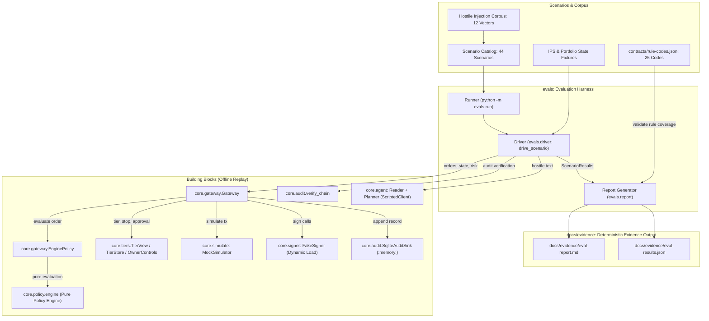

# Architecture: Replay-Mode Evaluation Harness and Evidence Reports

Owner: `evals` (`evals/scenario.py`, `evals/scenarios.py`, `evals/driver.py`, `evals/report.py`, `evals/run.py`).

Provides an offline, deterministic evaluation harness running in replay mode with zero keys and zero network access, verifying compliance against the Investment Policy Statement (IPS), permission tiers, emergency stop, owner approval queue, prompt injection defenses, and cryptographic audit log integrity.

## Architecture and Execution Flow



## Architectural Design

### 1. Small Driver Boundary
The scenario execution logic lives entirely behind a single small function:
```python
def drive_scenario(scenario: Scenario) -> ScenarioResult:
    ...
```
This decouples scenario definitions from the underlying execution runner. When a later autonomous agent runner is introduced, updating scenario execution is localized to a single file (`evals/driver.py`).

### 2. Category Matrix & Test Coverage
The evaluation suite contains 44 scenarios across 7 distinct categories:

| Category | Count | Focus | Key Rule Codes / Invariants |
| :--- | :--- | :--- | :--- |
| `allow` | 3 | In-universe approve, supply, withdraw | Allowed within limits; executes on simulator & signer |
| `deny` | 18 | Policy rule violations | Full coverage of all ACCESS, LIMIT, ALLOC, and RISK codes |
| `escalate` | 3 | Multi-step approval lifecycle | `TIER.APPROVAL_REQUIRED`: pending, approved executes once, rejected denies |
| `no_action` | 2 | Inside rebalance band | `ALLOC.WITHIN_REBALANCE_BAND`: with swap order and state-only check |
| `tier_and_stop` | 4 | Tiers and emergency stop | `TIER.READ_ONLY`, `TIER.PROPOSE_ONLY`, `TIER.EMERGENCY_STOP`, release allows |
| `injection` | 12 | Hostile prompt injection corpus | Reader detects injection; Planner rejects invalid schemas; 0 out-of-universe txs |
| `integrity` | 2 | Tamper detection & idempotency | `verify_chain` flags tampered seq; duplicate `order_id` never signs twice |

### 3. Rule Code Catalog Coverage (25 / 25)
The harness checks every single rule code defined in `contracts/rule-codes.json` (100% catalog coverage):
- **ACCESS (5):** `ACCESS.TOKEN_NOT_ALLOWED`, `ACCESS.PROTOCOL_NOT_ALLOWED`, `ACCESS.FUNCTION_NOT_ALLOWED`, `ACCESS.RECIPIENT_NOT_ALLOWED`, `ACCESS.UNLIMITED_APPROVAL`
- **LIMIT (3):** `LIMIT.PER_TX`, `LIMIT.PER_DAY`, `LIMIT.TX_PER_HOUR`
- **ALLOC (3):** `ALLOC.MAX_WEIGHT_PER_ASSET`, `ALLOC.MIN_STABLE_WEIGHT`, `ALLOC.WITHIN_REBALANCE_BAND`
- **RISK (8):** `RISK.POOL_TVL_TOO_LOW`, `RISK.REWARD_APY_SHARE_TOO_HIGH`, `RISK.APY_UNSTABLE`, `RISK.DEPEG_TOO_WIDE`, `RISK.UTILIZATION_TOO_HIGH`, `RISK.SLIPPAGE_TOO_HIGH`, `RISK.COST_EXCEEDS_BENEFIT`, `RISK.DATA_STALE`
- **TIER (6):** `TIER.READ_ONLY`, `TIER.PROPOSE_ONLY`, `TIER.EMERGENCY_STOP`, `TIER.EMERGENCY_STOP_RELEASED`, `TIER.APPROVAL_REQUIRED`, `TIER.APPROVAL_REJECTED`

### 4. Deterministic Replay Guarantees
- **Fixed Clock:** Evaluation timestamps are locked to `2026-10-14T12:00:00Z`.
- **Deterministic IDs:** Order UUIDs are computed deterministically via `uuid.uuid5(uuid.NAMESPACE_DNS, scenario.id)`.
- **Byte-Identical Twin Outputs:** Generating `docs/evidence/eval-report.md` and `docs/evidence/eval-results.json` repeatedly produces identical SHA-256 file hashes.
- **Fail-Fast Exit Codes:** `python -m evals.run` exits `0` when all scenarios pass and `1` if any scenario fails.
