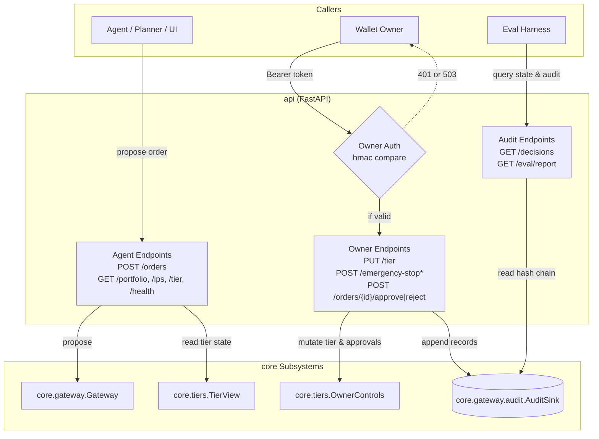

# Architecture: REST API backend

Owner: `api` (`api/app.py`, `api/main.py`). The HTTP interface implementing the single API contract between the minimal UI, the eval harness, and the backend as specified in `contracts/openapi.yaml`.

## Component architecture

## Module boundaries and responsibilities

| Endpoint | Method | Role | Caller | Target subsystem | Response contract |
| :--- | :--- | :--- | :--- | :--- | :--- |
| `/orders` | `POST` | Propose order | Agent / UI | `core.gateway.Gateway` | `decision-record.schema.json` |
| `/orders/{id}/approve` | `POST` | Approve pending order | Owner | `OwnerControls` & `AuditSink` | `decision-record.schema.json` |
| `/orders/{id}/reject` | `POST` | Reject pending order | Owner | `OwnerControls` & `AuditSink` | `decision-record.schema.json` |
| `/emergency-stop` | `POST` | Halt all orders | Owner | `OwnerControls` & `AuditSink` | `decision-record.schema.json` |
| `/emergency-stop/release` | `POST` | Resume orders | Owner | `OwnerControls` & `AuditSink` | `decision-record.schema.json` |
| `/tier` | `GET` | Current tier & stop flag | Any | `core.tiers.TierView` | `tier-state.schema.json` |
| `/tier` | `PUT` | Update tier (T0/T1/T2) | Owner | `core.tiers.OwnerControls` | `tier-state.schema.json` |
| `/portfolio` | `GET` | Snapshot of positions | Any | Portfolio provider | `portfolio-state.schema.json` |
| `/ips` | `GET` | Active IPS and SHA-256 | Any | `core.policy.ips` | `ips.schema.json` + hash |
| `/decisions` | `GET` | Paginated audit chain | Any | `core.gateway.audit.AuditSink` | Page of DecisionRecords |
| `/eval/report` | `GET` | Latest eval metrics | Any | Eval report provider | Eval report envelope |
| `/health` | `GET` | Liveness check | Any | None | `{"status": "ok"}` |

## Enforced rules and invariants

1. **Fail-closed owner authentication** (single mode; in multi mode see [Owner routes in multi mode](#owner-routes-in-multi-mode)): All owner endpoints (`/emergency-stop*`, `/orders/{id}/approve|reject`, `PUT /tier`) require an owner token via HTTP `Authorization: Bearer <token>` or `X-Owner-Token`. The token is compared against `AGENT_WALLET_OWNER_TOKEN` in constant time (`hmac.compare_digest`). If `AGENT_WALLET_OWNER_TOKEN` is unset in the environment, all owner endpoints immediately return HTTP 503 (`urn:agent-wallet:problem:service-unavailable`).
2. **Agent isolation**: Agent-facing callers cannot reach owner mutators. Requests without the owner token are rejected with HTTP 401 or 503. Agent orders (`POST /orders`) pass solely through `core.gateway.Gateway`.
3. **No signer calls**: As verified by AST boundary tests, `api` does not import `core.signer` and never invokes signing operations directly.
4. **RFC 7807 problem details**: All client and server error responses return `application/problem+json` matching the OpenAPI `components/schemas/Problem` schema with fields `type`, `title`, `status`, and optional `detail` and `errors`.
5. **OpenAPI contract equivalence**: The set of contract endpoints exposed on the FastAPI application strictly equals the path set declared in `contracts/openapi.yaml`.
6. **Deny-all default app**: Invoking `create_app()` without parameters creates an in-memory deny-all `T0` app so `uvicorn api.main:app` starts safely out-of-the-box.

## Proving checks

| Claim | Proving check |
| :--- | :--- |
| OpenAPI paths equal app routes | `pytest tests/api/test_routes.py::test_routes_equal_openapi_paths -q` |
| Default app starts and denies orders under T0 | `pytest tests/api/test_routes.py::test_default_app_instantiation_without_arguments -q` |
| Owner endpoints reject missing or bad token | `pytest tests/api/test_owner.py::test_owner_endpoints_reject_missing_token -q`, `test_owner_endpoints_reject_wrong_token` |
| Owner endpoints fail closed on unset env token | `pytest tests/api/test_owner.py::test_owner_endpoints_fail_closed_when_token_unset -q` |
| Agent cannot reach approve or stop | `pytest tests/api/test_owner.py::test_agent_facing_cannot_reach_approve_or_stop -q` |
| Responses validate against contract schemas | `pytest tests/api/test_state_and_audit.py -q` |
| Independent check passes | `pytest tests/api -q` (31 passed) |

## Webapp routes (ticket A3)

The wallet-session routes of design 12.2 are mounted by `create_app` on every start; the existing routes above are unchanged and the single-owner token mode keeps working. Without `AGENT_WALLET_MODE=multi` no webapp services are attached and every session route answers `503 service-unavailable` (fail closed); `/presets` and `/health` stay public. Detail, the ERD and the job table are in [`webapp.md`](webapp.md); sign-in and step-up are in [`auth.md`](auth.md).

| Route | Method | Auth | Module |
| :--- | :--- | :--- | :--- |
| `/auth/nonce`, `/auth/verify` | `POST` | none | `api/auth.py` |
| `/auth/logout` | `POST` | session | `api/auth.py` |
| `/auth/step-up` | `POST` | session | `api/auth.py` |
| `/me`, `/agent` | `GET` | session | `api/wallet.py` |
| `/topups` | `POST` | session | `api/wallet.py` |
| `/topups/{tx_hash}` | `GET` | session | `api/wallet.py` |
| `/presets` | `GET` | none | `api/wallet.py` (one placeholder preset; ticket A4 replaces it) |
| `/audit/verify` | `GET` | session | `api/wallet.py` (`verify_chain` on the owner's chain) |
| `/agent/mint`, `/runs` | `POST` | session | `api/jobs.py` |
| `/agent/withdraw` | `POST` | session plus step-up `withdraw` | `api/jobs.py` |
| `/jobs`, `/jobs/{job_id}` | `GET` | session | `api/jobs.py` |
| `/chat` | `POST` | session (CSRF header as every write) | `api/chat.py` (starts a job of kind `chat` in `api/jobs.py`) |
| `/chat?limit=50` | `GET` | session | `api/chat.py` |

Rules enforced here: the owner address comes only from `require_session` (no route has an owner parameter or body field; extra body fields are `422`); a foreign `job_id` or `tx_hash` is `404`; problems use the 12.1 slugs (`job-in-progress` 409 with the active `job_id`, `rate-limited` 429 with `Retry-After`, `custody-unavailable` 503); `origin="owner"` appears only in `api/jobs.py`.

| Claim | Proving check |
| :--- | :--- |
### Chat (ticket 115)

`POST /chat` takes `{message}` (1 to 500 characters, no other field) and answers `202 {job_id, status}`. It starts a job of kind `chat` under the same rules as `POST /runs`: one active job per owner (`409 job-in-progress` with the active `job_id`) and one shared hourly limit (6 per owner per hour; chat and run jobs are counted together, `429 rate-limited` with `Retry-After`). `GET /chat` returns `{items: [{id, role, text, job_id, created_at, steps}]}` oldest first (`limit` 1 to 200, default 50). A step is `{order_id, function, token, amount, outcome, reason, rule_codes, tx_hash, explanation}` rebuilt from the audit records of the message's job by `api/chat_compose.py`; `outcome` is `executed`, `denied`, `pending_approval`, `failed` or `skipped`. The agent `text` is composed by code from those outcomes; the model's optional `reply` is appended under the label `Agent says:` and is never part of a step. The chat route proposes with `origin="planner"` through the same gateway, so mint, transfer, withdraw and tier changes are not reachable from it. Detail is in [`webapp.md`](webapp.md#chat-ticket-115).

| Claim | Proving check |
| :--- | :--- |
| Chat: multi-order success, stop at the first failure, hostile message denied with nothing signed, question-only reply, T0 text, 409, shared 429, owner isolation | `pytest tests/webapp/test_chat.py -q` |

| Claim | Proving check |
| :--- | :--- |
| App routes and methods equal `contracts/openapi.yaml` | `pytest tests/api/test_routes.py -q` (reads the app's generated schema, since included routers hide their routes from `app.routes`) |
| Session routes reject anonymous callers; withdraw needs a bound step-up | `pytest tests/webapp/test_routes.py -q` |
| A session for A cannot read or act on B | `pytest tests/webapp/test_routes.py -k "session_a or foreign or owner_query or chain_verifies" -q` |

## Owner routes in multi mode

When `app.state.webapp` is set (`AGENT_WALLET_MODE=multi`) the nine routes below stop using `AGENT_WALLET_OWNER_TOKEN` and the one global gateway. They authenticate with the verified session cookie only (the shared token is never accepted, no path, query or body field names an owner), resolve the tenant of the session address and act on that tenant's tier store, approval queue, audit chain and gateway. Single mode is unchanged (token for owner actions, no credential for reads).

| Route | Method | Multi mode auth (design 6.2) | Acts on |
| :--- | :--- | :--- | :--- |
| `/tier` | `GET` | session | tenant tier state |
| `/tier` | `PUT` | session; **step-up `tier_raise`** bound to `{"tier": <new tier>}` only when the tier is raised (T0 to T1, T1 to T2, T0 to T2); lowering or keeping needs the session only | tenant tier store |
| `/emergency-stop` | `POST` | session only (one click) | tenant stop flag; appends the `TIER.EMERGENCY_STOP` record to the tenant chain |
| `/emergency-stop/release` | `POST` | session plus **step-up `release_stop`** (params `{}`) | tenant stop flag; appends `TIER.EMERGENCY_STOP_RELEASED` |
| `/decisions` | `GET` | session | tenant audit chain (filters, cursor and schema as before) |
| `/portfolio` | `GET` | session | live read through the tenant's portfolio reader (balances over RPC, limits from the ledger), `price_source: mainnet_reference`; RPC failure is `503` with no error text |
| `/ips` | `GET` | session | the tenant's active IPS and its hash |
| `/orders/{order_id}/approve` | `POST` | session plus **step-up `approve`** bound to `{"order_id": <id>}` | tenant approval queue; the stored order is proposed again so the gateway runs the whole path (tier, stops, policy, simulate, sign, audit) |
| `/orders/{order_id}/reject` | `POST` | session only | tenant approval queue; appends the rejection record |

Notes. Raising the tier is the only tier change that widens authority, so only it asks for a fresh signature; like the single-owner route, a tier change is held in the tier store and does not add an audit record (stops do). The tenant gateway has no approval callback, so an order left `pending_approval` is queued the first time its owner approves or rejects it; an order id that is not in the session owner's chain is `404`. An approved order is proposed again with planner origin, so an owner-only function stays denied (fail closed). If that proposal fails (gateway busy, reconcile required) the queue row is already approved but the chain still says `pending_approval`; the retry (with a fresh step-up) skips the queue write and proposes again, so the order is never stuck. Step-up is checked right after the session, before any state lookup, and a failed check consumes the challenge.

| Claim | Proving check |
| :--- | :--- |
| Every owner route rejects anonymous callers and the shared owner token in multi mode | `pytest tests/webapp/test_owner_routes.py -k "anonymous or shared_owner_token" -q` |
| Raising the tier needs a step-up bound to the new tier; lowering needs the session only | `test_owner_routes.py::test_raising_the_tier_needs_a_step_up_signature`, `test_step_up_is_bound_to_the_new_tier_action_and_single_use`, `test_lowering_the_tier_needs_the_session_only` |
| Stop is session only and audited; release needs a step-up | `test_owner_routes.py::test_stop_needs_the_session_only_and_is_audited`, `test_release_needs_a_step_up_signature` |
| Approve needs a step-up bound to the order id; reject is session only | `test_owner_routes.py::test_approve_needs_a_step_up_bound_to_the_order_id`, `test_reject_needs_the_session_only_and_records_a_denial`, `test_approve_that_hits_a_busy_gateway_can_be_retried` |
| A session for A cannot read or change B's tier, stop or approvals | `test_owner_routes.py::test_tier_and_stop_are_isolated_per_owner`, `test_an_order_of_owner_a_is_404_for_owner_b`, `test_decisions_are_the_session_owners_own` |
| After a raise to T2 a mint job executes with the fake signer | `test_owner_routes.py::test_mint_is_denied_at_t0_then_executes_after_the_owner_raises_to_t2` |
