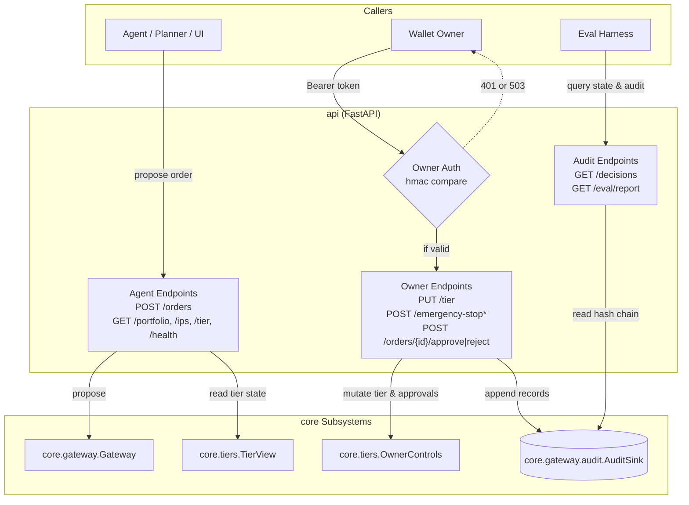

# Architecture: REST API backend

Owner: `api` (`api/app.py`, `api/main.py`). The HTTP interface implementing the single API contract between the minimal UI, the eval harness, and the backend as specified in `contracts/openapi.yaml`.

## Component architecture

## Module boundaries and responsibilities

| Endpoint | Method | Role | Caller | Target subsystem | Response contract |
| :--- | :--- | :--- | :--- | :--- | :--- |
| `/orders` | `POST` | Propose order | Agent / UI | `core.gateway.Gateway` | `decision-record.schema.json` |
| `/orders/{id}/approve` | `POST` | Approve pending order | Owner | `OwnerControls` & `AuditSink` | `decision-record.schema.json` |
| `/orders/{id}/reject` | `POST` | Reject pending order | Owner | `OwnerControls` & `AuditSink` | `decision-record.schema.json` |
| `/emergency-stop` | `POST` | Halt all orders | Owner | `OwnerControls` & `AuditSink` | `decision-record.schema.json` |
| `/emergency-stop/release` | `POST` | Resume orders | Owner | `OwnerControls` & `AuditSink` | `decision-record.schema.json` |
| `/tier` | `GET` | Current tier & stop flag | Any | `core.tiers.TierView` | `tier-state.schema.json` |
| `/tier` | `PUT` | Update tier (T0/T1/T2) | Owner | `core.tiers.OwnerControls` | `tier-state.schema.json` |
| `/portfolio` | `GET` | Snapshot of positions | Any | Portfolio provider | `portfolio-state.schema.json` |
| `/ips` | `GET` | Active IPS and SHA-256 | Any | `core.policy.ips` | `ips.schema.json` + hash |
| `/decisions` | `GET` | Paginated audit chain | Any | `core.gateway.audit.AuditSink` | Page of DecisionRecords |
| `/eval/report` | `GET` | Latest eval metrics | Any | Eval report provider | Eval report envelope |
| `/health` | `GET` | Liveness check | Any | None | `{"status": "ok"}` |

## Enforced rules and invariants

1. **Fail-closed owner authentication**: All owner endpoints (`/emergency-stop*`, `/orders/{id}/approve|reject`, `PUT /tier`) require an owner token via HTTP `Authorization: Bearer <token>` or `X-Owner-Token`. The token is compared against `AGENT_WALLET_OWNER_TOKEN` in constant time (`hmac.compare_digest`). If `AGENT_WALLET_OWNER_TOKEN` is unset in the environment, all owner endpoints immediately return HTTP 503 (`urn:agent-wallet:problem:service-unavailable`).
2. **Agent isolation**: Agent-facing callers cannot reach owner mutators. Requests without the owner token are rejected with HTTP 401 or 503. Agent orders (`POST /orders`) pass solely through `core.gateway.Gateway`.
3. **No signer calls**: As verified by AST boundary tests, `api` does not import `core.signer` and never invokes signing operations directly.
4. **RFC 7807 problem details**: All client and server error responses return `application/problem+json` matching the OpenAPI `components/schemas/Problem` schema with fields `type`, `title`, `status`, and optional `detail` and `errors`.
5. **OpenAPI contract equivalence**: The set of contract endpoints exposed on the FastAPI application strictly equals the path set declared in `contracts/openapi.yaml`.
6. **Deny-all default app**: Invoking `create_app()` without parameters creates an in-memory deny-all `T0` app so `uvicorn api.main:app` starts safely out-of-the-box.

## Proving checks

| Claim | Proving check |
| :--- | :--- |
| OpenAPI paths equal app routes | `pytest tests/api/test_routes.py::test_routes_equal_openapi_paths -q` |
| Default app starts and denies orders under T0 | `pytest tests/api/test_routes.py::test_default_app_instantiation_without_arguments -q` |
| Owner endpoints reject missing or bad token | `pytest tests/api/test_owner.py::test_owner_endpoints_reject_missing_token -q`, `test_owner_endpoints_reject_wrong_token` |
| Owner endpoints fail closed on unset env token | `pytest tests/api/test_owner.py::test_owner_endpoints_fail_closed_when_token_unset -q` |
| Agent cannot reach approve or stop | `pytest tests/api/test_owner.py::test_agent_facing_cannot_reach_approve_or_stop -q` |
| Responses validate against contract schemas | `pytest tests/api/test_state_and_audit.py -q` |
| Independent check passes | `pytest tests/api -q` (31 passed) |
