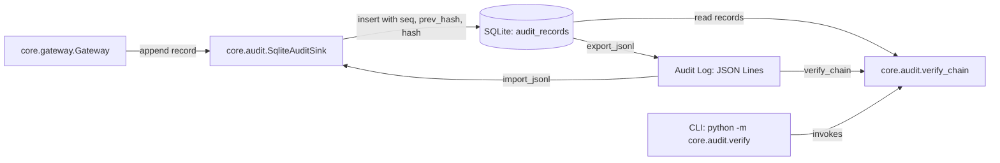
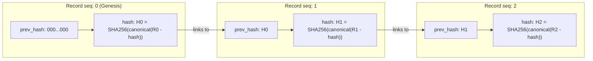
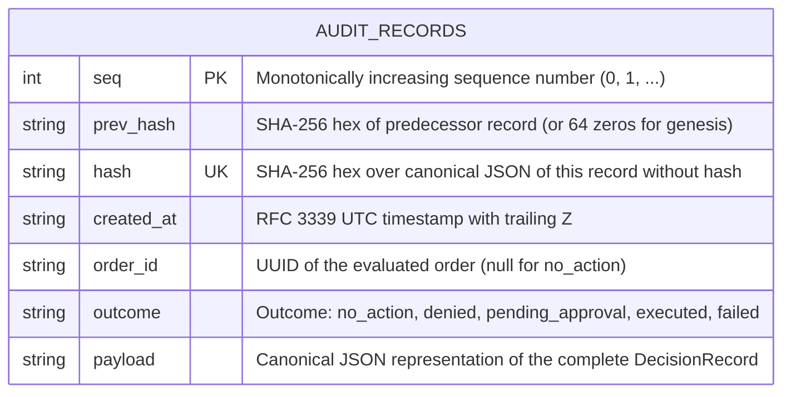

# Architecture: Persistent hash-chained audit log

Owner: `core.audit` (`core/audit/sink.py`, `core/audit/verify.py`). Provides a persistent, append-only cryptographic audit log implementing the gateway `AuditSink` protocol, maintaining a SHA-256 hash chain over all decision records crossing the gateway.

## Component architecture

## Hash chain integrity

Each record is cryptographically linked to its predecessor. The genesis record's `prev_hash` is 64 zeros (`0` * 64). The record hash is computed over canonical JSON (sorted keys, compact separators `(',', ':')`, UTF-8 encoded) excluding the `hash` field itself.

## Entity-Relationship Diagram (ERD)

## Tamper detection matrix

`verify_chain(records_or_sink) -> VerifyReport` inspects the chain in $O(N)$ and reports the first bad `seq`:

| Tamper kind | Detection mechanism | Reported bad `seq` |
| :--- | :--- | :--- |
| **Modified field** | `record_hash(rec) != rec["hash"]` | The `seq` of the modified record |
| **Broken prev_hash** | `rec["prev_hash"] != previous_hash` | The `seq` where the chain break occurred |
| **Deleted record** | Gap detected in sequence counter (`rec["seq"] != i`, `i` not in chain) | The missing `seq` |
| **Reordered records** | Out-of-order sequence (`rec["seq"] != i`, `i` present elsewhere) | The first `seq` out of position |

## Security guarantees

1. **Append-only database triggers**: SQLite `BEFORE UPDATE` and `BEFORE DELETE` triggers abort any mutation with `RAISE(ABORT, 'Audit log is append-only: ...')`.
2. **Canonical JSON serialization**: Dict keys are sorted with compact separators `(",", ":")` without ASCII escaping, ensuring byte-identical reproduction across environments.
3. **Thread-safe writes**: Internal `threading.RLock` combined with SQLite immediate transactions guarantees strictly increasing `seq` without sequence gaps during concurrent appends.
4. **No signer access**: `core.audit` never touches private keys or imports `core.signer` (enforced by `tests/test_signer_boundary.py`).

## Reads used by the runner and the gateway

- **Indexes**: `idx_audit_order_id` on `order_id` and `idx_audit_created_at` on `created_at` keep idempotency lookups and window queries cheap. They add no columns and do not touch the hash chain.
- **`find_by_order_id(order_id)`** returns the latest record (highest `seq`) for an order, or `None`. The gateway uses it for audit-backed idempotency.
- **Ledger** (`core.runner.ledger.AuditLedger`): the day spend and the hourly transaction count are derived from this log, not from caller input. Only records with outcome `executed` count; `approve` calls are excluded from spend; `denied`, `failed`, `pending_approval` and `no_action` never count.
- **`order_intents`** lives in the same SQLite file as a separate insert-only table. An intent without an `executed` or `failed` record means a crash between sign and append and requires manual reconcile.

