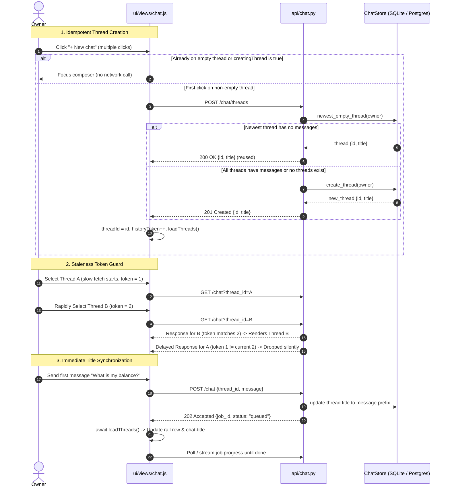
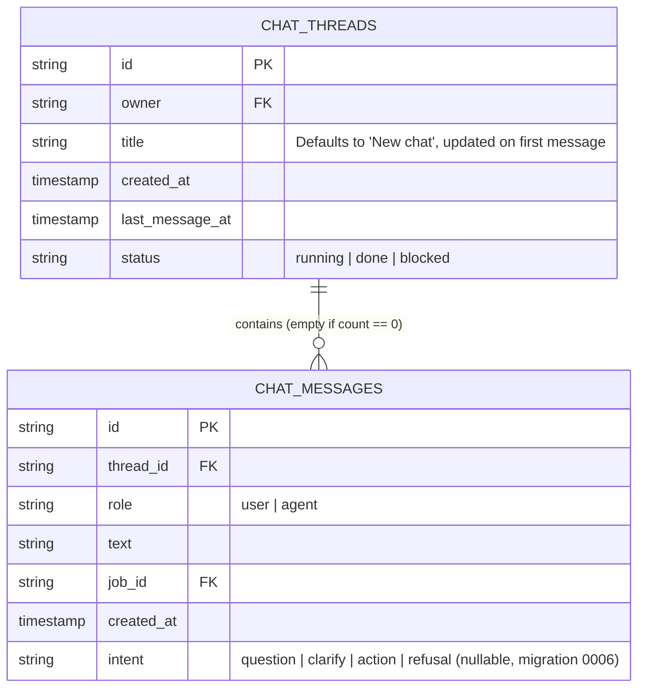

# Chat Thread Lifecycle and Staleness Protection

Owning modules:
- `ui/views/chat.js`: Client-side thread selection, idempotent creation, request staleness guards, and immediate title synchronization.
- `api/chat.py`: `POST /chat/threads` idempotent reuse of empty threads (`200 OK` vs `201 Created`).
- `core/storage/interfaces.py`: `ChatStore.newest_empty_thread()`.
- `core/storage/sqlite/chat.py`: SQLite implementation of `newest_empty_thread()`.
- `core/storage/postgres/adapters.py`: Postgres implementation of `newest_empty_thread()`.

## Purpose

1. **Thread Deduplication and Empty Thread Reuse:** Prevents runaway creation of blank threads when the owner clicks "+ New chat" multiple times or repeatedly without sending messages. If the newest thread for the owner contains zero messages, both client and server reuse it (`200 OK`) instead of inserting another row (`201 Created`).
2. **In-Flight Staleness Protection:** Guarantees that slow or delayed asynchronous fetches (`api.chat()`, `api.threads()`, `selectThread()`) never overwrite or revert the active view when switching threads or creating a new chat. Monotonic token counters (`historyToken`, `threadsToken`, `selectToken`) and `threadId` matching drop stale responses.
3. **Immediate Header and Rail Title Updates:** Refreshes thread title in the sidebar rail and top conversation header immediately when the first user message is accepted by the server (`POST /chat` 202 Accepted), rather than waiting for the entire background job to finish.
4. **Active Thread Retention and Sort Stability:** `loadThreads()` never switches or drops `threadId` on its own. If the active thread is temporarily missing from the server thread list, the UI preserves it and inserts a local placeholder row in the history rail. The legacy `default` thread is normalized to `null` (hash `#/chat`) so `thread_id: "default"` is never dispatched. On the server, `list_threads` normalizes timestamps to ISO UTC (`...Z`) and sorts just-created empty threads ahead of existing threads on timestamp ties.

## Architecture and Interaction Flow

## Staleness Tokens and Invariants

| Token | Scope | Invariant Checked | Effect when Violated |
| :--- | :--- | :--- | :--- |
| `historyToken` | `loadHistory()` | `token === historyToken && threadId === forId` | Discards delayed history payload from prior thread or cleared chat; prevents rendering ghost messages. |
| `threadsToken` | `loadThreads()` | `token === threadsToken` | Prevents outdated thread lists from reverting `threadId` back to an older thread. |
| `selectToken` | `selectThread(id)` | `token === selectToken && threadId === id` | Prevents race conditions during rapid thread switching in the sidebar rail. |

## Data Flow & Storage Contract

## Intent Persistence (Migration 0006)

Migration `core/storage/migrations/0006_chat_intent.sql` adds the nullable `intent` column (`text`) to `chat_messages` (with column UPDATE permission for `aw_app`). SQLite (`core/storage/sqlite/chat.py`) and Postgres adapter (`core/storage/postgres/adapters.py`) persist and surface `intent` on agent messages without requiring backfill.
