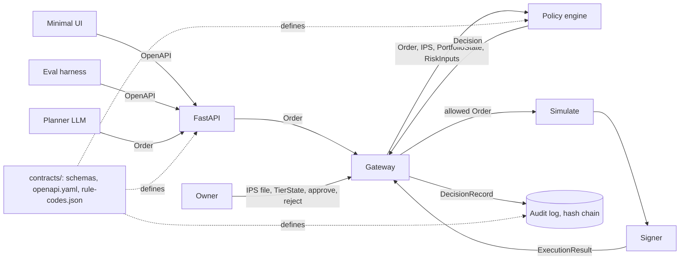
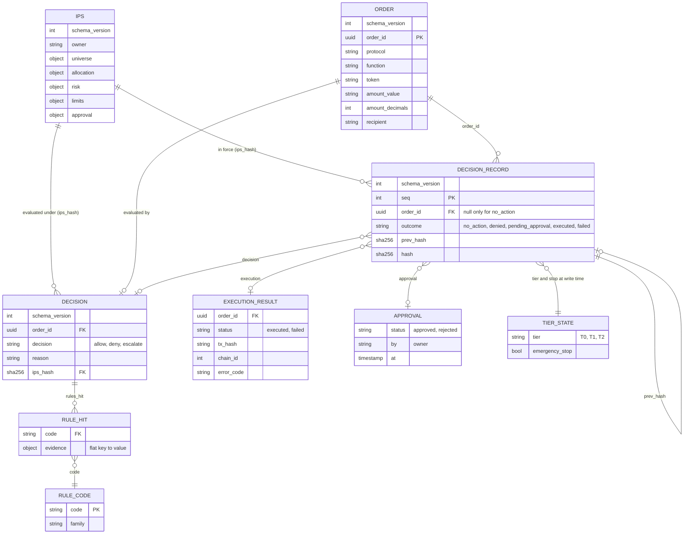

# Data contracts v1: architecture note

Owner: `contracts/` (schemas, OpenAPI, rule codes). Every module builds against it; no module owns a private copy of an object. How to read, validate and change them: [`contracts/README.md`](../../../contracts/README.md).

## Where contracts sit

Only the gateway calls the signer. The agent reads the IPS and has no write path to it, to `TierState` or to approvals.

## Object relations

`PortfolioState` and `RiskInputs` are inputs to the policy engine and are not stored in the record; the record keeps the order, the decision and what happened.

## Which test proves what
| Claim | Proving check |
| :--- | :--- |
| Every schema is valid draft 2020-12 and requires `schema_version` | schema validation check (`check_schema`) |
| Valid examples pass and invalid examples fail | example validation check |
| An order cannot carry an address, a float, or an unlimited amount | `order.invalid.address-recipient`, `.float-amount`, `.unlimited-approval` |
| The hash chain recomputes | chain recomputation check; the audit-log test suite owns the runtime test |
| The IPS has no agent-writable field | `ips.invalid.agent-editable-field` and no write path in `openapi.yaml`; permission tests verify write isolation |
