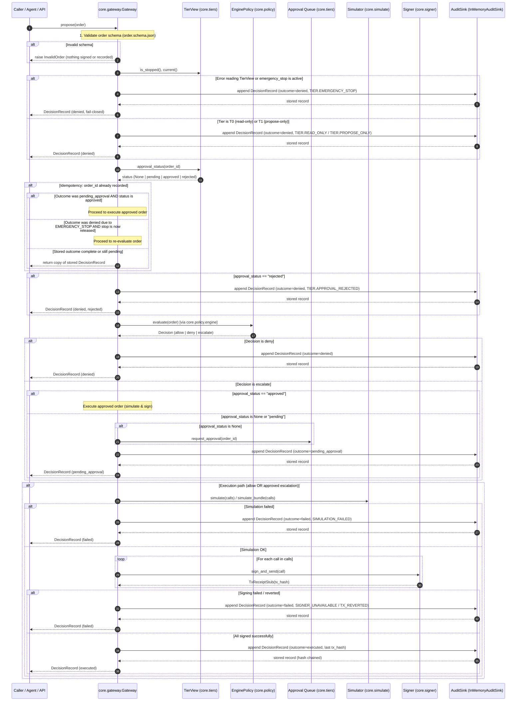

# Gateway wiring: Policy engine, permission tiers, and approval queue

Owner module: `core.gateway` (`core/gateway/gateway.py`, `core/gateway/policy.py`).

The gateway wires together the pure policy engine (`core.policy`), read-only tier and emergency stop controls (`core.tiers.view.TierView`), and the owner approval queue (`core.tiers.store.TierStore`), executing orders against EVM simulation and `core.signer` with cryptographic audit logging (`core.gateway.audit`).

## Sequence diagram of propose

## Architectural guarantees and invariants

1. **EnginePolicy adapter**:
   `EnginePolicy` implements the `Policy` protocol by calling the pure `core.policy.engine.evaluate` with the `LoadedIps`, a portfolio state callable, and an optional risk inputs callable. If the policy engine allows the order, `EnginePolicy` verifies `approval.escalate_above_usd`; if the order USD value exceeds this threshold, it yields an `escalate` decision with rule code `TIER.APPROVAL_REQUIRED`.

2. **Fail-closed tier inspection**:
   `Gateway` reads tier permission (`T0`, `T1`, `T2`) and emergency stop dynamically per `propose` call through a read-only `TierView`. Any failure reading tier state immediately triggers a fail-closed denial with `TIER.EMERGENCY_STOP`. Emergency stop denies all executions, even previously approved orders.

3. **Strict structural isolation**:
   No module in `core/gateway/` imports `core.tiers.owner` or `OwnerControls`. The gateway enqueues approval requests strictly through an injected callable `request_approval(order_id)`. Mutating controls remain exclusive to the owner API surface.

4. **Approval lifecycle and idempotency**:
   - An escalated order produces outcome `pending_approval` and enqueues in SQLite.
   - Re-proposing while pending returns the stored `pending_approval` record without signing or simulating.
   - An owner-approved order re-proposed under Tier T2 executes against the simulator and signer.
   - An owner-rejected order re-proposed is denied with `TIER.APPROVAL_REJECTED` and never executes.
   - After executing, repeat proposals return the stored record; the same `order_id` never executes twice.
