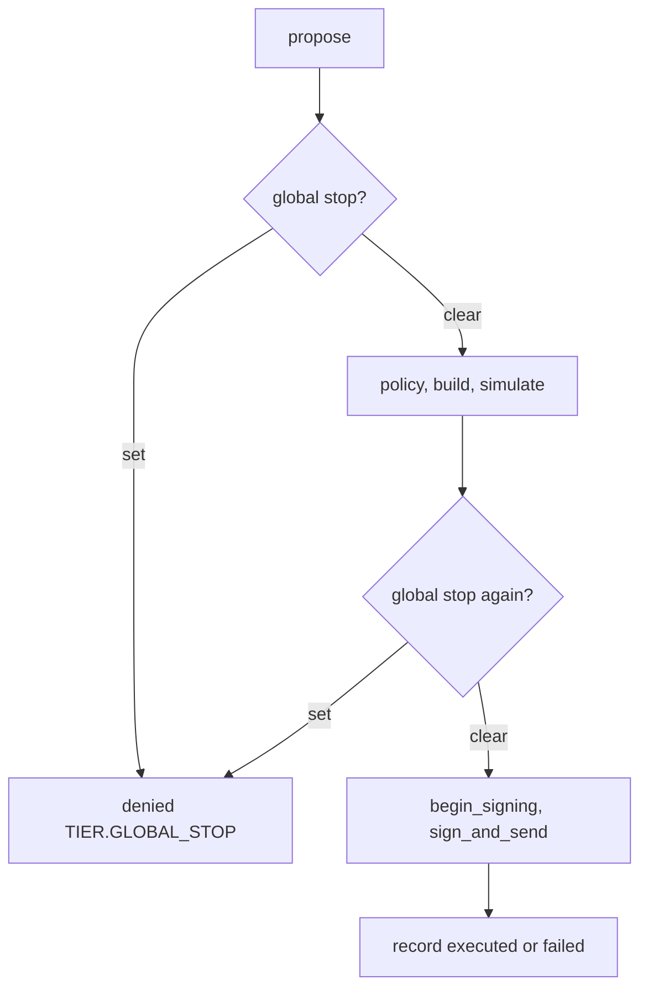

# Global stop

An operator-level kill switch, separate from the per-owner emergency stop (`TierStore`). When it is set, the gateway signs nothing for any tenant, including `transfer`.

## Sources (`core/gateway/globalstop.py`)

`file_flag(path, env, *, settings_reader=None)` returns a callable `() -> bool`. The stop is set when any of these says so:

| Source | Set when |
| :--- | :--- |
| Environment | `AGENT_WALLET_GLOBAL_STOP` is anything other than empty or `0` (read at call time) |
| Flag file | the file at `path` exists (`DATA_DIR/GLOBAL_STOP` on the SQLite backend) |
| Settings reader | the optional hook returns true (the Postgres `settings` row, wired later) |

**Fail closed:** any error while reading a source (permission error, unreachable database, a failing hook) means stopped. The gateway applies the same rule to whatever callable it is given: an exception counts as set.

Releasing the stop is an operator action (unset the variable, delete the file, reset the row); no HTTP route exists.

## Where the gateway reads it

Both reads happen inside the gateway lock. The second read comes after simulation and immediately before `IntentStore.begin_signing`, so a stop set while an order is being simulated writes no intent row and signs nothing; the record is `denied` with `TIER.GLOBAL_STOP` and no execution. A stored `TIER.GLOBAL_STOP` denial is re-evaluated when the same `order_id` is proposed again after the stop is released.

## Per-owner stop versus global stop

| | Per-owner emergency stop | Global stop |
| :--- | :--- | :--- |
| Agent orders (planner) | denied `TIER.EMERGENCY_STOP` | denied `TIER.GLOBAL_STOP` |
| `mint` | denied | denied |
| `transfer` to the owner | **allowed** (funds must be withdrawable) | denied |

## Tests

`tests/gateway/test_global_stop.py` covers: flag set between simulation and signing, no intent when blocked, unreadable flag and unreachable settings, the settings hook, the file and environment sources, `transfer` under each stop. `tests/gateway/test_origin.py` and `tests/gateway/test_owner_functions_exec.py` cover origin and the owner-function path.
