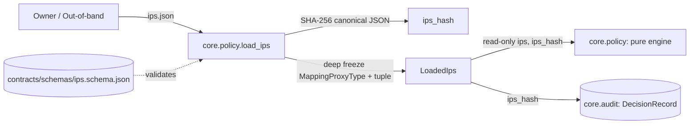

# IPS loader: architecture note

Owner: `core.policy` (`core/policy/ips.py`). Loads the Investment Policy Statement (IPS) JSON, enforces JSON Schema validation (Draft 2020-12) with strict type checking, computes the canonical SHA-256 hash outside the object, and returns a deeply immutable mapping.

## Where the IPS loader sits

The agent and runtime never write or modify the IPS. The loader exposes no write or persistence methods, and any attempt at attribute or item mutation raises `TypeError` or `AttributeError`.

## Architecture and invariants

1. **Owner-defined out-of-band**: The IPS defines the investment universe, allocation caps, risk limits, tx spend ceilings, and approval thresholds. It is supplied out-of-band and loaded by the policy engine.
2. **Schema validation**: Evaluated against `contracts/schemas/ips.schema.json` using Draft 2020-12 validator. Rejects unknown properties (`additionalProperties: false`), missing required fields (e.g., `schema_version`), and floats where integer basis points are required (such as `0.4` or `4000.0` in `max_weight_per_asset_bps`).
3. **Canonical SHA-256 hash**: Calculated over the canonical JSON of the IPS (sorted keys, compact separators `","` and `":"`, UTF-8 encoded, `ensure_ascii=False`). The hash lives outside the IPS document and identifies the active policy revision on `Decision` and `DecisionRecord` objects (`ips_hash`).
4. **Deep immutability**: Dicts are recursively wrapped in `types.MappingProxyType` and lists are converted to immutable `tuple`s. Mutating items or attributes on `LoadedIps` or `LoadedIps.ips` raises `TypeError` or `AttributeError`.

## Interface

| Component | Signature / Type | Description |
| :--- | :--- | :--- |
| `load_ips` | `(path: str \| Path, schema_path: str \| Path \| None = None) -> LoadedIps` | Reads JSON file, validates schema, calculates hash, returns `LoadedIps`. |
| `LoadedIps` | `Mapping[str, Any]` | Read-only object with `.ips` (`MappingProxyType`) and `.hash` (`str`). |
| `IpsError` | `ValueError` | Raised on schema validation errors or invalid JSON. |
| `compute_ips_hash` | `(data: Any) -> str` | Generates the lowercase hex SHA-256 hash from canonical JSON. |
| `canonical_ips_json` | `(data: Any) -> bytes` | Serializes data to canonical JSON bytes. |

## Proving checks

| Claim | Proving check |
| :--- | :--- |
| Valid examples load and yield stable hashes across runs | `tests/ips/test_loader.py::test_valid_examples_load_successfully`, `test_hash_is_stable_across_runs` |
| Any value change alters the SHA-256 hash | `tests/ips/test_loader.py::test_hash_changes_on_any_single_value_change` |
| All invalid contract examples fail schema validation | `tests/ips/test_loader.py::test_each_invalid_contract_example_raises_ips_error` |
| Floats in integer fields are strictly rejected | `tests/ips/test_loader.py::test_float_where_basis_point_integer_required_raises_ips_error` |
| Loaded object and nested mappings reject mutations | `tests/ips/test_loader.py::test_loaded_ips_item_assignment_raises_type_error`, `test_loaded_ips_attribute_assignment_raises_attribute_error` |
| No write or save method exists on loader or object | `tests/ips/test_loader.py::test_loaded_ips_exposes_no_write_or_save_methods` |
