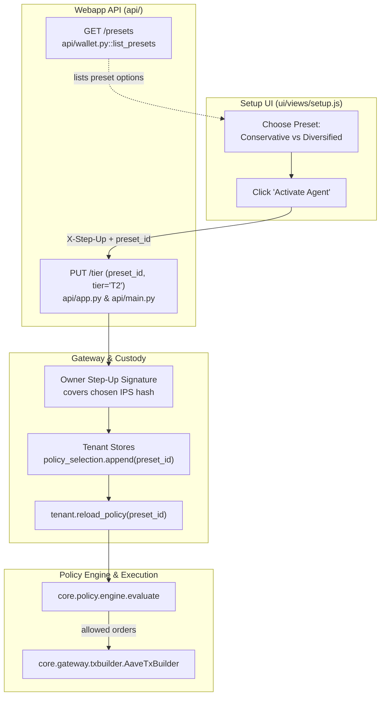
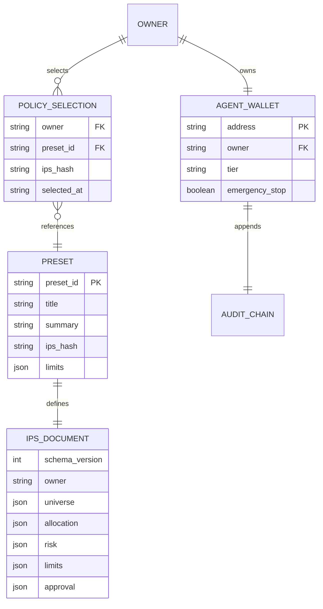

# IPS Presets and Multi-Protocol Activation (D4)

This architecture note documents the Investment Policy Statement (IPS) presets system, enabling owners to choose between conservative stablecoin lending and a diversified multi-protocol DeFi strategy at agent activation.

## Overview

Previously, the agent defaults to a single conservative preset (Aave v3 USDC lending). With new protocol adapters merged (Aave USDT, Aave Stata vaults, Morpho Blue, and Uniswap v3 swaps), the policy engine denied orders targeting those protocols (`ACCESS.PROTOCOL_NOT_ALLOWED`) unless the owner's active IPS included them.

The presets system introduces two versioned, schema-validated contract files:
- `contracts/presets/conservative.json`: Preserves existing behaviour (Aave v3 USDC lending, unchanged canonical SHA-256 hash).
- `contracts/presets/diversified.json`: Expands the universe to USDT, WBTC, WETH, protocols `aave-v3`, `aave-stata`, `morpho-blue`, and `uniswap-v3`, with a conservative risk profile (min 60% stable weight, max 20% weight per volatile asset, 100 bps max slippage, $100 per-tx limit).

## Architecture Flow

## Data Model (ERD)

## Module Ownership & Boundary

- **`contracts/presets/`**: Canonical JSON files validated against `contracts/schemas/ips.schema.json`.
- **`api/wallet.py`**: `list_presets()` reads both files and returns plain-language summaries and limits without exposing internal paths.
- **`api/main.py`**: `ips_for(owner, preset_id)` loads preset files and falls back to recorded policy selections.
- **`api/app.py`**: `PUT /tier` handles optional `preset_id`, validates it against available presets, verifies owner step-up signature against the active IPS hash, and reloads tenant policy under gateway lock.
- **`core/agent/planner.py`**: `render_system_prompt` formats protocol descriptions, allowed tokens, and Morpho markets dynamically based on the active IPS universe.
- **`ui/`**: Setup view renders a 2-option radio selector and passes the selected preset to `setTier` upon activation.

## Testnet liquidity calibration

Risk inputs are read from chain per protocol (`core/risk/router.py`), so the IPS thresholds must fit what exists on Base Sepolia. Aave USDC holds about 33 million USD there, Morpho's USDC/WBTC market about 30 thousand, the Uniswap USDC/WBTC pool about 2 thousand. The mainnet-sized minimum of 50 million USD would deny every order, so `conservative` sets `risk.min_pool_tvl_usd` to 10,000,000 and `diversified` to 1,000. Everything else in the presets is unchanged: the utilization ceiling (90%), the data age limit (2 hours) and the per-transaction and daily caps still apply, which is why the Morpho USDC/cbETH market (93.56% utilization, stale data) stays denied. These are testnet calibrations, not claims about mainnet safety; a mainnet preset would use mainnet-sized values.
