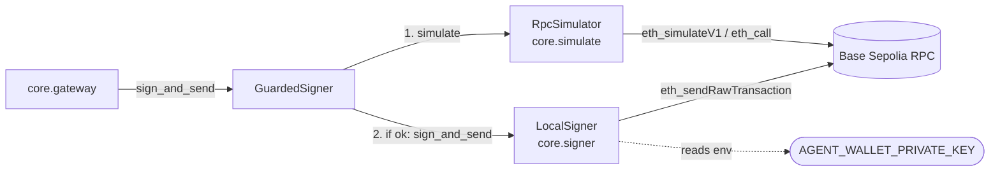
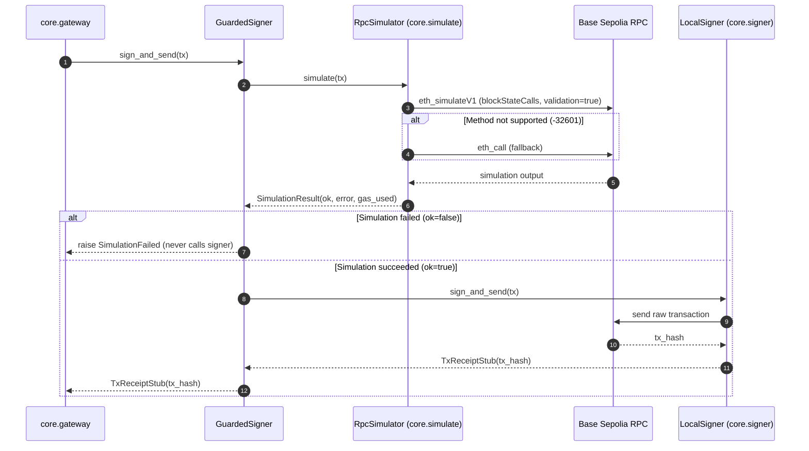

# Signer architecture note

Owner modules: `core.signer` and `core.simulate`.

The signer subsystem provides key management, transaction signing, and dry-run simulation for the agent wallet. Per system invariants, only `core.gateway` may import `core.signer`.

## Where the signer sits

## Sequence and boundary flow

## Security and design guarantees

1. **Simulate-before-sign**: `GuardedSigner` wraps any `Signer` with a `Simulator`. If simulation fails (e.g. EVM revert or out of funds), `SimulationFailed` is raised immediately, and the inner signer is never invoked.
2. **Zero key exposure**: `LocalSigner` reads `AGENT_WALLET_PRIVATE_KEY` only at construction using `eth_account`. Its `__repr__`, `__str__`, exception messages, and logs never contain the private key or any sensitive key material. Missing or malformed keys raise `SignerKeyError` without echoing the invalid value.
3. **Simulation isolation**: `core.simulate` is an independent package that never imports `core.signer` or handles private keys. Tests use an injectable transport to execute deterministically without network access.
4. **RPC fallback strategy**: Follows the findings in `docs/research/testnet-facts-rpc.md`: uses `eth_simulateV1` with `blockStateCalls` and `validation: true` as the primary method, falling back to `eth_call` if `eth_simulateV1` returns method-not-found (`-32601`).
5. **Architectural boundary**: Enforced by `tests/test_signer_boundary.py` and CI: only `core.gateway` may import `core.signer`.
