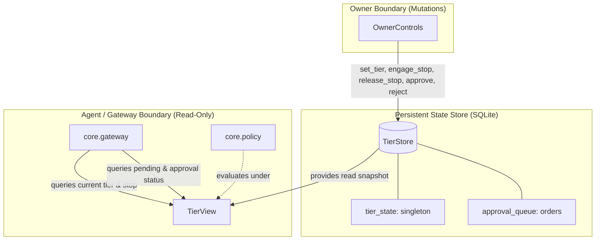
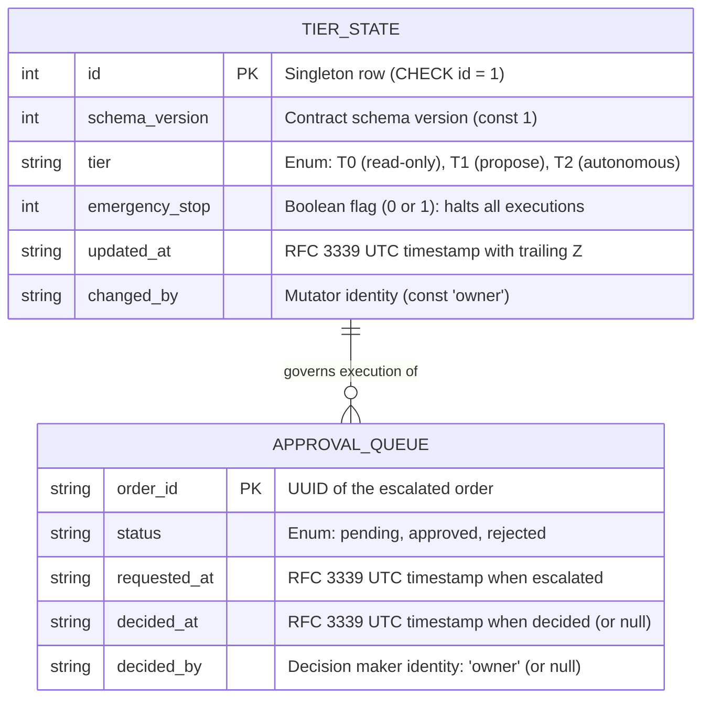

# Architecture: Tiers, approval queue, and emergency stop

Owner: `core.tiers` (`core/tiers/store.py`, `core/tiers/view.py`, `core/tiers/owner.py`). A persistent state store with a strict architectural boundary dividing read-only evaluation state consumed by the gateway/agent from mutating controls restricted to the wallet owner.

## Component architecture

## Entity-Relationship Diagram (ERD)

## Module boundaries and responsibilities

| Module | Class | Role | Permitted callers |
| :--- | :--- | :--- | :--- |
| `core.tiers.store` | `TierStore` | SQLite persistent storage over standard library `sqlite3`. Manages table schemas, singleton initialization (`T0`, stop off), and Draft 2020-12 schema validation against `tier-state.schema.json`. Supports in-memory (`:memory:`) and file paths. | `TierView`, `OwnerControls` |
| `core.tiers.view` | `TierView` | Read-only inspection interface exposing `current()`, `is_stopped()`, `pending_orders()`, and `approval_status(order_id)`. Contains no mutators. | `core.gateway`, `core.policy`, UI/API endpoints |
| `core.tiers.owner` | `OwnerControls` | The only mutator class. Exposes `set_tier(tier)`, `engage_stop()`, `release_stop()`, `request_approval(order_id)`, `approve(order_id)`, and `reject(order_id)`. Automatically assigns `owner` as `changed_by` and `decided_by`. | Owner API endpoints only (never imported by gateway, signer, or policy) |

## Enforced rules and invariants

1. **Owner-only mutation**: Only `OwnerControls` possesses methods to update tiers, flip the emergency stop flag, or record approval decisions. Agent-facing modules (`core/gateway`, `core/signer`, `core/policy`) are structurally barred from importing `core.tiers.owner`.
2. **Emergency stop precedence**: While `emergency_stop` is true, calling `approve(order_id)` immediately raises `EmergencyStopActiveError` (and `ValueError`), preventing any held order from being released for on-chain execution.
3. **Strict enum validation**: `set_tier` rejects any tier value outside `("T0", "T1", "T2")` with `InvalidTierError`.
4. **Finite decision lifecycle**: Approving or rejecting an unknown order raises `OrderNotFoundError` (and `KeyError`). Approving or rejecting an order already decided raises `OrderAlreadyDecidedError`. A second decision is never accepted.
5. **No false approvals**: A rejected or unknown order is never reported as `"approved"`. Unknown orders return `None`; rejected orders return `"rejected"`.
6. **Schema compliance**: Every write and read of tier state strictly validates against `contracts/schemas/tier-state.schema.json` using `Draft202012Validator`.

## Proving checks

| Claim | Proving check |
| :--- | :--- |
| Default state is `T0`, stop off; `set_tier("T2")` persists across new store instances | `tests/tiers/test_tiers.py::test_set_tier_persists_across_new_store_instance` |
| `engage_stop()` makes `is_stopped()` true and `approve` raise; `release_stop()` restores it | `tests/tiers/test_tiers.py::test_engage_stop_makes_is_stopped_true_and_approve_raise` |
| Approval lifecycle transitions `pending` -> `approved` or `rejected`; duplicate decisions raise | `tests/tiers/test_tiers.py::test_approval_lifecycle_pending_to_approved`, `test_approval_lifecycle_pending_to_rejected`, `test_second_decision_raises` |
| `TierView` has no mutating attributes | `tests/tiers/test_tiers.py::test_tierview_has_no_mutating_attributes` |
| Agent-facing modules (`core/gateway`, `core/signer`, `core/policy`) do not import `core.tiers.owner` | `tests/tiers/test_tiers.py::test_agent_facing_modules_do_not_import_core_tiers_owner` |
| Stored tier state validates against `tier-state.schema.json` | `tests/tiers/test_tiers.py::test_stored_tier_state_always_validates_against_schema` |
| Independent check passes | `pytest tests/tiers -q` (16 passed) |
