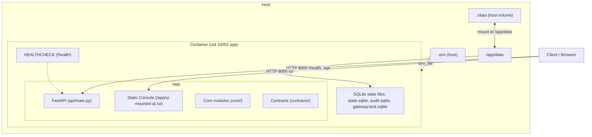

# Container deployment

The container deployment packages `agent-wallet` into a minimal `python:3.11-slim` image, running as a non-root user (`app`, UID 10001). The FastAPI service serves the REST API and the static owner console (`/ui`), with a health check on `/health` and a single uvicorn worker.

## Architecture



## State storage

State lives under `AGENT_WALLET_DATA_DIR` (set to `/app/data` in `Dockerfile` and `docker-compose.yml`, mounted from host directory `./data`). At build time, `/app/data` is created and owned by UID 10001.

The multi-owner app (`AGENT_WALLET_MODE=multi`) chooses its storage from the environment. With `DATABASE_URL` set it uses Postgres: tenants, keystores, the audit chain, jobs, top-ups and sign-in state all live in the database, so a restart or an ephemeral filesystem loses nothing. Unset, it uses per-owner SQLite files under `AGENT_WALLET_DATA_DIR` (`owners/<address>/`, `auth.sqlite`). With Postgres the app applies migrations only when `DATABASE_MIGRATE_URL` is set; otherwise it checks the schema version and refuses to start when it is behind (`python -m core.storage.migrate` fixes that). See [`storage.md`](storage.md).

The single-owner mode keeps its state in three SQLite databases within `AGENT_WALLET_DATA_DIR`, managed by `core.runner.config.StatePaths`:
1. `state.sqlite` — permission tiers and emergency stop state.
2. `audit.sqlite` — tamper-evident hash-chained audit log.
3. `gateway.lock.sqlite` — execution concurrency lock.

`DB_PATH` is obsolete and removed: no Python module reads it.

## Environment variables

Only variable names are declared (values remain in `.env`, which is never committed; testnet only):

| Variable | Default in Container | Description |
| :--- | :--- | :--- |
| `AGENT_WALLET_DATA_DIR` | `/app/data` | Directory for persistent SQLite state files (all state in single mode; per-owner files when `DATABASE_URL` is unset) |
| `DATABASE_URL` | (unset) | Postgres URL of the application role (use the pooler URL); set selects Postgres in multi mode |
| `DATABASE_MIGRATE_URL` | (unset) | DDL-capable URL; when set the app applies pending migrations at start, otherwise it only checks the schema |
| `AGENT_WALLET_OWNER_TOKEN` | (unset) | Bearer token for owner controls and `/ui` |
| `AGENT_WALLET_PRIVATE_KEY` | (unset) | Testnet private key for the agent wallet (signer only) |
| `OPENAI_API_KEY` | (unset) | API key for LLM Planner and Reader |
| `BASE_SEPOLIA_RPC_URL` | `https://sepolia.base.org` | JSON-RPC provider for Base Sepolia |
| `IPS_PATH` | `contracts/examples/ips.valid.json` | Path to active Investment Policy Statement |
| `AGENT_WALLET_RISK_SOURCE` | `onchain` | Risk inputs source for policy evaluation: `onchain` (default, live reads via RiskRouter) or `reference` (static reference data for offline demos and tests) |

## Volume backup and restore

State survives container recreation (`docker compose down && docker compose up`) via the `./data:/app/data` volume mount.

### Backup
1. Stop the container to ensure WAL writes are flushed:
   ```sh
   docker compose stop api
   ```
2. Archive the host `./data` directory:
   ```sh
   tar -czf "backup-agent-wallet-$(date +%Y%m%d%H%M%S).tar.gz" data/
   ```
3. Restart the container:
   ```sh
   docker compose start api
   ```

### Restore
1. Stop the container:
   ```sh
   docker compose stop api
   ```
2. Restore the archive into `./data`:
   ```sh
   tar -xzf backup-agent-wallet-<timestamp>.tar.gz
   ```
3. Ensure file permissions allow UID 10001 to read and write:
   ```sh
   chmod -R u+rwX,g+rwX data/
   ```
4. Restart the container:
   ```sh
   docker compose up -d
   ```

## Repository scripts

`scripts/` (e.g. `scripts/container_smoke.sh`, `scripts/check_no_secrets.py`) and evaluation runners (`evals/`) are not bundled into the runtime container image. They run directly on the host from a repository checkout.

## Hosted deployment (Render and Supabase)

The reference deployment is one Render free web service (Docker, branch `main`, auto deploy on commit, health check `/health`) plus a Supabase Postgres project. The same service serves the API and the UI at `/ui/`.

| Setting | Value |
| :--- | :--- |
| `AGENT_WALLET_MODE` | `multi` |
| `DATABASE_URL` | Supabase pooler URL, transaction mode (port 6543); the app role |
| `DATABASE_MIGRATE_URL` | Not set on the service. Run migrations from a workstation: `python -m core.storage.migrate` with the session pooler URL (port 5432) |
| `AGENT_WALLET_KEYSTORE_SECRET` | Random secret that encrypts agent keys at rest |
| `AGENT_WALLET_KEYSTORE_KDF` | `pbkdf2` (fits the free instance memory) |
| `AGENT_WALLET_SESSION_SECRET` | Random secret for session cookies |
| `AGENT_WALLET_PUBLIC_ORIGIN` | The public URL of the service (sign-in message and Origin check) |
| `BASE_SEPOLIA_RPC_URL` | Base Sepolia JSON-RPC endpoint |
| `OPENAI_API_KEY` | Optional; without it the labelled fallback planner is used |

Steps: create the Supabase project, run the migrations, create the Render service from this repository with the variables above, open `/health/deep` (one database read). The free tier sleeps after 15 minutes idle; ping `/health/deep` every 10 minutes from an external cron to keep it warm. Supabase pauses a free project after a week without activity, so the same ping also keeps the database active. The testnet and custody notice is shown on every page.
