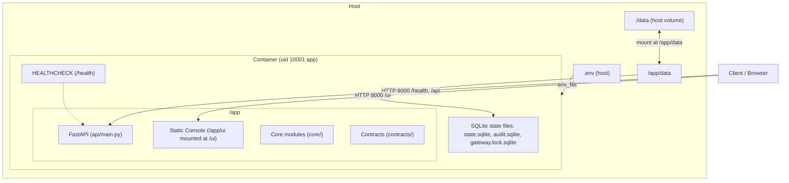

# Container deployment

The container deployment packages `agent-wallet` into a minimal `python:3.11-slim` image, running as a non-root user (`app`, UID 10001). The FastAPI service serves the REST API and the static owner console (`/ui`), with a health check on `/health` and a single uvicorn worker.

## Architecture



## State storage

State lives under `AGENT_WALLET_DATA_DIR` (set to `/app/data` in `Dockerfile` and `docker-compose.yml`, mounted from host directory `./data`). At build time, `/app/data` is created and owned by UID 10001.

Runtime state is managed by `core.runner.config.StatePaths` and consists of three SQLite databases within `AGENT_WALLET_DATA_DIR`:
1. `state.sqlite` — permission tiers and emergency stop state.
2. `audit.sqlite` — tamper-evident hash-chained audit log.
3. `gateway.lock.sqlite` — execution concurrency lock.

`DB_PATH` is obsolete and removed: no Python module reads it.

## Environment variables

Only variable names are declared (values remain in `.env`, which is never committed; testnet only):

| Variable | Default in Container | Description |
| :--- | :--- | :--- |
| `AGENT_WALLET_DATA_DIR` | `/app/data` | Directory for persistent SQLite state files |
| `AGENT_WALLET_OWNER_TOKEN` | (unset) | Bearer token for owner controls and `/ui` |
| `AGENT_WALLET_PRIVATE_KEY` | (unset) | Testnet private key for the agent wallet (signer only) |
| `OPENAI_API_KEY` | (unset) | API key for LLM Planner and Reader |
| `BASE_SEPOLIA_RPC_URL` | `https://sepolia.base.org` | JSON-RPC provider for Base Sepolia |
| `IPS_PATH` | `contracts/examples/ips.valid.json` | Path to active Investment Policy Statement |

## Volume backup and restore

State survives container recreation (`docker compose down && docker compose up`) via the `./data:/app/data` volume mount.

### Backup
1. Stop the container to ensure WAL writes are flushed:
   ```sh
   docker compose stop api
   ```
2. Archive the host `./data` directory:
   ```sh
   tar -czf "backup-agent-wallet-$(date +%Y%m%d%H%M%S).tar.gz" data/
   ```
3. Restart the container:
   ```sh
   docker compose start api
   ```

### Restore
1. Stop the container:
   ```sh
   docker compose stop api
   ```
2. Restore the archive into `./data`:
   ```sh
   tar -xzf backup-agent-wallet-<timestamp>.tar.gz
   ```
3. Ensure file permissions allow UID 10001 to read and write:
   ```sh
   chmod -R u+rwX,g+rwX data/
   ```
4. Restart the container:
   ```sh
   docker compose up -d
   ```

## Repository scripts

`scripts/` (e.g. `scripts/container_smoke.sh`, `scripts/check_no_secrets.py`) and evaluation runners (`evals/`) are not bundled into the runtime container image. They run directly on the host from a repository checkout.
