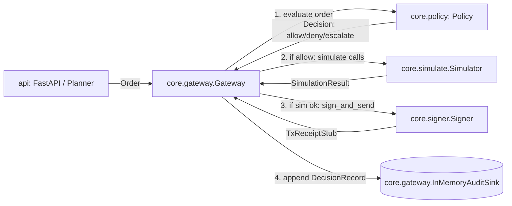
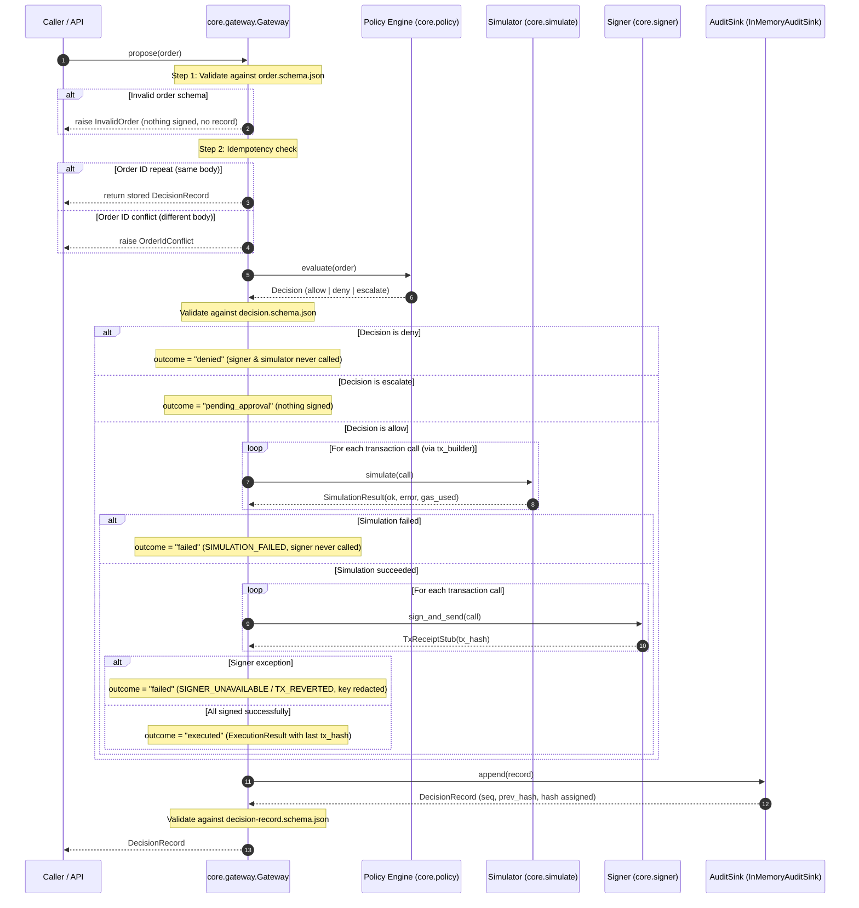
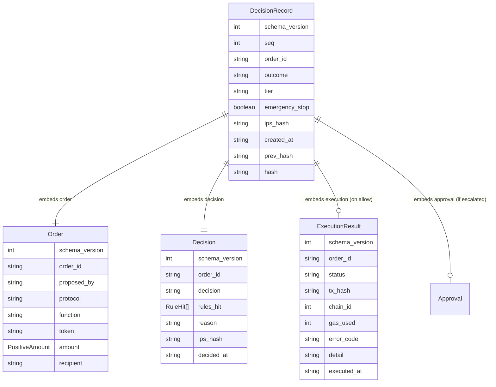
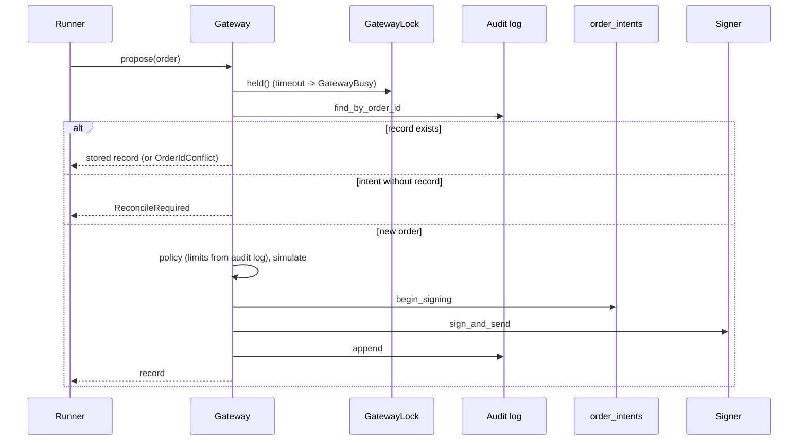

# Gateway architecture note

Owner module: `core.gateway`.

The gateway is the single execution pipeline and boundary controller for the agent wallet. It validates incoming proposed orders, queries the policy engine, runs pre-flight EVM simulations, invokes the signer, and commits append-only cryptographic decision records to the audit sink.

Per system security invariants, only `core.gateway` is permitted to import `core.signer`.

## Where the gateway sits

## Pipeline sequence diagram

## Data structure and ERD

The returned `DecisionRecord` links the proposed `Order`, the policy `Decision`, and the optional `ExecutionResult` within an immutable cryptographic chain:

## Security and design guarantees

1. **Default deny**: If no policy is provided, `DenyAllPolicy` is enforced, denying all proposed orders with `ACCESS.TOKEN_NOT_ALLOWED`. The simulator and signer are never called.
2. **Pre-flight simulate-before-sign**: On allowed orders, all transaction calls are simulated with `Simulator` before any signing occurs. If simulation fails, the transaction is rejected with outcome `failed` (`SIMULATION_FAILED`) and the signer is never called.
3. **Idempotency from the audit log**: Every `order_id` is looked up in the audit log (`find_by_order_id`, latest record) under the gateway lock. A repeat with the exact same body returns the stored `DecisionRecord` without re-evaluating or re-signing, also after a process restart. A different body for a known `order_id` raises `OrderIdConflict`. A `failed` record is terminal for that `order_id`.
4. **Append-only cryptographic hash chain**: Audit records are chained using canonical JSON serialization and SHA-256 (`hash = sha256(canonical(record - {hash}))`). The first record points to `0` * 64, and each subsequent record links to `prev_hash`.
5. **Zero key exposure**: Error messages and execution details are sanitized to redact any private keys or raw exception data.
6. **Signer isolation**: Enforced by `tests/test_signer_boundary.py` and CI: only `core.gateway` may import `core.signer`.
7. **Gateway lock**: `GatewayLock` (a SQLite `BEGIN IMMEDIATE` on `gateway.lock.sqlite` next to the audit file) is acquired at the start of `propose`, before limits are read, and held through the audit append. Two processes cannot both pass a limit. On timeout `GatewayBusy` is raised and nothing is signed or recorded (fail closed).
8. **Order intents**: Before the signer is called, `IntentStore.begin_signing` inserts a row into `order_intents` (insert-only, UPDATE and DELETE are blocked by triggers). If the process dies between signing and the audit append, the next `propose` of that `order_id` finds an intent without an `executed` or `failed` record and raises `ReconcileRequired`; the signer is not called again and no synthetic record is written. Only `core.gateway` may import `core.gateway.intents` (`tests/test_intent_boundary.py`).
9. **`record_no_action`**: lets the runner record a `no_action` decision (no order, no `order_id`) through the gateway, so the audit sink stays written only by the gateway.

