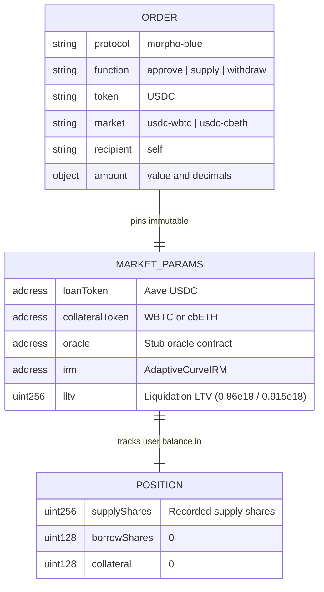

# Morpho Blue Lending Adapter (D3)

The Morpho Blue adapter connects the agent wallet to Morpho Blue lending markets on Base Sepolia (Chain ID 84532), allowing the wallet to supply and withdraw USDC against whitelisted isolated collateral markets (`usdc-wbtc` and `usdc-cbeth`).

## Architecture

```mermaid
flowchart LR
    O[Order<br/>protocol: morpho-blue<br/>market: usdc-wbtc | usdc-cbeth] --> G[Gateway Preflight & TxBuilder]
    G --> R[(Protocol Registry)]
    R --> M[core/protocols/morpho_blue.py<br/>ProtocolSpec]
    M -->|approve| U[Aave USDC<br/>0xba50Cd...D5f]
    M -->|supply / withdraw| B[Morpho Blue<br/>0xBBBBBb...FFCb]
    P[Portfolio Reader<br/>core/runner/portfolio.py] -->|positions| M
    M -->|position & market view calls| B
```

## Data Model & Market Identifiers



## Module Ownership & Connections

- **Module Owner:** `core/protocols/morpho_blue.py` registers `ProtocolSpec(id="morpho-blue", category="lending", ...)` on import.
- **Gateway TxBuilder (`core/gateway/txbuilder.py`):** Dispatches order building to `morpho_blue.build_calls(order, ctx)`. Builds exact ERC-20 `approve` to Morpho Blue (`0xBBBBBbbBBb9cC5e90e3b3Af64bdAF62C37EEFFCb`), `supply` (`0xa99aad89`), and `withdraw` (`0x5c2bea49`).
- **Gateway Preflight (`core/protocols/registry.py::preflight`):** Enforces protocol enablement and market whitelist rules. An order with a missing or unwhitelisted market is denied with rule `ACCESS.MARKET_NOT_ALLOWED`.
- **Portfolio Reader (`core/runner/portfolio.py`):** Calls `spec.positions(wallet, reader)`. `morpho_blue.positions` queries `position(bytes32, address)` and `market(bytes32)`, converting supply shares to underlying USDC assets via Morpho Blue's `SharesMathLib` virtual offsets:
  $$\text{assets} = \frac{\text{shares} \times (\text{totalSupplyAssets} + 1)}{\text{totalSupplyShares} + 10^6}$$
- **Whitelisted Markets:**
  - `usdc-wbtc` (`0xa7cc9d96371f4c4b5be131281cd24a410cf6b76dcfb4319004d5bd66045adb97`): Collateral Aave WBTC (`0x54114591963CF60EF3aA63bEfD6eC263D98145a4`), Oracle `0xb22092390D44EF7271a71a371097aBf44aBb6C27`, LLTV `0.86e18`.
  - `usdc-cbeth` (`0x532165f57c1077690d6b2f413e5555eba34611df4e625820ca6aa187f3f89b65`): Collateral Aave cbETH (`0xD171b9694f7A2597Ed006D41f7509aaD4B485c4B`), Oracle `0xF4FbCFDdA39202549ca4f1230E694c32B5A2F80D`, LLTV `0.915e18`.
