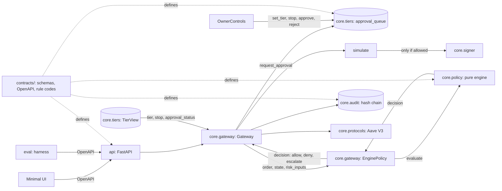

# Architecture overview

One request path, one signer, one audit log. The LLM proposes; code decides.

## Boundaries (each has a test)
| Rule | Test |
| :--- | :--- |
| Only `core.gateway` imports `core.signer` | `tests/test_signer_boundary.py` |
| Agent-facing modules never import `core.tiers.owner` | `tests/tiers/test_tiers.py` |
| Every contract example validates against its schema | `tests/test_contracts.py` |
| No secret is tracked | `scripts/check_no_secrets.py` (run by `make check` and CI) |

## Packages
| Package | Responsibility | Status |
| :--- | :--- | :--- |
| `api` | HTTP surface, matches `contracts/openapi.yaml` | `/health` only |
| `core.gateway` | propose, policy, simulate, sign, record | wired to policy & tiers |
| `core.signer` | holds the key, signs | implemented |
| `core.policy` | pure engine (allow, deny), EnginePolicy adapter | implemented |
| `core.tiers` | permission tiers T0-T2, emergency stop, approval queue | implemented |
| `core.audit` | append-only hash chain | implemented |
| `core.protocols` | calldata builders | implemented |
