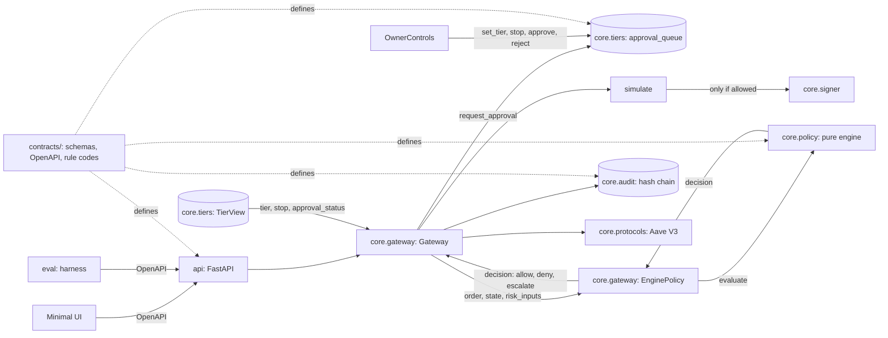

# Architecture overview

One request path, one signer, one audit log. The LLM proposes; code decides.



## Boundaries (each has a test)
| Rule | Test |
| :--- | :--- |
| Only `core.gateway` imports `core.signer` | `tests/test_signer_boundary.py` |
| Agent-facing modules never import `core.tiers.owner` | `tests/tiers/test_tiers.py` |
| Every contract example validates against its schema | `tests/test_contracts.py` |
| No secret is tracked | `scripts/checks/check_no_secrets.py` (run by `make check` and CI) |

## Packages
| Package | Responsibility | Status |
| :--- | :--- | :--- |
| `api` | HTTP surface, matches `contracts/openapi.yaml` | `/health` only |
| `core.gateway` | propose, policy, simulate, sign, record | wired to policy & tiers |
| `core.signer` | holds the key, signs | implemented |
| `core.policy` | pure engine (allow, deny), EnginePolicy adapter | implemented |
| `core.tiers` | permission tiers T0-T2, emergency stop, approval queue | implemented |
| `core.audit` | append-only hash chain | implemented |
| `core.protocols` | calldata builders | implemented |

## Repository map

```text
.
├── api/          # FastAPI HTTP surface, auth sessions, SSE event streams, OpenAPI endpoints
├── contracts/    # Data contracts, JSON Schemas, OpenAPI specification, rule codes, strategy presets
├── core/         # Core policy, execution, and security architecture
│   ├── agent/    # Untrusted LLM Reader fact extraction and Planner proposal synthesis
│   ├── audit/    # Append-only SHA-256 hash-chained tamper-evident audit log
│   ├── gateway/  # Execution pipeline, simulation-before-signing, concurrency lock
│   ├── policy/   # Pure deterministic policy engine and IPS mathematical rule checks
│   ├── protocols/# Calldata builders and protocol adapters (Aave, Morpho, Uniswap)
│   ├── risk/     # Risk router aggregating live on-chain metrics and reference data
│   ├── runner/   # Autonomous agent loop cycle, portfolio state, ledger tracking
│   ├── signer/   # Isolated local key signer restricted exclusively to Base Sepolia
│   ├── simulate/ # RPC transaction bundle simulation (eth_call) before signing
│   ├── storage/  # Dual-backend persistence (SQLite and PostgreSQL with RLS)
│   └── tiers/    # Permission tier state machine (T0-T2), emergency stop, approvals
├── docs/         # Documentation index, architecture specs, guides, research, and evidence
├── evals/        # 46 offline evaluation scenarios covering 27 of 28 rule codes
├── scripts/      # Operational scripts: checks, evidence generation, submission packaging
├── tests/        # Comprehensive pytest test suite (1,460+ tests across all layers)
└── ui/           # Zero-build single-page webapp console (plain HTML, CSS, ES modules)
```

