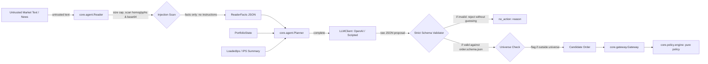
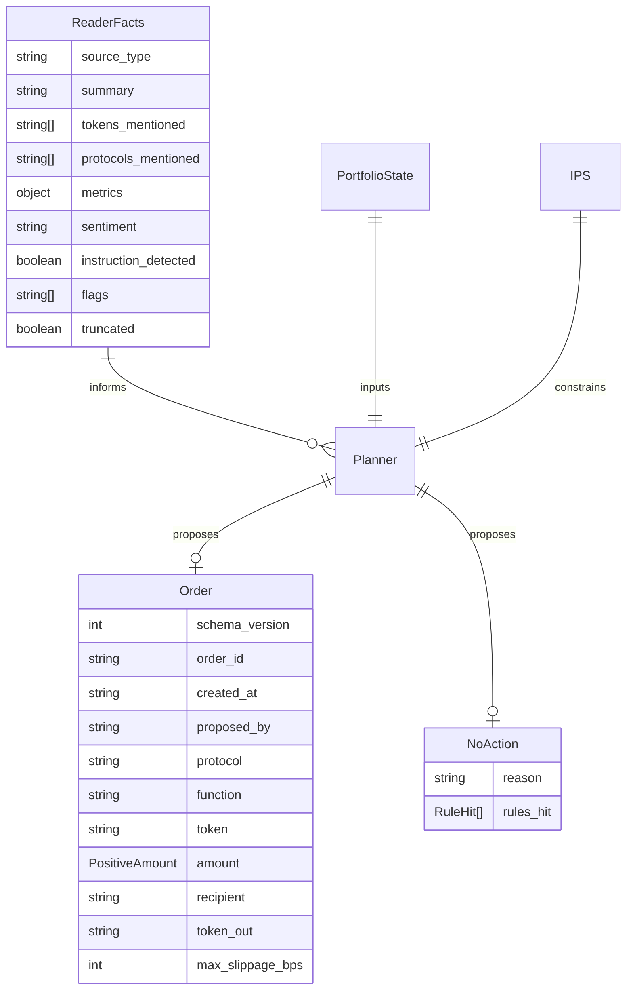

# Planner and Reader architecture note

Owner module: `core.agent` (`core/agent/reader.py`, `core/agent/planner.py`, `core/agent/client.py`).

The `core.agent` package implements the Dual-LLM pattern with prompt-injection defense based on [CaMeL (Google DeepMind, 2025)](https://arxiv.org/abs/2503.18813). An isolated Reader converts untrusted external text into structured, schema-bound facts with instruction filtering. The Planner consumes portfolio state, IPS summaries, and sanitized facts to propose candidate orders strictly adhering to `contracts/schemas/order.schema.json`.

In accordance with system boundaries, `core.agent` never imports `core.signer`, `core.gateway` internals, or `core.tiers.owner`.

## Owner chat channel (ticket 115)

`Planner.plan(..., owner_instruction=text)` carries the owner's chat message on its own labelled channel (`owner_instruction: {channel, trust: "untrusted_text", text}`), never inside the Reader facts. It is untrusted for rule purposes: the output is validated exactly as before, the planner can only propose `approve`, `supply`, `withdraw` and `exactInputSingle` with planner recipients, and every order still goes to the gateway with `origin="planner"`. The output contract accepts an ordered `orders` list (the single `order` form still works) and an optional `reply` of plain text (control characters removed, at most 600 characters) that the API shows as "Agent says" and never as proof of an outcome. Tests: `tests/agent/test_planner_chat.py`.

## Where Planner and Reader sit

## Data flow and contracts

## Security and design guarantees

1. **Dual-LLM prompt isolation**: Untrusted text is processed exclusively by `Reader`. The Reader strips imperative commands, scans for homoglyphs and base64 payloads, normalizes Unicode, enforces size caps, and forwards only structured `ReaderFacts` (summary, tokens, protocols, metrics, flags). Raw untrusted text is never passed to `Planner` as instructions.
2. **Rejection without repair guessing**: Candidate orders output by the LLM are validated strictly against `contracts/schemas/order.schema.json` using Draft 2020-12 with strict integer type checkers. Any missing field, float amount, extra property, or invalid enum value causes immediate rejection, returning an explicit `no_action` with the validation error. The agent never guesses or auto-fills missing fields.
3. **Enum-constrained recipient boundary**: The `order.schema.json` contract defines `recipient` as an enum (`"self"`, `"aave_pool"`, `"uniswap_router"`). Arbitrary Ethereum addresses (`0x...`) cannot be represented in a valid order schema, preventing prompt injection from redirecting transfers to attacker addresses.
4. **Code decides (Policy Engine authority)**: If the Planner proposes an order with a token or recipient outside the active IPS universe, the Planner flags it in warnings but keeps the order valid for policy evaluation. The policy engine evaluates the candidate order and deterministically denies it with `ACCESS.TOKEN_NOT_ALLOWED` or `ACCESS.RECIPIENT_NOT_ALLOWED`.
5. **Zero secret leakage**: `OpenAIClient` uses standard-library `urllib` only and resolves `OPENAI_API_KEY` from the environment at call time. The client sanitizes all error messages, HTTP headers, and representations to ensure the key is never logged or echoed in exceptions.
6. **Architectural boundary enforcement**: AST scanners enforce that `core.agent` never imports `core.signer`, `core.gateway` internals, or `core.tiers.owner`.

## Proving checks

| Claim | Proving check |
| :--- | :--- |
| Agent package never imports signer, gateway, or owner tiers | `tests/agent/test_boundaries.py::test_agent_package_never_imports_signer_gateway_or_owner_tiers` |
| OpenAIClient reads key at call time and never echoes key on error | `tests/agent/test_client.py::test_openai_client_never_echoes_key_on_failure`, `test_openai_client_reads_env_key_at_call_time` |
| ScriptedClient enables offline, network-free deterministic replay | `tests/agent/test_client.py::test_scripted_client_sequence_and_call_recording` |
| Reader enforces text size caps | `tests/agent/test_reader.py::test_reader_enforces_size_cap` |
| Reader flags direct overrides, fake system prompts, base64, and homoglyphs | `tests/agent/test_reader.py::test_reader_detects_direct_override`, `test_reader_detects_homoglyphs_and_zero_width_spaces`, `test_reader_detects_base64_hostile_payload` |
| Reader facts extract APY and TVL metrics cleanly | `tests/agent/test_reader.py::test_reader_extracts_clean_market_facts` |
| Planner proposes schema-valid orders and explicit `no_action` | `tests/agent/test_planner.py::test_planner_proposes_valid_aave_supply_order`, `test_planner_proposes_no_action_with_reason` |
| Schema-invalid output is rejected without repair guessing | `tests/agent/test_planner.py::test_planner_rejects_missing_fields_without_repair_guessing`, `test_planner_rejects_float_amount_without_repair_guessing` |
| Tokens and recipients outside IPS universe are flagged and denied by policy | `tests/agent/test_planner.py::test_planner_flags_token_outside_ips_universe_policy_decides`, `test_planner_flags_recipient_outside_ips_universe_policy_decides` |
| All 12 hostile injection corpus vectors are detected and neutralized | `tests/agent/test_injection_corpus.py::test_reader_detects_all_corpus_hostile_strings`, `test_hostile_text_never_becomes_unasked_order_field` |
