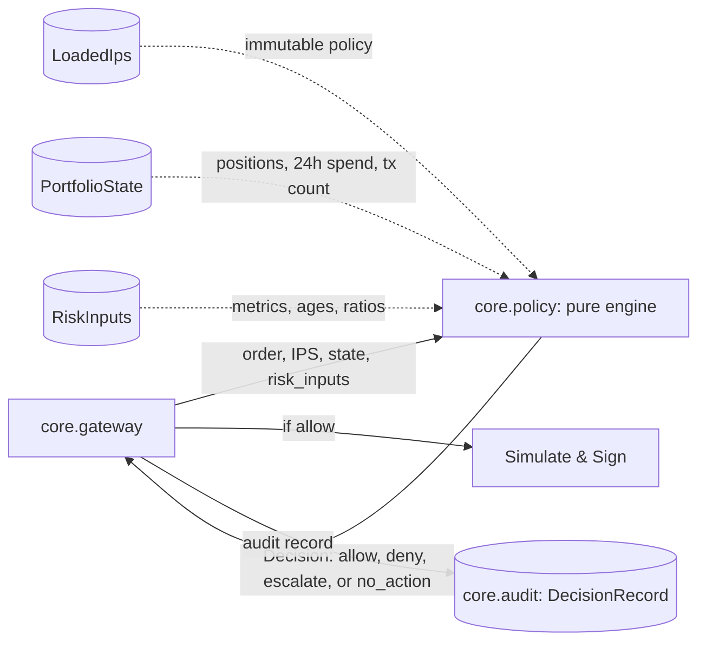

# Policy engine: access, limit, allocation, and risk-input rules

Owner: `core.policy` (`core/policy/engine.py`). A pure evaluation function `evaluate(ips, state, order=None, risk_inputs=None, now=None) -> dict` that inspects proposed orders against the Investment Policy Statement (IPS) and current portfolio state, producing a strictly validated `Decision`.

## Where the policy engine sits

The policy engine is completely stateless and deterministic. It performs no network requests, executes no filesystem operations, invokes no LLM, and never mutates its input parameters.

## Interface

| Component | Signature / Return | Description |
| :--- | :--- | :--- |
| `evaluate` | `(ips: LoadedIps \| Mapping[str, Any], state: Mapping[str, Any], order: Mapping[str, Any] \| None = None, risk_inputs: Mapping[str, Any] \| None = None, now: datetime \| None = None) -> dict[str, Any]` | Evaluates access, limit, allocation, and risk-input rules and returns a `Decision` dictionary validating against `contracts/schemas/decision.schema.json` (or no-action record payload). |

## Implemented rules

| Rule code | Family | Condition / Threshold | Evidence keys |
| :--- | :--- | :--- | :--- |
| `ACCESS.TOKEN_NOT_ALLOWED` | `ACCESS` | Order `token` or `token_out` is not in `ips.universe.tokens`. | `token` or `token_out` |
| `ACCESS.PROTOCOL_NOT_ALLOWED` | `ACCESS` | Order `protocol` is not in `ips.universe.protocols`. | `protocol` |
| `ACCESS.FUNCTION_NOT_ALLOWED` | `ACCESS` | Order `function` is not in `ips.universe.functions`. | `function` |
| `ACCESS.RECIPIENT_NOT_ALLOWED` | `ACCESS` | Order `recipient` is not in `ips.universe.recipients`. | `recipient` |
| `ACCESS.UNLIMITED_APPROVAL` | `ACCESS` | Approve order with `amount >= 2**256 - 1` or exceeding order's own supply/withdraw amount. | `amount`, `max_uint256`, `supply_amount`, `withdraw_amount` |
| `LIMIT.PER_TX` | `LIMIT` | Order USD value exceeds `limits.per_tx_usd`, or token price is missing in portfolio positions. | `order_usd`, `per_tx_usd` (or `price_missing`, `token`) |
| `LIMIT.PER_DAY` | `LIMIT` | `state.spent_24h_usd` plus order USD value exceeds `limits.per_day_usd`. | `order_usd`, `spent_24h_usd`, `per_day_usd`, `projected_24h_usd` |
| `LIMIT.TX_PER_HOUR` | `LIMIT` | `state.tx_count_1h` is already at or above `limits.max_tx_per_hour`. | `tx_count_1h`, `max_tx_per_hour` |
| `ALLOC.MAX_WEIGHT_PER_ASSET` | `ALLOC` | After the order, a non-stable asset's portfolio weight exceeds `allocation.max_weight_per_asset_bps`. | `token`, `weight_bps`, `max_weight_per_asset_bps` |
| `ALLOC.MIN_STABLE_WEIGHT` | `ALLOC` | After the order, aggregate stablecoin weight falls below `allocation.min_stable_weight_bps`. | `stable_weight_bps`, `min_stable_weight_bps` |
| `ALLOC.WITHIN_REBALANCE_BAND` | `ALLOC` | Current allocation deviation $\Delta \le \text{rebalance\_band\_bps}$. Yields `no_action` rather than a violation denial. | `deviation_bps`, `rebalance_band_bps` |
| `RISK.POOL_TVL_TOO_LOW` | `RISK` | Pool TVL is below `risk.min_pool_tvl_usd`. | `pool_tvl_usd`, `min_pool_tvl_usd` |
| `RISK.REWARD_APY_SHARE_TOO_HIGH` | `RISK` | Share of total APY coming from reward tokens exceeds `risk.max_reward_apy_share_bps`. | `reward_share_bps`, `max_reward_share_bps` |
| `RISK.APY_UNSTABLE` | `RISK` | APY 7d/30d deviation exceeds `risk.max_apy_deviation_bps`. | `apy_deviation_bps`, `max_apy_deviation_bps` |
| `RISK.DEPEG_TOO_WIDE` | `RISK` | Stablecoin price depeg from 1.00 USD exceeds `risk.max_depeg_bps`. | `depeg_bps`, `max_depeg_bps` |
| `RISK.UTILIZATION_TOO_HIGH` | `RISK` | Lending pool utilization exceeds `risk.max_utilization_bps`. | `utilization_bps`, `max_utilization_bps` |
| `RISK.SLIPPAGE_TOO_HIGH` | `RISK` | Estimated or specified slippage exceeds `risk.max_slippage_bps`. | `estimated_slippage_bps` / `order_slippage_bps`, `max_slippage_bps` |
| `RISK.COST_EXCEEDS_BENEFIT` | `RISK` | Estimated benefit/cost multiple is below `risk.min_benefit_cost_ratio_bps`. | `actual_ratio_bps`, `estimated_benefit_usd`, `estimated_cost_usd`, `min_benefit_cost_ratio_bps` |
| `RISK.DATA_STALE` | `RISK` | Risk inputs are missing (`risk_inputs=None`) or data age exceeds `risk.max_data_age_seconds`. | `data_age_seconds`, `max_data_age_seconds` (or `risk_inputs: "missing"`) |

## Weight calculation and rebalance formulas

All allocation calculations use exact `decimal.Decimal` and integer basis points (10000 bps = 100%).

1. **Post-order asset values**:
   - For swaps (`exactInputSingle`):
     $$V_{\text{post}}(t_{\text{in}}) = V_{\text{current}}(t_{\text{in}}) - O_{\text{usd}}$$
     $$V_{\text{post}}(t_{\text{out}}) = V_{\text{current}}(t_{\text{out}}) + O_{\text{usd}}$$
     Total portfolio USD value $V_{\text{total}}$ remains unchanged.
   - For supplies (`supply`):
     $$V_{\text{post}}(t) = V_{\text{current}}(t) + O_{\text{usd}}$$
     $$V_{\text{total, post}} = V_{\text{total}} + O_{\text{usd}}$$
   - For withdrawals (`withdraw`):
     $$V_{\text{post}}(t) = \max(0, V_{\text{current}}(t) - O_{\text{usd}})$$
     $$V_{\text{total, post}} = \max(0, V_{\text{total}} - O_{\text{usd}})$$

2. **Post-order asset weight in basis points**:
   $$W(t) = \lfloor \frac{V_{\text{post}}(t) \times 10000}{V_{\text{total, post}}} \rfloor$$

3. **Aggregate stablecoin weight in basis points**:
   $$W_{\text{stable}} = \lfloor \frac{\sum_{t \in \text{STABLE}} V_{\text{post}}(t) \times 10000}{V_{\text{total, post}}} \rfloor$$
   where $\text{STABLE} = \{\text{USDC}, \text{USDT}, \text{DAI}\}$.

4. **Rebalance deviation**:
   Current allocation deviation $\Delta$ is computed across stable and non-stable assets:
   $$\Delta_{\text{stable}} = \max(0, \text{min\_stable\_weight\_bps} - W_{\text{stable, current}})$$
   $$\Delta(t) = \max(0, W_{\text{current}}(t) - \text{max\_weight\_per\_asset\_bps}) \quad \forall t \notin \text{STABLE}$$
   $$\Delta = \max\left(\Delta_{\text{stable}}, \max_{t \notin \text{STABLE}} \Delta(t)\right)$$

   If $\Delta \le \text{rebalance\_band\_bps}$, the state is within the rebalance band and `ALLOC.WITHIN_REBALANCE_BAND` triggers a `no_action` outcome.

## Invariants and guarantees

1. **Purity and determinism**: For identical inputs and timestamp, `evaluate` always returns identical decision dictionaries. Network sockets and file open calls raise without affecting execution.
2. **Zero mutation**: Neither `ips`, `state`, `order`, nor `risk_inputs` is modified in any way.
3. **No floats**: All monetary math and ratios use `decimal.Decimal` and `int`, ensuring exact precision and canonical JSON serialization compatibility.
4. **Comprehensive evaluation**: `evaluate` evaluates all rules across families without early exits, populating all violations in `rules_hit`.
5. **Fail closed**: Orders requiring risk inputs (supply, withdraw, swap) deny with `RISK.DATA_STALE` when `risk_inputs=None`.
6. **Contract compliance**: Every decision output satisfies Draft 2020-12 schema validation against `contracts/schemas/decision.schema.json`.

## Proving checks

| Claim | Proving check |
| :--- | :--- |
| Every ACCESS and LIMIT rule has passing and blocking test cases | `tests/policy/test_access_rules.py`, `tests/policy/test_limit_rules.py` |
| Every ALLOC rule has passing and blocking test cases | `tests/policy/test_alloc_rules.py` |
| Every RISK rule has passing and blocking test cases | `tests/policy/test_risk_rules.py` |
| Multiple simultaneous violations all appear in `rules_hit` | `tests/policy/test_multiple_violations.py` |
| Execution is pure, offline, and does not mutate inputs | `tests/policy/test_engine_purity.py` |
| Outputs validate against `decision.schema.json` | `tests/policy/test_schema_compliance.py` |
| Independent check matches twice the rule count | `pytest tests/policy -q` (77 passed, $\ge 38$) |
