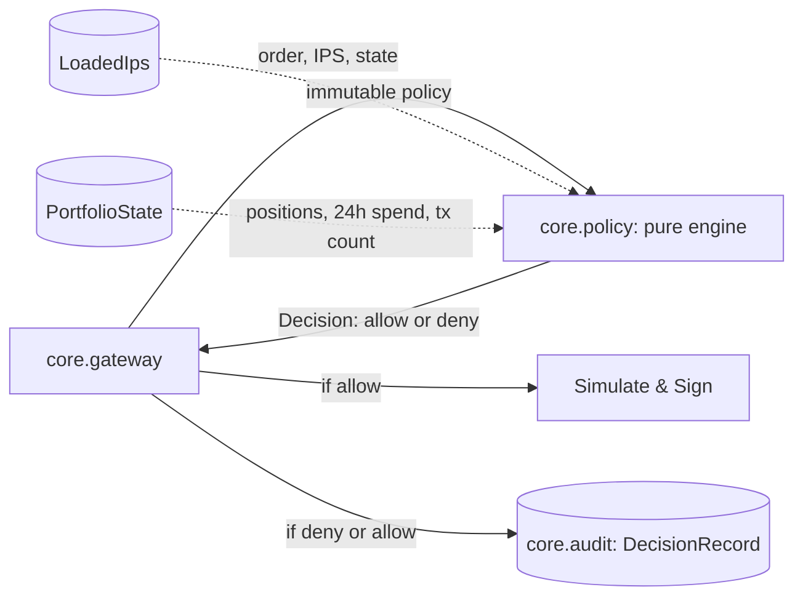

# Policy engine: access and limit rules

Owner: `core.policy` (`core/policy/engine.py`). A pure evaluation function `evaluate(ips, state, order, now=None) -> dict` that inspects proposed orders against the Investment Policy Statement (IPS) and current portfolio state, producing a strictly validated `Decision`.

## Where the policy engine sits

The policy engine is completely stateless and deterministic. It performs no network requests, executes no filesystem operations, invokes no LLM, and never mutates its input parameters.

## Interface

| Component | Signature / Return | Description |
| :--- | :--- | :--- |
| `evaluate` | `(ips: LoadedIps \| Mapping[str, Any], state: Mapping[str, Any], order: Mapping[str, Any], now: datetime \| None = None) -> dict[str, Any]` | Evaluates access and limit rules and returns a `Decision` dictionary validating against `contracts/schemas/decision.schema.json`. |

## Implemented rules (ACCESS and LIMIT)

| Rule code | Family | Condition / Threshold | Evidence keys |
| :--- | :--- | :--- | :--- |
| `ACCESS.TOKEN_NOT_ALLOWED` | `ACCESS` | Order `token` or `token_out` is not in `ips.universe.tokens`. | `token` or `token_out` |
| `ACCESS.PROTOCOL_NOT_ALLOWED` | `ACCESS` | Order `protocol` is not in `ips.universe.protocols`. | `protocol` |
| `ACCESS.FUNCTION_NOT_ALLOWED` | `ACCESS` | Order `function` is not in `ips.universe.functions`. | `function` |
| `ACCESS.RECIPIENT_NOT_ALLOWED` | `ACCESS` | Order `recipient` is not in `ips.universe.recipients`. | `recipient` |
| `ACCESS.UNLIMITED_APPROVAL` | `ACCESS` | Approve order with `amount >= 2**256 - 1` or exceeding order's own supply/withdraw amount. | `amount`, `max_uint256`, `supply_amount`, `withdraw_amount` |
| `LIMIT.PER_TX` | `LIMIT` | Order USD value exceeds `limits.per_tx_usd`, or token price is missing in portfolio positions. | `order_usd`, `per_tx_usd` (or `price_missing`, `token`) |
| `LIMIT.PER_DAY` | `LIMIT` | `state.spent_24h_usd` plus order USD value exceeds `limits.per_day_usd`. | `order_usd`, `spent_24h_usd`, `per_day_usd`, `projected_24h_usd` |
| `LIMIT.TX_PER_HOUR` | `LIMIT` | `state.tx_count_1h` is already at or above `limits.max_tx_per_hour`. | `tx_count_1h`, `max_tx_per_hour` |

## Invariants and guarantees

1. **Purity and determinism**: For identical inputs and timestamp, `evaluate` always returns identical decision dictionaries. Network sockets and file open calls raise without affecting execution.
2. **Zero mutation**: Neither `ips`, `state`, nor `order` is modified in any way.
3. **No floats**: All monetary math uses `decimal.Decimal` and `int`, ensuring exact precision and canonical JSON serialization compatibility.
4. **Comprehensive evaluation**: `evaluate` evaluates all rules across families without early exits, populating all violations in `rules_hit`.
5. **Contract compliance**: Every output satisfies Draft 2020-12 schema validation against `contracts/schemas/decision.schema.json`.

## Proving checks

| Claim | Proving check |
| :--- | :--- |
| Every ACCESS and LIMIT rule has passing and blocking test cases | `tests/policy/test_access_rules.py`, `tests/policy/test_limit_rules.py` |
| Multiple simultaneous violations all appear in `rules_hit` | `tests/policy/test_multiple_violations.py` |
| Execution is pure, offline, and does not mutate inputs | `tests/policy/test_engine_purity.py` |
| Outputs validate against `decision.schema.json` | `tests/policy/test_schema_compliance.py` |
| Independent check matches twice the rule count | `pytest tests/policy -q -k 'access or limit'` (25 passed) |
