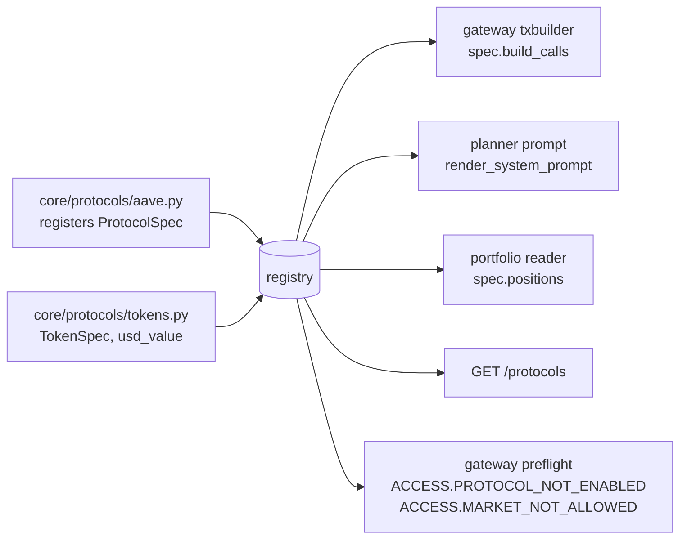

# Protocol registry (D0)

One registry says which DeFi protocols the agent knows, what each one can do and how its calls are built. The gateway tx builder, the planner prompt, the portfolio reader and `GET /protocols` read it, so a new protocol is one adapter file plus data, not edits across the repo.

## Pieces

| Piece | File | Notes |
| :--- | :--- | :--- |
| `ProtocolSpec`, `ProtocolRegistry` (`register`, `get`, `all_specs`, `by_category`) | `core/protocols/registry.py` | id, name, category, chain id, `paper`, functions, tokens, spenders, `build_calls(order, ctx)`, `positions(wallet, reader)`, `describe(order)` |
| `TokenSpec`, `usd_value(token, amount)` | `core/protocols/tokens.py` | `usd_source`: `stable` (pegged, sanity band), `aave_oracle` (`AaveOracle.getAssetPrice`, read once per call), `unavailable` |
| Aave v3 and wallet specs | `core/protocols/aave.py` | registered on import, behaviour unchanged |
| Derived constants | `core/protocols/addresses.py` | `SUPPORTED_PROTOCOLS`, `SUPPORTED_TOKENS`, `SUPPORTED_FUNCTIONS`, `PROTOCOL_ADDRESSES`, `TOKEN_ADDRESSES` are computed from the registry on first access |

## Valuation

Every USD value goes through the token registry (`usd_value`, with `core.runner.prices.price_usd` as the historic entry point on top of it, used by the ledger and the portfolio reader). A token is **data only** until an adapter calls `enable_token(symbol)`: USDT, WETH, WBTC, cbETH, LINK and USDbC are listed but priceless today. A price that cannot be read (token not enabled, oracle error, zero price, stable outside its peg band) raises `PriceUnavailable`: the position is omitted and the policy engine denies with `LIMIT.PER_TX` (`price_missing`). `RISK.PRICE_UNAVAILABLE` is reserved for the first adapter that prices an oracle token at order time.

## Order, IPS and gateway

- Order schema: `protocol` gains `uniswap-v3` (already there), `morpho-blue`, `moonwell`, `aave-stata`; `token` gains `USDT`, `WBTC`, `cbETH`, `LINK`, `USDbC`; optional `market` (`usdc-wbtc`, `usdc-cbeth`, only with `morpho-blue`). `schema_version` stays 1, `additionalProperties: false`, no address or free text.
- IPS universe enums grow the same way. A protocol is usable only when the IPS lists it (`ACCESS.PROTOCOL_NOT_ALLOWED`, unchanged) **and** the registry has an adapter for it.
- The policy engine decides first. If it allows or escalates, the gateway runs `registry.preflight(order)`; an unregistered protocol or an unlisted market turns the decision into a deny (`ACCESS.PROTOCOL_NOT_ENABLED`, `ACCESS.MARKET_NOT_ALLOWED`) before anything is built or signed. The registry never widens what the policy allowed.
- `txbuilder.build_calls` dispatches to the spec. Only the gateway builds calls and only the gateway reaches the signer.
- Approvals name only spender addresses declared by the spec (`spec.spenders`) and the exact order amount.

## Planner

`render_system_prompt(enabled_protocols)` builds the system prompt from the registry: enabled protocols, planner-visible functions (owner functions such as `mint` and `transfer` never appear), tokens with decimals, recipients, one-line summaries and the `paper` flag. The planner still returns enums only; it never supplies an address, spender or calldata field.

## Read model

`GET /protocols` (session) returns the registry entries the owner's IPS enables: `id, name, category, tokens, functions, paper`. No addresses. `PortfolioReader.read` takes positions from each registered spec (`spec.positions`); the Aave result is identical to before.

## How to add a protocol

1. **Adapter** `core/protocols/<name>.py`: encoders, a `build_calls(order, ctx)` that takes every address from constants in code, `positions`, `describe`, then `register(ProtocolSpec(...))`. Import it from `registry._ensure_loaded`.
2. **Tokens**: if it uses a listed token, call `enable_token`; a new token is a `TokenSpec` in `tokens.py` with its `usd_source`.
3. **Schemas**: only additive enum values (order, IPS, decision-record embedded copy; `test_embedded_copies_byte_identical` keeps them in step), plus an example valid and invalid order.
4. **Spenders**: list every approval target in `spenders`. A new spender is an owner-review item (see `docs/security/self-assessment.md`).
5. **Tests**: encoder unit tests with fixed vectors, `build_calls` through the registry, a denial test (disabled protocol, price unavailable), and an eval scenario if a new rule code is used.
6. **Evidence**: an `eth_simulateV1` or live Base Sepolia run recorded in `docs/design/` or `docs/evidence/`; never a mainnet address or key.
7. **Docs**: row in this file's table, `api.md` if an endpoint changes.
