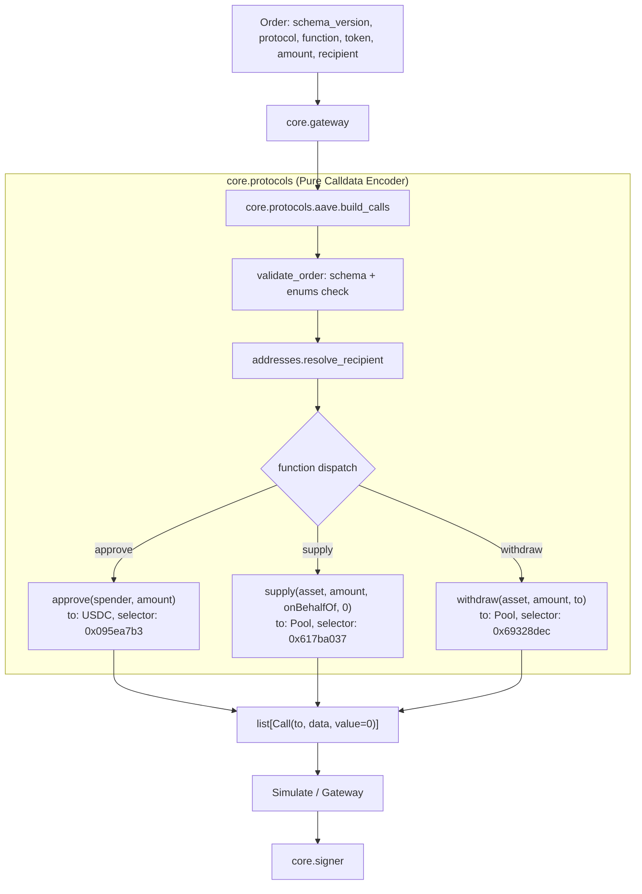

# Aave V3 protocol adapter: architecture note

Owning module: `core.protocols` (`core/protocols/aave.py`, `core/protocols/addresses.py`).
Specification & data contract: [`contracts/schemas/order.schema.json`](../../../contracts/schemas/order.schema.json).

## Purpose
The Aave V3 adapter translates a validated `Order` into a list of executable Ethereum `Call(to, data, value)` objects for Base Sepolia (Chain ID 84532). It is a pure, offline calldata encoder with no network dependencies and zero access to private keys or the signer.

## Architecture and Flow

## Contract Addresses on Base Sepolia (Chain ID 84532)

Addresses are verified on-chain against Base Sepolia RPC and sourced from primary registry artifacts documented in `docs/research/testnet-facts-aave.md`:

| Role | Contract Address | Primary Source |
| :--- | :--- | :--- |
| **Aave V3 Pool** | `0x8bAB6d1b75f19e9eD9fCe8b9BD338844fF79aE27` | [`bgd-labs/aave-address-book` (`AaveV3BaseSepolia.sol#L16-L17`)](https://github.com/bgd-labs/aave-address-book/blob/main/src/AaveV3BaseSepolia.sol#L16-L17) |
| **USDC Underlying** (Mock) | `0xba50Cd2A20f6DA35D788639E581bca8d0B5d4D5f` | [`bgd-labs/aave-address-book` (`AaveV3BaseSepolia.sol#L88-L91`)](https://github.com/bgd-labs/aave-address-book/blob/main/src/AaveV3BaseSepolia.sol#L88-L91) |
| **PoolAddressesProvider** | `0xE4C23309117Aa30342BFaae6c95c6478e0A4Ad00` | [`bgd-labs/aave-address-book` (`AaveV3BaseSepolia.sol#L11-L13`)](https://github.com/bgd-labs/aave-address-book/blob/main/src/AaveV3BaseSepolia.sol#L11-L13) |
| **aUSDC** | `0x10F1A9D11CDf50041f3f8cB7191CBE2f31750ACC` | [`bgd-labs/aave-address-book` (`AaveV3BaseSepolia.sol#L93-L94`)](https://github.com/bgd-labs/aave-address-book/blob/main/src/AaveV3BaseSepolia.sol#L93-L94) |
| **Faucet** | `0xD9145b5F45Ad4519c7ACcD6E0A4A82e83bB8A6Dc` | [`bgd-labs/aave-address-book` (`MiscBaseSepolia.sol#L12-L13`)](https://github.com/bgd-labs/aave-address-book/blob/main/src/MiscBaseSepolia.sol#L12-L13) |

> [!IMPORTANT]
> Aave V3 Base Sepolia accepts only Aave's mock test USDC (`0xba50Cd2A20f6DA35D788639E581bca8d0B5d4D5f`), not Circle's native testnet USDC.

## Supported Operations

1. **ERC-20 `approve(address spender, uint256 amount)`**
   - Target (`to`): `AAVE_V3_USDC` (`0xba50Cd2A20f6DA35D788639E581bca8d0B5d4D5f`)
   - Spender: resolved recipient (typically `AAVE_V3_POOL`)
   - Amount: exact order amount (never unlimited or max uint256)
   - Function selector: `0x095ea7b3`

2. **Aave V3 Pool `supply(address asset, uint256 amount, address onBehalfOf, uint16 referralCode)`**
   - Target (`to`): `AAVE_V3_POOL` (`0x8bAB6d1b75f19e9eD9fCe8b9BD338844fF79aE27`)
   - Asset: `AAVE_V3_USDC`
   - OnBehalfOf: caller wallet address (resolved from `recipient: "self"`)
   - ReferralCode: `0`
   - Function selector: `0x617ba037`

3. **Aave V3 Pool `withdraw(address asset, uint256 amount, address to)`**
   - Target (`to`): `AAVE_V3_POOL` (`0x8bAB6d1b75f19e9eD9fCe8b9BD338844fF79aE27`)
   - Asset: `AAVE_V3_USDC`
   - To: caller wallet address (resolved from `recipient: "self"`)
   - Function selector: `0x69328dec`

## Safety and Boundary Guarantees

| Boundary Rule | Enforcement | Test |
| :--- | :--- | :--- |
| Exact-amount approvals only | `order.schema.json` regex limits amount length to 30 digits; adapter encodes exact value; assert no 32-byte max word | `test_approve_amount_equals_order_amount_and_no_max_word`, `test_invalid_schema_orders_raise` |
| Signer isolation | `core.protocols` never imports `core.signer` | `tests/test_signer_boundary.py` |
| Strict schema validation | Every order is validated via `jsonschema.Draft202012Validator` before any calldata is constructed | `test_invalid_schema_orders_raise` |
| Enum boundary checking | Non-Aave protocols, tokens, functions, or recipients reject immediately | `test_out_of_enum_orders_raise` |
| Completely offline | Pure ABI encoding; zero network RPC calls | `test_no_network_access_in_calldata_building` |
