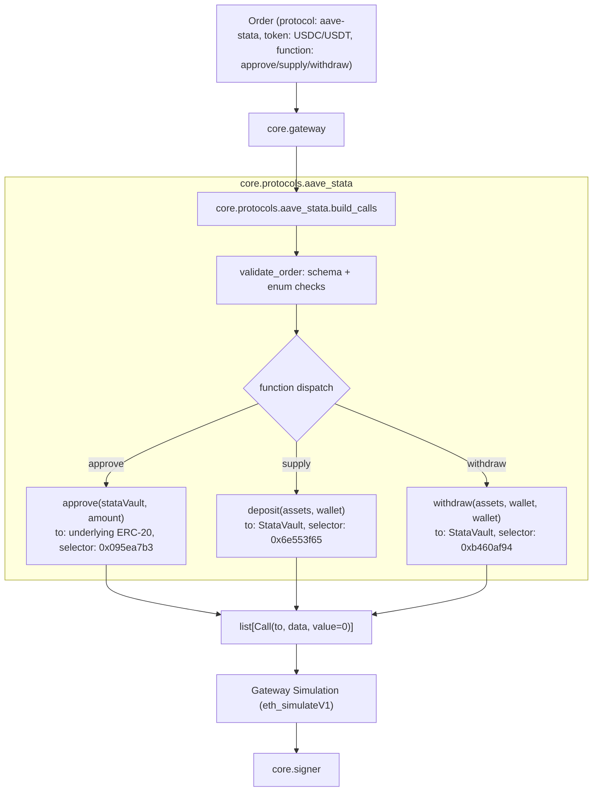
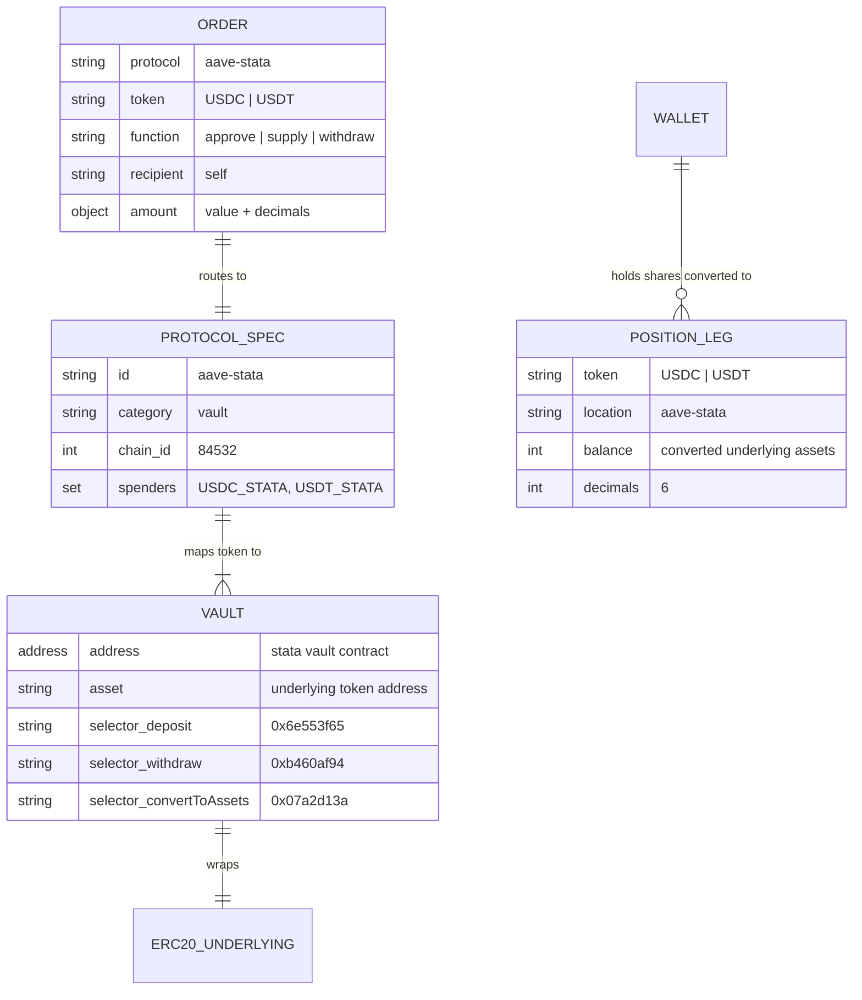

# Aave Stata (ERC-4626) Vault Adapter: Architecture Note

Owning module: `core.protocols` (`core/protocols/aave_stata.py`).  
Specification & data contract: [`contracts/schemas/order.schema.json`](../../../contracts/schemas/order.schema.json).

## Purpose

The Aave Stata adapter translates validated `Order` contracts for `protocol="aave-stata"` into executable Ethereum `Call(to, data, value)` objects targeting Aave's ERC-4626 static aToken vaults on Base Sepolia (Chain ID 84532). It also provides position readings that convert held static shares back to underlying asset balances via `convertToAssets`.

Like all protocol adapters in `agent-wallet`, it is a pure, offline calldata encoder with no network access, no dependency on the signer, and strict bounds on spenders and targets in code.

## Architecture and Flow

## Data Model & Relationships

## Contract Addresses on Base Sepolia (Chain ID 84532)

Addresses verified on-chain via Base Sepolia RPC (see `docs/research/evidence-aave-stata.md`):

| Token | Underlying Token Address | Stata Vault Contract Address (`VAULTS[token]`) |
| :--- | :--- | :--- |
| **USDC** | `0xba50Cd2A20f6DA35D788639E581bca8d0B5d4D5f` | `0xf430cb6E2b85f99222fBFA6dFEa18Ff60FA6B32a` |
| **USDT** | `0x0a215D8ba66387DCA84B284D18c3B4ec3de6E54a` | `0xf63dA51069FAe9448747FA425F8Cb84B0149eC0F` |

## Supported Operations

1. **ERC-20 `approve(address spender, uint256 amount)`**
   - Target (`to`): Underlying token contract (`AAVE_V3_USDC` or `AAVE_V3_USDT`)
   - Spender: The token's Stata Vault address (`AAVE_STATA_USDC` or `AAVE_STATA_USDT`)
   - Amount: Exact order amount (never max uint256)
   - Function selector: `0x095ea7b3`

2. **ERC-4626 `deposit(uint256 assets, address receiver)` via `supply`**
   - Target (`to`): The token's Stata Vault contract
   - Assets: Order amount in token base units
   - Receiver: Agent wallet address (from `recipient: "self"`)
   - Function selector: `0x6e553f65`

3. **ERC-4626 `withdraw(uint256 assets, address receiver, address owner)` via `withdraw`**
   - Target (`to`): The token's Stata Vault contract
   - Assets: Order amount in token base units
   - Receiver: Agent wallet address
   - Owner: Agent wallet address
   - Function selector: `0xb460af94`

4. **Positions Read Model (`_stata_positions`)**
   - Reads static share balance using `reader.balance_of(vault_address)`.
   - Converts held shares into underlying assets via `reader.convert_to_assets(vault_address, shares)` or `convertToAssets(shares)` (`0x07a2d13a`).
   - Returns `PositionLeg(token=token, location="aave-stata", balance=assets, decimals=6)`.
   - If shares balance is 0, no position leg is returned.
