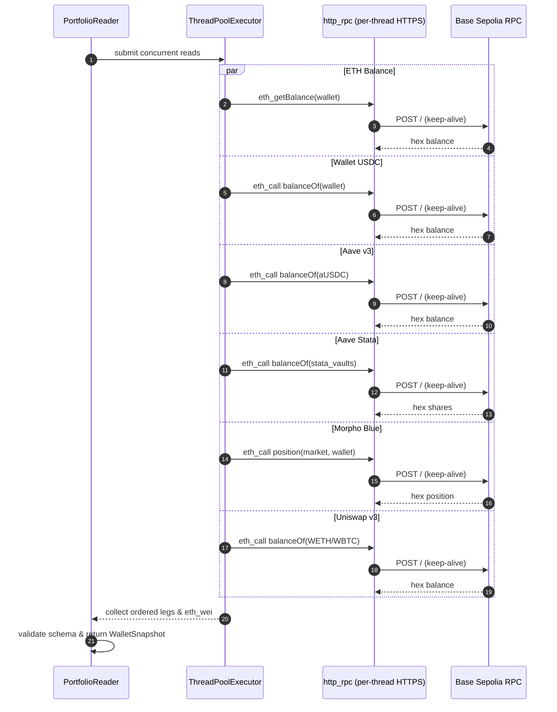

# Concurrent RPC Portfolio Reader and Connection Reuse

Owner modules: `core.runner.portfolio` (`core/runner/portfolio.py`) and `api.main` (`api/main.py`).

## Overview

Chat instructions and runner cycles require reading the wallet's current holdings across registered protocol adapters (USDC at wallet, Aave v3, Aave Stata vaults, Morpho Blue markets, Uniswap v3 positions). Previously, 10–11 RPC calls were executed strictly sequentially, each opening a new TLS connection over HTTPS, resulting in ~4.3 s of wait time per portfolio read.

`PortfolioReader.read` executes these reads concurrently using a standard library `ThreadPoolExecutor` (at most 8 workers), with persistent HTTP keep-alive connections isolated per thread via `threading.local` in `http_rpc`.

## Details
- **Concurrency**: Native ETH balance and registered protocol specs (`wallet`, `aave-v3`, `aave-stata`, `morpho-blue`, `uniswap-v3`) run in parallel via `ThreadPoolExecutor(max_workers=min(8, ...))`.
- **Determinism**: Position ordering, valuation, and output schemas remain byte-identical to the sequential implementation.
- **Fail-closed semantics**: Any failed RPC read re-raises or wraps into `PortfolioUnavailable`, preserving safety.
- **Connection reuse**: `http_rpc` maintains one `http.client.HTTPSConnection` per thread via `threading.local` with keep-alive headers and a single retry if an existing connection was closed by the remote server.
- **Timing instrumentation**: Logger `agent_wallet.timing` logs `perf_counter` durations for each phase (`portfolio_read`, `planner`, `gateway`).

## Tests
| Claim | Test |
| :--- | :--- |
| Concurrent read with 5 specs finishes in well under serial time | `tests/runner/test_portfolio.py::test_portfolio_reader_concurrent_under_serial_time_and_identical_state` |
| RPC failure in concurrent read raises `PortfolioUnavailable` | `tests/runner/test_portfolio.py::test_portfolio_reader_concurrent_failed_read_raises_portfolio_unavailable` |
| `http_rpc` reuses connection and retries on closed connection | `tests/test_http_stdlib.py::test_http_rpc_keep_alive_and_retry_on_closed_connection` |
| `http_rpc` error handling for RPC error and HTTP 500 | `tests/test_http_stdlib.py::test_http_rpc_error_handling` |
| Timing log messages emitted during `run_instruction` | `tests/runner/test_runner.py::test_run_instruction_emits_timing_logs` |
