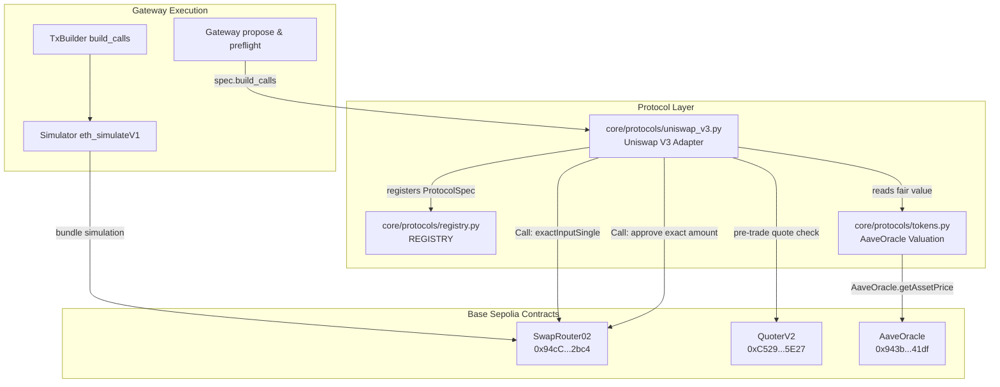

# Uniswap v3 Adapter Architecture

The Uniswap v3 adapter (`core/protocols/uniswap_v3.py`) plugs DEX swap execution into the protocol registry. It enables the agent wallet to execute `exactInputSingle` token swaps on Uniswap v3 (Base Sepolia) with oracle-based slippage protection and pool price deviation guardrails.

## Module Ownership & Wiring

- **Module**: `core/protocols/uniswap_v3.py`
- **Protocol ID**: `uniswap-v3` (category `dex`, chain 84532)
- **Functions**: `approve` (target: token contract, spender: `SwapRouter02`), `exactInputSingle` (target: `SwapRouter02`)
- **Tokens**: `USDC` (6 dec), `WETH` (18 dec), `WBTC` (8 dec)
- **Fee Tiers**: Chosen strictly by code: `USDC<->WETH` is fee 3000 (0.3%), `USDC<->WBTC` is fee 500 (0.05%). Other pairs are disallowed.
- **Executable Pool Minimum Output (`amountOutMinimum`)**: Computed in code from the executable QuoterV2 pool quote floored by $(1 - \text{max\_slippage\_bps} / 10000)$, while the oracle deviation guard bounds how far that quote may be from fair value (3%).
- **Slippage Cap**: The adapter enforces a hard ceiling of 100 bps (1.0%); any higher value denies the order.
- **Pool Price Deviation Guard (`check_pool_price_guard`)**: Compares QuoterV2 quote with oracle fair value; if the pool output is >3% worse than oracle fair value, the order is flagged with `RISK.POOL_PRICE_DEVIATION`.
- **Recipient**: Hardcoded to `self` (the wallet address passed by `BuildContext`).
- **Positions**: `spec.positions(wallet, reader)` queries idle `WETH` and `WBTC` wallet balances.
