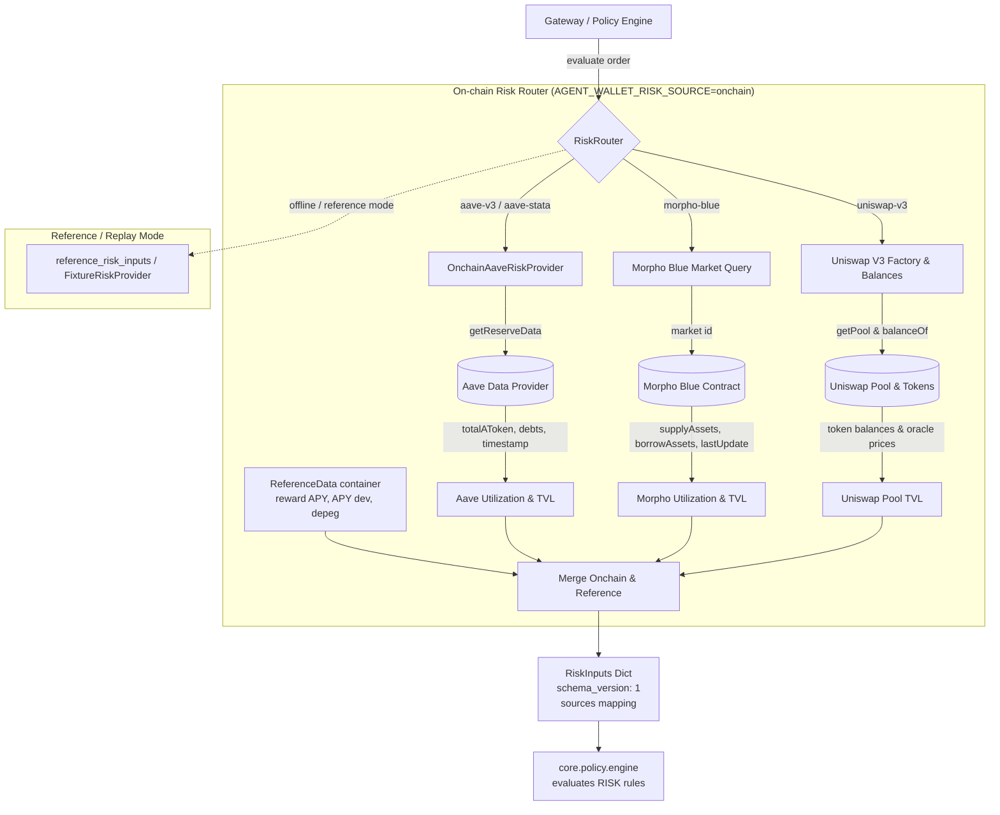
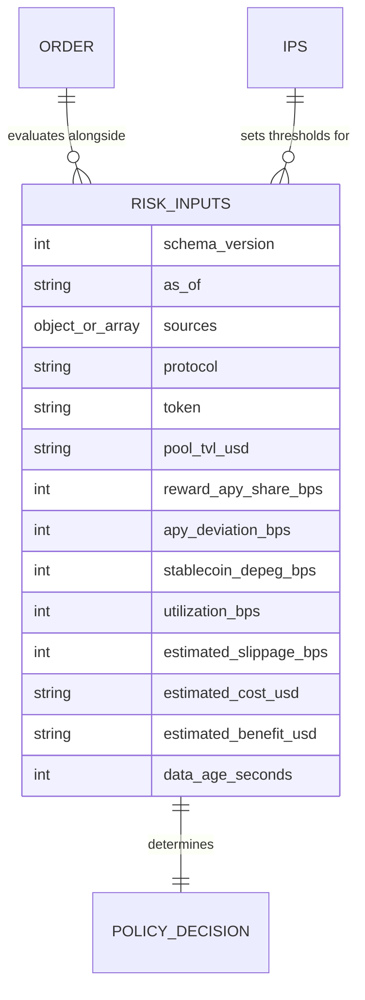

# Risk inputs provider: architecture note

Owning module: `core.risk` (`core/risk/provider.py`, `core/risk/router.py`, `core/risk/aave.py`, `core/risk/fixture.py`).
Specification & data contract: [`contracts/schemas/risk-inputs.schema.json`](../../contracts/schemas/risk-inputs.schema.json).
Live testnet evidence: [`docs/design/evidence-risk-inputs.md`](../design/evidence-risk-inputs.md).

## Purpose

The risk provider supplies measured inputs (`RiskInputs`) required by the pure policy engine (`core.policy.engine`) to evaluate the `RISK` rule family (`RISK.UTILIZATION_TOO_HIGH`, `RISK.POOL_TVL_TOO_LOW`, `RISK.DATA_STALE`, `RISK.COST_EXCEEDS_BENEFIT`, etc.).

Rather than serving fixed static reference data for every market, `RiskRouter` inspects the order's `protocol`, `token`, and `market` to fetch on-chain reserve, market, and pool data from Base Sepolia testnet contracts.

Implementations:
1. `RiskRouter` (`core.risk.router`): Routes requests per protocol:
   - `aave-v3`: Queries `AaveProtocolDataProvider` for USDC or USDT reserve data on-chain.
   - `aave-stata`: Queries the Aave reserve data of the vault's underlying asset (USDC or USDT).
   - `morpho-blue`: Queries `market(id)` on Morpho Blue for whitelisted markets (`usdc-wbtc`, `usdc-cbeth`), calculating exact integer utilization and USDC-denominated TVL.
   - `uniswap-v3`: Derives pool address via Uniswap V3 Factory `getPool(tokenA, tokenB, fee)`, reads pool ERC-20 token balances, and values pool TVL in USD via `core.protocols.tokens.usd_value`.
2. `OnchainAaveRiskProvider` (`core.risk.aave`): Specialized on-chain provider for Aave V3 reserves (USDC, USDT).
3. `FixtureRiskProvider` (`core.risk.fixture`): Replays pre-recorded fixtures deterministically for offline evaluation and replay mode, preserving original timestamps without restamping so stale data stays stale.

## Architecture and Flow



## Data Schema & Relationships



## What is On-Chain vs. Reference Data

On Base Sepolia, protocol-wide secondary metrics (such as protocol reward distribution shares, 30-day mean APY deviation, and cross-exchange depeg) are not tracked by public indexers. Rather than inventing arbitrary or zero numbers silently, `RiskRouter` explicitly separates on-chain metrics from reference defaults and records this honest provenance in the `sources` mapping:

| Field | Source | Description |
|---|---|---|
| `pool_tvl_usd` | **onchain** | Derived from live reserve balances, Morpho supply totals, or Uniswap pool token balances valued via Aave Oracle |
| `utilization_bps` | **onchain** | Exact integer ratio `(borrow * 10000) // supply` for Aave and Morpho; 0 for Uniswap AMM |
| `data_age_seconds` | **onchain** | Computed from on-chain `lastUpdateTimestamp` against current UTC clock (or 0 for real-time pool balance reads) |
| `reward_apy_share_bps` | **reference** | Conservative default (`0`), no unearned reward subsidy assumed |
| `apy_deviation_bps` | **reference** | Conservative default (`0`), stable baseline APY assumed |
| `stablecoin_depeg_bps` | **reference** | Conservative default (`0` on testnet USDC/USDT) |
| `estimated_slippage_bps` | **reference / order** | From order `max_slippage_bps` (swaps) or reference default (`None` for lending supply/withdraw) |
| `estimated_cost_usd` | **reference** | Conservative Base L2 gas fee estimate (`"0.40"`) |
| `estimated_benefit_usd` | **reference** | Conservative net yield projection (`"3.10"`) |

Every returned risk input dictionary contains a `sources` mapping reflecting this explicit provenance:
```json
{
  "pool_tvl_usd": "onchain",
  "utilization_bps": "onchain",
  "data_age_seconds": "onchain",
  "reward_apy_share_bps": "reference",
  "apy_deviation_bps": "reference",
  "stablecoin_depeg_bps": "reference",
  "estimated_slippage_bps": "reference",
  "estimated_cost_usd": "reference",
  "estimated_benefit_usd": "reference"
}
```

## Contract Addresses on Base Sepolia (Chain ID 84532)

Addresses are verified against Base Sepolia RPC and documented in `docs/design/testnet-facts-defi-survey.md`:

| Role | Contract Address | Notes |
| :--- | :--- | :--- |
| **AaveProtocolDataProvider** | `0xBc9f5b7E248451CdD7cA54e717a2BFe1F32b566b` | Target for `getReserveData(address asset)` (selector `0x35ea6a75`) |
| **Aave V3 Pool** | `0x8bAB6d1b75f19e9eD9fCe8b9BD338844fF79aE27` | Main lending pool |
| **Aave V3 USDC** | `0xba50Cd2A20f6DA35D788639E581bca8d0B5d4D5f` | USDC reserve asset address |
| **Aave V3 USDT** | `0x0a215D8ba66387DCA84B284D18c3B4ec3de6E54a` | USDT reserve asset address |
| **Morpho Blue** | `0xBBBBBbbBBb9cC5e90e3b3Af64bdAF62C37EEFFCb` | Target for `market(bytes32 id)` (selector `0x5c60e39a`) |
| **Uniswap V3 Factory** | `0x4752ba5DBc23f44D87826276BF6Fd6b1C372aD24` | Target for `getPool(address,address,uint24)` (selector `0x1698ee82`) |
| **AaveOracle** | `0x943b0de18d4abf4ef02a85912f8fc07684c141df` | Token price oracle (8 decimals) used by `tokens.usd_value` |

## Safety Guarantees

| Boundary Rule | Enforcement | Test |
| :--- | :--- | :--- |
| **Fail closed on RPC error** | Reverts, connection drops, truncated responses, or empty hex raise typed `RpcCallError`; router never falls back to zero utilization or fake liquidity | `test_rpc_failure_denies_with_data_stale` |
| **Unknown protocol denies** | Unregistered or unsupported protocol raises `UnsupportedProtocolError`, causing policy engine to deny with `RISK.DATA_STALE` | `test_unknown_protocol_denies_with_data_stale` |
| **Pure integer math** | Utilization and TVL are calculated exclusively with integer division and integer strings; zero floating-point arithmetic | `test_morpho_utilization_math_94_percent_denies_and_70_percent_passes` |
| **Stale detection** | Data age is calculated honestly from contract timestamps. If age exceeds `max_data_age_seconds`, router raises `StaleDataError` | `test_stale_detection_provider_fails_closed_when_exceeding_threshold` |
| **Zero liquidity detection** | A pool with zero balance or zero total supply where liquidity is required raises `RiskDataUnavailableError` | `test_zero_liquidity_uniswap_pool_fails_closed` |
| **Strict schema validation** | Every output dict is validated against `risk-inputs.schema.json` via `jsonschema.Draft202012Validator` before return | `test_router_picks_right_provider_aave_v3`, `test_onchain_aave_provider_schema_validity` |
| **Signer boundary isolation** | `core.risk` never imports `core.signer` or handles private keys | `tests/test_signer_boundary.py` |
