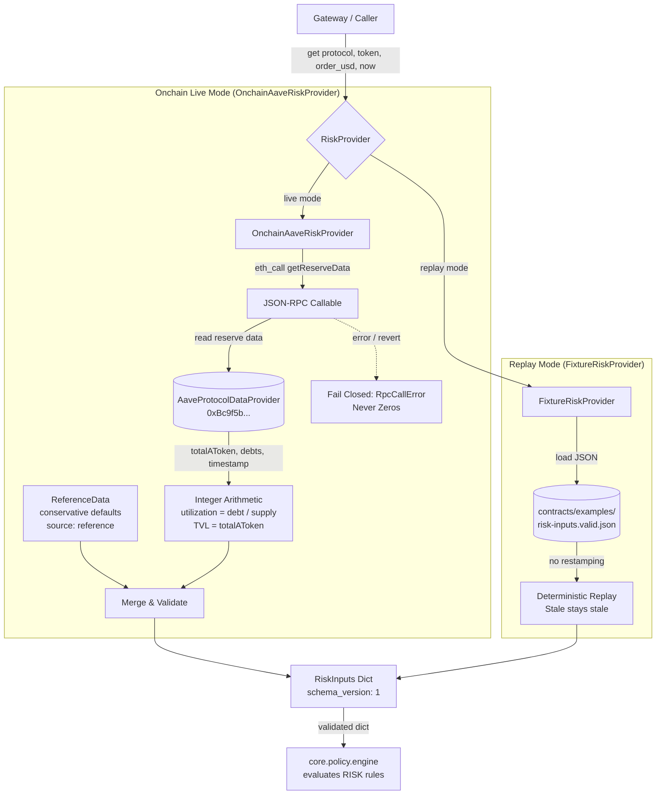
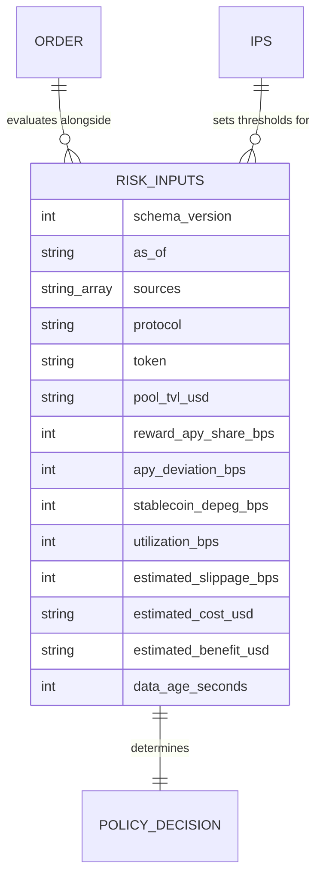

# Risk inputs provider: architecture note

Owning module: `core.risk` (`core/risk/provider.py`, `core/risk/aave.py`, `core/risk/fixture.py`).
Specification & data contract: [`contracts/schemas/risk-inputs.schema.json`](../../contracts/schemas/risk-inputs.schema.json).

## Purpose

The risk provider supplies measured inputs (`RiskInputs`) required by the pure policy engine (`core.policy.engine`) to evaluate the `RISK` rule family (`RISK.UTILIZATION_TOO_HIGH`, `RISK.POOL_TVL_TOO_LOW`, `RISK.DATA_STALE`, `RISK.COST_EXCEEDS_BENEFIT`, etc.).

Two implementations satisfy the `RiskProvider` protocol:
1. `OnchainAaveRiskProvider`: Reads live on-chain reserve data from Aave V3 on Base Sepolia (`AaveProtocolDataProvider`) via an injected JSON-RPC callable, computing reserve utilization and TVL via exact integer arithmetic.
2. `FixtureRiskProvider`: Replays pre-recorded fixtures deterministically for offline evaluation and judges' replay mode, preserving original timestamps without restamping so stale data stays stale.

## Architecture and Flow

## Data Schema & Relationships

## Contract Addresses on Base Sepolia (Chain ID 84532)

Addresses are verified against Base Sepolia RPC and sourced from primary registry artifacts documented in `docs/design/testnet-facts-aave.md`:

| Role | Contract Address | Notes |
| :--- | :--- | :--- |
| **AaveProtocolDataProvider** | `0xBc9f5b7E248451CdD7cA54e717a2BFe1F32b566b` | Target for `getReserveData(address asset)` (selector `0x35ea6a75`) |
| **USDC Underlying** (Mock) | `0xba50Cd2A20f6DA35D788639E581bca8d0B5d4D5f` | Reserve asset query address |
| **Aave V3 Pool** | `0x8bAB6d1b75f19e9eD9fCe8b9BD338844fF79aE27` | Main lending pool |

## Testnet Reference Data Strategy

On Base Sepolia, protocol-wide secondary statistics (DefiLlama reward share, 30-day mean APY deviation, and cross-DEX depeg) are not tracked by public aggregators. Rather than inventing values silently, the provider uses an explicit `ReferenceData` container with conservative defaults:
- `reward_apy_share_bps = 0`
- `apy_deviation_bps = 0`
- `stablecoin_depeg_bps = 0`
- `estimated_slippage_bps = null` (lending pool supply/withdraw does not incur AMM slippage)
- `estimated_cost_usd = "0.40"` (Base L2 gas estimate)
- `estimated_benefit_usd = "3.10"` (conservative yield projection)
- `sources = ("reference",)` (auditable trail)

The live on-chain source in the validated `RiskInputs` dictionary is honestly stamped as `["rpc_aave_pool"]`.

## Safety Guarantees

| Boundary Rule | Enforcement | Test |
| :--- | :--- | :--- |
| **Fail closed on RPC error** | Reverts, connection drops, truncated responses, or empty hex raise typed `RpcCallError`; provider never falls back to zero utilization or fake liquidity | `test_rpc_failure_revert_raises_typed_error`, `test_rpc_failure_network_exception_raises_typed_error` |
| **Pure integer math** | Utilization and TVL are calculated exclusively with integer division and integer strings; zero floating-point arithmetic | `test_exact_integer_utilization_math`, `test_tvl_usd_formatting_no_floats` |
| **Stale detection** | Data age is calculated honestly from the reserve's on-chain `lastUpdateTimestamp`. If age exceeds `max_data_age_seconds`, provider raises `StaleDataError` | `test_stale_detection_honest_data_age`, `test_stale_detection_provider_fails_closed_when_exceeding_threshold` |
| **Deterministic replay** | `FixtureRiskProvider` re-stamps nothing; stale fixtures retain stale ages for reproducible offline evaluation | `test_fixture_provider_deterministic_replay`, `test_fixture_provider_restamps_nothing_stale_stays_stale` |
| **Strict schema validation** | Every output dict is validated against `risk-inputs.schema.json` via `jsonschema.Draft202012Validator` before return | `test_onchain_aave_provider_schema_validity`, `test_fixture_provider_schema_validity` |
| **Signer boundary isolation** | `core.risk` never imports `core.signer` or handles private keys | `tests/test_signer_boundary.py` |
