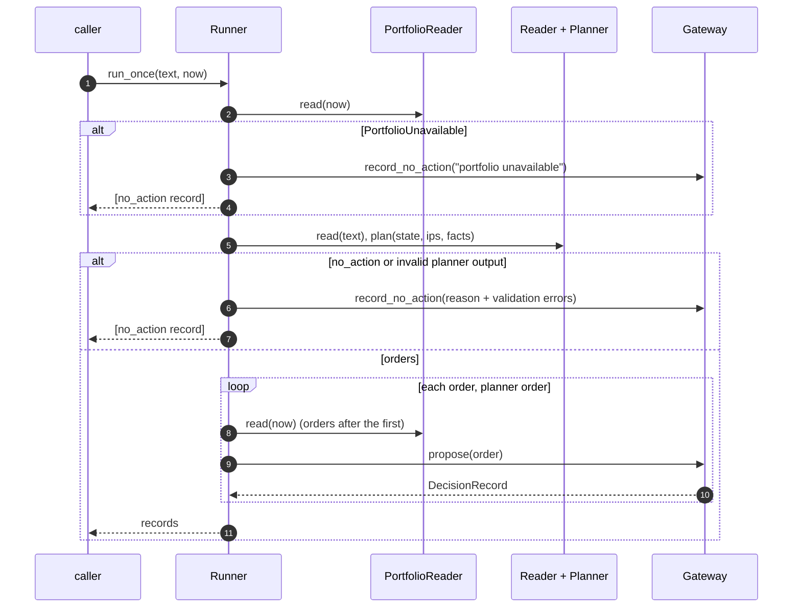

# Runner: Reader, Planner, portfolio and gateway in one cycle

Owner module: `core.runner` (`core/runner/runner.py`). Design: [`docs/design/runner/design.md`](../design/runner/design.md), sections 4 and 6.

`Runner.run_once(untrusted_text, now)` composes the pieces that already exist and adds no decision logic. The LLM proposes, the gateway decides.

## Behaviour
- The portfolio snapshot is read before planning; it is read again before every order after the first, and an unavailable portfolio stops the loop with a `no_action` record (never zero balances).
- `PortfolioReader.read` issues its RPC reads concurrently via `ThreadPoolExecutor` (at most 8 workers) with keep-alive connection reuse, speeding up reads while preserving identical position ordering and fail-closed error semantics. See [`docs/architecture/rpc-latency.md`](rpc-latency.md).
- `run_instruction` logs timing measurements for each phase (`portfolio_read`, `planner`, `gateway`) using logger `agent_wallet.timing`.
- A policy denial, an escalation and an execution are all appended by the gateway; the runner returns the record it got and writes nothing itself.
- The loop stops after a `failed` outcome. `GatewayBusy` and `ReconcileRequired` propagate to the caller; earlier records of the cycle are already in the audit log.
- Reasons passed to `record_no_action` are truncated to 500 characters, the schema limit.

## Boundaries
`core/runner/*.py` must not import `core.signer`, `core.tiers.owner` or `core.gateway.intents`; `tests/runner/test_boundaries.py::test_runner_imports` checks it with the AST. A stop engaged by the API (a second `TierStore` instance on the same file) denies the next `run_once` with `TIER.EMERGENCY_STOP` (`tests/e2e/test_runner_stop.py`).

## Tests
| Claim | Test |
| :--- | :--- |
| Runner imports no signer, owner or intents module | `tests/runner/test_boundaries.py::test_runner_imports` |
| Scripted order executes through the fake signer | `tests/runner/test_runner.py::test_planner_order_executes_through_fake_signer` |
| `no_action` goes through the gateway | `tests/runner/test_runner.py::test_no_action_recorded_through_gateway` |
| Denial recorded by the gateway and returned | `tests/runner/test_runner.py::test_policy_denial_recorded_by_gateway_and_returned` |
| Hostile reader input never executes | `tests/runner/test_runner.py::test_hostile_reader_input_never_executes_outside_universe` |
| API stop denies next run | `tests/e2e/test_runner_stop.py::test_api_stop_denies_next_run_once` |
| Chain from a run verifies | `tests/e2e/test_runner_chain.py::test_run_once_chain_verifies` |
| Concurrent portfolio read finishes under serial time with identical state | `tests/runner/test_portfolio.py::test_portfolio_reader_concurrent_under_serial_time_and_identical_state` |
| Concurrent portfolio read failure raises `PortfolioUnavailable` | `tests/runner/test_portfolio.py::test_portfolio_reader_concurrent_failed_read_raises_portfolio_unavailable` |
| Chat instruction emits timing logs for all phases | `tests/runner/test_runner.py::test_run_instruction_emits_timing_logs` |
