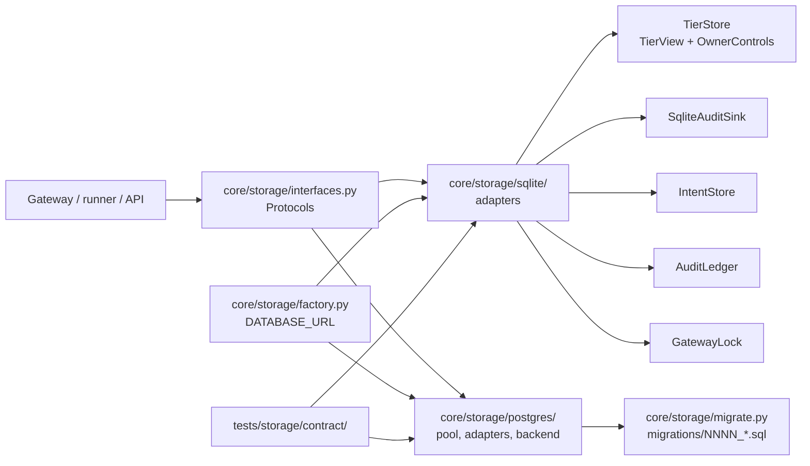

# Storage: Protocols, SQLite and Postgres adapters, contract suite

Tickets P1 (Protocols, SQLite adapters) and P2 (Postgres backend) of the webapp design (`docs/design/webapp/system-design.md`, sections 5 and 13).

## Structure

## What changed

- `core/storage/sqlite/adapters.py` wraps the five existing SQLite stores. Each adapter delegates
  to the wrapped class; the classes themselves (`core/tiers/store.py`, `core/audit/sink.py`,
  `core/gateway/lock.py`, `core/gateway/intents.py`, `core/runner/ledger.py`) are not modified, so
  their public names and behaviour are unchanged and the existing suites are the regression test.

| Protocol | SQLite adapter | Wraps |
| :--- | :--- | :--- |
| `TierRead` / `TierWrite` | `SqliteTiers` | `TierStore` through `TierView` and `OwnerControls` |
| `AuditStore` | `SqliteAuditStore` | `SqliteAuditSink` (`list` and `iter_all` read the chain in seq order) |
| `IntentStore` | none needed: `core.gateway.intents.IntentStore` already satisfies it | itself; `open_tenant` takes it as a factory because only `core.gateway` may import the intents module (`tests/test_intent_boundary.py`) |
| `LedgerQueries` | `SqliteLedgerQueries` | `AuditLedger` |
| `GatewayLockProvider` | `SqliteGatewayLockProvider` | `GatewayLock`; `held(timeout_s)` overrides the timeout per call |

- `core/storage/sqlite/tenant.py` holds the per-owner layout
  `DATA_DIR/owners/<0x lowercase address>/{state,audit,gateway.lock}.sqlite`. `tenant_dir`
  validates `^0x[0-9a-f]{40}$` and asserts the resolved path is inside `owners/`.
- SQLite has no adapters yet for `KeystoreStore`, `OwnerRegistry`, `JobStore`,
  `PolicySelectionStore`, `SettingsStore` (A2 and A3 own them); `api/auth.py` has its own
  `SqliteAuthStore`. The Postgres backend implements every Protocol.

## Contract suite

`tests/storage/contract/` runs against the `backend` fixture in `conftest.py`, parametrised over
`sqlite` and `postgres`. The `postgres` parameter is skipped unless `TEST_DATABASE_URL` is set (CI
service container, local compose). A backend supplies `open(owner)`, `raw_audit_sql(stores, sql)`
and `append_only_error`. Each Postgres test runs in its own freshly migrated schema, dropped
afterwards (the append-only triggers forbid TRUNCATE, so tables are never cleaned in place).

| Behaviour | Tests |
| :--- | :--- |
| Chain, append-only, latest by order, listing | `test_audit.py` |
| Intents insert-only, `unfinished` | `test_intents.py` |
| Only `executed` counts, `approve` out of spend, window edge | `test_ledger.py` |
| Exclusion, timeout fails closed (`GatewayBusy`), release on error | `test_lock.py` |
| Tier default, stop, approvals, read after write on two connections | `test_tiers.py` |
| Two owners never see each other, address validation | `test_isolation.py` |

## Postgres backend (P2)

Selected when `DATABASE_URL` is set; unset keeps SQLite (`core/storage/factory.py`; the caller
supplies the SQLite backend, because only `core.gateway` may import the intents module).

| Topic | Implementation |
| :--- | :--- |
| Tables | one set with `owner` as the first key column (`0001_init.sql`); tenant tables have no foreign key to `owners`, so a tenant opens before it registers, and a `CHECK` pins the lowercase address pattern |
| Isolation | every query carries `owner = %s`; each tenant transaction runs `set_config('app.owner', owner, true)` and row-level security (`tenant_isolation` policy) returns nothing when it is missing. `keystores` also admits `app.owner = '*'` for secret rotation (`PostgresBackend.keystore_admin()`) |
| Append-only | `audit_records`, `order_intents`, `policy_selection`: row triggers reject UPDATE and DELETE, statement triggers reject TRUNCATE; role `aw_app` is granted `SELECT, INSERT` only |
| Chain | `append` takes `pg_advisory_xact_lock(hashtextextended('aw:audit:' || owner, 0))`, reads the last `(seq, hash)` and inserts; `PRIMARY KEY (owner, seq)` is the backstop. Hashes use the same canonical JSON as SQLite, so an exported chain verifies with `python -m core.audit.verify` |
| Gateway lock | a dedicated connection (not a pool slot) polls `pg_try_advisory_xact_lock` every 100 ms up to the timeout; timeout raises `GatewayBusy` before the body runs; an unreachable database raises `StorageUnavailable` |
| Ledger | SQL over derived columns (`function`, `token`, `amount_value`, `decimals`) filled at insert from the same payload; `approve`, `mint` and `transfer` are not spend, all executed rows count as transactions; price comes from the same `price_fn` as SQLite |
| Jobs | partial unique index `jobs_one_active` allows one queued or running job per owner (`ActiveJobExists`); `update` takes a fixed field allowlist; `mark_interrupted` is per tenant |
| Settings | `global_stop` is true when `AGENT_WALLET_GLOBAL_STOP` is set, when the `settings` row says so, or when the read fails (fail closed) |
| SQL | string literals with bound parameters only; `tests/storage/test_pg_no_string_sql.py` scans `core/storage/postgres/`, `migrate.py` and `factory.py`. The one exemption is `migrate._run_migration_file`, which runs a shipped migration file with no parameters |

### Pool and pooler mode

`PgPool` is an in-house pool capped at 5 connections (no `psycopg_pool`). Every use is one
transaction, nothing depends on session state: no prepared statements (`prepare_threshold=None`),
no `SET` outside a transaction, no session advisory locks, no `LISTEN`. Both Supabase pooler modes
work; use the pooler URL (IPv4) with `?sslmode=require`, **transaction mode (port 6543) is
enough**, session mode (5432) also works. The gateway lock holds its own connection for as long as
the lock is held, so the pooler must allow the pool size plus one connection per concurrently
locked owner.

### Migrations

`python -m core.storage.migrate [--check]` (`DATABASE_MIGRATE_URL`, falling back to
`DATABASE_URL`). Files `core/storage/migrations/NNNN_name.sql` run in version order; each one in a
transaction that first takes `pg_advisory_xact_lock(7240001)` and re-reads `schema_migrations`, so
concurrent starters apply a file once and a second run changes nothing. A checksum mismatch (line
endings are normalised first) or a database holding a version the code lacks raises
`MigrationError`; `--check` and `PostgresBackend.verify_schema()` fail closed when the schema is
behind. `0001_init.sql` creates role `aw_app` (`NOLOGIN NOBYPASSRLS`) where the migration role may;
grant it to the login role of `DATABASE_URL`. Where role creation is refused the triggers still
hold and RLS is bypassed (design 15.4 fallback).

### Run it

- CI: the `postgres:16` service container and `TEST_DATABASE_URL` run the whole suite, contract
  tests included, on both backends.
- Locally: `docker run --rm -e POSTGRES_PASSWORD=x -p 5432:5432 postgres:16`, then
  `TEST_DATABASE_URL=postgresql://postgres:x@localhost:5432/postgres pytest tests/storage`.
  Without `TEST_DATABASE_URL` the Postgres tests are skipped with a stated reason.
- `docker compose up --build` starts `db` (`postgres:16`, volume `pgdata`, healthcheck
  `pg_isready`) and `api` with `DATABASE_URL` composed from `POSTGRES_PASSWORD`. Wiring the app to
  the backend at startup belongs to the API tickets.
