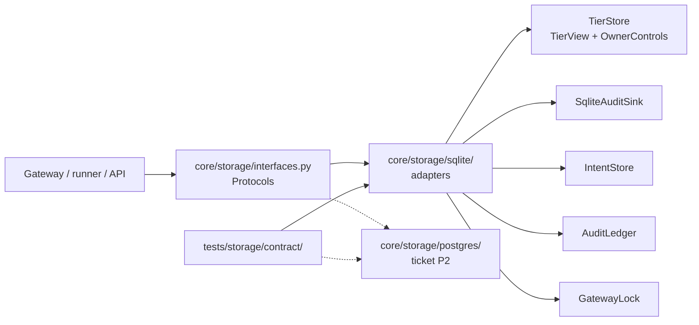

# Storage: Protocols, SQLite adapters, contract suite

Ticket P1 of the webapp design (`docs/design/webapp/system-design.md`, sections 5 and 13).

## Structure

## What changed

- `core/storage/sqlite/adapters.py` wraps the five existing SQLite stores. Each adapter delegates
  to the wrapped class; the classes themselves (`core/tiers/store.py`, `core/audit/sink.py`,
  `core/gateway/lock.py`, `core/gateway/intents.py`, `core/runner/ledger.py`) are not modified, so
  their public names and behaviour are unchanged and the existing suites are the regression test.

| Protocol | SQLite adapter | Wraps |
| :--- | :--- | :--- |
| `TierRead` / `TierWrite` | `SqliteTiers` | `TierStore` through `TierView` and `OwnerControls` |
| `AuditStore` | `SqliteAuditStore` | `SqliteAuditSink` (`list` and `iter_all` read the chain in seq order) |
| `IntentStore` | none needed: `core.gateway.intents.IntentStore` already satisfies it | itself; `open_tenant` takes it as a factory because only `core.gateway` may import the intents module (`tests/test_intent_boundary.py`) |
| `LedgerQueries` | `SqliteLedgerQueries` | `AuditLedger` |
| `GatewayLockProvider` | `SqliteGatewayLockProvider` | `GatewayLock`; `held(timeout_s)` overrides the timeout per call |

- `core/storage/sqlite/tenant.py` holds the per-owner layout
  `DATA_DIR/owners/<0x lowercase address>/{state,audit,gateway.lock}.sqlite`. `tenant_dir`
  validates `^0x[0-9a-f]{40}$` and asserts the resolved path is inside `owners/`.
- Not in this ticket: `KeystoreStore`, `OwnerRegistry`, `AuthStore`, `JobStore`,
  `PolicySelectionStore`, `SettingsStore` and the `StorageBackend` factory. The Protocols exist;
  their adapters belong to A2, A3 and P2.

## Contract suite

`tests/storage/contract/` runs against the `backend` fixture in `conftest.py`. Today `BACKENDS`
holds `sqlite` only; the Postgres backend adds itself to that dict and every test then runs on it.
A backend supplies `open(owner)`, `raw_audit_sql(stores, sql)` and `append_only_error`.

| Behaviour | Tests |
| :--- | :--- |
| Chain, append-only, latest by order, listing | `test_audit.py` |
| Intents insert-only, `unfinished` | `test_intents.py` |
| Only `executed` counts, `approve` out of spend, window edge | `test_ledger.py` |
| Exclusion, timeout fails closed (`GatewayBusy`), release on error | `test_lock.py` |
| Tier default, stop, approvals, read after write on two connections | `test_tiers.py` |
| Two owners never see each other, address validation | `test_isolation.py` |

## Known gap against design section 20

`test_mint_transfer_not_in_spend_but_in_count` is not included: the current ledger excludes only
`approve` from spend, and changing that is a behaviour change owned by C2/C3.
