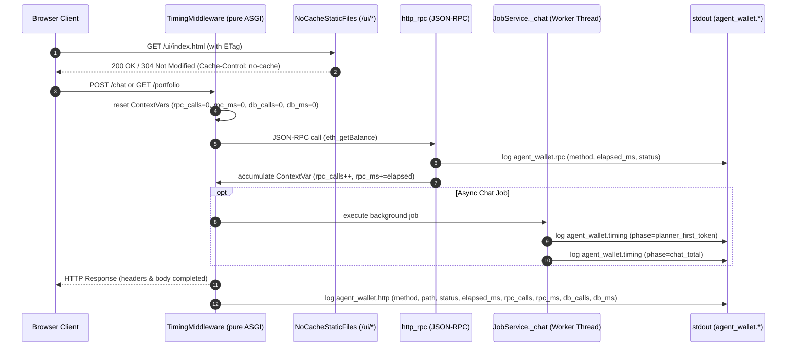

# Latency Visibility, Timing Instrumentation & UI Cache Control

Owner modules: `api.main` (`api/main.py`), `api.jobs` (`api/jobs.py`), and `core.runner.runner` (`core/runner/runner.py`).

## Overview

On hosted free-tier cloud infrastructure (such as Render), visibility into latency bottlenecks (HTTP request duration, JSON-RPC queries, and LLM first-token generation) is vital for performance diagnostics. Furthermore, static browser caching can prevent webapp updates from taking effect immediately upon deployment.

This architecture provides structured, low-overhead timing instrumentation across three distinct loggers and eliminates stale client assets through strict HTTP cache revalidation:

## Core Components

1. **Hierarchy Logger Configuration (`configure_logging`)**:
   - Configures the `agent_wallet` logger and children (`agent_wallet.http`, `agent_wallet.rpc`, `agent_wallet.timing`).
   - Attached to `sys.stdout` with format `%(asctime)s %(levelname)s %(name)s %(message)s`.
   - Log level resolved from `AGENT_WALLET_LOG_LEVEL` (default `INFO`).
   - `propagate = False` ensures uvicorn and root loggers remain untouched.
   - Idempotent: repeated calls reconfigure log levels without duplicating handlers.

2. **Per-Request HTTP Timing (`TimingMiddleware`)**:
   - Pure ASGI middleware wrapping all routes.
   - Emits `method=<verb> path=<route> status=<code> elapsed_ms=<ms> rpc_calls=<n> rpc_ms=<ms> db_calls=<n> db_ms=<ms>` on `agent_wallet.http`.
   - Excludes health check probes (`/health`, `/health/deep`) and static assets (`/ui/*`).
   - Accurately captures end-of-stream timing for SSE (`/chat/stream/*`).
   - ContextVars (`rpc_calls`, `rpc_ms`, `db_calls`, `db_ms`) are scoped and reset per request.

3. **Outbound JSON-RPC Timing (`http_rpc`)**:
   - Instruments every Ethereum JSON-RPC call using `time.perf_counter()`.
   - Emits `method=<method> elapsed_ms=<ms> status=ok|error` on `agent_wallet.rpc`.
   - Never logs parameters, URLs, or authorization secrets.
   - Accumulates total RPC calls and duration in request ContextVars.

4. **Background Job Milestones (`JobService._chat`)**:
   - Tracks chat milestones using `agent_wallet.timing`:
     - `planner_first_token`: Elapsed milliseconds from job initiation to the first streamed token fragment.
     - `chat_total`: Total wall-clock milliseconds upon return of `_chat`.

5. **Static UI Cache Invalidation (`NoCacheStaticFiles`)**:
   - Custom `StaticFiles` subclass overriding `file_response`.
   - Appends `Cache-Control: no-cache` to all responses under `/ui/`.
   - Preserves standard ETag validation: browsers cache assets but revalidate against the server with conditional HTTP `304 Not Modified`, ensuring deploys take effect immediately.

6. **Request-Scoped Memoization (`_request_memo`)**:
   - Scoped `ContextVar[dict[str, Any] | None]` initialized to an empty dictionary per HTTP request in `TimingMiddleware` and reset in the `finally` block.
   - De-duplicates redundant within-request checks (e.g. `global_stop_flag`, `ips_for`).
   - Never cached across requests: safety-critical flags and tier status are always evaluated fresh on each subsequent request.

## Verification

| Requirement | Test |
| :--- | :--- |
| Idempotent logging configuration & level control | `tests/webapp/test_timing_logs.py::test_configure_logging_idempotent_and_sets_level` |
| HTTP timing middleware & exclusions | `tests/webapp/test_timing_logs.py::test_http_timing_middleware_logs_request_and_excludes_health_and_ui` |
| JSON-RPC timing & contextvar accumulation | `tests/webapp/test_timing_logs.py::test_http_rpc_timing_logs_and_counters` |
| UI Cache-Control header & ETag 304 handling | `tests/webapp/test_timing_logs.py::test_ui_cache_control_and_etag` |
| Zero secrets/headers/bodies in log lines | `tests/webapp/test_timing_logs.py::test_logs_contain_no_secrets_headers_cookies_or_bodies` |
| Chat milestones (`planner_first_token`, `chat_total`) | `tests/webapp/test_timing_logs.py::test_chat_milestones_logged` |
| Database timing in HTTP logs & no secrets/SQL | `tests/webapp/test_timing_logs.py::test_http_timing_middleware_logs_db_metrics_and_no_sql_or_owner` |
| Database timing per-request isolation | `tests/webapp/test_timing_logs.py::test_db_accumulator_per_request_isolation` |
| Request-scoped memo lifecycle & within-request de-duplication | `tests/webapp/test_timing_logs.py::test_request_memo_isolation_and_deduplication` |
