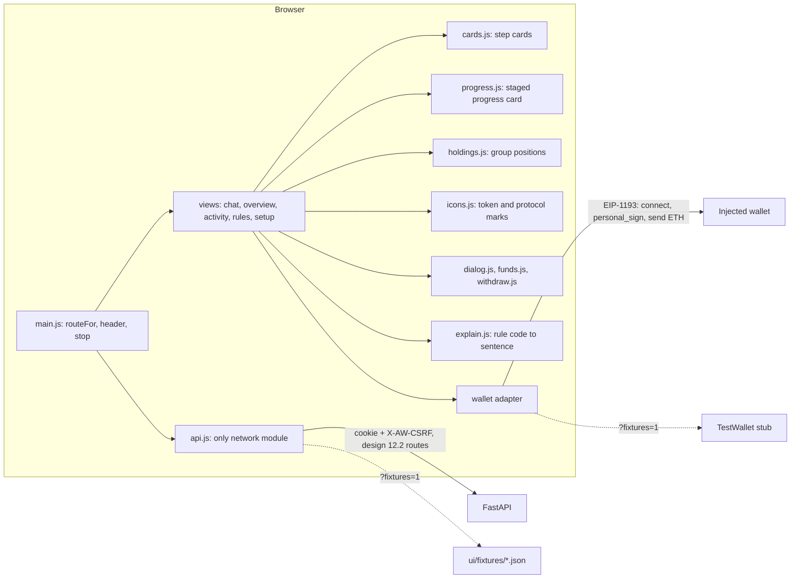
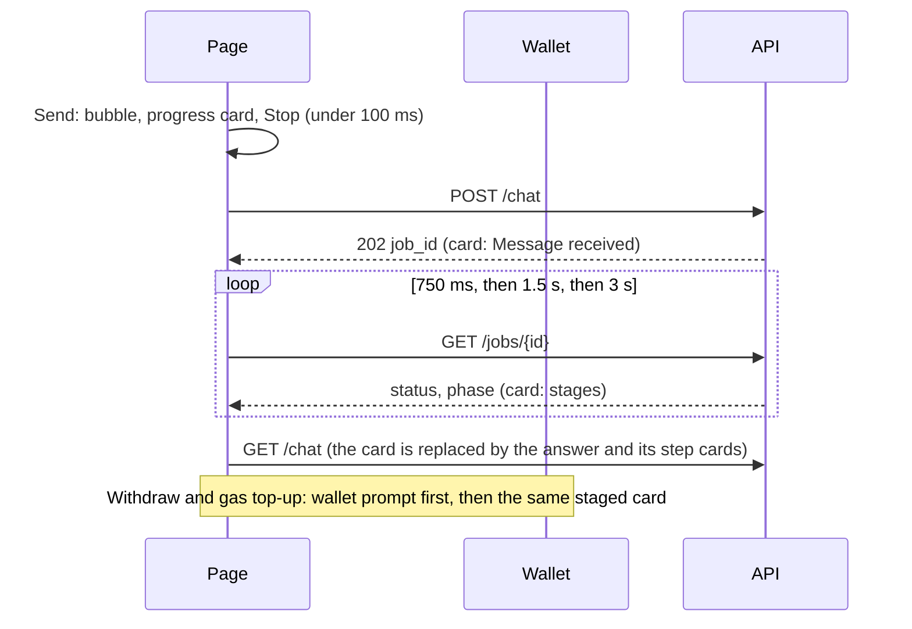

# Webapp UI (UI v3: fits the viewport, never silent, grouped holdings)

> Look and layout: [`docs/design/webapp/ui-contract.md`](../design/webapp/ui-contract.md) (the approved contract, with the v3 changes listed at its end) and the plan that led to this version, [`docs/design/webapp/ui-v3-plan.md`](../design/webapp/ui-v3-plan.md) (audit, screenshots, wireframes, data contract). Tokens and behaviour: [`DESIGN.md`](../../DESIGN.md), [`docs/design/webapp/system-design.md`](../design/webapp/system-design.md) (sections 12 and 14). Where a mockup and `DESIGN.md` disagree, `DESIGN.md` wins.

A static single page under `ui/`, mounted by `api/main.py` at `/ui`. Plain ES modules, no build step, no dependency, no CDN, no web font, no `localStorage`: it works offline except for the wallet and the RPC behind it. Every image is a local file under `ui/assets/`.

## Shell
One header row from 901 px up: logo mark and name, tabs **Chat · Overview · Activity · Rules**, the network chip "Base Sepolia testnet", the owner address chip, the status pill, **Emergency stop** and **Log out** (`views/account.js`). Fixtures mode adds a second chip, "Demo data (fixtures), not live". The Setup header keeps the address chip and Log out. There is **no warning banner** anywhere. Testnet and custody are stated three times, all static markup:

| Where | Text |
| :--- | :--- |
| Header chip | "Base Sepolia testnet" |
| Footer, one grey line | "Testnet only. The server holds this agent's key. Not financial advice." |
| Setup (first run) | "This is a testnet demo: the server holds the agent's key and no real funds are involved." |

`main.js` sets `document.body.className = "screen-<name>"` on every route change, and the stylesheet uses it:

| Screen | Layout |
| :--- | :--- |
| Chat (`body.screen-chat`) | The page is `100dvh` and never scrolls. A grid of header, main, footer line: the history rail (240 px), the conversation card and the wallet panel (320 px) scroll on their own, content is capped at 1600 px and centred, and messages sit in a 760 px reading lane. The composer is pinned under the conversation. Between 901 and 1100 px the columns are 200 / fluid / 260. |
| Overview, Activity, Rules, Setup | Normal page scrolling, content capped at 1280 px. |
| 900 px and below | The tabs become a fixed bar at the bottom (60 px, the current tab marked by a 4 px gold top edge); the header is two rows (logo, status pill, Emergency stop, Log out, then the chips); every button, chip and tab is at least 44 px tall; the history rail is a drawer behind a "History" button; the wallet panel is one strip, "Wallet · $total", that opens a full-height sheet (`Escape` closes it, focus returns to the strip). |

`color-scheme: light dark` is declared, so scrollbars and form controls follow the theme. A frozen agent shows a red rule, a solid red pill, "Resume (needs signature)", a frozen card in each screen (sticky at the top of the conversation in Chat) and a disabled composer. Engaging the stop needs the session only but asks first in a modal ("Stop the agent now?", `views/confirm.js`: focus trapped, Escape closes, focus returns to the button); resuming asks for a fresh signature. Status pill: "Agent active" (green, tier T2), "Read only" (amber, T0), "Propose only" (amber, T1), "Stopped" (red).

## Routing
`routeFor(hash, {signedIn, tier})` in `main.js` is a pure function (tested under node):

| Situation | Screen |
| :--- | :--- |
| signed out, or tier T0 | Setup (the header shows only the logo and the fixtures chip) |
| tier T2 (activated) | `#/chat` home; `#/setup` redirects to Chat |
| tier T1 (lowered by the owner) | any tab; `#/setup` stays reachable to activate again |
| old hashes | `#/portfolio`, `#/dashboard` and `#/approvals` go to Overview, `#/feed` to Activity, `#/onboard` to Setup |

After Activate succeeds the view calls `ctx.go("#/chat")` and the header re-routes.

## Screens
| Screen | File | Contents |
| :--- | :--- | :--- |
| Chat | `views/chat.js`, `views/progress.js`, `views/side.js` | Conversation card: owner bubbles right (yellow), agent bubbles left (grey), step cards under an agent message, the staged progress card while a job runs, suggested prompts above the composer (from `GET /chat/suggestions`, static fallback), history rail on the left, Enter sends, 500 character counter. Right column: wallet value and idle/earning bar, today's limit, gas with Top up, audit log line |
| Overview | `views/overview.js`, `holdings.js`, `icons.js`, `views/funds.js`, `views/withdraw.js`, `views/approvals.js` | Main column: a note and the approvals card when an order waits; the hero (agent wallet value, "working for you" and "idle", the allocation bar with legend, **Add funds** and **Withdraw**); "What the agent holds" grouped by what the money is doing (idle in the wallet, lent on Aave v3, Aave vaults, Morpho Blue, swapped assets), each row with token and protocol marks, amount, value and share, and the agent's gas. Side column: your wallet, today's limit, recent activity |
| Activity | `views/activity.js` | Every decision, newest first, as step cards; Verify audit chain with a verdict card; planner and reference-price chips |
| Rules | `views/rules.js` | Read-only rows from `GET /limits` (`ui/limits.js`), the allowed protocols with their marks, the **Agent permission** control (lower to propose-only or read-only) and the scripted **Safety demo** |
| Setup | `views/setup.js`, `views/activate.js` | Three steps (Connected, Add gas, Activate). Agent address with Copy, gas amount and send, Activate with its one-sentence explanation and one free signature |

### Step cards (`views/cards.js`)
One vocabulary for Chat, Activity and Overview:

| Kind | Look | Used for |
| :--- | :--- | :--- |
| `done` | green, ✓ | `executed`; "BaseScan ↗" link on the right |
| `blocked` | red, ✕ | `denied`; plain sentence first, rule code as a small chip |
| `pending` | amber, … | `pending_approval`; Approve and Reject on Overview |
| `skipped` | grey, ↷ | a step not attempted because an earlier one was blocked, and "No action" |
| `fail` | red, ! | an execution that errored |

The state is also a word ("Executed", "Blocked", "Waiting for you", "Skipped", "Failed"), so it is never colour alone. Transaction hashes appear only as BaseScan links; the "Transactions: 0x..." sentence the server composes into the agent's text is hidden because the cards carry the links. "Agent says" paragraphs get an "Agent says" chip: that is the model's own words, the cards are the record.

## Never silent: the progress card (`views/progress.js`)
Within 100 ms of Send the owner's bubble and a progress card are in the conversation (the card is created before the request leaves) and the list is scrolled to them; the Send button becomes Stop. The card is a list of rows that only ever grows, so it never promises a stage the backend cannot confirm. It maps the job `phase` that `GET /jobs/{id}` and `GET /chat` already carry (no backend change):

| Row | When |
| :--- | :--- |
| "Sending your message" | the POST has not answered; after 2 s the sub line reads "Waking up the server. Your message is safe." |
| "Message received" | the POST answered `202` |
| "Waiting to start" | `phase: queued` |
| "Working on your request" | `rules_check`, or a phase the page does not know. Its sub line says "Nothing has been sent yet." only until a `sent` stage has been seen, because the second order of a plan is checked after the first was sent |
| "Sending to Base Sepolia" | `sent` |
| "Confirming on Base Sepolia" | `confirming` (documented, not emitted by the backend today) |

A row shows its elapsed time once it has lasted 2 s; the head shows the total ("Working on it · 7 s"). Notes appear under the rows at 10 s ("Still working. The model can take up to 30 seconds."), 30 s and 60 s. Screen readers hear stage changes, not the ticking counter (`aria-live` on the rows, the times are `aria-hidden`). The card's own Stop is disabled until the server has answered and once an order is sent. A finished job never draws a row. Jobs are polled every 750 ms for the first seven polls, then every 1.5 s until about 28 s, then every 3 s, for about five minutes (`pollDelay` in `main.js`).

`GET /jobs/{id}` and each agent message in `GET /chat` carry `phase`: `queued`, `rules_check`, `sent`, `confirming`, `done`. `POST /jobs/{id}/cancel` (CSRF header) answers `202 {job_id, status: "cancelling"}`, or `409 not-cancellable` once the phase is `sent` or later; a cancelled job ends `status: "denied"`, `error_code: "OWNER_CANCELLED"`, and the steps not attempted are `outcome: "skipped"`. See [`api.md`](api.md#job-phases-and-cancel-ticket-122-contract-c1-and-c2).

### Chat wiring (ticket 130, kept)
- **History rail** (`historyRail` in `views/side.js`): "+ New chat" and the threads from `GET /chat/threads` grouped Today, Yesterday, Earlier, each row with a title, a status word and a relative time; the implicit default conversation stays reachable as "Earlier chat". Rows are disabled while a job runs.
- **Stop**: while a job is queued or running the Send button reads "Stop" and calls `POST /jobs/{id}/cancel`. A 409 shows "Too late to stop: this order is already sent." A job that ends `failed` after the page saw `sent` shows "It may still land. Check Activity before trying again."
- **Limit line** on pending and blocked cards, **quick fixes** ("Try 100 USDC", "Why is this blocked?") on the newest agent message, and **prompt chips** from `GET /chat/suggestions`.

## Holdings, icons and money dialogs
- **`holdings.js`** is pure (BigInt cents, no floats, no DOM). `groupHoldings(portfolio, agent)` groups `GET /portfolio` positions by what the money is doing: `wallet` stablecoins idle, `aave-v3` lent, `aave-stata` vaults, `morpho-blue`, and any other wallet token as swapped. Zero or unreadable balances are left out, unknown locations land in idle, nothing throws. `allocationSegments` feeds the bar.
- **`icons.js`** builds token avatars, protocol badges, the testnet "T" mark and a deterministic letter avatar (FNV-1a hash into eight palette colours, each at least 4.5:1 against white). Token images are five CC0 SVGs under `ui/assets/tokens/`; WETH is the ETH image plus a "W" badge, cbETH a letter avatar, protocol marks are monograms. Sources, licence and the rules for adding a token: [`docs/design/webapp/icons.md`](../design/webapp/icons.md).
- **`dialog.js`** is the shared modal (focus trap, Escape, scrim click, focus returns); under 520 px it is a bottom sheet. **`funds.js`**: "Send ETH for gas" (the existing `sendGas` flow) and "Get test USDC" (the faucet mint job). **`withdraw.js`**: USDC or ETH to the owner's own address only, Max (ETH keeps the gas floor), a note when money is lent or in vaults, one signature; the amount that is signed and the amount that is sent are the same object, and the staged progress card and the transaction link follow.

## Known gaps
- **Swapped assets and idle USDT are not in `GET /portfolio` yet.** The reader values only tokens with a stable price, so WETH and WBTC wallet balances are dropped and idle USDT is not read; the Swapped group is therefore empty until the backend reports them. Both Morpho markets also arrive as one `morpho-blue` position. The proposed read-only `GET /holdings` that fixes this is in the plan's data contract and needs the owner's approval.
- **The owner's own wallet balance is not shown.** The "Your wallet" card says so; a read route is part of the same proposal.
- **No rate route:** the interest rate of a lent position is not shown.
- `GET /decisions` is not per owner in single mode; Activity and the approvals card read the owner's recent jobs, and the in-browser chain check stays fixtures-only.
- The `confirming` phase is documented but not emitted by the backend; the fixtures emit it, so the demo shows a stage the live app cannot.

## Files
| File | Role |
| :--- | :--- |
| `index.html` | Shell: header, tabs, chips, pill, Emergency stop, `#view`, footer line |
| `style.css` | `DESIGN.md` tokens as CSS custom properties, dark mode, focus ring, reduced motion, the desktop and phone layouts. `icons.css`, `progress.css` and `overview.css` hold the styles of their features |
| `main.js` | `routeFor`, header wiring, stop and resume, shared context (`makeCtx`), `describeError`, `pollDelay` |
| `api.js` | The only module that calls the network; `ROUTES` lists every path; `?fixtures=1` switch |
| `gauges.js`, `explain.js`, `limits.js` | Pure helpers: gauges, retry text, relative time; rule code to sentence and unit formatting; the `/limits` read |
| `holdings.js`, `icons.js` | The holdings grouping model; token and protocol marks |
| `views/chat.js`, `progress.js`, `side.js` | Chat, the staged progress card, the wallet panel and the history rail |
| `views/overview.js`, `funds.js`, `withdraw.js`, `dialog.js`, `approvals.js`, `topup.js` | Overview, the money dialogs, the approvals card, the gas top-up flow |
| `views/activity.js`, `rules.js`, `setup.js`, `activate.js`, `account.js`, `confirm.js`, `cards.js`, `jobs.js` | The other screens and shared pieces |
| `wallet/adapter.js`, `injected.js`, `test.js` | Adapter interface, EIP-1193 implementation (EIP-6963 first), `TestWallet` stub |
| `assets/tokens/*.svg` | Five CC0 token images, listed in `docs/design/webapp/icons.md` |
| `fixtures/*.json` | Data for the no-backend mode |

## Rules the page keeps
- **API strings are text.** Every value from the API is written with `textContent`; no `innerHTML` anywhere. Local token images are fixed paths under `assets/tokens/`.
- **No storage.** No `localStorage`, `sessionStorage` or cookie access from JS; the session is an HttpOnly cookie. Step-up signatures are asked per action and not kept.
- **Honest labels.** Reference prices and fixture data carry a chip in words; "Agent says" text is labelled; step cards come from the audit log only; the progress card names only stages the backend reports.
- **Only listed routes.** `tests/ui/test_ui.py` checks that every path in `api.js` is in the design 12.2 list and in `contracts/openapi.yaml`. The only external URLs are the BaseScan transaction link (navigation) and the chain parameters handed to the wallet.
- **Keyboard and focus.** Every control is a button, link or form field; `:focus-visible` draws a 3 px ring; the skip link jumps to `#view`; dialogs trap focus and return it.

## Fixtures mode
`/ui/?fixtures=1` serves everything from `ui/fixtures/` with an in-memory state and `TestWallet`; `&demo=1` starts signed in and funded at T2, `&scenario=t0` starts at T0 (Setup with Activate), `&scenario=hostile` starts with a blocked hostile order in Activity. In a real browser every fixture chat job walks the stages one poll at a time (a question or a blocked order stops before "Sending"). It exists for judges, previews and tests.

## Tests
`tests/ui/test_ui.py` (static scans, contract checks, route list, rule-code coverage, tokens) and node programs that run the real modules against a fake DOM: `harness.mjs`, `flows.mjs`, `chat_flows.mjs`, `f3_flows.mjs` (the existing flows) plus one per new module: `progress_check.mjs`, `icons_check.mjs`, `holdings_check.mjs`, `dialogs_check.mjs`, `rules_check.mjs`, `overview_check.mjs`, each wrapped by a `test_<name>.py`. The node-based tests are skipped when `node` is not on the PATH; the static scans always run. Layout checks that need a real browser (no horizontal overflow, one scroll region on Chat, 44 px targets at 375 px, the progress card visible within 100 ms) were measured in Chrome; the numbers are in the status section of [`ui-v3-plan.md`](../design/webapp/ui-v3-plan.md).

| Contract item | Test |
| :--- | :--- |
| No banner element; chip, footer line and Setup text present | `test_no_banner_element_and_testnet_custody_are_chip_footer_and_setup_text`, `test_setup_text_states_testnet_and_custody` |
| Four tabs, chips, pill and stop in order | `test_header_has_the_four_tabs_chips_pill_and_stop_in_contract_order` |
| Chat is one scroll region, colour scheme declared | `test_chat_screen_is_a_single_scroll_region_and_declares_color_scheme` |
| Progress card and Stop | `test_chat_send_with_enter_shows_progress_then_step_cards`, `test_chat_progress_card_and_stop_button`, `tests/ui/test_progress.py` |
| Step card kinds, frozen state | `test_step_card_kinds_done_blocked_pending_skipped_and_failed`, `test_frozen_state_appears_on_stop_and_clears_on_release` |
| Withdraw signs the body it sends | `test_withdraw_signs_the_exact_body_it_sends`, `tests/ui/test_dialogs.py` |
| Every JS-called route is in `openapi.yaml` | `test_every_route_the_js_calls_exists_in_openapi`, `test_rules_tab_reads_the_limits_route` |
| API strings stay inert text | `test_hostile_api_string_does_not_become_html`, `test_chat_hostile_strings_stay_text_and_fixtures_flow_works` |

## Previews
`docs/previews/ui3-<screen>-<width>-<scheme>.png`: Chat (1280 light and dark, 1920, 375, mid-run progress card, wallet sheet), Overview (1280 light and dark, 375), the Add funds and Withdraw dialogs, Rules (1280, 375). The audit of the previous version, with the defects it measured, is in `docs/previews/ux-audit/`.
