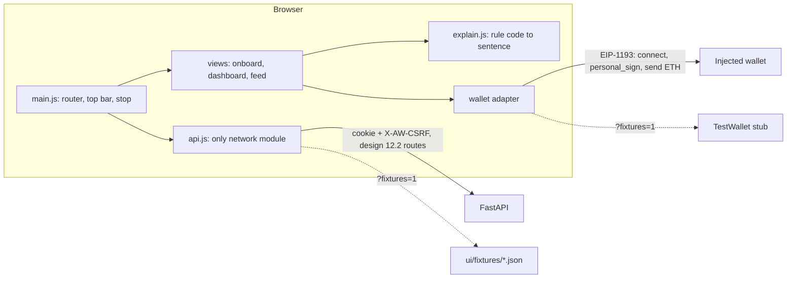
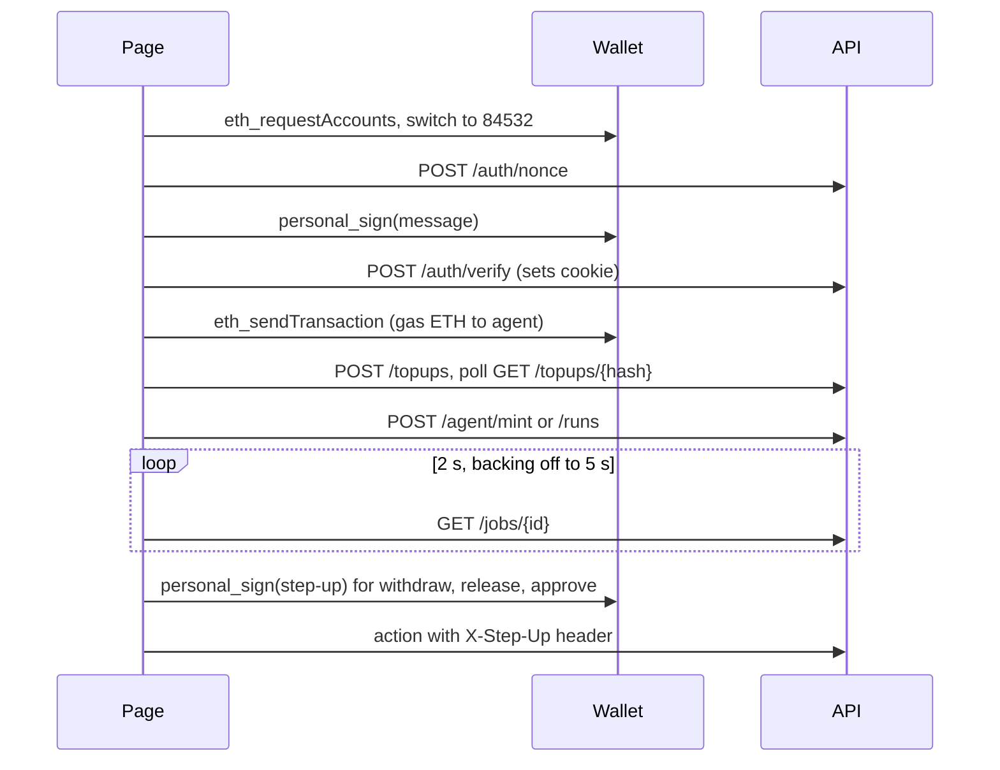
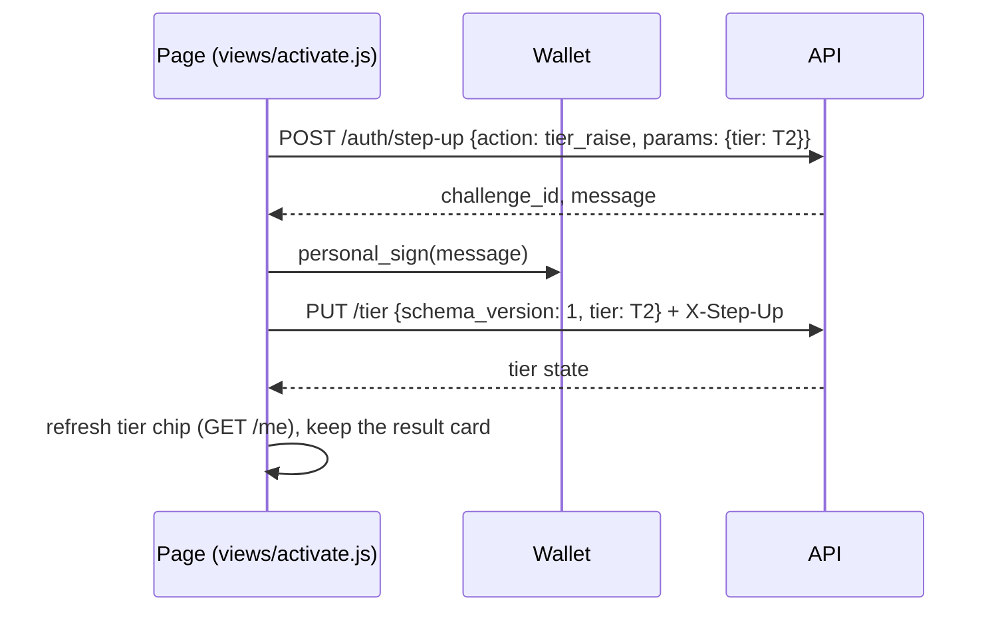

# Webapp UI (Stage 0 views, F1c additions)

> Visual language: [`DESIGN.md`](../../DESIGN.md). Behaviour and architecture: [`docs/design/webapp/system-design.md`](../design/webapp/system-design.md) (sections 12, 14). Tickets F1 and F1b (live API).

A static single page under `ui/`, mounted by `api/main.py` at `/ui`. Plain ES modules, no build step, no dependency, no CDN, no web font: it works offline except for the wallet and the RPC behind it.

## Live mode (F1b)
Real mode is the default when the page is served by the API; `?fixtures=1` keeps the demo. Every call goes through `api.js` with `credentials: "same-origin"` and `X-AW-CSRF: 1`; the browser adds the `Origin` header the API checks. Problem bodies (RFC 7807) become `ApiError` (slug, detail, `retryAfter`, the whole problem for the `job_id` of a 409) and `describeError` maps them to plain sentences. A 401 from any route clears the signed-in state once.

- **Jobs.** `views/jobs.js` follows a job to its records (`GET /jobs/{id}` carries record summaries) and draws them with the feed's card: outcome, plain sentence, BaseScan link, planner label (`openai`, `scripted`, `fallback`), reference-price label. `views/actions.js` holds Mint, Run, "Try a hostile note" (`planner: scripted_hostile`) and Withdraw; one job at a time, a 409 follows the job already running.
- **Feed and approvals** read the owner's recent jobs, because `/decisions` is not per owner yet. `views/approvals.js` lists pending orders with Approve (step-up) and Reject.
- **Chain status** comes from `GET /audit/verify`.
- **Tier chip** reads `GET /me` in live mode (it carries the owner's tier and stop flag); `GET /tier` is the single-owner global state.

## Activate agent and the UX adoption list (F1c)
A new owner is at tier T0 and every order is denied `TIER.READ_ONLY`, so the page now has an explicit **Activate agent** control: a step in the Set up stepper and a callout on the dashboard while the tier is T0 or T1. It explains in one sentence what activating means, then runs the step-up flow.

Lowering the tier (`PUT /tier` without a header) and the emergency stop need the session only.

| Item | Where |
| :--- | :--- |
| A-1 prompt disclosures | each stepper step shows a "Wallet prompt: ..." chip before the button (`views/onboard.js`) |
| A-2 plain-language headline | blocked and waiting cards lead with the rule's sentence; rule codes are small mono chips (`views/feed.js`) |
| A-3 FROZEN state | `applyTopbar` in `gauges.js` turns the masthead red, the chip reads "FROZEN" and the bar says "EMERGENCY STOP ACTIVE"; clears on release |
| A-4 spend bar | `spendGauge` (BigInt maths) with `role="progressbar"`; the window is a rolling 24 hours, so there is no fixed reset time and the card says so |
| A-5 gas floor | chip with a "Fund the agent" link to Set up when below the floor |
| A-6 planner provenance | chips `OpenAI Planner`, `Offline Fallback`, `Scripted Demo` |
| A-7 approvals card | amount, action, protocol, holding rule, Approve (signature) and Reject |
| A-8 audit verdict | structured card: "Hash chain intact (N records verified)" or the first broken `seq` |
| A-9 empty states | each says what to do and links there |
| A-10 testnet and custody notice | static, first line "Testnet only (Base Sepolia) · Custodial server key · Mainnet reference prices" |

A 429 shows when to try again from `Retry-After` (`retryText`). The dashboard now reads `/portfolio` and `/ips`, which are per owner in multi mode, and falls back to the owner's own balances if they fail.

Tests: `tests/ui/flows.mjs` and `tests/ui/test_ui.py` (`test_activate_agent_sends_step_up_then_tier_raise_and_updates_chip`, `test_frozen_state_appears_on_stop_and_clears_on_release`, `test_spend_bar_maths_and_card`, and others). Previews: `docs/previews/f1c-*.png` (API in `AGENT_WALLET_MODE=multi`, fake chain RPC, throwaway keys).

### Known gaps in the API (UI is ready, backend is not)
- Stop, release, approve and reject are per session in multi mode since #104; `GET /portfolio` and `/ips` are per owner too. `GET /decisions` is read through the owner's jobs, and the in-browser chain check stays hidden outside fixtures mode.
- There is no policy route yet (ticket A4): the Policy step shows the default preset.

## Files
| File | Role |
| :--- | :--- |
| `index.html` | Shell. The testnet banner and the top bar (tier chip, Emergency stop) are static markup |
| `style.css` | `DESIGN.md` tokens as CSS custom properties, dark mode, focus ring, reduced motion |
| `main.js` | Hash router, top bar, shared context (`makeCtx`), `describeError` |
| `api.js` | The only module that calls the network; `ROUTES` lists every path; `?fixtures=1` switch |
| `gauges.js` | Pure helpers: spend and gas gauges, retry text, empty-state button, top bar state (FROZEN) |
| `views/activate.js` | Activate agent (step-up then `PUT /tier`), lower tier, result card |
| `explain.js` | Rule code (all 25 plus `ACCESS.OWNER_ONLY_FUNCTION`, `TIER.GLOBAL_STOP`, `TIER.POLICY_CHANGED`) and error code to plain language; unit helpers |
| `wallet/adapter.js`, `injected.js`, `test.js` | Adapter interface, EIP-1193 implementation (EIP-6963 first), `TestWallet` stub |
| `views/onboard.js`, `dashboard.js`, `feed.js`, `approvals.js` | The views, each with empty, loading and error states |
| `views/jobs.js`, `views/actions.js` | Job panel and polling, record loading; Mint, Run, hostile note, Withdraw |
| `chain.js` | In-browser audit hash check (unchanged), used by the feed's "Check in browser" |
| `fixtures/*.json` | Data for the no-backend mode |

## Rules the page keeps
- **API strings are text.** Every value from the API is written with `textContent`; no `innerHTML` anywhere. Evidence values are only interpolated into sentences when they match a conservative character set.
- **No storage.** No `localStorage`, `sessionStorage` or cookie access from JS; the session is an HttpOnly cookie. Step-up signatures are asked per action and not kept.
- **Honest labels.** A permanent banner (testnet only, custodial agent key, do not send real funds, the agent cannot top up its own ETH) is static markup that no script touches. Reference prices and fixture data carry a chip in words.
- **State is not colour alone.** Outcome cards carry an icon and a word; wallet rejection reads "You declined in your wallet" and is not shown as a failure.
- **Only listed routes.** `tests/ui/test_ui.py` checks that every path in `api.js` is in the design 12.2 list. The only external URLs are the BaseScan transaction link (navigation) and the chain parameters handed to the wallet.

## Fixtures mode
`/ui/?fixtures=1` serves everything from `ui/fixtures/` with an in-memory state and `TestWallet`; `&demo=1` starts signed in and funded, `&scenario=hostile` starts with a blocked hostile order. It exists for judges, previews and tests, and is labelled "Demo data (fixtures), not live" in the banner.

## Tests
`tests/ui/test_ui.py` (static scans, route list, rule-code coverage, design tokens) and `tests/ui/harness.mjs` (runs the real modules against a fake DOM and the fixtures under node: hostile strings, fixture flow, wallet rejection, API error mapping). The audit-chain tests from the owner console are kept.

### Design 14.4 and ticket names to the tests that prove them
| Design name | Test in `tests/ui/test_ui.py` |
| :--- | :--- |
| `test_render_safety.mjs::api_strings_never_reach_innerhtml` | `test_hostile_api_string_does_not_become_html` (rendered) and `test_no_local_storage_and_no_external_url` (no `innerHTML` in source) |
| `test_banner.mjs::banner_present_on_every_view` | `test_banner_present_and_not_removable_by_api_data` |
| `test_stop.mjs::stop_visible_and_session_only` | `test_stop_visible_and_session_only` |
| `test_labels.mjs::reference_and_fallback_labels_rendered` | `test_reference_and_fallback_labels_rendered` |
| `test_offline.mjs::no_external_assets_in_default_path` | `test_no_local_storage_and_no_external_url`, `test_fixtures_hold_no_secrets_or_external_assets` |
| `test_storage.mjs::no_token_in_storage_or_globals` | `test_no_local_storage_and_no_external_url` |
| `test_explain.mjs::every_rule_code_has_a_sentence` | `test_every_existing_rule_code_has_a_plain_language_sentence`, `test_explain_table_is_complete_and_non_empty` |
| every `api.js` path is a 12.2 route | `test_api_paths_are_in_design_route_list` |
| the page works from fixtures | `test_page_works_from_fixtures` |
| old `test_js_endpoints_exist_in_openapi`, `test_js_read_endpoints_respond` | `test_existing_routes_used_by_ui_exist_in_openapi`, `test_js_read_endpoints_respond` |

F1b adds `tests/ui/flows.mjs`: a fake `fetch` (bodies copied from `api/wallet.py`, `api/jobs.py`, `api/auth.py`) and `TestWallet` drive sign-in, top-up, mint, run, blocked hostile run, withdraw, stop, release, verify and approvals; `test_every_route_the_js_calls_exists_in_openapi` checks `ROUTES` against `contracts/openapi.yaml`. Previews of the live page: `docs/previews/f1b-dashboard.png`, `f1b-running-job.png`, `f1b-blocked-hostile.png` (API in `AGENT_WALLET_MODE=multi` with throwaway secrets, a stubbed RPC and a stub wallet).

The node-based tests are skipped when `node` is not on the PATH; the static scans always run.

## Scope notes
- Policy and audit views (design 14) belong to later tickets.
- The previous owner console (Bearer owner token, `app.js`) is replaced one for one by the tests above. The new page uses the session routes of the design, which arrive with the backend tickets (A1, C1); until then use `?fixtures=1`.
