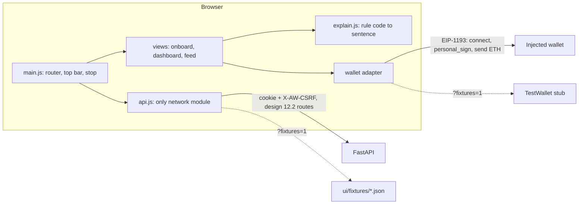

# Webapp UI (Stage 0 views)

> Visual language: [`DESIGN.md`](../../DESIGN.md). Behaviour and architecture: [`docs/design/webapp/system-design.md`](../design/webapp/system-design.md) (sections 12, 14). Ticket F1.

A static single page under `ui/`, mounted by `api/main.py` at `/ui`. Plain ES modules, no build step, no dependency, no CDN, no web font: it works offline except for the wallet and the RPC behind it.

## Files
| File | Role |
| :--- | :--- |
| `index.html` | Shell. The testnet banner and the top bar (tier chip, Emergency stop) are static markup |
| `style.css` | `DESIGN.md` tokens as CSS custom properties, dark mode, focus ring, reduced motion |
| `main.js` | Hash router, top bar, shared context (`makeCtx`), `describeError` |
| `api.js` | The only module that calls the network; `ROUTES` lists every path; `?fixtures=1` switch |
| `explain.js` | Rule code (all 25 plus `ACCESS.OWNER_ONLY_FUNCTION`, `TIER.GLOBAL_STOP`, `TIER.POLICY_CHANGED`) and error code to plain language; unit helpers |
| `wallet/adapter.js`, `injected.js`, `test.js` | Adapter interface, EIP-1193 implementation (EIP-6963 first), `TestWallet` stub |
| `views/onboard.js`, `dashboard.js`, `feed.js` | The three views, each with empty, loading and error states |
| `chain.js` | In-browser audit hash check (unchanged), used by the feed's "Check in browser" |
| `fixtures/*.json` | Data for the no-backend mode |

## Rules the page keeps
- **API strings are text.** Every value from the API is written with `textContent`; no `innerHTML` anywhere. Evidence values are only interpolated into sentences when they match a conservative character set.
- **No storage.** No `localStorage`, `sessionStorage` or cookie access from JS; the session is an HttpOnly cookie. Step-up signatures are asked per action and not kept.
- **Honest labels.** A permanent banner (testnet only, custodial agent key, do not send real funds, the agent cannot top up its own ETH) is static markup that no script touches. Reference prices and fixture data carry a chip in words.
- **State is not colour alone.** Outcome cards carry an icon and a word; wallet rejection reads "You declined in your wallet" and is not shown as a failure.
- **Only listed routes.** `tests/ui/test_ui.py` checks that every path in `api.js` is in the design 12.2 list. The only external URLs are the BaseScan transaction link (navigation) and the chain parameters handed to the wallet.

## Fixtures mode
`/ui/?fixtures=1` serves everything from `ui/fixtures/` with an in-memory state and `TestWallet`; `&demo=1` starts signed in and funded, `&scenario=hostile` starts with a blocked hostile order. It exists for judges, previews and tests, and is labelled "Demo data (fixtures), not live" in the banner.

## Tests
`tests/ui/test_ui.py` (static scans, route list, rule-code coverage, design tokens) and `tests/ui/harness.mjs` (runs the real modules against a fake DOM and the fixtures under node: hostile strings, fixture flow, wallet rejection, API error mapping). The audit-chain tests from the owner console are kept.

### Design 14.4 and ticket names to the tests that prove them
| Design name | Test in `tests/ui/test_ui.py` |
| :--- | :--- |
| `test_render_safety.mjs::api_strings_never_reach_innerhtml` | `test_hostile_api_string_does_not_become_html` (rendered) and `test_no_local_storage_and_no_external_url` (no `innerHTML` in source) |
| `test_banner.mjs::banner_present_on_every_view` | `test_banner_present_and_not_removable_by_api_data` |
| `test_stop.mjs::stop_visible_and_session_only` | `test_stop_visible_and_session_only` |
| `test_labels.mjs::reference_and_fallback_labels_rendered` | `test_reference_and_fallback_labels_rendered` |
| `test_offline.mjs::no_external_assets_in_default_path` | `test_no_local_storage_and_no_external_url`, `test_fixtures_hold_no_secrets_or_external_assets` |
| `test_storage.mjs::no_token_in_storage_or_globals` | `test_no_local_storage_and_no_external_url` |
| `test_explain.mjs::every_rule_code_has_a_sentence` | `test_every_existing_rule_code_has_a_plain_language_sentence`, `test_explain_table_is_complete_and_non_empty` |
| every `api.js` path is a 12.2 route | `test_api_paths_are_in_design_route_list` |
| the page works from fixtures | `test_page_works_from_fixtures` |
| old `test_js_endpoints_exist_in_openapi`, `test_js_read_endpoints_respond` | `test_existing_routes_used_by_ui_exist_in_openapi`, `test_js_read_endpoints_respond` |

The node-based tests are skipped when `node` is not on the PATH; the static scans always run.

## Scope notes
- Approvals, policy, audit and withdraw views (design 14, `views/approvals.js` and others) belong to later tickets; the feed shows "waiting for you" cards without buttons for now.
- The previous owner console (Bearer owner token, `app.js`) is replaced one for one by the tests above. The new page uses the session routes of the design, which arrive with the backend tickets (A1, C1); until then use `?fixtures=1`.
