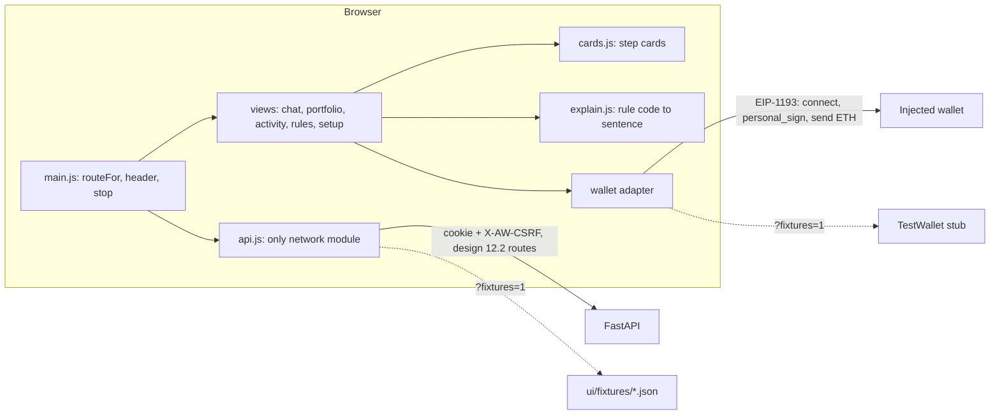
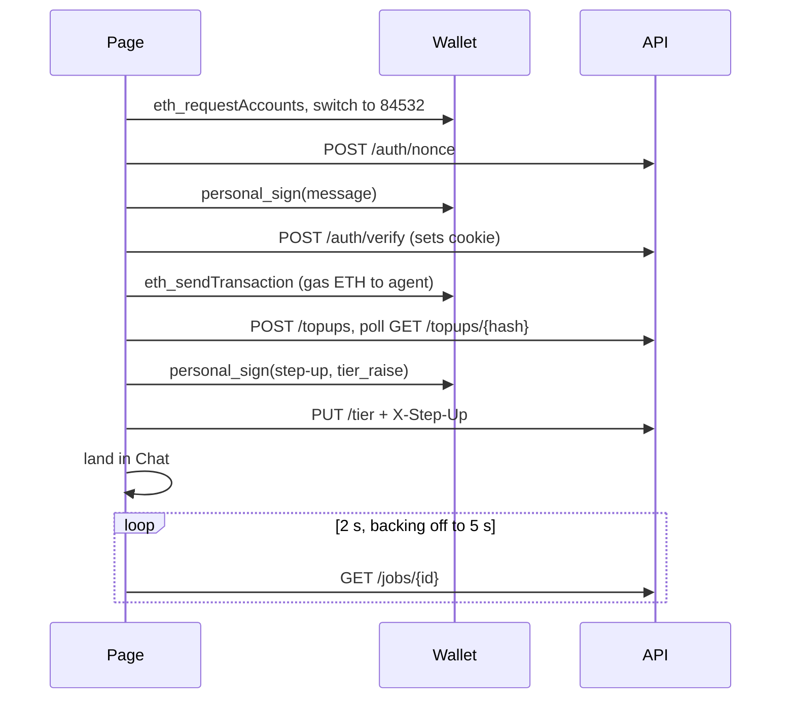

# Webapp UI (rebuilt to the approved UI contract, ticket 119)

> Look and layout: [`docs/design/webapp/ui-contract.md`](../design/webapp/ui-contract.md) and the three static mockups in [`docs/design/webapp/ui-contract/`](../design/webapp/ui-contract/) (`Main.html`, `Portfolio.html`, `Setup.html`). Tokens and behaviour: [`DESIGN.md`](../../DESIGN.md), [`docs/design/webapp/system-design.md`](../design/webapp/system-design.md) (sections 12 and 14). Where the mockups and `DESIGN.md` disagree, `DESIGN.md` wins.

A static single page under `ui/`, mounted by `api/main.py` at `/ui`. Plain ES modules, no build step, no dependency, no CDN, no web font, no `localStorage`: it works offline except for the wallet and the RPC behind it.

## Shell
Header (64 px, wraps to two rows below 900 px): logo mark and name, tabs **Chat · Portfolio · Activity · Rules**, then the network chip "Base Sepolia testnet", the owner address chip, the status pill, **Emergency stop** and **Log out** (`views/account.js`, `renderAccountControl()`; it calls `POST /auth/logout`, clears the client state and shows the connect screen, and no protected route is called again until the next sign-in). The Setup header keeps the address chip and Log out. There is **no warning banner** anywhere. Testnet and custody are stated three times, all static markup:

| Where | Text |
| :--- | :--- |
| Header chip | "Base Sepolia testnet" |
| Footer, one grey line | "Testnet only. The server holds this agent's key. Not financial advice." |
| Setup (first run) | "This is a testnet demo: the server holds the agent's key and no real funds are involved." |

Status pill: "Agent active" (green, tier T2), "Read only" (amber, T0), "Propose only" (amber, T1), "Stopped" (red). **Frozen is unmistakable without a strip:** the pill turns solid red, the header gets a red rule and tint, the button becomes "Resume (needs signature)", and Chat, Portfolio, Activity and Rules show a red frozen card; the composer is disabled. Engaging the stop needs the session only but asks first in a modal ("Stop the agent now?", `views/confirm.js`: focus trapped, Escape closes, focus returns to the button); resuming asks for a fresh signature.

Fixtures mode adds a second chip, "Demo data (fixtures), not live".

## Routing
`routeFor(hash, {signedIn, tier})` in `main.js` is a pure function (tested under node):

| Situation | Screen |
| :--- | :--- |
| signed out, or tier T0 | Setup (the header shows only the logo and the fixtures chip) |
| tier T2 (activated) | `#/chat` home; `#/setup` redirects to Chat |
| tier T1 (lowered by the owner) | any tab; `#/setup` stays reachable to activate again |
| old hashes | `#/dashboard` and `#/approvals` go to Portfolio, `#/feed` to Activity, `#/onboard` to Setup |

After Activate succeeds the view calls `ctx.go("#/chat")` and the header re-routes.

## Screens
| Screen | File | Contents |
| :--- | :--- | :--- |
| Chat | `views/chat.js`, `views/side.js` | Conversation card ("Your agent"): owner bubbles right (yellow), agent bubbles left (grey), step cards under an agent message, live phase card while a job runs, suggested prompts above the composer (from `GET /chat/suggestions`, static fallback), history rail on the left, Enter sends, 500 character counter. Right column: wallet value and idle/earning bar, today's limit (rolling 24 h, approval threshold), gas with Top up, audit log line with verified state |
| Portfolio | `views/portfolio.js`, `views/actions.js`, `views/approvals.js` | Total value with allocation bar and legend, earning card, holdings (USDC with Withdraw, aUSDC, ETH gas with Top up), recent activity, the waiting-for-approval card (Approve needs a signature, Reject does not), Mint test USDC, Run the agent, "Try a hostile note", Withdraw, job panel, lower-the-tier control |
| Setup | `views/setup.js`, `views/activate.js` | Three steps (Connected, Add gas, Activate). Agent address with Copy, gas amount and send, Activate with its one-sentence explanation and one free signature |
| Activity | `views/activity.js` | Every decision, newest first, as step cards; Verify audit chain with a verdict card; planner and reference-price chips |
| Rules | `views/rules.js` | Read-only rows from `GET /limits` (`ui/limits.js`): per order, per day with "Used today", ask me first above, where money may go, emergency stop state. A failed read shows an error line, never numbers |

### Step cards (`views/cards.js`)
One vocabulary for Chat, Activity, Portfolio and the job panel:

| Kind | Look | Used for |
| :--- | :--- | :--- |
| `done` | green, ✓ | `executed`; "BaseScan ↗" link on the right |
| `blocked` | red, ✕ | `denied`; plain sentence first, rule code as a small chip |
| `pending` | amber, … | `pending_approval`; Approve and Reject on Portfolio |
| `skipped` | grey, ↷ | a step not attempted because an earlier one was blocked, and "No action" |
| `fail` | red, ! | an execution that errored |

The state is also a word ("Executed", "Blocked", "Waiting for you", "Skipped", "Failed"), so it is never colour alone. Transaction hashes appear only as BaseScan links; the "Transactions: 0x..." sentence the server composes into the agent's text is hidden because the cards carry the links. "Agent says" paragraphs get an "Agent says" chip: that is the model's own words, the cards are the record.

### Live mode
Real mode is the default when the page is served by the API; `?fixtures=1` keeps the demo. Every call goes through `api.js` with `credentials: "same-origin"` and `X-AW-CSRF: 1`. Problem bodies (RFC 7807) become `ApiError` and `describeError` maps them to plain sentences. A 401 clears the signed-in state once. A 429 says when to try again from `Retry-After`. Jobs are polled at 2 s, backing off to 5 s.

## Phases and Stop (contract C1, C2; backend ticket 122)
`GET /jobs/{id}` and each agent message in `GET /chat` carry `phase`: `queued`, `rules_check`, `sent`, `confirming`, `done`. Treat unknown values as "working"; `confirming` is not emitted yet. `POST /jobs/{id}/cancel` (CSRF header) answers `202 {job_id, status: "cancelling"}`, or `409 not-cancellable` once the phase is `sent` or later. After a cancel the job ends `status: "denied"`, `error_code: "OWNER_CANCELLED"` (already a terminal status for the poller), and the steps not attempted are `outcome: "skipped"` with a `reason` ending `owner-cancelled`. See [`api.md`](api.md#job-phases-and-cancel-ticket-122-contract-c1-and-c2).

### Chat wiring (F1 and F2, ticket 130)
- **History rail** (`historyRail` in `views/side.js`): 220 px left of the chat card, "+ New chat" primary button, threads from `GET /chat/threads` grouped Today, Yesterday, Earlier (the owner's local day), each row title plus a status word (Running, Done, Blocked, Waiting) and relative time; the active row is filled with the primary colour. Selecting a row loads `GET /chat?thread_id=`; New chat calls `POST /chat/threads`; `POST /chat` carries the active `thread_id`. The implicit default conversation (no `thread_id`) is the first one shown and stays reachable as "Earlier chat". Under 900 px the rail is a drawer behind a "History" button (Escape and Close dismiss it). Rows are disabled while a job runs, so a poll never lands in another thread.
- **Phase strip** (`phaseStrip`, `runningCard` in `views/cards.js`): chips Rules checked, Sent, Confirming, Done, green once passed and gold for the current one, driven by the polled job `phase`. An unknown phase shows the plain line "Working". A page reloaded mid-run follows the job again.
- **Stop**: while a job is queued or running the Send button reads "Stop" (ink fill) and calls `POST /jobs/{id}/cancel`. A 409 shows "Too late to stop: this order is already sent." Steps skipped by the cancel render as grey skipped cards with "You stopped the run, so this step was not sent." A job that ends `failed` after the page saw `sent` shows "It may still land. Check Activity before trying again." instead of a failure line.
- **Limit line**: pending and blocked step cards read "This order $X, per-order limit $Y, today $A of $B" from `GET /limits` (strings with two decimals; read once per render, cached 5 seconds; left out when the route fails).
- **Quick fixes** (newest agent message only): "Try <cap> USDC" when the block code is `LIMIT.PER_TX` and `per_order_usd` is known puts the order text in the composer and never sends; "Why is this blocked?" sends that question.
- **Suggestions**: the prompt chips come from `GET /chat/suggestions` (at most 4), with the static three as the fallback on error.

## Known gaps
- **No policy route** (ticket A4): the preset step of the old stepper is gone from Setup; the default preset applies. `api.js` keeps `setPreset` for fixtures only.
- **No rate route:** the Portfolio "Earning" card shows the aUSDC amount and says the rate is not exposed, instead of the mockup's "3.1% APY".
- **"Pull 5 USDC back out"** is a prompt chip only; what the planner does with it is the planner's decision, shown as step cards.
- `GET /decisions` is not per owner; Activity and the approvals card read the owner's recent jobs, and the in-browser chain check stays fixtures-only.

## Files
| File | Role |
| :--- | :--- |
| `index.html` | Shell: header, tabs, chips, pill, Emergency stop, `#view`, footer line |
| `style.css` | `DESIGN.md` tokens as CSS custom properties (canvas, ink, hairline, gold, forest, error; radii 4 / 8 / 15 px; Georgia for titles and numbers), dark mode, focus ring, reduced motion, 1280 px and 375 px layouts |
| `main.js` | `routeFor`, header wiring, stop and resume, shared context (`makeCtx`), `describeError` |
| `api.js` | The only module that calls the network; `ROUTES` lists every path; `?fixtures=1` switch |
| `gauges.js` | Pure helpers: spend and gas gauges, retry text, relative time, header state, frozen card |
| `explain.js` | Rule code (all 25 plus `ACCESS.OWNER_ONLY_FUNCTION`, `TIER.GLOBAL_STOP`, `TIER.POLICY_CHANGED`) and error code to plain language; unit helpers |
| `views/cards.js` | Step cards, record cards, BaseScan link, planner labels |
| `views/topup.js` | Gas top-up flow shared by Setup, Portfolio and the Chat side panel |
| `views/chat.js`, `portfolio.js`, `activity.js`, `rules.js`, `setup.js` | The five screens, each with empty, loading and error states; Portfolio and Activity load with shimmer skeletons (`skeleton.js`, static under `prefers-reduced-motion`) |
| `limits.js`, `views/account.js`, `views/confirm.js` | The `/limits` read and money formatting, the Log out control, the modal confirm |
| `views/side.js`, `actions.js`, `approvals.js`, `activate.js`, `jobs.js` | Chat side panel; Mint, Run, Withdraw; approvals card; activate and lower tier; job polling |
| `wallet/adapter.js`, `injected.js`, `test.js` | Adapter interface, EIP-1193 implementation (EIP-6963 first), `TestWallet` stub |
| `chain.js` | In-browser audit hash check, used by Activity's "Check in browser" (fixtures) |
| `fixtures/*.json` | Data for the no-backend mode |

## Rules the page keeps
- **API strings are text.** Every value from the API is written with `textContent`; no `innerHTML` anywhere. Evidence values are only interpolated into sentences when they match a conservative character set.
- **No storage.** No `localStorage`, `sessionStorage` or cookie access from JS; the session is an HttpOnly cookie. Step-up signatures are asked per action and not kept.
- **Honest labels.** Reference prices and fixture data carry a chip in words; "Agent says" text is labelled; step cards come from the audit log only.
- **Only listed routes.** `tests/ui/test_ui.py` checks that every path in `api.js` is in the design 12.2 list and in `contracts/openapi.yaml`. The only external URLs are the BaseScan transaction link (navigation) and the chain parameters handed to the wallet.
- **Keyboard and focus.** Every control is a button, link or form field; `:focus-visible` draws a 3 px ring; the skip link jumps to `#view`.

## Fixtures mode
`/ui/?fixtures=1` serves everything from `ui/fixtures/` with an in-memory state and `TestWallet`; `&demo=1` starts signed in and funded at T2, `&scenario=t0` starts at T0 (Setup with Activate), `&scenario=hostile` starts with a blocked hostile order in Activity. It exists for judges, previews and tests.

## Tests
`tests/ui/test_ui.py` (static scans, contract checks, route list, rule-code coverage, tokens) and three node programs that run the real modules against a fake DOM: `harness.mjs` (fixtures: hostile strings, routing, step card kinds, header pill), `flows.mjs` (fake server: sign-in, top-up, mint, run, withdraw, stop and resume, approvals, activate, 401 and 429) and `chat_flows.mjs` (chat flows). The node-based tests are skipped when `node` is not on the PATH; the static scans always run.

| Contract item | Test |
| :--- | :--- |
| No banner element; chip, footer line and Setup text present | `test_no_banner_element_and_testnet_custody_are_chip_footer_and_setup_text`, `test_setup_text_states_testnet_and_custody` |
| Four tabs, chips, pill and stop in order | `test_header_has_the_four_tabs_chips_pill_and_stop_in_contract_order` |
| Setup for T0, not after activation | `test_setup_is_shown_for_t0_and_not_after_activation`, `test_activate_agent_sends_step_up_then_tier_raise_and_updates_chip` |
| Step card kinds | `test_step_card_kinds_done_blocked_pending_skipped_and_failed` |
| Frozen state | `test_frozen_state_appears_on_stop_and_clears_on_release`, `test_chat_frozen_state_disables_the_composer` |
| No horizontal overflow guards | `test_layout_guards_for_375px_are_in_the_stylesheet` (the real check is in the browser: `scrollWidth <= innerWidth` on every screen at 1280 and 375 px) |
| Every JS-called route is in `openapi.yaml` | `test_every_route_the_js_calls_exists_in_openapi`, `test_rules_tab_reads_the_limits_route` |
| API strings stay inert text | `test_hostile_api_string_does_not_become_html`, `test_chat_hostile_strings_stay_text_and_fixtures_flow_works` |

## Previews
`docs/previews/ui2-<screen>-<1280|375>.png` for chat, portfolio, activity, rules and setup, taken from the built page (fixtures mode, light scheme) next to the mockups they implement.
