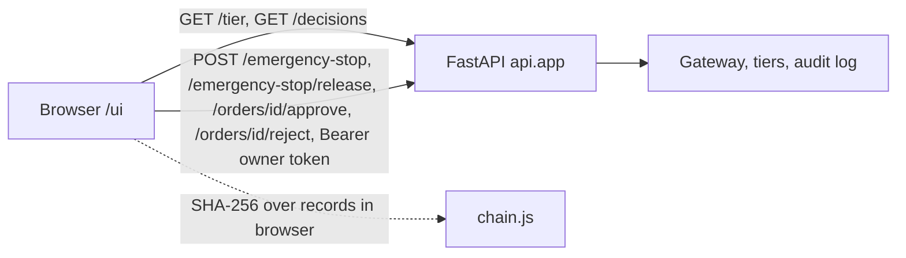

# Owner UI

> Visual language: see [`DESIGN.md`](../../DESIGN.md) (the UI design system). Behaviour and architecture: [`docs/design/webapp/system-design.md`](../design/webapp/system-design.md).

A static single page (`ui/`: `index.html`, `style.css`, `app.js`, `chain.js`) mounted by `api/main.py` at `/ui`. It has no build step, no dependency and no external asset. It talks only to endpoints in `contracts/openapi.yaml`.

- **Owner token**: typed into the page and kept in a JS variable only (no storage, never in a URL). Without it the owner controls are disabled; a 503 from the API is shown as "owner controls not configured".
- **Audit chain**: the API has no verify endpoint, so `ui/chain.js` recomputes each record hash with `crypto.subtle` (canonical JSON per `contracts/README.md`) and checks `prev_hash` linkage. It is a browser check; authoritative verification is `python -m core.audit.verify`. `tests/ui/` runs the same file under node against `contracts/examples/decision-record.chain.json`.
- **Pending approvals** are derived from `GET /decisions`: orders whose latest record has outcome `pending_approval`.
- **Safety**: all API strings are written with `textContent`; the wallet address is not shown because `GET /ips` exposes the owner address, not the agent wallet.
