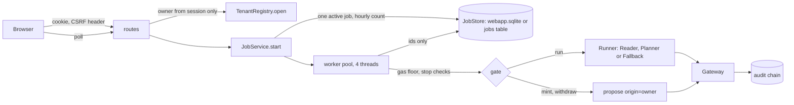
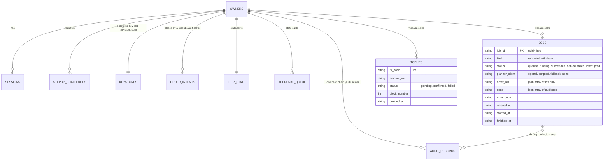

# Webapp: agent wallet routes, jobs and top-ups (ticket A3)

Source of truth: `docs/design/webapp/system-design.md` sections 5, 8, 10, 11, 12 and 13. Testnet only. Custodial: the server holds each agent key (see [`custody-tenancy.md`](custody-tenancy.md)). The LLM proposes; the gateway decides.

## Modules

| Module | Role |
| :--- | :--- |
| `api/wallet.py` | `WebappServices`, `current_tenant` (the session owner's tenant), `WalletService` (live balances, gas floor, top-up verification through an injected RPC callable), the top-up service over `tenant.stores.topups`, routes `/me`, `/agent`, `/topups`, `/presets`, `/audit/verify` |
| `api/jobs.py` | `JobService` (`start`, `get`, `list`, `mark_interrupted_on_startup`), `JobLimits` (the job rows live in `tenant.stores.jobs`; `SqliteJobs` is re-exported from `core/storage/sqlite/webapp.py`), routes `/agent/mint`, `/agent/withdraw`, `/runs`, `/jobs` |
| `core/agent/planner.py` | `FallbackPlanner`: deterministic, labelled `fallback` |
| `api/main.py` | In `AGENT_WALLET_MODE=multi`, builds the services from the environment (RPC URL, keystore secret, `DATABASE_URL` or data directory) and the `StorageBackend` |
| `core/gateway/tenant.py` | `TenantRegistry(settings, rpc, backend=...)` builds every per-owner object from `backend.open_tenant(owner)` |

## Flow

## Entity-relationship diagram (SQLite backend, per owner directory)

Auth rows are global; the others live in `DATA_DIR/owners/<0x address>/`. The Postgres layout of design section 11 is the same entities with an `owner` column (ticket P2); since ticket W1 the app runs on either, chosen by `DATABASE_URL` (see [`storage.md`](storage.md)).

The jobs table never holds an order body, a note or a key. A partial unique index (`status IN ('queued','running')`) makes "one active job per owner" atomic.

## Job statuses and error codes (design 10)

| Situation | Status | `error_code` |
| :--- | :--- | :--- |
| Run, mint or withdraw finished; a policy denial inside a run | `succeeded` | none |
| Mint or withdraw order denied by the gateway | `denied` | first rule code |
| Owner stop or global stop (run pre-check, or a record with a stop code) | `denied` | `TIER.EMERGENCY_STOP`, `TIER.GLOBAL_STOP` |
| Agent ETH below the gas floor (2 x base fee x 500,000 gas) | `failed` | `GAS_BELOW_FLOOR` |
| RPC unreadable for the gas check | `failed` | `RPC_UNAVAILABLE` |
| Gateway recorded `failed` | `failed` | `SIMULATION_FAILED`, `TX_REVERTED`, `BALANCE_DELTA_UNEXPECTED`; `SIGNER_UNAVAILABLE` is reported as `RPC_UNAVAILABLE` |
| Gateway lock timeout / unfinished intent | `failed` | `GATEWAY_BUSY` / `RECONCILE_REQUIRED` |
| Process restart | `interrupted` | none |
| Another job is active / hourly limit used | no job (`409 job-in-progress` / `429 rate-limited`) | n/a |

Limits (one place, `JobLimits`): 6 runs per owner per hour, 4 mint calls per owner per hour (`AGENT_WALLET_MINT_CALLS_PER_HOUR`), note at most 2,000 characters. The count is of job rows, so every mint attempt counts whatever its outcome.

## Planners

`auto` uses `OpenAIClient` when `OPENAI_API_KEY` is set and falls back to `FallbackPlanner` on `LLMError` (nothing is proposed before the LLM answers, so the retry cannot duplicate an order). Without a key the fallback is used directly. `scripted_hostile` is a scripted client that emits a schema-valid supply far above the per-transaction limit, to show the gateway denying it. Records of the audit chain have a closed schema and cannot carry `planner_client`; the label is on the job and on every record summary returned by `GET /jobs/{job_id}`.

## Top-ups (design 8.1)

`POST /topups` checks through the injected RPC callable that the transaction is from the session owner, to the agent address, above zero, on chain 84532, then stores it `pending`. `GET /topups/{tx_hash}` reads the receipt (`0x1` confirmed, `0x0` failed) and settles the row once. A hash another owner registered is unknown to this owner (`404`). The server never sees the owner's key.

## Owner path and ticket C3

Mint and withdraw call `Gateway.propose(order, origin="owner")` through `propose_with_origin`, which passes the keyword only when the gateway accepts it. Until C3 lands the call is a plain `propose` and the engine denies the owner function (`ACCESS.OWNER_ONLY_FUNCTION`): fail closed. The operator global stop is an injected callable: the backend setting (`settings` row on Postgres), `AGENT_WALLET_GLOBAL_STOP=1` or `DATA_DIR/GLOBAL_STOP`; any one of them stops, and an unreadable flag counts as set.

## Wiring in `api/main.py` (`AGENT_WALLET_MODE=multi`)

`build_webapp` reads the environment only and opens no connection (on Postgres the one exception is the schema check, which is the point: see [`storage.md`](storage.md)). Risk inputs for the policy engine are the repository's reference file stamped fresh (`reference_risk_inputs`, the same values `scripts/live_first_tx.py` uses; Base Sepolia has no indexer for them), because without them every `supply` is denied as `RISK.DATA_STALE`. The keystore secret is optional at start: reads work and wallet creation fails closed with `503 custody-unavailable`.

## Proving checks

| Claim | Proving check |
| :--- | :--- |
| Jobs store ids only | `pytest tests/webapp/test_jobs.py::test_job_row_has_no_order_body -q` |
| One active job; rate limits | `test_jobs.py::test_second_job_409`, `test_runs_per_hour`, `test_mint_calls_per_hour_counts_every_outcome` |
| Fallback is labelled | `test_jobs.py::test_llm_unavailable_uses_fallback_labelled` |
| Run under stop ends `denied` | `test_jobs.py::test_run_under_stop_ends_denied_not_failed` |
| Hostile note: denied record, nothing signed | `test_jobs.py::test_hostile_note_yields_denied_record_and_nothing_signed`, `test_routes.py::test_hostile_note_over_http_is_denied_in_plain_words_and_nothing_is_signed` |
| Top-up checks | `tests/webapp/test_wallet.py` (`wrong_sender`, `wrong_recipient`, `zero_value`, `unknown_hash`, `pending_then_confirmed`) |
| Gas floor before mint, run and withdraw | `test_jobs.py::test_gas_below_floor_fails_before_anything_is_proposed` |
| Cross-owner isolation | `tests/webapp/test_routes.py::test_session_a_cannot_read_owner_b_state` and the other isolation tests |
| `origin="owner"` only in `api/jobs.py` | `test_jobs.py::test_origin_owner_literal_only_in_jobs_module` |
| Keystore, chain and jobs survive a restart on both backends | `tests/webapp/test_storage_backends.py::test_restart_keeps_keystore_and_chain`, `test_running_job_is_interrupted_after_restart` |
| Sign-in creates the tenant and a keystore row | `test_storage_backends.py::test_sign_in_creates_tenant_and_keystore` |
| A second owner cannot read the first owner's rows | `test_storage_backends.py::test_second_owner_cannot_read_first_owners_rows` |
| Works through a transaction-mode pooler (no session state) | `test_storage_backends.py::test_every_statement_works_on_a_fresh_connection` |
| `migrate()` is not called without `DATABASE_MIGRATE_URL`; a schema that is behind fails closed | `test_storage_backends.py::test_app_role_without_migrate_url_only_checks_the_schema`, `test_schema_behind_the_code_fails_closed`, `test_postgres_behind_schema_refuses_to_start` |
