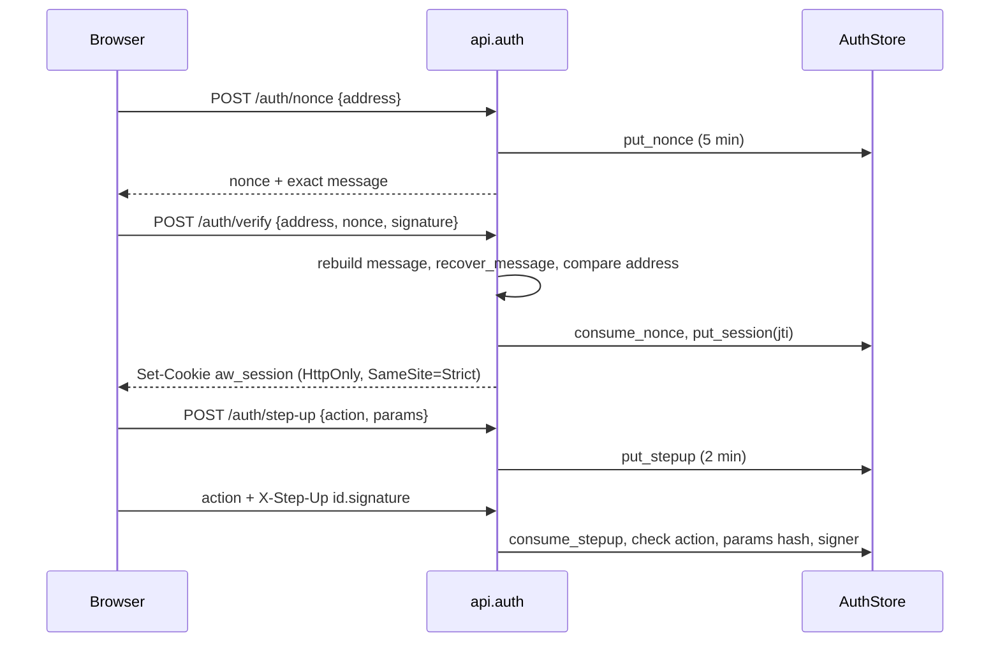

# Wallet sign-in, sessions and step-up

Testnet
only. EOAs only; a contract wallet (EIP-1271) is rejected with a clear message.

## Modules

| Module | Role |
| :--- | :--- |
| `api/session.py` | `AuthConfig.from_env()` (secret of at least 32 bytes, public origin, bearer flag; unset or short raises `AuthUnavailable`, mapped to 503), `sign_token`, `verify_token`, address normalisation |
| `api/auth.py` | `AuthService`, `router` (`/auth/nonce`, `/auth/verify`, `/auth/logout`, `/auth/step-up`), dependencies `require_session` and `require_step_up(action)`, `InMemoryAuthStore`, `SqliteAuthStore` (`DATA_DIR/auth.sqlite`), RFC 7807 problems |

Wiring: set `app.state.auth_service = AuthService(store, on_login=<create tenant>)`,
`app.include_router(router)` and call `install_auth_handlers(app)` so the dependencies return
`problem+json` on other routes. The session comes only from `require_session`; no route reads an
owner address from a body, query or header.

## Rules

- **Nonce** is 32 hex random digits plus the issue time (8 hex digits), so the message is rebuilt
  byte for byte from the nonce and the configured domain; a different domain, chain id or text
  changes the recovered address (`signature-invalid`). Single use; consumed only after the signature
  matches, so a wrong signer cannot burn the owner's nonce. 10 nonces per address per minute.
- **Session token** `base64url(payload).base64url(HMAC-SHA256)`, payload `{addr, iat, exp, jti}`,
  8 hours, compared in constant time; the `jti` must exist, be unrevoked and belong to `addr`.
  Cookie `aw_session`: HttpOnly, SameSite=Strict, Secure unless the origin host is local.
  `Authorization: Bearer` only when `AGENT_WALLET_ALLOW_BEARER=1`.
- **CSRF** for state-changing methods: header `X-AW-CSRF: 1` and `Origin` equal to
  `AGENT_WALLET_PUBLIC_ORIGIN`, else `403 csrf`. Applies to cookie sessions and to the sign-in
  routes; bearer clients carry no ambient credential and are exempt.
- **Step-up** actions: `release_stop`, `tier_raise`, `policy_change`, `withdraw`, `approve`. The
  challenge text names the action and the canonical JSON parameters. `require_step_up(action)`
  takes the parameters from path parameters plus the JSON object body (override with
  `params_from`). The challenge is consumed before any comparison, so every failure burns it.
  Emergency stop needs the session only.
- **Problems**: `unauthenticated`, `signature-invalid`, `step-up-required` (with a `challenge`
  hint), `csrf`, `rate-limited`, `service-unavailable` (503, fail closed), `invalid-request`.
- **Logs** carry the address on login only; never a secret, token or signature.
