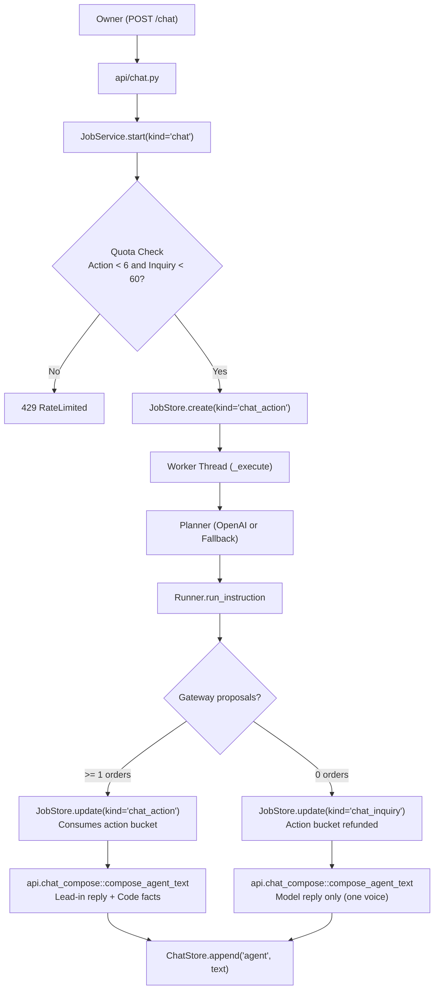
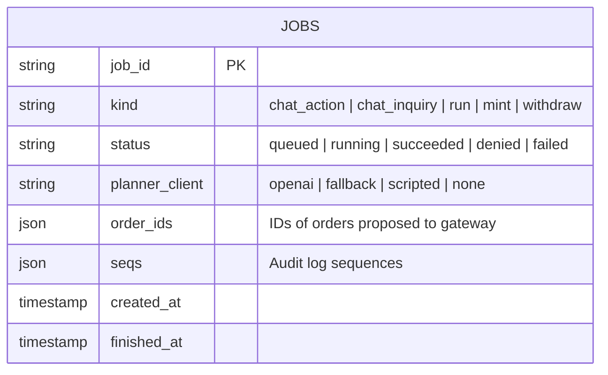

# Chat Quota Buckets and One-Voice Composition

Owning modules:
- `api/jobs.py`: `JobLimits`, `JobService` (quota check, action/inquiry classification, refund).
- `api/chat_compose.py`: `compose_agent_text` (one-voice composition).
- `core/agent/planner.py`: `FallbackPlanner` (keyword routing, swap support).
- `core/storage`: `JobStore` implementations (`SqliteJobs`, `PgJobStore`).

Specification: [`docs/design/webapp/chat-v3-spec.md`](../../design/webapp/chat-v3-spec.md).

## Purpose

1. **Two Quota Buckets:** Separates chat quota into `chat_action` (shares 6/hr limit with `run`) and `chat_inquiry` (own limit 60/hr). Chat jobs that finish with zero gateway proposals are recorded as inquiries and refund the action bucket.
2. **Fallback Swap Fix:** Removes `swap` from `_OWNER_ONLY_WORDS` in `FallbackPlanner` so swapping is not falsely refused as an owner-only action.
3. **One Voice:** Removes the boilerplate "No transaction was made." prefix and "Agent says: " label. For questions and no-action replies, the model reply is the entire text; for actions with orders, the model reply serves as a lead-in line before the code-recorded facts.

## Architecture and Flow

## Data Schema & Accounting

