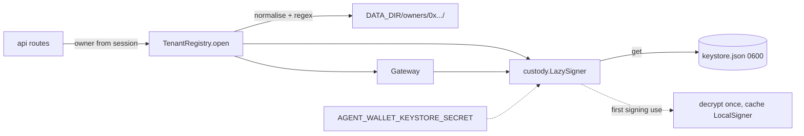

# Custody, tenancy and storage interfaces

Source of truth: `docs/design/webapp/system-design.md` sections 4, 5 and 13. Testnet only. This is a
custodial service: the server holds each agent key. Never send real funds.

## Modules

| Module | Role |
| :--- | :--- |
| `core/storage/interfaces.py` | Protocols only (`TierRead`, `TierWrite`, `AuditStore`, `IntentStore`, `LedgerQueries`, `GatewayLockProvider`, `KeystoreStore`, `OwnerRegistry`, `AuthStore`, `JobStore`, `PolicySelectionStore`, `SettingsStore`, `TenantStores`, `StorageBackend`) and `StorageUnavailable`. No `sqlite3` or `psycopg` import. Adapters implement SQLite and PostgreSQL storage backends |
| `core/gateway/custody.py` | Generate, encrypt, store, decrypt once, rotate. Importable only by `core.gateway` (boundary test). Contains the file `KeystoreStore` adapter |
| `core/gateway/tenant.py` | `TenantRegistry.open(owner)` builds the per-owner objects and a `Gateway`; the only gateway module the API imports |
| `core/gateway/setup.py` | `python -m core.gateway.setup` writes the two secrets into `.env` if absent |

## Key custody

- `create_agent_wallet` runs `Account.create`, encrypts with `Account.encrypt(key, secret, kdf=...)`
  and stores the Web3 Secret Storage JSON through a `KeystoreStore`. It returns only the address
  and refuses to overwrite an existing keystore (`O_EXCL`, mode `0600`).
- Secret: `AGENT_WALLET_KEYSTORE_SECRET`, at least 32 bytes. Unset or short: creation and signing
  raise `CustodyUnavailable` (fail closed). The address is read from the stored `address` field, so
  reads keep working without the secret.
- KDF: `AGENT_WALLET_KEYSTORE_KDF` = `scrypt` (default) or `pbkdf2`; stored in the JSON.
- `LazySigner` decrypts on the first signing use and caches the `LocalSigner`. The decrypted
  address must equal the stored one.
- Rotation: `python -m core.gateway.custody rotate` re-encrypts every keystore from
  `AGENT_WALLET_KEYSTORE_SECRET_PREVIOUS` to `AGENT_WALLET_KEYSTORE_SECRET`, checks the address is
  unchanged, and skips keystores that already open with the new secret (safe to rerun).
- Every custody failure raises a fixed message from `None`; the key, the keystore JSON and the
  secret never appear in `repr`, `str`, logs or exception text
  (`tests/webapp/test_custody.py::test_key_never_in_logs_or_errors`).

## Tenancy

- The owner address is lowercased and checked against `^0x[0-9a-f]{40}$` before any path is built;
  no path comes from any other input, and the resolved path is asserted to be inside
  `DATA_DIR/owners`.
- Per owner: `state.sqlite` (tiers), `audit.sqlite` (chain and intents), `gateway.lock.sqlite`,
  `keystore.json`. Two owners never share a directory.
- An LRU of `max_open` (32) tenants; eviction drops the signer reference.
- `Tenant` exposes the address, the `Gateway`, a `TierView` and the paths; never a key.

## Boundary

`tests/test_signer_boundary.py::test_only_gateway_imports_custody` fails if any module outside
`core/gateway` imports `core.gateway.custody` (plain, `from`, or `from core.gateway import custody`).

## Tests

`tests/webapp/test_custody.py`, `test_tenant_paths.py`, `test_keystore.py`.
