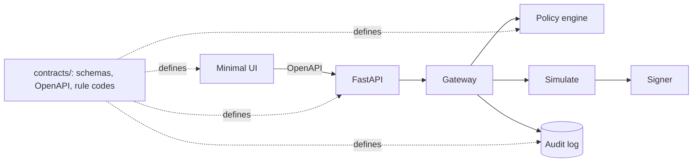

# Data contracts v1: Phase A proposal

Status: draft for orchestrator review (Phase A). Ticket: issue #3. Branch: `docs/data-contracts-v1`.
Nothing in `contracts/` exists yet; this note fixes the design choices before the files are written.

## Question and constraints
- S1 (gateway) and S2 (policy engine) need one shared, language-neutral definition of Order, Decision, IPS, portfolio, risk inputs, execution result, audit record and tier state, so parallel workers do not diverge.
- Fixed by the owner (issue #3, decisions 1 to 8): JSON Schema 2020-12 plus one OpenAPI 3.1 file; money as an integer string plus `decimals`; USD as a decimal string; client UUID order ids that never execute twice; `Decision` separate from `Outcome`; stable rule codes in one file; canonical-JSON SHA-256 hash chain starting at 64 zeros; integer `schema_version` on every object; RFC 7807 errors; no auth when local.
- Hard rule from the draft (sections 3 and 8): an order contains only enum values, never an address or free text. The agent has read access to the IPS and no write path.
- The independent check validates the schemas with plain `jsonschema` and the three-record chain. So each schema file should work without a custom reference registry.

## Decision 1: how schemas share definitions

| Option | Trade-off |
| :--- | :--- |
| A. One self-contained file per object, shared fragments (`Amount`, `Uuid`, `UtcTimestamp`, enums) repeated in `$defs` of each file | No cross-file resolution; any `jsonschema` call works; each file readable alone. Cost: small duplication, drift risk. |
| B. A `common.schema.json` referenced by `$ref` from the 8 files | No duplication. Needs a registry or base URI to resolve; a 9th file without `schema_version` breaks "each schema has `schema_version`". |
| C. One bundled file with all objects under `$defs` | Single source, but contradicts the required `contracts/schemas/<name>.schema.json` layout. |

Recommendation: **A**. Embedded objects (`Order` and `Decision` and `ExecutionResult` inside `DecisionRecord`) are repeated as `$defs` copies. Drift is controlled by two things: the copies are byte-identical fragments, and the validation step checks that every example of the embedded object also validates against the standalone schema. The cost of A is paid once; the cost of B is paid by every consumer.

## Decision 2: how "pending approval" is modelled

| Option | Trade-off |
| :--- | :--- |
| A. Mutable status field on a stored record | Breaks append-only and the hash chain. Rejected. |
| B. Append a new `DecisionRecord` for the same `order_id` at each state change (`pending_approval`, then `executed`, `denied` or `failed`) | Log stays append-only; the full history of one order is reconstructable by `order_id`. Cost: "current state" is the last record for that order. |
| C. Separate approval table outside the audit log | Approval (a permission event) would not be tamper-evident. Rejected. |

Recommendation: **B**. `Decision.decision` is the policy result (`allow | deny | escalate`). `escalate` produces a record with outcome `pending_approval`; the owner's approval (`POST /orders/{order_id}/approve`) appends a second record whose `approval.approved_by` is `owner` and whose outcome is `executed` or `failed`. The same `order_id` is accepted once for execution; a replay returns the stored result (same body) or 409 `order-id-conflict` (different body). No order is hashed twice.

`no_action` has no order. Recommendation: `order_id` is required except when `outcome = no_action`, where it is `null` (enforced with `if/then` in the schema).

## Decision 3: how money, ratios and portfolio value are represented

- Token amount: `{ "value": "<digits>", "decimals": <int> }`. `value` is a string of digits only (no sign, no exponent). `decimals` is repeated per token on purpose (decision 2); an `if/then` pins `USDC` to 6 and `WETH` to 18 so a mismatch fails validation.
- USD: decimal string `^-?[0-9]+(\.[0-9]{1,6})?$`.
- **Ratios are integer basis points.** The sample IPS in section 6 uses `0.40`, `0.05`, `0.5`; floats are forbidden by decision 2 and would break canonical hashing across languages. v1 uses `max_weight_bps: 4000`, `min_stable_weight_bps: 6000`, `rebalance_band_bps: 500`, `max_reward_apy_share_bps: 5000`. A mapping table goes in `contracts/README.md`. This is a visible change from the sample; flagged as open question Q1.
- Portfolio: a list of positions (`token`, `balance` as Amount, `price_usd` string, `value_usd` string, `weight_bps` int) plus `total_value_usd`, `as_of` (UTC) and `price_source` enum. Values are computed by code; the schema only carries them. Testnet token prices follow the mainnet price of the token (draft section 6); recorded as `price_source: "mainnet_reference"`.
- Spend counters needed by `LIMIT.PER_DAY` and `LIMIT.TX_PER_HOUR` live in `portfolio-state` (`spent_24h_usd`, `tx_count_1h`), so the policy engine stays a pure function of (IPS, portfolio state, risk inputs, order).

## Decision 4: IPS shape and what the agent cannot edit

- Same sections as the sample: `universe`, `allocation`, `risk`, `limits`, `approval`, plus `ips_version` (this is the IPS `schema_version`; one field, not two), `owner` (address pattern, the only address in the IPS), `objective` (owner-written text, max length).
- `additionalProperties: false` at every level; enum-only universe lists; `minItems: 1` and `uniqueItems`. There is no field for permissions, tool grants or "editable" flags, and no OpenAPI write endpoint for the IPS (only `GET /ips`). Changes happen out of band by the owner as a new file and hash.
- The hash of the IPS is outside the IPS object (it cannot contain itself): `GET /ips` returns `{ips, ips_hash}` and every `Decision` carries the `ips_hash` it was evaluated under.
- `rủi-ro-cao`: the IPS schema is a permission boundary; the owner reviews the PR.

## Decision 5: tiers

- `tier-state`: `tier` in `T0 | T1 | T2`, `emergency_stop` boolean, `updated_at`, `changed_by` (`owner` only), `schema_version`.
- T3 ("needs approval") is not a value: the draft says it is always on with T2 and is driven by `approval.escalate_above_usd`. So T3 is the rule `TIER.APPROVAL_REQUIRED`, not a tier. The draft and `PLAN.md` list T3 as a tier; flagged as Q2.
- Only the owner changes the tier (endpoint exists; no agent role in the API). The emergency stop is a separate endpoint and a separate field so that stopping never needs a tier change.

## Decision 6: rule codes

Family prefixes follow the issue: `ACCESS`, `LIMIT`, `ALLOC`, `RISK`, `TIER`. Entries come from draft sections 6 (IPS and tiers), 7 (risk table) and 9 (scenarios AM, SEC, CMP). Proposed list (about 23 codes):

- ACCESS: `TOKEN_NOT_ALLOWED`, `PROTOCOL_NOT_ALLOWED`, `FUNCTION_NOT_ALLOWED`, `RECIPIENT_NOT_ALLOWED`, `UNLIMITED_APPROVAL`
- LIMIT: `PER_TX`, `PER_DAY`, `TX_PER_HOUR`
- ALLOC: `MAX_WEIGHT_PER_ASSET`, `MIN_STABLE_WEIGHT`, `WITHIN_REBALANCE_BAND` (no-action reason, not a violation)
- RISK: `POOL_TVL_TOO_LOW`, `REWARD_APY_SHARE_TOO_HIGH`, `APY_UNSTABLE`, `DEPEG_TOO_WIDE`, `UTILIZATION_TOO_HIGH`, `SLIPPAGE_TOO_HIGH`, `COST_EXCEEDS_BENEFIT`, `DATA_STALE`
- TIER: `READ_ONLY`, `PROPOSE_ONLY`, `EMERGENCY_STOP`, `APPROVAL_REQUIRED`

Each entry: `code`, `family`, `description`, plus `source` (draft section) for traceability. Codes are append-only: a code is never renamed or reused. Thresholds are never in this file; they are IPS values and are illustrative.

## Decision 7: Decision, ExecutionResult, DecisionRecord

- `Decision`: `schema_version`, `order_id`, `decision` (`allow | deny | escalate`), `rules_hit` (each `{code, evidence}`; `evidence` is a flat object of string, integer or boolean values, never nested, so the UI and eval can render it), `reason` (human-readable, generated by code from rules and evidence), `ips_hash`, `decided_at`.
- `ExecutionResult`: `status` (`executed | failed`), `tx_hash` (nullable pattern `0x` + 64 hex), `chain_id` (84532), `block_number`, `gas_used`, `error_code` enum (`SIMULATION_FAILED`, `BALANCE_DELTA_UNEXPECTED`, `TX_REVERTED`, `SIGNER_UNAVAILABLE`), `executed_at`.
- `DecisionRecord`: `schema_version`, `seq` (from 0), `order_id` (nullable only for `no_action`), `order` (nullable), `decision`, `outcome`, `execution` (nullable), `approval` (nullable: `approved_by`, `approved_at`), `tier`, `emergency_stop`, `created_at`, `prev_hash`, `hash`.
- Hashing: canonical JSON as in decision 6 of the issue (sorted keys, separators `,` and `:`, UTF-8, no ASCII escaping, nulls kept, no floats exist in any contract). `hash` = lowercase hex SHA-256 over the record without `hash`. The sample chain gets recomputed by a short Python snippet whose command and output go in the report.

## Decision 8: OpenAPI and errors

- Paths: `POST /orders`, `GET /decisions`, `GET /portfolio`, `GET /tier`, `PUT /tier`, `POST /emergency-stop`, `GET /ips`, `GET /eval/report`, `POST /orders/{order_id}/approve`.
- Schemas are referenced from `components/schemas` as `$ref` to `schemas/*.schema.json`. OpenAPI 3.1 supports 2020-12 so no translation is needed.
- All error responses are `application/problem+json` with `type` (`urn:agent-wallet:problem:<slug>`), `title`, `status`, `detail`, and an extension `rule_codes` where relevant. A policy `deny` is not an HTTP error: `POST /orders` returns 200 with the `DecisionRecord`; problem responses are for malformed input (422), unknown order (404), id conflict or double approval (409), emergency stop active on write (409).
- `GET /eval/report` response is a loose envelope defined inline (`schema_version`, `generated_at`, `metrics`, `scenarios`); it is not one of the 8 schemas and its scenario list follows draft section 9. Flagged Q4.

## Recommendation summary
Option A (self-contained schemas), append-only approval records, basis points for ratios, T3 as a rule not a tier, flat evidence objects, `order_id` null only for `no_action`.

## Open questions (recommended answers)
| # | Question | Recommended answer |
| :--- | :--- | :--- |
| Q1 | Ratios as basis points instead of the sample's decimals; the sample IPS values change form, not meaning. OK? | Yes. Floats break cross-language hashing and decision 2. |
| Q2 | Is T3 a tier value or the approval rule? | The rule `TIER.APPROVAL_REQUIRED`, driven by `approval.escalate_above_usd`; tier enum is `T0, T1, T2`. |
| Q3 | Does a `no_action` cycle get an order id? | No; `order_id` is `null` for it. |
| Q4 | Eval report shape: freeze now or leave loose? | Loose in v1 (inline in OpenAPI), freeze when S6 starts; eval metrics list comes from section 9. |
| Q5 | Is rejecting a pending order in scope? | Not in v1 (issue lists approve only). Recommend adding `POST /orders/{order_id}/reject` and an `expired` state in v1.1. |
| Q6 | Should a simulation failure carry a rule code? | No; it is an `Outcome = failed` with `error_code`, not a policy rule. |
| Q7 | Exact decimals and price source for testnet tokens. | Pin USDC 6 and WETH 18 in v1; price source `mainnet_reference` (draft section 6). Thresholds stay illustrative. |
| Q8 | Issue Docs says not to edit root `README.md`; the task file allows one row each for `contracts/` and `docs/architecture/`. | Follow the task file (PR #2 is already merged); the orchestrator can drop the two rows if it prefers. |

## Files to produce in Phase B
- `contracts/schemas/{order,portfolio-state,risk-inputs,ips,decision,execution-result,decision-record,tier-state}.schema.json`
- `contracts/openapi.yaml`
- `contracts/rule-codes.json`
- `contracts/examples/<name>.valid*.json` and `<name>.invalid*.json` for each of the 8, plus `decision-record.chain.json` (3 records)
- `contracts/README.md`
- `docs/architecture/contracts.md` (Mermaid and `erDiagram`)
- `README.md`: two rows in the repository map
- This note is updated with the final decisions after `advice-1.md`.

## Where contracts sit (preview)

