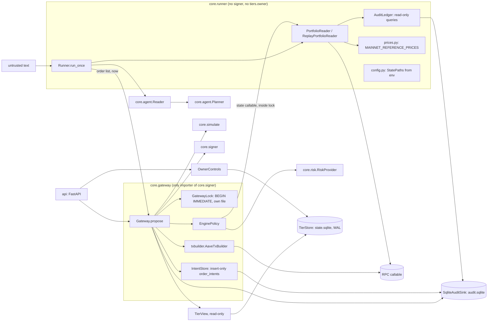
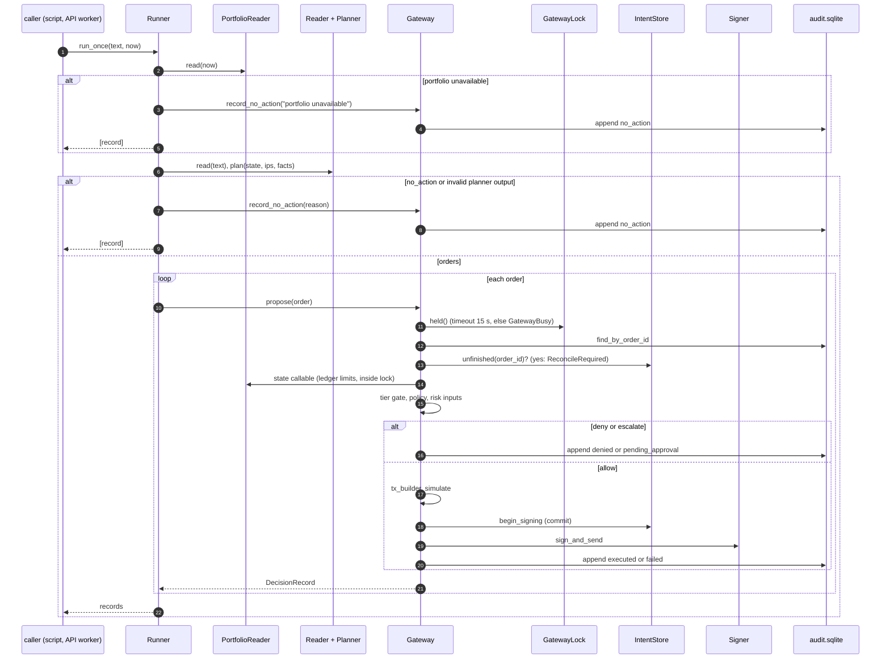
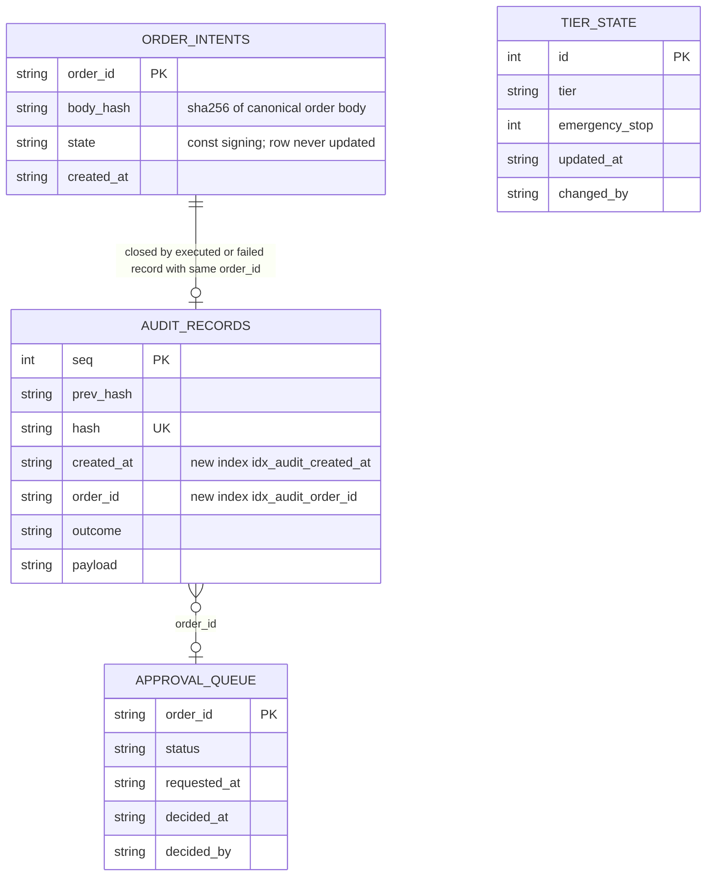

# Runner design (ticket #48): planner to gateway end to end

Status: final design (Phase B). Risk label: **`rủi-ro-cao`**. This design changes the gateway (path to the signer), adds a gateway-owned table, changes the audit sink, and changes `core.tiers.store` (a permission-tier module). It changes no tier semantics and no contract schema. The signer interface is not changed.

Inputs: [`proposal.md`](proposal.md) and the orchestrator's `advice-1.md`. The advice is applied point by point in the last section.

## 1. Problem and decisions

| Gap | Today | Decision |
| :--- | :--- | :--- |
| Limits are cosmetic | `scripts/live_first_tx.py` hardcodes `spent_24h_usd = "0"`, `tx_count_1h = 0` | Derived from the audit log by `AuditLedger`, read **inside** the gateway lock |
| Idempotency is in memory | `Gateway._orders`, `_in_flight` | Audit lookup by `order_id` plus a gateway-owned insert-only `order_intents` table; unfinished intent raises `ReconcileRequired` |
| Two TierStores | each process opens its own | One SQLite file via `AGENT_WALLET_DATA_DIR`, WAL and busy timeout |
| Tx builder lives in a script | `full_tx` in `scripts/` | `core/gateway/txbuilder.py`, used by script and runner; builder errors recorded as `failed` |
| Private `tier_view._store` fallback | gateway reaches into a private attribute | Public `TierView.get_approval(order_id)` |

## 2. Component diagram



Files in `AGENT_WALLET_DATA_DIR` (default `.data/`, ignored by git): `state.sqlite` (TierStore), `audit.sqlite` (audit chain and `order_intents`), `gateway.lock.sqlite` (lock only).

## 3. Module layout and boundaries

| Module | Class | Calls | Must never |
| :--- | :--- | :--- | :--- |
| `core/runner/runner.py` | `Runner` | `Reader`, `Planner`, `PortfolioReader`, `Gateway.propose`, `Gateway.record_no_action` | import `core.signer`, `core.tiers.owner`, `core.gateway.intents`; write the audit sink or a tier; decide allow or deny |
| `core/runner/portfolio.py` | `PortfolioReader`, `ReplayPortfolioReader` | injected `rpc`, `AuditLedger`, `prices` | cache balances across calls; return zero for an unreadable balance |
| `core/runner/ledger.py` | `AuditLedger` | read-only SQL on `audit_records` | write, update or delete; count non-`executed` records |
| `core/runner/prices.py` | `MAINNET_REFERENCE_PRICES`, `price_usd(token)` | none | return a default for an unknown token |
| `core/runner/config.py` | `StatePaths`, `from_env()` | env only | read or log a secret value |
| `core/gateway/txbuilder.py` | `AaveTxBuilder` | injected `rpc`, `core.protocols.aave.build_calls` | sign, send, or hold a key |
| `core/gateway/lock.py` | `GatewayLock` | stdlib `sqlite3` on `gateway.lock.sqlite` | proceed without the lock |
| `core/gateway/intents.py` | `IntentStore` | `audit.sqlite` table `order_intents` | be imported outside `core.gateway`; update or delete a row |
| `core/tiers/view.py` | `TierView.get_approval` | `TierStore.get_approval` | expose a mutator |

## 4. Interfaces (Python signatures)

```python
# core/runner/config.py
@dataclass(frozen=True)
class StatePaths:
    tiers: Path          # AGENT_WALLET_DATA_DIR/state.sqlite
    audit: Path          # AGENT_WALLET_DATA_DIR/audit.sqlite
    lock: Path           # AGENT_WALLET_DATA_DIR/gateway.lock.sqlite
def from_env(env: Mapping[str, str]) -> StatePaths: ...   # unset dir -> ".data"

# core/runner/prices.py  (labelled reference values, NOT testnet market prices)
PRICE_SOURCE: Final = "mainnet_reference"
MAINNET_REFERENCE_PRICES: Final[Mapping[str, str]] = {"USDC": "1.00"}
def price_usd(token: str) -> Decimal: ...                 # raises PriceUnavailable

# core/runner/ledger.py
class AuditLedger:
    def __init__(self, audit_db: Path | str) -> None: ...  # read-only connection
    def spent_usd_since(self, since: datetime) -> Decimal: ...   # executed, function != approve
    def executed_count_since(self, since: datetime) -> int: ...  # executed, any function

# core/runner/portfolio.py
RpcCall = Callable[[str, list[Any]], Any]
@dataclass(frozen=True)
class WalletSnapshot:
    state: dict[str, Any]       # validates against portfolio-state.schema.json
    eth_wei: int                # gas balance, outside PortfolioState (schema has no ETH)
class PortfolioReader:
    def __init__(self, rpc: RpcCall, wallet: str, ledger: AuditLedger) -> None: ...
    def read(self, now: datetime) -> WalletSnapshot: ...  # raises PortfolioUnavailable
class ReplayPortfolioReader:
    def __init__(self, fixture: Path, ledger: AuditLedger) -> None: ...
    def read(self, now: datetime) -> WalletSnapshot: ...  # fixture balances, ledger limits

# core/runner/runner.py
class Runner:
    def __init__(self, reader: Reader, planner: Planner, portfolio: PortfolioReaderLike,
                 gateway: Gateway, ips: LoadedIps, clock: Callable[[], datetime]) -> None: ...
    def run_once(self, untrusted_text: str, now: datetime) -> list[dict[str, Any]]: ...

# core/gateway/txbuilder.py
class TxBuildError(Exception): ...
class AaveTxBuilder:
    def __init__(self, rpc: RpcCall, wallet: str, chain_id: int = 84532,
                 max_head_age_s: int = 60, allow_estimate_fallback: bool = False) -> None: ...
    def __call__(self, order: dict[str, Any]) -> list[dict[str, Any]]: ...  # full txs, nonces n, n+1, ...

# core/gateway/lock.py
class GatewayBusy(GatewayError): ...
class GatewayLock:
    def __init__(self, path: Path, acquire_timeout_s: float = 15.0) -> None: ...
    @contextmanager
    def held(self) -> Iterator[None]: ...    # raises GatewayBusy on timeout

# core/gateway/intents.py
class IntentStore:
    def begin_signing(self, order_id: str, body_hash: str, now: str) -> None: ...  # insert-only
    def unfinished(self, order_id: str) -> bool: ...  # intent exists, no executed/failed record

# core/gateway/exceptions.py
class ReconcileRequired(GatewayError): ...

# core/gateway/gateway.py additions
class Gateway:
    def record_no_action(self, reason: str, now: str) -> dict[str, Any]: ...  # outcome=no_action
# core/audit/sink.py additions
class SqliteAuditSink:
    def find_by_order_id(self, order_id: str) -> dict[str, Any] | None: ...   # latest by seq
```

## 5. Required items answered

### 5.1 Portfolio reader (item 2)
- Reads over the injected `rpc` callable: USDC `balanceOf(wallet)`, aUSDC `balanceOf(wallet)` (address from `core.protocols.addresses`), `eth_getBalance`. USDC in the wallet is position `USDC` at `wallet`; aUSDC is position `USDC` at `aave-v3` (the schema has no aUSDC token). ETH goes to `WalletSnapshot.eth_wei` only and feeds the builder's gas check.
- Valuation: integer balances times `MAINNET_REFERENCE_PRICES` (`core/runner/prices.py`), `price_source = "mainnet_reference"`, the only value the schema allows. Testnet prices are not meaningful, so every position says reference value; the runner copies `price_source` into the run summary and the eval report must print "reference prices, not testnet market prices".
- An RPC error raises `PortfolioUnavailable`; the reader never substitutes zero. A token without a price is omitted from `positions`, so the engine denies `LIMIT.PER_TX` with `price_missing` (fail closed).
- `ReplayPortfolioReader` loads balances from a fixture file but still takes `spent_24h_usd` and `tx_count_1h` from the ledger, so replay exercises the same limit path.

### 5.2 Limits from the audit log (item 3)
- Query shape: `SELECT payload FROM audit_records WHERE outcome = 'executed' AND created_at > :since` (index `idx_audit_created_at`), then in Python `function != 'approve'` and USD = `amount / 10**decimals * price_usd(token)`.
- Windows: 24 hours for spend, 1 hour for count, both `> now - window`, `now` injected, UTC.
- Counts: `executed` only. `pending_approval`, `denied`, `failed`, `no_action` never count. `approve` is excluded from spend and included in `tx_count_1h`. An order executed after owner approval counts at the time of its `executed` record.
- Race: the state callable runs inside `Gateway.propose`, under `GatewayLock`, in the same critical section as simulate, sign and append. Two concurrent proposes (API plus runner) are serialised, so the second sees the first one's `executed` record.

### 5.3 Idempotency (item 4)
Inside the lock, in order:
1. `find_by_order_id(order_id)`. A record with a different `order` body raises `OrderIdConflict`.
2. Same body: `executed` and `failed` return the stored record (terminal; a retry needs a new `order_id`). `pending_approval` and stop-denied keep today's re-evaluation rules from `gateway-wiring.md`.
3. No record, but `IntentStore.unfinished(order_id)`: raise `ReconcileRequired`. Nothing is signed and no record is written (the order may have been signed).
4. New order: run policy and simulation. Only after simulation passes and immediately before `sign_and_send`, `IntentStore.begin_signing` commits a row. After `append` the record closes the intent by existing, no update.

Restart: `_orders` and `_in_flight` are removed; everything above reads the files, so a restart changes nothing.

### 5.4 One TierStore file (item 5)
`from_env` builds the paths once; the API app factory and the runner both open `StatePaths.tiers` (`TierStore(path)`), each in its own process. `TierStore.__init__` sets `PRAGMA journal_mode=WAL` and `PRAGMA busy_timeout=5000`. The gateway already reads tier and stop on every propose and keeps no cache, so a stop engaged through the API denies the next propose with `TIER.EMERGENCY_STOP`. If WAL cannot be used (network filesystem), documented fallback: run API and runner in one process (cut order, section 9).

### 5.5 Gateway-side tx builder (item 6)
- Interface: `AaveTxBuilder(rpc, wallet)` is the `tx_builder` callable the gateway already accepts. It wraps `build_calls` and fills `chainId`, `nonce`, `gas`, `maxPriorityFeePerGas`, `maxFeePerGas` (logic moved from `full_tx`: gas = estimate times 13/10, tip 0.001 gwei, max fee = 2 times base fee plus tip).
- Nonce: one read of `eth_getTransactionCount(wallet, "pending")` per order, then `n, n+1, ...` for a multi-call order. It also reads `latest`; if `pending < latest` the node is inconsistent and the builder raises `TxBuildError`.
- Stale node: the head block timestamp must be within `max_head_age_s` (60) of the injected clock, else `TxBuildError`. `eth_chainId` must be 84532.
- Gas: `eth_estimateGas` failure raises `TxBuildError`. The 400000 fallback exists only with `allow_estimate_fallback=True`, which only the dry-run script sets; the runner never does.
- Gas funds: `eth_getBalance` below `gas * maxFeePerGas` raises `TxBuildError`.
- Gateway change: `_execute_order` catches `TxBuildError` (and any builder exception) and records `outcome=failed`, `error_code=SIMULATION_FAILED`, `detail="tx build: <sanitized message>"` (<= 500 chars, passes `_sanitize_error_detail`), so the failure is in the chain. Signer never called.

### 5.6 `run_once` contract (item 7)
`run_once(untrusted_text, now) -> list[DecisionRecord]`:
1. `snapshot = portfolio.read(now)`; on `PortfolioUnavailable` append one `no_action` record via `Gateway.record_no_action("portfolio unavailable")` and return it. Nothing is proposed.
2. `facts = Reader.read(untrusted_text)`; `plan = Planner.plan(snapshot.state, ips, facts)`.
3. If `plan.is_no_action` (explicit no_action, or output rejected by schema validation): `Gateway.record_no_action(reason, now)`; return that single record. `validation_errors` are put in the reason (truncated to the schema's `Reason` limit).
4. For each planned order, in planner order: `Gateway.propose(order)`; append its record. A policy-denied order is recorded by the gateway as `denied` with the engine's `rules_hit`; the runner adds nothing. Stop the loop after a `failed` outcome, `GatewayBusy` or `ReconcileRequired` (the exception propagates after the earlier records were returned through the exception's `records` attribute; in v1 the runner re-raises and the audit log holds the earlier records).
5. Persisted: only what the gateway appends (one record per order, or one `no_action`). The runner has no audit write path.

### 5.7 Lock bounds (advice 1)
`GatewayLock` uses its own file, `gateway.lock.sqlite`, not `audit.sqlite`: holding `BEGIN IMMEDIATE` on the audit file would block the same process's `append` (correction to the proposal wording). Acquire timeout 15 s; on timeout it raises `GatewayBusy` before any state read, so nothing is signed or recorded and the caller may retry. Longest hold is bounded by the RPC timeouts: estimate 30 s + simulate 30 s + send 30 s, so under 120 s per propose; RPC callables must carry a timeout (`httpx` already does 30 s in the script). If the process dies while holding it, SQLite rolls the transaction back and releases the lock; the next propose acquires it and handles an unfinished intent by `ReconcileRequired`.

## 6. Sequence of `run_once`



## 7. ERD (new or changed tables)



`order_intents` has `BEFORE UPDATE` and `BEFORE DELETE` triggers like `audit_records`. It lives in `audit.sqlite` but outside the hash chain; `IntentStore` is the only writer. `tier_state` and `approval_queue` are unchanged (only pragmas).

## 8. Evidence plan (item 8)
`scripts/runner_evidence.py` (ticket T6) builds the real stack with the same factory the API uses and never calls the signer or `propose` bypass; every order goes through `Runner.run_once`. Owner's live confirmation variable is required, as in `live_first_tx.py`.
1. Cycle 1 (executed): the Planner proposes `approve 1 USDC` then `supply 1 USDC` (two orders, as in the live path). Both pass policy and execute; two tx hashes.
2. Cycle 2 (denied): the Planner proposes a supply above `per_tx_usd`, or the text is a hostile injection corpus string; the policy denies with `LIMIT.PER_TX` or `ACCESS.*`. No tx.
3. Output to `docs/evidence/runner-*.{md,jsonl,txt}`: tx hashes, `python -m core.audit.verify` result on the exported chain, and a line "Planner client: OpenAIClient | ScriptedClient". `OpenAIClient` is used when `OPENAI_API_KEY` is set, `ScriptedClient` otherwise; the file says which. If the live model is nondeterministic and does not produce the denied order, the denied cycle uses `ScriptedClient` and says so.
4. Both cycles are in one chain in one `audit.sqlite`; evidence includes the restart check (re-run `run_once` with the same order id: no new tx).

## 9. Tickets

| # | Ticket | Files touched | Depends | Acceptance test | Risk |
| :--- | :--- | :--- | :--- | :--- | :--- |
| T1 | Audit sink transaction fix | `core/audit/sink.py`, `tests/audit/test_sink_concurrency.py` | none | two processes append 200 records each; `verify_chain` ok, no gap, no `IntegrityError` | `rủi-ro-cao` (audit integrity) |
| T2 | Tx builder, builder errors as `failed`, `TierView.get_approval` | `core/gateway/txbuilder.py`, `core/gateway/gateway.py` (`_execute_order`, `_get_approval_info` only), `core/tiers/view.py`, `scripts/live_first_tx.py`, `tests/gateway/test_txbuilder.py` | none | stale head, `pending < latest`, estimate failure each give `failed` with `detail` starting `tx build:`; two-call builder yields nonces n, n+1 and passes `simulate_bundle` | `rủi-ro-cao` (path to signer) |
| T3 | Ledger, lock, intents, audit-backed idempotency | `core/runner/ledger.py`, `core/gateway/lock.py`, `core/gateway/intents.py`, `core/gateway/gateway.py` (`propose`, `__init__`), `core/gateway/exceptions.py`, `core/audit/sink.py` (`find_by_order_id`, indexes), `tests/gateway/`, `tests/runner/test_ledger.py` | T1; merge after T2 (same file) | seeded log denies `LIMIT.PER_DAY` and `LIMIT.TX_PER_HOUR`; restart same `order_id` does not call signer; raising in `append` after sign then restart gives `ReconcileRequired` and signer not called | `rủi-ro-cao` |
| T4 | TierStore WAL and busy timeout | `core/tiers/store.py`, `tests/tiers/test_shared_file.py` | none | two `TierStore` on one file: stop engaged by one is seen by the other's `TierView` | `rủi-ro-cao` (permission-tier module) |
| T5 | Portfolio reader, prices, config, runner, e2e | `core/runner/{portfolio,prices,config,runner}.py`, `tests/runner/`, `tests/e2e/test_runner_stop.py`, `README.md`, `docs/architecture/runner.md` | T2, T3 (T4 for the e2e) | planner scripted order executes through fake signer; API-engaged stop denies next `run_once` | `rủi-ro-thấp` (no key, no signer import) |
| T6 | Evidence run | `scripts/runner_evidence.py`, `docs/evidence/runner-*` | T5 | one executed and one denied planner order in a chain that `python -m core.audit.verify` passes | `rủi-ro-cao` (live funds, owner confirmation) |
| T7 | `reconcile(order_id, tx_hash_or_none)` owner tool (cut candidate) | `core/gateway/reconcile.py`, `api/app.py` (owner route) | T3 | checks receipt, appends the truthful record, closes the intent | `rủi-ro-cao` |

Parallelism: builder A runs T1 then T3. Builder B runs T2 and T4 in parallel with A, then T5 once T2 and T3 are merged; start `core/runner/prices.py` and `portfolio.py` earlier because they touch no gateway file. `core/gateway/gateway.py` is touched by T2 and T3: they edit different functions, T3 rebases after T2. `core/audit/sink.py` is touched by T1 then T3: sequential, same builder.

Cut order: drop T7 `reconcile`, then the multi-call nonce test, then the WAL change (single-process fallback documented). Never drop persistent limits or audit-backed idempotency.

## 10. "X is enforced" and the test that proves it

| Claim | Test (to be written by the ticket) |
| :--- | :--- |
| Runner never imports `core.signer`, `core.tiers.owner`, `core.gateway.intents` | `tests/runner/test_boundaries.py::test_runner_imports` (AST, like `tests/test_signer_boundary.py`) |
| Only `core.gateway` writes `order_intents` | `tests/test_intent_boundary.py::test_only_gateway_imports_intents` |
| `order_intents` rows cannot be updated or deleted | `tests/gateway/test_intents.py::test_triggers_block_update_delete` |
| Limits come from the audit log, not the caller | `tests/runner/test_ledger.py::test_per_day_denied_from_seeded_log`, `test_tx_per_hour_denied_from_seeded_log` |
| Only `executed` counts; `approve` excluded from spend | `tests/runner/test_ledger.py::test_only_executed_counts`, `test_approve_not_in_spend` |
| Concurrent proposes cannot both pass a limit | `tests/gateway/test_lock.py::test_two_processes_serialised_limit` |
| Lock timeout fails closed, nothing signed | `tests/gateway/test_lock.py::test_timeout_raises_gateway_busy_signer_not_called` |
| Same `order_id` after restart does not execute | `tests/gateway/test_idempotency.py::test_restart_same_order_id_no_second_sign` |
| Crash between sign and append: no re-sign | `tests/gateway/test_idempotency.py::test_append_raises_then_restart_reconcile_required` |
| Different body, same `order_id` conflicts | `tests/gateway/test_idempotency.py::test_body_mismatch_conflict` |
| Stop through API denies runner's next order | `tests/e2e/test_runner_stop.py::test_api_stop_denies_next_run_once` |
| Builder errors are recorded as `failed` with detail | `tests/gateway/test_txbuilder.py::test_builder_error_recorded_failed_with_detail` |
| Unknown token or missing price denies, never zero | `tests/runner/test_prices.py::test_unknown_token_raises`, `tests/runner/test_portfolio.py::test_missing_price_omits_position_and_engine_denies` |
| Records and eval report say prices are reference values | `tests/runner/test_portfolio.py::test_price_source_labelled_mainnet_reference` |
| Chain from a run verifies | `tests/e2e/test_runner_chain.py::test_run_once_chain_verifies` |

## 11. Threat notes (item 10)

| Threat | Can | Cannot |
| :--- | :--- | :--- |
| Compromised planner | Propose any schema-valid order, any id | Hold a key or call the signer; name an address (recipient is an enum); bypass policy, tier, stop, limits; execute a reused `order_id` twice |
| Replayed order | Re-send an old `order_id` | Execute again (audit lookup, intent); change the body (`OrderIdConflict`) |
| Poisoned risk input | Make the engine see healthy pool data | Exceed `per_tx`, `per_day`, tx-per-hour or universe limits; skip simulation. Residual risk: a benign-looking order that is allowed by a falsified `RISK` input, so risk data is read from chain by `OnchainAaveRiskProvider` and stale data denies `RISK.DATA_STALE` |
| Stale state (node or balances) | Cause a failed order | Make the builder sign with a nonce behind `latest` or an old head block (`TxBuildError` recorded `failed`); make limits read from caller-supplied data |
| Compromised runner process | Propose orders | Write `order_intents` or the audit log directly (no import path, boundary tests); mutate tier or approvals (no `owner` import) |
| Lost process mid-sign | Leave an intent without a record | Cause a second signature (`ReconcileRequired`) |

## 12. Open questions (recommended answers)
1. Count on-chain-reverted `failed` orders in `tx_count_1h`? Recommend no (not `executed`). Accepted in advice.
2. Error code for builder failure: reuse `SIMULATION_FAILED`, `detail` prefixed `tx build:`. Accepted in advice.
3. Native ETH outside `PortfolioState`. Accepted in advice.
4. WETH reference price: no value is defined and the choice is a business assumption. Recommend omit WETH from `MAINNET_REFERENCE_PRICES` for v1 (positions with WETH are omitted, orders denied fail-closed) until a swap ticket exists.
5. Should the runner replace the planner's `order_id` with a code-generated one? Recommend no for v1: idempotency already makes a repeated id harmless and replay stays deterministic.
6. Mid-loop failure of `run_once`: return partial records through an exception attribute or let the audit log be the only source? Recommend the latter (v1).

## 13. How the advice was applied

| # | Applied in |
| :--- | :--- |
| 1 | 5.7: acquire timeout 15 s, fails closed before any read, hold bound under 120 s, SQLite releases on death. Note: lock on its own file |
| 2 | T1 is its own ticket, first, two-process test |
| 3 | 5.3 step 3: `ReconcileRequired`, no synthetic `failed`; `reconcile` is T7, cut first; acceptance test named in T3 |
| 4 | `IntentStore` only inside `core.gateway`; boundary test and insert-only triggers in section 10 |
| 5 | T2 acceptance: two-call builder against `simulate_bundle`; live path stays two orders; no atomic multi-call signer path |
| 6 | 5.1: table at `core/runner/prices.py`, labelled `mainnet_reference`; tests for unknown token and label in section 10 |
| 7 | Section 8: Planner client stated in the evidence file; every order goes through `Runner.run_once` and the gateway |
| 8 | Section 9: T1..T7, parallelism and file ownership stated. Deviation: T3 also edits `core/audit/sink.py` and `gateway.py`, so it is sequenced after T1 and T2 |
| 9 | Section 9, cut order line |
| 10 | 5.5 gateway change: `detail` reaches the audit record |
