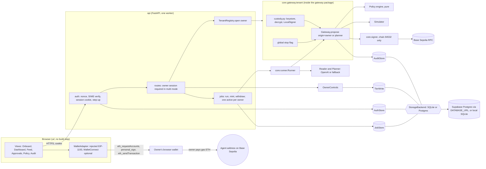
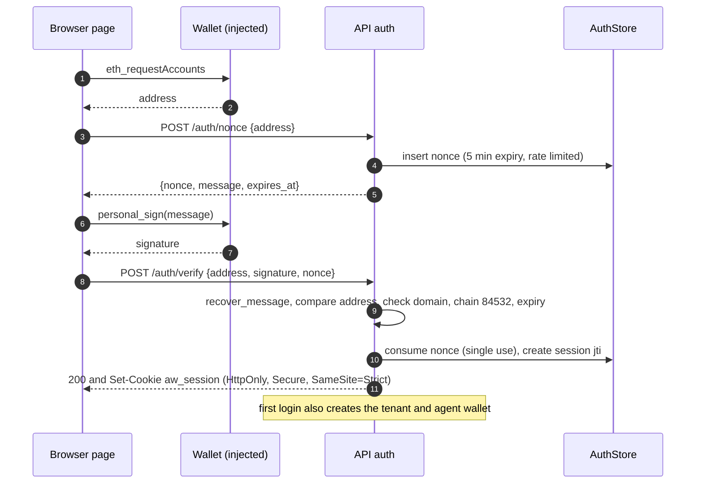
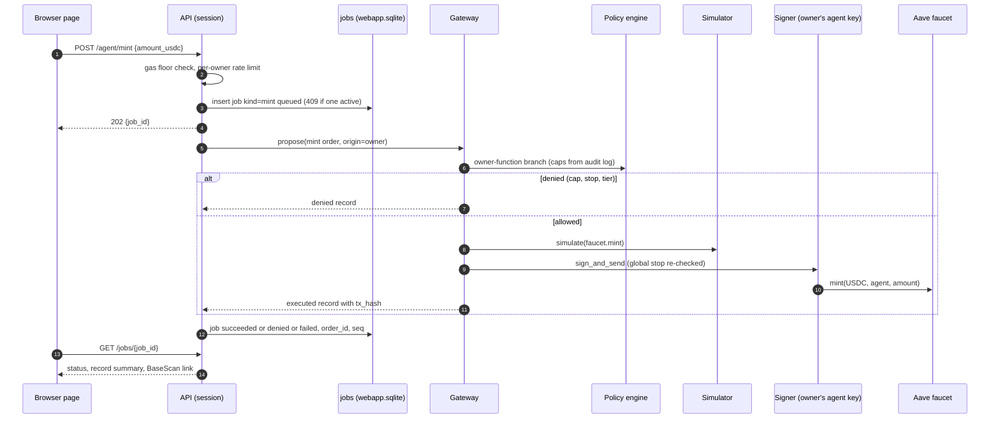
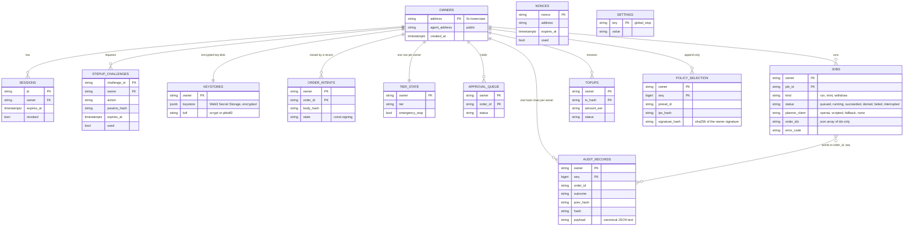

# Webapp design (ticket #71): wallet sign-in, per-owner agent wallet, top-up, mint, live runs

Status: final design (Phase B). Risk label: **`rủi-ro-cao`**. This design moves four security boundaries (key custody, owner authentication, the order contract, and the gateway's path to the signer) and so goes to the owner before any builder starts, except ticket W0 (container fixes), which touches none of them.

Inputs: [`proposal.md`](proposal.md), [`product.md`](product.md), the orchestrator's `advice-webapp-1.md` (applied point by point in section 17) and owner addendum 1 (applied in sections 3, 14, 15 and 16). Testnet only, chain 84532. Nothing here is built yet; "enforced" means "enforced by the named test once its ticket lands".

Addendum 2 (owner decisions, 14 Oct night) is applied throughout and summarised here.

## Amendments (addendum 2)

| Section | Change |
| :--- | :--- |
| 1 | Summary rows for custody, tenancy, deployment and staging updated; storage row added |
| 2 | Component diagram: stores sit behind a storage interface with SQLite and Postgres backends |
| 3 | Rate-limit, backup and secrets rows updated (no mint amount cap; provider backups plus export) |
| 4 | Keystore is an encrypted row (Postgres) or file (SQLite), never plaintext; secret still from env |
| **5** | **Rewritten**: storage interface (Protocols), Postgres design (owner column plus RLS, append-only triggers and grants, advisory locks, migrations, pooling), one parametrised contract suite for both backends |
| 7 | **No mint amount cap in our contract**; the faucet's on-chain maximum and cooldown apply; token and faucet address pinned; owner-origin only; rate limit is a call count per owner per hour (4). Rule codes `LIMIT.MINT_PER_CALL` and `LIMIT.MINT_PER_DAY` removed. Additive enums confirmed; ETH `transfer` outside USD limits confirmed |
| 9 | Global stop also readable from a database `settings` row; fail closed |
| **11** | **Rewritten**: ERD with `owner` columns and composite keys |
| **15** | **Rewritten**: Render free web service plus Supabase Postgres, deploy steps, post-deploy checks, cold start, keep-warm, backup |
| **16** | **Rewritten**: lane P added; Stage 0 re-dated to 18 Oct (owner accepted); who starts tonight; owner approval items including the Postgres driver; cut order puts the hosted demo behind the polish items |
| 17, 19, 20, 21 | Mint rows, new threats (database credentials, SQL injection, provider pause), new tests, decided open questions |

## 1. Summary of decisions

| # | Question | Decision |
| :--- | :--- | :--- |
| 1 | Key custody | `eth_account` keystore per owner (encrypted JSON), written and read only in `core/gateway/custody.py`, stored as a file (SQLite backend) or an encrypted row (Postgres); secret from `AGENT_WALLET_KEYSTORE_SECRET`; decrypted once per process and cached; **custodial and testnet only**, stated on every page |
| 2 | Multi-tenancy | Storage behind Protocols with two backends: SQLite (directory per owner; local, replay, tests) and Postgres (one set of tables, `owner` column, composite keys, RLS; hosted). Owner address only from the session |
| 3 | Auth | SIWE-style message verified with `eth_account`; HMAC session in an HttpOnly cookie; fresh owner signature only for actions that widen authority or move funds |
| 4 | Order contract | New functions `mint` and `transfer`, new recipient `owner`, new token `ETH`, new protocol `wallet`; owner-only; additive under `schema_version` 1 (owner confirmed); IPS schema untouched; **no mint amount cap in our contract** (the faucet enforces its own) |
| 5 | Run flow | Jobs: `202` then poll; one active job per owner; single worker; planner labelled `openai`, `scripted` or `fallback` |
| 6 | Deployment | Render free web service (Docker) plus Supabase Postgres via `DATABASE_URL`; `docker compose up` brings up Postgres and the app, or SQLite in replay mode; four container defects fixed in W0 |
| 7 | Staging | Stage 0 local demo path by 18 Oct (owner accepted), Stage 1 hardening and hosted demo by 19 Oct, Stage 2 roadmap only; Stage 0 wins every conflict; lane P (Postgres) blocks only the hosted demo |

## 2. Component diagram



Boundaries that stay: only `core.gateway` imports `core.signer` and `core.gateway.custody`; the runner imports neither the signer nor `core.tiers.owner` nor `core.gateway.intents`; the LLM never holds a key.

## 3. Production concerns, each in brief

| Concern | v1 (this design) | Production step |
| :--- | :--- | :--- |
| Custody model | Custodial testnet keys, encrypted at rest (section 4) | Non-custodial smart account; owner is root; the agent holds a **scoped session key** (token, function, amount, expiry, target allowlist). The same policy engine decides off-chain; the account contract enforces the same bounds on-chain. Changes: `custody.py` is replaced by a session-key registry, the owner signs a grant instead of the server generating a key, the gateway still simulates and signs but with a session-key signer, and `transfer` to owner becomes unnecessary because the owner keeps the root |
| Per-owner isolation | Directory per owner (section 5) | Same layout on a managed database with per-tenant encryption keys; a process per tenant for high-value accounts |
| Rate limits and abuse | Per owner: 6 runs/hour, 4 mint calls/hour (a count; the faucet enforces its own amount maximum and cooldown), 10 sign-in challenges per address per hour; global: 50 new owners per day (section 12) | Per-IP and per-account limits at an edge proxy, CAPTCHA on registration, budget alarms on the LLM account |
| Observability | JSON logs with `request_id`, no secrets, redaction filter; `GET /audit/verify` per owner; `/health` and `/ready` | Metrics (run latency, deny rate, mint volume), alerts on chain-verify failure, tracing |
| Backup and restore | Postgres: the provider's backups where the plan has them (Supabase free: none, unverified) plus `python -m core.storage.export`; SQLite: online backup per file; restore drill is a test | Provider point-in-time recovery, encrypted off-site snapshots |
| Key rotation | Secret rotation re-encrypts keystores (`..._PREVIOUS` accepted); agent key rotation sweeps funds via `transfer` | KMS-wrapped data keys, automatic rotation |
| Secrets management | Env vars only, generated by `python -m core.gateway.setup`, never printed, never in the image or repo | Host secret store or KMS; separate secrets per environment |
| CI/CD and environments | Local, CI (offline, fakes), hosted demo (optional). CI runs lint, tests, secret scan, signer and custody boundary checks, OpenAPI route equality, a headless login test and a compose smoke test | Staging with a funded test wallet, signed images, protected deploys |
| Incident response | Per-owner emergency stop (session only) and **global stop** (operator flag, section 9); runbook below | Pager, on-call, automated stop on chain-verify failure |
| Data retention | Audit logs kept for the life of the tenant; nonces and expired sessions purged after 24 h; job rows after 30 days | Per-jurisdiction retention policy and export or delete on request |
| Legal and compliance notes | Testnet only; no real value; not financial advice; custody disclaimer on every page and in the README; no personal data beyond the wallet address | Terms of service, KYC and AML review, licensing analysis for custody |

Incident runbook (v1): (1) set the global stop (`touch DATA_DIR/GLOBAL_STOP`); (2) export each affected owner's chain (`python -m core.audit.verify`); (3) rotate `AGENT_WALLET_SESSION_SECRET` (invalidates every session); (4) rotate the keystore secret if the host was exposed; (5) clear the flag after review.

## 4. Key custody (answer to item 1)

- **Where:** `core/gateway/custody.py`, importable only by `core.gateway` modules. API code reaches it through `core/gateway/tenant.py`, which returns an address, a status, or a built `Gateway`, never a key.
- **Format:** `Account.encrypt(key, secret, kdf=...)` (Web3 Secret Storage v3 JSON). Stored through `KeystoreStore`: a file `owners/<addr>/keystore.json` with mode `0600` (SQLite backend) or a row in `keystores` (Postgres). Either way only the encrypted JSON is stored, never a plaintext key, and `AGENT_WALLET_KEYSTORE_SECRET` exists only in the process environment. Checked against `eth-account 0.14.0` (`Account.encrypt(private_key, password, kdf=None, iterations=None)`; default scrypt n=262144; measured 0.93 s per encrypt on the dev laptop; pbkdf2 0.52 s encrypt, 0.58 s decrypt).
- **KDF choice:** `AGENT_WALLET_KEYSTORE_KDF` = `scrypt` (default) or `pbkdf2` (for hosts under about 1 GB). Both are standard keystore KDFs; the value is stored in the JSON, so decrypt needs no setting.
- **Secret:** `AGENT_WALLET_KEYSTORE_SECRET`, at least 32 random bytes (64 hex characters). Shorter or unset: wallet creation and signing fail closed with `503 custody-unavailable`; reads keep working.
- **Decrypt once:** the first signing use after a start decrypts and builds `LocalSigner(private_key=...)`, which the tenant caches. `LocalSigner.__repr__` and `__str__` never print the key (control C3); custody adds the keystore JSON and the secret to the redaction list.
- **Rotation:** `python -m core.gateway.custody rotate` re-encrypts every keystore from `AGENT_WALLET_KEYSTORE_SECRET_PREVIOUS` to the new secret and checks the address is unchanged; run offline or with the global stop set. Agent key rotation = `transfer` to the owner, create a new wallet, re-fund.
- **Attacker with the database dump or the data volume but not the secret:** addresses, audit history, presets chosen, job rows (no secrets) and encrypted keystores to brute-force offline. Infeasible for a 256-bit random secret; feasible for a human passphrase, so the setup helper generates the secret and the config check rejects short values.
- **Attacker with process memory or the running host:** has the decrypted keys of loaded tenants. This is the nature of custody and is why v1 is testnet-only with a per-tenant spend cap on `mint` and policy limits.
- **Statement for the page and README:** *This is a custodial, testnet-only service. The server holds the agent key. Never send real funds.*

`rủi-ro-cao`: signer key source.

## 5. Multi-tenancy and storage (answer to item 2; amended by addendum 2)

Layout by backend. The **storage interface** (5.1) hides the difference; the gateway, runner and API see only Protocols.

| | SQLite backend (local, replay, tests) | Postgres backend (hosted, `docker compose` default) |
| :--- | :--- | :--- |
| Selected by | `DATABASE_URL` unset | `DATABASE_URL` set |
| Tenant isolation | one directory per owner: `DATA_DIR/owners/<0x lowercase address>/{state,audit,gateway.lock,webapp}.sqlite` plus `keystore.json` | one set of tables with an `owner` column and composite keys, plus row-level security (5.2) |
| Auth, owners, settings | `DATA_DIR/auth.sqlite` | tables in the same database |
| Global stop | `DATA_DIR/GLOBAL_STOP` file or env | `settings` row or env |
| Keystore | file `keystore.json`, mode `0600`, encrypted JSON | row in `keystores`, encrypted JSON (never plaintext) |

- **Routing (both backends):** the owner address comes **only** from the verified session. `TenantRegistry.open(address)` lowercases it and checks `^0x[0-9a-f]{40}$` before any path or query is built. No route takes an owner address as a parameter; `order_id`, `job_id` and cursors are looked up inside the tenant's own rows or files, so a foreign id is a `404`. On SQLite the resolved path is asserted to be inside `DATA_DIR/owners`.
- **Per-owner objects**, built by `TenantRegistry.open`: tier store, audit sink, intents, ledger queries, gateway lock, portfolio reader, tx builder, policy, cached signer, `Gateway`. `OwnerControls` is created in the API owner routes only, as today.
- **Cache:** an LRU of 32 tenants; eviction drops the signer reference.
- **Stage 0:** one tenant is acceptable but the per-owner layout and the owner column exist from the start, so nothing migrates in Stage 1.
- **Shared between tenants:** the auth tables, the `settings` row, the RPC client, and (Postgres) the connection pool.

### 5.1 Storage interface (Python Protocols)

One module, `core/storage/interfaces.py`, with no import of `sqlite3` or `psycopg`. Adapters live in `core/storage/sqlite/` (wrapping today's `TierStore`, `SqliteAuditSink`, `IntentStore`, `GatewayLock`, `AuditLedger` without changing their behaviour) and `core/storage/postgres/`. The existing split is kept: a read protocol for the gateway and agent side, a write protocol that only `OwnerControls` receives.

| Protocol | Methods (summary) | Replaces |
| :--- | :--- | :--- |
| `TierRead` / `TierWrite` | `current`, `is_stopped`, `pending_orders`, `approval_status`, `get_approval` / `set_tier`, `engage_stop`, `release_stop`, `request_approval`, `approve`, `reject` | `core.tiers.store.TierStore` behind `TierView` and `OwnerControls` |
| `AuditStore` | `append(record) -> record` (assigns `seq`, `prev_hash`, `hash`), `find_by_order_id`, `list(after_seq, limit, order_id, outcome)`, `iter_all` | `SqliteAuditSink` |
| `IntentStore` | `begin_signing(order_id, body_hash, now)`, `unfinished(order_id)` | `core.gateway.intents.IntentStore` |
| `LedgerQueries` | `spent_usd_since`, `executed_count_since` | `core.runner.ledger.AuditLedger` |
| `GatewayLockProvider` | `held(timeout_s) -> ContextManager`, raises `GatewayBusy` | `core.gateway.lock.GatewayLock` |
| `KeystoreStore` | `put(owner, blob, *, overwrite=False)`, `get(owner)`, `exists(owner)` | new (file or row) |
| `OwnerRegistry` | `create(owner, agent_address)`, `get`, `count_created_since` | new |
| `AuthStore` | `put_nonce`, `consume_nonce`, `put_session`, `get_session`, `revoke`, `put_stepup`, `consume_stepup`, `purge_expired` | new |
| `JobStore` | `create` (one active per owner), `update`, `get`, `list`, `mark_interrupted` | new |
| `PolicySelectionStore` | `append(preset_id, ips_hash, signature_hash)`, `latest` | new |
| `SettingsStore` | `global_stop() -> bool` (fail closed on error) | new |
| `StorageBackend` | `open_tenant(owner) -> TenantStores`, `auth() -> AuthStore`, `settings() -> SettingsStore`, `migrate()`, `close()` | factory |

`StorageUnavailable` is the one new exception: raised when a backend cannot be reached. The gateway treats it as fail closed: nothing is signed (the intent is written before signing, so an unrecorded send surfaces as `ReconcileRequired`, as in K3); the API answers `503 storage-unavailable`.

`tiers` is a permission-tier module and the audit sink is the audit boundary, so the refactor that puts adapters behind these Protocols is `rủi-ro-cao` (ticket P1). Behaviour must not change: P1's acceptance is that the existing `tests/tiers`, `tests/audit`, `tests/gateway` and `tests/runner` suites pass unchanged on the SQLite adapters.

### 5.2 Postgres backend

**Choice: one set of tables with an `owner` column and composite keys, plus row-level security; not one schema per owner.** A schema per owner needs DDL on every sign-up (so migrations run N times and drift), depends on `search_path`, which is session state and unsafe behind a transaction-mode pooler, and multiplies objects on a free tier. One set of tables is migrated once, works through a pooler, and the composite primary key `(owner, seq)` is exactly the per-owner chain. Isolation is enforced twice: every adapter query is parameterised with the owner taken from the tenant object, and RLS makes a missing predicate return no rows.

```sql
-- core/storage/migrations/0001_init.sql (abridged)
CREATE TABLE owners (
  address       text PRIMARY KEY CHECK (address ~ '^0x[0-9a-f]{40}$'),
  agent_address text NOT NULL,
  created_at    timestamptz NOT NULL
);
CREATE TABLE keystores (
  owner      text PRIMARY KEY REFERENCES owners(address),
  keystore   jsonb NOT NULL,            -- Web3 Secret Storage JSON, already encrypted
  kdf        text NOT NULL,
  created_at timestamptz NOT NULL
);
CREATE TABLE audit_records (
  owner      text   NOT NULL REFERENCES owners(address),
  seq        bigint NOT NULL,
  order_id   text,
  outcome    text   NOT NULL,
  function   text, token text, amount_value numeric, decimals int,   -- derived at insert, for ledger SQL
  created_at timestamptz NOT NULL,
  prev_hash  char(64) NOT NULL,
  hash       char(64) NOT NULL,
  payload    text   NOT NULL,           -- canonical JSON text, the hashed bytes' source
  PRIMARY KEY (owner, seq),
  UNIQUE (owner, hash)
);
CREATE INDEX audit_order ON audit_records (owner, order_id, seq DESC);
CREATE INDEX audit_exec  ON audit_records (owner, created_at) WHERE outcome = 'executed';
CREATE TABLE order_intents (
  owner text NOT NULL, order_id text NOT NULL, body_hash text NOT NULL,
  state text NOT NULL CHECK (state = 'signing'), created_at timestamptz NOT NULL,
  PRIMARY KEY (owner, order_id)
);
-- tier_state (owner PK), approval_queue (owner, order_id), jobs, topups, policy_selection,
-- nonces, sessions, stepup_challenges, settings, schema_migrations follow the same pattern.
```

| Topic | Design |
| :--- | :--- |
| **Append-only** | `BEFORE UPDATE OR DELETE` and `BEFORE TRUNCATE` triggers on `audit_records`, `order_intents` and `policy_selection` raise an exception; the application role `aw_app` has `INSERT, SELECT` only on them (`REVOKE UPDATE, DELETE, TRUNCATE`). The migration role owns the tables and is not used at runtime |
| **Chain per owner under concurrency** | `append` runs in one transaction: take `pg_advisory_xact_lock(hashtextextended('aw:audit:' + owner, 0))`, read the owner's last `(seq, hash)`, insert `seq + 1` with `prev_hash`; the transaction-scoped lock is released at commit. `PRIMARY KEY (owner, seq)` is the backstop: a forked chain is a unique violation, never silent |
| **Hash input** | the adapter hashes the same canonical JSON bytes as SQLite (`contracts/README.md`), stored as `payload text`, so a chain exported from either backend verifies with `python -m core.audit.verify` |
| **Gateway lock** | `GatewayLockProvider.held()` opens a dedicated connection, `BEGIN`, then polls `pg_try_advisory_xact_lock(key)` every 100 ms up to 15 s; on timeout `GatewayBusy` is raised before any read, nothing signed or recorded. The lock lives as long as that transaction: commit, rollback or a dropped connection releases it, matching the SQLite semantic. A different key namespace from the audit append avoids self-deadlock |
| **Why transaction-scoped locks** | session-level advisory locks need session pooling; transaction-scoped ones work in Supabase's transaction mode as well as session mode (see pooling) |
| **Idempotency and intents** | `find_by_order_id` reads the latest record for `(owner, order_id)` inside the lock; `begin_signing` inserts into `order_intents` in its own autocommit transaction **before** the signer is called, so a crash after sending leaves an intent without a record (`ReconcileRequired`) exactly as on SQLite |
| **`GatewayBusy`** | only lock acquisition timeout. A database outage is `StorageUnavailable`, a different exception and status (`503`) |
| **Ledger** | `spent_usd_since` and `executed_count_since` are SQL over `audit_records` using the derived columns; the adapter test asserts the derived columns equal the payload |
| **Row-level isolation** | RLS enabled on every owner-keyed table, policy `owner = current_setting('app.owner', true)`; each tenant transaction starts with `set_config('app.owner', $1, true)`; `aw_app` is `NOBYPASSRLS`. Defence in depth, not the only control |
| **Pooling** | one in-process bounded pool (default 5 connections, no extra package). Use the provider's pooler URL. Nothing relies on session state: no prepared statements (`prepare_threshold=None`), no `SET` outside a transaction, no session advisory locks, no `LISTEN` |
| **Migrations** | plain SQL files `core/storage/migrations/NNNN_name.sql`, table `schema_migrations(version, name, checksum, applied_at)`. `python -m core.storage.migrate` and the app at startup (when `DATABASE_MIGRATE_URL` or a DDL-capable role is available) apply pending files, each in one transaction that first takes `pg_advisory_xact_lock(7240001)`. A checksum mismatch or a database newer than the code refuses to start. An app role without DDL rights verifies the version and fails closed if behind |
| **SQL injection** | parameterised queries only; identifiers come from fixed allowlists via `psycopg.sql`; a test scans for string-built SQL |

### 5.3 One contract suite for both backends

`tests/storage/contract/` is parametrised over the backend fixture (`sqlite`, `postgres`). The Postgres parameter runs when `TEST_DATABASE_URL` is set (local compose, CI service container) and is skipped with a stated reason otherwise, so a laptop without Postgres still passes. Every behaviour below must hold identically on both.

| Behaviour | Test (runs on both backends) |
| :--- | :--- |
| Append assigns `seq` from 0 and links `prev_hash`; chain verifies | `tests/storage/contract/test_audit.py::test_append_assigns_seq_and_chain_verifies` |
| Concurrent appends from threads and processes never fork or gap | `test_audit.py::test_concurrent_appends_serialised_per_owner` |
| UPDATE and DELETE are rejected | `test_audit.py::test_update_and_delete_rejected` |
| Latest record by `order_id` | `test_audit.py::test_find_by_order_id_returns_latest` |
| Intents are insert-only; `unfinished` is true until a record exists | `test_intents.py::test_insert_only_and_unfinished` |
| Only `executed` counts; `approve` excluded from spend | `test_ledger.py::test_only_executed_counts_approve_excluded` |
| Lock excludes a second holder; timeout raises `GatewayBusy`; released on exception | `test_lock.py::test_exclusion`, `test_timeout_raises_gateway_busy`, `test_released_on_exception` |
| Tier default T0; stop persists; approval lifecycle; second decision raises | `test_tiers.py::test_default_t0`, `test_stop_persists`, `test_approval_lifecycle`, `test_second_decision_raises` |
| Keystore blob round trip; no overwrite; no plaintext key in the stored value | `test_keystore.py::test_roundtrip_no_overwrite_no_plaintext` |
| Nonce and step-up single use; expiry; revoked session | `test_auth_store.py::test_nonce_single_use`, `test_stepup_single_use`, `test_revoked_session` |
| One active job per owner | `test_jobs.py::test_one_active_job_per_owner` |
| Owner A cannot read or append in owner B's data | `test_isolation.py::test_owner_a_cannot_see_owner_b` |
| Exported chain from either backend verifies with `core.audit.verify` | `test_audit.py::test_export_verifies_with_cli` |

Postgres-only tests: `tests/storage/test_pg_append_only.py::test_app_role_cannot_update_delete_truncate`, `tests/storage/test_pg_rls.py::test_rls_blocks_select_without_owner_setting`, `test_rls_blocks_cross_owner_select`, `tests/storage/test_pg_migrate.py::test_migrations_apply_once_under_lock`, `test_checksum_mismatch_refuses_start`, `tests/storage/test_no_string_sql.py::test_no_string_built_sql` (AST scan of `core/storage/` and `api/`: every `execute` argument must be a string literal or `sql.SQL(<literal>)`).

### 5.4 Isolation tests (names)

| Claim | Test |
| :--- | :--- |
| A's session cannot read B's portfolio, decisions, tier, jobs | `tests/webapp/test_isolation.py::test_session_a_cannot_read_owner_b_state` |
| A cannot approve or reject B's pending order (404) | `tests/webapp/test_isolation.py::test_session_a_cannot_approve_owner_b_order` |
| A's `order_id` is unknown in B's chain | `tests/webapp/test_isolation.py::test_foreign_order_id_is_404` |
| A cannot stop or release B's agent | `tests/webapp/test_isolation.py::test_session_a_cannot_stop_owner_b` |
| Path traversal and mixed-case addresses cannot select another directory or row set | `tests/webapp/test_tenant_paths.py::test_address_is_validated_and_normalised`, `test_path_stays_inside_owners_dir` |
| Two tenants' chains verify independently | `tests/webapp/test_isolation.py::test_each_owner_chain_verifies_alone` |
| A signer built for A signs from A's address only | `tests/webapp/test_custody.py::test_tenant_signer_address_matches_keystore` |
| Same tests pass on both backends | `tests/webapp/` fixture `backend` parametrised like the contract suite |

## 6. Authentication and sessions (answer to item 3)

### 6.1 Login (SIWE-style, EOA only)



- **Message** (plain text, server-built so the client cannot alter it): `agent-wallet wants you to sign in with your Ethereum account.` + domain (`AGENT_WALLET_PUBLIC_ORIGIN` host) + address + `Chain ID: 84532` + `Nonce:` + `Issued At:` + `Expiration Time:` (5 min) + a statement "Testnet only. This signature does not move funds."
- **Verify:** `encode_defunct(text=message)`, `Account.recover_message`; equality with the claimed address (case-insensitive, stored lowercase); the message is rebuilt from the stored nonce row and compared byte for byte; nonce unused and unexpired; consumed in the same transaction.
- **Session token:** `base64url(json{addr,iat,exp,jti}).base64url(HMAC-SHA256(AGENT_WALLET_SESSION_SECRET))`, expiry 8 h, constant-time compare, `jti` checked against `sessions` (logout revokes). The address comes only from the token.
- **Cookie and CSRF:** `HttpOnly; Secure; SameSite=Strict; Path=/`. Every state-changing route also requires header `X-AW-CSRF: 1` and an `Origin` equal to `AGENT_WALLET_PUBLIC_ORIGIN`; a cookie-bearing request without them is `403 csrf`. Same-origin only: CORS is off.
- **Non-browser clients:** the same token is accepted as `Authorization: Bearer` when `AGENT_WALLET_ALLOW_BEARER=1` (CLI and tests); the shared `AGENT_WALLET_OWNER_TOKEN` keeps its old behaviour in `AGENT_WALLET_MODE=single` and never maps to a tenant in `multi`.
- **Wallet types:** EOAs only; a smart-contract wallet fails ecrecover and gets `401 signature-invalid` with a message saying EIP-1271 is not supported.

### 6.2 Step-up signatures: fresh signature only where it adds safety

| Action | Session only | Fresh owner signature | Why |
| :--- | :---: | :---: | :--- |
| Read anything (portfolio, feed, audit) | yes | | read only |
| **Emergency stop** (engage) | yes | | fail-safe direction; one click, no friction |
| Lower the tier (T2 to T1 or T0) | yes | | restricts the agent |
| Reject a pending order | yes | | restricts the agent |
| Run the agent, mint | yes | | bounded by policy, the faucet's own limits and rate limits |
| **Release stop** | | yes | widens authority |
| **Raise the tier** (T0 or T1 to T2) | | yes | widens authority |
| **Change preset** | | yes | rewrites the policy |
| **Approve a pending order** | | yes | authorises a spend above the threshold (my addition to the advice list; see 17) |
| **Withdraw to owner** (`transfer`) | | yes | moves funds |

Flow: `POST /auth/step-up {action, params}` returns `{challenge_id, message, expires_at}` where the message names the action and the exact parameters (preset id and `ips_hash`, tier, order id, amount); the page asks the wallet to `personal_sign` it; the action request carries header `X-Step-Up: <challenge_id>.<signature>`. The server recovers the address, requires it equals the session address, requires the challenge to match the requested action and parameters hash, single use, 2 minute expiry.

### 6.3 Endpoint roles

| Role | Routes |
| :--- | :--- |
| Unauthenticated | `GET /health`, `GET /ready`, `POST /auth/nonce`, `POST /auth/verify`, `GET /presets`, `GET /config`, static `/ui` |
| Owner session | everything else (per-tenant); step-up where marked |
| Agent-internal | none over HTTP: the runner and gateway are in-process; no route accepts `proposed_by: owner` from a body (`POST /orders` forces `origin="planner"` in multi mode and rejects `mint` and `transfer`) |

### 6.4 Headless proof of the login flow (advice 7)

CI cannot drive MetaMask. `tests/webapp/conftest.py` provides `TestWallet`, an `eth_account` key that signs the exact message the server returns. The whole flow is covered by API tests; the browser adapter gets one thin smoke test.

| Claim | Test |
| :--- | :--- |
| Valid login creates a session and the tenant | `tests/webapp/test_auth.py::test_login_happy_path_creates_session_and_tenant` |
| Nonce is single use | `test_auth.py::test_nonce_reuse_rejected` |
| Expired message rejected | `test_auth.py::test_expired_message_rejected` |
| Wrong domain rejected | `test_auth.py::test_wrong_domain_rejected` |
| Signature by another address rejected | `test_auth.py::test_wrong_address_rejected` |
| Wrong chain id in message rejected | `test_auth.py::test_wrong_chain_rejected` |
| Altered message text rejected | `test_auth.py::test_tampered_message_rejected` |
| Tampered or expired session token rejected | `test_auth.py::test_session_token_tamper_and_expiry_rejected` |
| Logout revokes the session | `test_auth.py::test_logout_revokes_jti` |
| Cookie without CSRF header or wrong Origin rejected | `test_auth.py::test_csrf_header_and_origin_required` |
| Step-up for action X cannot authorise action Y | `test_stepup.py::test_challenge_bound_to_action_and_params` |
| Step-up single use and expiry | `test_stepup.py::test_challenge_single_use_and_expiry` |
| Stop works with session only; release needs step-up | `test_stepup.py::test_stop_session_only_release_needs_stepup` |
| Secret unset fails closed | `test_auth.py::test_unset_session_secret_returns_503` |
| Smart-contract-wallet style signature gets a clear error | `test_auth.py::test_eip1271_not_supported_message` |
| Browser adapter smoke (injected provider stub, no wallet) | `tests/ui/test_wallet_adapter.mjs::injected_adapter_signs_and_reports_account` |

## 7. Order contract change (answer to item 4) — **contract change, `rủi-ro-cao`**

### 7.1 Additions

| Contract | Change |
| :--- | :--- |
| `order.schema.json` `Function` enum | add `mint`, `transfer` |
| `order.schema.json` `Recipient` enum | add `owner` (resolved by the server to the session address; never an address in an order) |
| `order.schema.json` `Token` enum | add `ETH` (decimals 18, used by `transfer` only) |
| `order.schema.json` `Protocol` enum | add `wallet` (plain transfers); `mint` uses `aave-v3` because the faucet is Aave's testnet faucet |
| `order.schema.json` `allOf` | `ETH` requires `amount.decimals` 18; `mint` requires `token` `USDC`, `recipient` `self`, `protocol` `aave-v3`; `transfer` requires `recipient` `owner`, `protocol` `wallet`, and token `USDC` or `ETH`; no function other than `transfer` may use recipient `owner` |
| `decision-record.schema.json` | the same four enum additions in the embedded `Order` copy (byte-identical, per contracts README) |
| `ips.schema.json` | **unchanged.** `mint` and `transfer` are owner functions, not agent authority, so they are not in `universe.functions` and the engine handles them before the universe check |
| `rule-codes.json` (append-only) | `ACCESS.OWNER_ONLY_FUNCTION`, `TIER.GLOBAL_STOP`, `TIER.POLICY_CHANGED` (status, not a violation); there is no mint cap code because the contract sets no mint amount cap |
| `openapi.yaml` | new routes (section 8); wording changes listed in 7.5 |

### 7.2 `schema_version`

Recommendation: **additive under `schema_version` 1, no bump.** Per `contracts/README.md`, a change that existing valid data still satisfies keeps `1`. Every existing example and stored record stays valid; no field is removed, renamed, tightened or made required. The note to record: consumers must not assume the function enum is closed over `approve|supply|withdraw|exactInputSingle`; in-repo consumers that switch on `function` (policy engine, `core/protocols/aave.py`, planner prompt, eval scenarios, UI renderer) get an explicit default branch that denies or labels unknown functions. A README entry documents the addition. A bump would be needed only if an external consumer must reject unknown enum values; none exists. The owner confirms this in section 18, question 1.

### 7.3 Rules that bound `mint` and `transfer`

Both are **owner functions**. The gateway gets one new keyword argument, `propose(order, *, origin)`, where `origin` is `"planner"` (runner, `POST /orders` in multi mode) or `"owner"` (set by the API's mint and withdraw handlers). `origin` is a Python argument set by code, not a field the LLM can write; `order.proposed_by` is informational. The engine evaluates owner functions in their own branch, before the IPS universe, limit, allocation and risk rules (which would otherwise deny a large mint under `per_tx_usd` and escalate it above the approval threshold).

| Check | Rule code | Detail |
| :--- | :--- | :--- |
| `mint` or `transfer` with `origin != "owner"` | `ACCESS.OWNER_ONLY_FUNCTION` | the Planner is also narrowed (below), so this is defence in depth |
| `mint` token not the Aave test USDC | `ACCESS.TOKEN_NOT_ALLOWED` | enum is USDC; the adapter maps it to `AAVE_V3_USDC` only |
| `transfer` recipient not `owner` | `ACCESS.RECIPIENT_NOT_ALLOWED` | schema `allOf` already forbids it; the engine re-checks |
| Any owner function with tier T0 or T1, emergency stop, or global stop | `TIER.READ_ONLY`, `TIER.PROPOSE_ONLY`, `TIER.EMERGENCY_STOP`, `TIER.GLOBAL_STOP` | **Exception: `transfer` to the owner is allowed under stop and under T0/T1**, because getting funds out must work when the agent is stopped. It is still denied under the global stop (operator incident) |
| `mint` and `transfer` and the IPS `escalate_above_usd` | none | not evaluated: these are owner-origin functions, not agent spend |
| Spend ledger | | `mint` and `transfer` are excluded from `spent_24h_usd` and included in `tx_count_1h` |

Constraints for `mint` (addendum 2 replaces the earlier per-call and per-day caps): **there is no amount cap in our contract.** The Aave faucet enforces its own on-chain limits: a maximum of 1,000,000 USDC per call and a 1 hour cooldown per caller (both verified on chain in `docs/design/testnet-facts-aave.md`). What stays pinned: the token is the Aave test USDC only; the target is the constant `AAVE_V3_FAUCET` (`0xD9145b5F45Ad4519c7ACcD6E0A4A82e83bB8A6Dc`), never caller-supplied; the faucet's `to` argument is the agent wallet (`recipient: self`), never anything else; `mint` is owner-origin only. Abuse control is a **server-side rate limit of 4 mint calls per owner per hour** (`AGENT_WALLET_MINT_CALLS_PER_HOUR`; counts every attempt, all outcomes, so failed calls cannot be spammed; 4 because the faucet cooldown makes more than one success per hour impossible and a few retries cover a first-try revert). A second mint inside the cooldown reverts in simulation and is recorded `failed` with `SIMULATION_FAILED`; the UI explains the cooldown in words and shows the time left. A very large mint changes the portfolio weights the policy sees; the IPS allocation rules then block further agent buys, which is the intended behaviour.

**Planner narrowing:** `Planner` rejects any order whose function is not in `PLANNER_FUNCTIONS = {approve, supply, withdraw, exactInputSingle}` and any recipient `owner`; the Planner system prompt is unchanged (it never offered the new values); `core/agent/planner.py` gets a validation step and a test.

### 7.4 Tx builder and adapter

| Order | Calls |
| :--- | :--- |
| `mint` USDC | `Call(to=AAVE_V3_FAUCET, data=0xc6c3bbe6 + abi.encode(address token=AAVE_V3_USDC, address to=wallet, uint256 amount))` (selector verified as `keccak("mint(address,address,uint256)")[:4]`) |
| `transfer` USDC to owner | `Call(to=AAVE_V3_USDC, data=0xa9059cbb + abi.encode(address owner, uint256 amount))` |
| `transfer` ETH to owner | `Call(to=owner, data=0x, value=amount)`; the builder keeps its gas floor (the transfer amount plus gas must leave the wallet able to pay the fee; "withdraw all ETH" sends balance minus gas floor, computed server-side) |

`build_calls(order, wallet_address, *, owner_address=None)` resolves `owner` only when `owner_address` is given; otherwise `OrderValidationError`. `SUPPORTED_*` sets gain the new values. `AaveTxBuilder` is constructed per tenant with the owner address. The gas check is unchanged: below the floor it raises `TxBuildError`, recorded `failed` with `tx build: insufficient gas funds`.

### 7.5 Wording changes in `openapi.yaml` (contract meaning changes for the owner)
1. `info.description`: "No authentication when run locally" becomes "`single` mode: owner token; `multi` mode: wallet session cookie. See `AGENT_WALLET_MODE`".
2. `info.description`: "No endpoint writes the IPS." becomes "**The IPS can only be set from the preset list** (`PUT /policy` with a preset id and a fresh owner signature). No endpoint accepts an IPS body."
3. `POST /orders` in `multi` mode: orders are proposed with `origin: planner`; `mint` and `transfer` are rejected there with `422 owner-only-function`.

### 7.6 Migration of examples and tests
- Add valid examples: `order.valid.mint.json`, `order.valid.transfer-usdc.json`, `order.valid.transfer-eth.json`; invalid: `order.invalid.mint-recipient-owner.json`, `order.invalid.transfer-recipient-self.json`, `order.invalid.eth-decimals.json`. Existing examples are untouched.
- `tests/test_contracts.py` embedded-copy check covers the new enums automatically; add a case for each new example.
- `tests/protocols/test_aave.py`: calldata and selector tests for mint and transfer, plus `owner` unresolved raises.
- `tests/policy/`: `test_owner_functions.py` (rules above); `tests/policy/test_access_rules.py` unchanged.
- `evals/scenarios.py`: add scenarios `SEC-` for a planner-proposed `mint` (denied `ACCESS.OWNER_ONLY_FUNCTION`) and a planner `transfer` to `owner` (denied); report counts update.
- `core/agent/planner.py` prompt unchanged; `tests/agent`: planner output containing `mint` is rejected as invalid.

## 8. Mint and top-up flows (answer to item 5)

### 8.1 Top-up (owner's wallet sends gas ETH)

```mermaid
sequenceDiagram
  autonumber
  participant B as Browser page
  participant W as Owner wallet
  participant A as API
  participant R as Base Sepolia RPC
  B->>A: GET /agent (address, eth balance, gas floor)
  A->>R: eth_getBalance(agent), eth_getBlockByNumber
  A-->>B: {address, eth_wei, gas_floor_wei, suggested_topup_wei}
  B->>W: eth_sendTransaction {to: agent, value}
  W-->>B: tx_hash (wallet shows its own confirmation)
  B->>A: POST /topups {tx_hash}
  A->>R: eth_getTransactionByHash
  A->>A: from==owner, to==agent, value>0, chain 84532
  A-->>B: {status: pending}
  loop poll every 3 s
    B->>A: GET /topups/{tx_hash}
    A->>R: eth_getTransactionReceipt
    A-->>B: pending or confirmed (block, BaseScan link)
  end
  Note over A: balance poll is the source of truth for "enough gas"; the tx hash is for display
```

- The server never holds or sees the owner's key; the page only shows the transaction the wallet produced.
- **Gas honesty (advice 9):** the page says "The agent cannot fund its own ETH: public faucets need a human CAPTCHA. You send gas from your wallet. Minting test USDC is the only funding step the agent does by itself." It shows the **gas floor** the builder needs (`gas_floor_wei` = 2 x current base fee x 500,000 gas, labelled as an estimate) and a suggested amount (10 x floor).
- **Detecting confirmation:** `POST /topups` stores `{tx_hash, status}` after checking sender, recipient and value; `GET /topups/{hash}` reads the receipt (`status 0x1`, then confirmations >= 1). `GET /agent` always reads the live balance, so a top-up from any source is seen.
- **Below the gas floor:** `mint`, `run` and `withdraw` first read the balance. Under the floor the job ends `failed` with `error_code: GAS_BELOW_FLOOR` before proposing anything; at the gateway the builder would also fail the order with `tx build: insufficient gas funds` (recorded `failed`, nothing signed). The UI deep-links to the Fund step.

### 8.2 Mint



The order is built by the server (`order_id` uuid4, `proposed_by: owner`, `recipient: self`); the browser sends only an amount.

## 9. Global and per-owner kill switches (advice 5)

- **Per owner:** `TierStore` emergency stop, engaged by `POST /emergency-stop` with the session only.
- **Global:** the operator sets the stop in any one of: the `settings` row `global_stop` (Postgres backend; `UPDATE settings SET value = '1' WHERE key = 'global_stop'` from the SQL editor, or `python -m core.storage.admin global-stop on`), `DATA_DIR/GLOBAL_STOP` (SQLite backend; the Render filesystem is ephemeral, so the file is not used there), or `AGENT_WALLET_GLOBAL_STOP=1`. `Gateway` receives `global_stop: Callable[[], bool]` (backed by `SettingsStore.global_stop()`) and evaluates it **inside the gateway lock, immediately before `IntentStore.begin_signing` and the signer call**, after simulation. If set: no intent row, no signing, record `denied` with `TIER.GLOBAL_STOP`. It is also checked at the start of `propose` (fast denial) and by the runner before planning (`run` ends `denied`).
- **Fail closed:** if the flag cannot be read (file permission error, database unreachable), the gateway treats the stop as set.
- Releasing the global stop is an operator action (reset the row, delete the file or unset the variable); there is no HTTP route for it.

| Claim | Test |
| :--- | :--- |
| A flag set between simulation and signing blocks the signer | `tests/gateway/test_global_stop.py::test_flag_set_between_simulation_and_signing_blocks_signer` |
| No intent is written when blocked | `test_global_stop.py::test_blocked_order_writes_no_intent` |
| Unreadable flag or unreachable database fails closed | `test_global_stop.py::test_unreadable_flag_denies`, `test_unreachable_settings_denies` |
| The `settings` row blocks the signer | `tests/storage/contract/test_settings.py::test_global_stop_row_read_on_both_backends`, `test_global_stop.py::test_settings_row_blocks_signer` |
| Global stop denies `transfer` too; owner stop does not | `test_global_stop.py::test_global_stop_blocks_transfer`, `tests/policy/test_owner_functions.py::test_transfer_allowed_under_owner_stop` |
| A run started under either stop ends `denied` | `tests/webapp/test_jobs.py::test_run_under_stop_ends_denied_not_failed` |

`rủi-ro-cao`: gateway path to the signer.

## 10. Run flow (answer to item 6)

Decision: **job with polling** (section 6 of the proposal). `POST /runs` returns `202`; the page polls `GET /jobs/{id}`. Typical duration 10 to 90 s; hard cap per job 150 s (RPC calls carry 30 s timeouts; the lock wait is 15 s).

```mermaid
sequenceDiagram
  autonumber
  participant B as Browser page
  participant A as API (session)
  participant J as jobs
  participant W as Worker thread
  participant R as Runner
  participant L as Reader and Planner
  participant G as Gateway
  B->>A: POST /runs {note?}
  A->>A: rate limit, one active job, global stop and owner stop check
  A->>J: insert job kind=run status=queued
  A-->>B: 202 {job_id}
  A->>W: submit(job)
  W->>J: status=running, planner_client
  W->>R: run_once(note, now)
  R->>L: read, plan (OpenAI; on LLMError use fallback)
  R->>G: propose(order, origin=planner) for each order
  G-->>R: DecisionRecords (denied, pending_approval, executed, failed)
  R-->>W: records
  W->>J: status=succeeded or denied, record ids (order_id, seq), planner_client
  loop poll 2 s, back off to 5 s
    B->>A: GET /jobs/{job_id}
    A-->>B: status, steps, records with plain-language reasons
  end
```

| Situation | Behaviour | Job status |
| :--- | :--- | :--- |
| LLM unavailable, timeout, invalid output | Planner falls back to `FallbackPlanner` (fixed schema, deterministic: if idle USDC above a floor, `approve` then `supply` capped at the IPS per-tx limit; otherwise `no_action`). Run result and every record carry `planner_client: "fallback"`; the UI badge says "Rule-based fallback, not the LLM" | `succeeded` |
| No `OPENAI_API_KEY` | Same as above, labelled `fallback` | `succeeded` |
| Replay or scripted hostile demo | `ScriptedClient`; badge "Scripted demo, not the LLM" | `succeeded` |
| RPC unavailable for the portfolio | Runner records `no_action` "portfolio unavailable" | `succeeded` with note |
| RPC down during send | Gateway records `failed`; loop stops | `failed` `RPC_UNAVAILABLE` |
| `GatewayBusy` (lock 15 s) | nothing signed or recorded; retry allowed | `failed` `GATEWAY_BUSY` |
| `ReconcileRequired` | nothing signed; shown with explanation; no retry | `failed` `RECONCILE_REQUIRED` |
| Owner stop or global stop | orders denied with `TIER.EMERGENCY_STOP` or `TIER.GLOBAL_STOP`; or the pre-check ends the job | **`denied`**, not `failed` (advice 10) |
| Gas below floor | no proposal made | `failed` `GAS_BELOW_FLOOR` |
| Concurrent click or any active job | `409 job-in-progress` with the active `job_id` | none created |
| Process restart mid-job | at startup, `queued` and `running` rows become `interrupted`; the audit log shows what executed | `interrupted` |
| LLM cost abuse | 6 runs per owner per hour, note capped at 2,000 characters, `max_tokens` fixed | `429 rate-limited` |

The `jobs` table stores **ids only** (`order_id`, `seq`), never order bodies; the audit log is the truth (advice 10). Single uvicorn worker; a `ThreadPoolExecutor(max_workers=4)` across owners; the same owner is serialised by the one-active-job rule and `GatewayLock`.

## 11. Entity-relationship diagram (amended by addendum 2)

The ERD is the Postgres layout: every owner-keyed table carries `owner` as the first column of its key. The SQLite backend has the same logical entities, one file set per owner directory (section 5).



`NONCES`, `SESSIONS`, `STEPUP_CHALLENGES`, `OWNERS` and `SETTINGS` are global; the others are per owner. `AUDIT_RECORDS`, `ORDER_INTENTS` and `POLICY_SELECTION` are insert-only (triggers and role grants, 5.2). `KEYSTORES.keystore` is never plaintext; the secret that decrypts it exists only in the process environment.

## 12. API additions (answer to item 7)

### 12.1 Error shape
RFC 7807 as today (`application/problem+json`, `type` in `urn:agent-wallet:problem:<slug>`). New slugs: `unauthenticated` (401), `signature-invalid` (401), `step-up-required` (401, with `challenge` hint), `csrf` (403), `owner-only-function` (422), `job-in-progress` (409), `rate-limited` (429, `Retry-After`), `custody-unavailable` (503), `gas-below-floor` (409), `stopped` (409). Problem `detail` never contains keys, secrets, keystore data, RPC URLs or stack traces.

### 12.2 Routes

| Route | Method | Auth | Purpose |
| :--- | :--- | :--- | :--- |
| `/auth/nonce` | POST | none | issue a nonce and the message to sign |
| `/auth/verify` | POST | none | verify signature, set session cookie |
| `/auth/logout` | POST | session | revoke the session |
| `/auth/step-up` | POST | session | issue a challenge for a named action |
| `/me` | GET | session | address, agent address, mode, tier summary |
| `/agent` | GET | session | agent address, ETH balance, gas floor, USDC and aUSDC balances, price source |
| `/topups` | POST | session | register an owner-signed top-up tx hash |
| `/topups/{tx_hash}` | GET | session | pending or confirmed |
| `/agent/mint` | POST | session | mint test USDC through the gateway (job) |
| `/agent/withdraw` | POST | session + step-up | `transfer` to the owner (job) |
| `/presets` | GET | none | list presets in plain language with `ips_hash` |
| `/policy` | GET | session | current preset and IPS |
| `/policy` | PUT | session + step-up | select a preset |
| `/runs` | POST | session | start a run (job) |
| `/jobs/{job_id}` | GET | session | job status and record summaries |
| `/jobs` | GET | session | recent jobs |
| `/audit/verify` | GET | session | server-side chain verification result |

Changed existing routes (multi mode): `GET /portfolio`, `/tier`, `/ips`, `/decisions`, `PUT /tier`, `POST /emergency-stop`, `POST /emergency-stop/release`, `POST /orders/{id}/approve|reject` read the owner from the session and require it; `PUT /tier` raising the tier, release, and approve need step-up; `POST /orders` rejects `mint` and `transfer`. `GET /health` is unchanged. Single mode behaves exactly as today.

### 12.3 OpenAPI fragment (additions to `contracts/openapi.yaml`)

```yaml
# tags: add  - name: auth   - name: agent   - name: jobs
# components.securitySchemes:
#   SessionCookie: { type: apiKey, in: cookie, name: aw_session }
#   OwnerToken:    { type: http, scheme: bearer }
paths:
  /auth/nonce:
    post:
      tags: [auth]
      operationId: authNonce
      summary: Issue a single-use sign-in nonce and the exact message to sign.
      requestBody:
        required: true
        content:
          application/json:
            schema:
              type: object
              required: [address]
              additionalProperties: false
              properties:
                address: { type: string, pattern: "^0x[0-9a-fA-F]{40}$" }
      responses:
        "200":
          description: Nonce and message.
          content:
            application/json:
              schema:
                type: object
                required: [nonce, message, expires_at]
                properties:
                  nonce: { type: string, pattern: "^[0-9a-f]{32}$" }
                  message: { type: string, maxLength: 1000 }
                  expires_at: { $ref: "#/components/schemas/UtcTimestamp" }
        "429": { $ref: "#/components/responses/Problem" }
  /auth/verify:
    post:
      tags: [auth]
      operationId: authVerify
      summary: "Verify the wallet signature and start a session (Set-Cookie aw_session)."
      requestBody:
        required: true
        content:
          application/json:
            schema:
              type: object
              required: [address, nonce, signature]
              additionalProperties: false
              properties:
                address: { type: string, pattern: "^0x[0-9a-fA-F]{40}$" }
                nonce: { type: string, pattern: "^[0-9a-f]{32}$" }
                signature: { type: string, pattern: "^0x[0-9a-fA-F]{130}$" }
      responses:
        "200":
          description: Session started.
          content:
            application/json:
              schema: { $ref: "#/components/schemas/Me" }
        "401": { $ref: "#/components/responses/Problem" }
  /auth/step-up:
    post:
      tags: [auth]
      operationId: authStepUp
      summary: Issue a fresh-signature challenge for one named action.
      security: [{ SessionCookie: [] }]
      requestBody:
        required: true
        content:
          application/json:
            schema:
              type: object
              required: [action, params]
              additionalProperties: false
              properties:
                action: { type: string, enum: [release_stop, raise_tier, set_preset, approve_order, withdraw] }
                params: { type: object, additionalProperties: { type: [string, integer] } }
      responses:
        "200":
          description: "Challenge. Send header X-Step-Up with value <challenge_id>.<signature> on the action request."
          content:
            application/json:
              schema:
                type: object
                required: [challenge_id, message, expires_at]
                properties:
                  challenge_id: { type: string, pattern: "^[0-9a-f]{32}$" }
                  message: { type: string, maxLength: 1000 }
                  expires_at: { $ref: "#/components/schemas/UtcTimestamp" }
  /me:
    get:
      tags: [auth]
      operationId: getMe
      security: [{ SessionCookie: [] }]
      responses:
        "200":
          description: Current owner.
          content: { application/json: { schema: { $ref: "#/components/schemas/Me" } } }
        "401": { $ref: "#/components/responses/Problem" }
  /agent:
    get:
      tags: [agent]
      operationId: getAgent
      summary: Agent wallet address, live balances and the gas floor.
      security: [{ SessionCookie: [] }]
      responses:
        "200":
          description: Agent wallet state.
          content: { application/json: { schema: { $ref: "#/components/schemas/Agent" } } }
  /topups:
    post:
      tags: [agent]
      operationId: registerTopup
      security: [{ SessionCookie: [] }]
      requestBody:
        required: true
        content:
          application/json:
            schema:
              type: object
              required: [tx_hash]
              additionalProperties: false
              properties:
                tx_hash: { type: string, pattern: "^0x[0-9a-f]{64}$" }
      responses:
        "202":
          description: "Registered; poll GET /topups/{tx_hash}."
          content: { application/json: { schema: { $ref: "#/components/schemas/Topup" } } }
        "422": { $ref: "#/components/responses/Problem" }
  /topups/{tx_hash}:
    get:
      tags: [agent]
      operationId: getTopup
      security: [{ SessionCookie: [] }]
      parameters:
        - { name: tx_hash, in: path, required: true, schema: { type: string, pattern: "^0x[0-9a-f]{64}$" } }
      responses:
        "200":
          description: Top-up status.
          content: { application/json: { schema: { $ref: "#/components/schemas/Topup" } } }
        "404": { $ref: "#/components/responses/Problem" }
  /agent/mint:
    post:
      tags: [agent]
      operationId: mintTestUsdc
      summary: Mint test USDC to the agent wallet through the gateway (testnet only; the faucet enforces its own limits).
      security: [{ SessionCookie: [] }]
      requestBody:
        required: true
        content:
          application/json:
            schema:
              type: object
              required: [amount_usdc]
              additionalProperties: false
              properties:
                amount_usdc: { type: string, pattern: "^[1-9][0-9]{0,6}$", description: "Whole USDC, 1 to 9999999. No cap in our contract: the Aave faucet enforces its own on-chain maximum and cooldown." }
      responses:
        "202": { $ref: "#/components/responses/JobAccepted" }
        "409": { $ref: "#/components/responses/Problem" }
        "429": { $ref: "#/components/responses/Problem" }
  /agent/withdraw:
    post:
      tags: [agent]
      operationId: withdrawToOwner
      summary: "Transfer USDC or ETH from the agent wallet to the owner address. Needs a step-up signature."
      security: [{ SessionCookie: [] }]
      parameters:
        - { name: X-Step-Up, in: header, required: true, schema: { type: string } }
      requestBody:
        required: true
        content:
          application/json:
            schema:
              type: object
              required: [token, amount]
              additionalProperties: false
              properties:
                token: { type: string, enum: [USDC, ETH] }
                amount: { $ref: "schemas/order.schema.json#/$defs/PositiveAmount" }
      responses:
        "202": { $ref: "#/components/responses/JobAccepted" }
        "401": { $ref: "#/components/responses/Problem" }
  /presets:
    get:
      tags: [state]
      operationId: listPresets
      responses:
        "200":
          description: Fixed list of presets shipped with the service.
          content:
            application/json:
              schema:
                type: object
                required: [schema_version, items]
                properties:
                  schema_version: { type: integer, const: 1 }
                  items:
                    type: array
                    items:
                      type: object
                      required: [preset_id, title, summary, ips_hash, limits]
                      properties:
                        preset_id: { type: string, pattern: "^[a-z][a-z0-9-]{1,31}$" }
                        title: { type: string }
                        summary: { type: string, description: "Plain-language description." }
                        ips_hash: { type: string, pattern: "^[0-9a-f]{64}$" }
                        limits: { type: object, additionalProperties: { type: string } }
  /policy:
    put:
      tags: [owner]
      operationId: setPolicyPreset
      summary: "Select a preset. The only way the IPS is written; no endpoint accepts an IPS body."
      security: [{ SessionCookie: [] }]
      parameters:
        - { name: X-Step-Up, in: header, required: true, schema: { type: string } }
      requestBody:
        required: true
        content:
          application/json:
            schema:
              type: object
              required: [preset_id]
              additionalProperties: false
              properties:
                preset_id: { type: string, pattern: "^[a-z][a-z0-9-]{1,31}$" }
      responses:
        "200":
          description: "New IPS and hash; a no_action record with TIER.POLICY_CHANGED was appended."
          content:
            application/json:
              schema:
                type: object
                required: [schema_version, preset_id, ips_hash]
                properties:
                  schema_version: { type: integer, const: 1 }
                  preset_id: { type: string }
                  ips_hash: { type: string, pattern: "^[0-9a-f]{64}$" }
        "401": { $ref: "#/components/responses/Problem" }
        "404": { $ref: "#/components/responses/Problem" }
  /runs:
    post:
      tags: [jobs]
      operationId: startRun
      summary: Run one agent cycle (Reader, Planner, gateway) as a job.
      security: [{ SessionCookie: [] }]
      requestBody:
        required: false
        content:
          application/json:
            schema:
              type: object
              additionalProperties: false
              properties:
                note: { type: string, maxLength: 2000, description: "Untrusted text for the Reader." }
                planner: { type: string, enum: [auto, scripted_hostile], default: auto }
      responses:
        "202": { $ref: "#/components/responses/JobAccepted" }
        "409": { $ref: "#/components/responses/Problem" }
        "429": { $ref: "#/components/responses/Problem" }
  /jobs/{job_id}:
    get:
      tags: [jobs]
      operationId: getJob
      security: [{ SessionCookie: [] }]
      parameters:
        - { name: job_id, in: path, required: true, schema: { type: string, pattern: "^[0-9a-f]{32}$" } }
      responses:
        "200":
          description: Job.
          content: { application/json: { schema: { $ref: "#/components/schemas/Job" } } }
        "404": { $ref: "#/components/responses/Problem" }
  /audit/verify:
    get:
      tags: [audit]
      operationId: verifyAudit
      security: [{ SessionCookie: [] }]
      summary: Recompute the owner's hash chain on the server.
      responses:
        "200":
          description: Result.
          content:
            application/json:
              schema:
                type: object
                required: [ok, records, first_bad_seq]
                properties:
                  ok: { type: boolean }
                  records: { type: integer, minimum: 0 }
                  first_bad_seq: { type: [integer, "null"] }
components:
  responses:
    JobAccepted:
      description: "Job accepted. Poll GET /jobs/{job_id}."
      content:
        application/json:
          schema:
            type: object
            required: [job_id, status]
            properties:
              job_id: { type: string, pattern: "^[0-9a-f]{32}$" }
              status: { type: string, enum: [queued] }
  schemas:
    UtcTimestamp:
      type: string
      pattern: "^[0-9]{4}-[0-9]{2}-[0-9]{2}T[0-9]{2}:[0-9]{2}:[0-9]{2}(\\.[0-9]{1,6})?Z$"
    Me:
      type: object
      required: [address, agent_address, mode, chain_id]
      properties:
        address: { type: string, pattern: "^0x[0-9a-f]{40}$" }
        agent_address: { type: string, pattern: "^0x[0-9a-fA-F]{40}$" }
        mode: { type: string, enum: [single, multi, replay] }
        chain_id: { type: integer, const: 84532 }
    Agent:
      type: object
      required: [address, eth_wei, gas_floor_wei, usdc, ausdc, price_source, custody]
      properties:
        address: { type: string }
        eth_wei: { type: string, pattern: "^[0-9]+$" }
        gas_floor_wei: { type: string, pattern: "^[0-9]+$" }
        usdc: { $ref: "schemas/order.schema.json#/$defs/PositiveAmount" }
        ausdc: { $ref: "schemas/order.schema.json#/$defs/PositiveAmount" }
        price_source: { type: string, const: mainnet_reference }
        custody: { type: string, const: "custodial-testnet" }
    Topup:
      type: object
      required: [tx_hash, status]
      properties:
        tx_hash: { type: string }
        status: { type: string, enum: [pending, confirmed, failed, rejected] }
        amount_wei: { type: string }
        explorer_url: { type: string }
    Job:
      type: object
      required: [job_id, kind, status, planner_client, order_ids, created_at]
      properties:
        job_id: { type: string }
        kind: { type: string, enum: [run, mint, withdraw] }
        status: { type: string, enum: [queued, running, succeeded, denied, failed, interrupted] }
        planner_client: { type: string, enum: [openai, scripted, fallback, none] }
        order_ids: { type: array, items: { type: string }, description: "Ids only; fetch records from /decisions." }
        error_code: { type: [string, "null"] }
        created_at: { $ref: "#/components/schemas/UtcTimestamp" }
        finished_at: { type: [string, "null"] }
```

`tests/api/test_routes.py::test_routes_equal_openapi_paths` keeps guarding that the app and the file agree.

## 13. Interface signatures (Python)

```python
# core/gateway/custody.py            (importable only by core.gateway; boundary-tested)
class CustodyUnavailable(Exception): ...
@dataclass(frozen=True)
class AgentWallet:
    address: str                                   # public

def create_agent_wallet(store: KeystoreStore, owner: str, secret: str, kdf: str = "scrypt") -> AgentWallet: ...  # refuses to overwrite
def load_address(store: KeystoreStore, owner: str) -> str: ...   # reads the "address" field, no decrypt
def open_signer(store: KeystoreStore, owner: str, secret: str, *, sender: Callable[[bytes], Any]) -> Signer: ...  # LocalSigner(private_key=...)
def rotate(store: KeystoreStore, new_secret: str, previous_secret: str) -> int: ...

# core/gateway/tenant.py             (the only gateway module api may import)
@dataclass
class Tenant:
    owner: str
    agent_address: str
    gateway: Gateway
    tier_view: TierView
    paths: TenantPaths
    def reload_policy(self, preset_id: str) -> str: ...      # returns ips_hash; under GatewayLock

class TenantRegistry:
    def __init__(self, backend: StorageBackend, settings: TenantSettings, rpc: RpcCall, max_open: int = 32) -> None: ...
    def open(self, owner: str, *, create: bool = False) -> Tenant: ...   # validates ^0x[0-9a-f]{40}$
    def exists(self, owner: str) -> bool: ...

# core/gateway/gateway.py (changed signature; origin is set by code, never by the LLM)
class Gateway:
    def propose(self, order: dict[str, Any], *, origin: Literal["planner", "owner"] = "planner") -> dict[str, Any]: ...
    # global_stop: Callable[[], bool] added to __init__

# core/gateway/globalstop.py
def file_flag(path: Path, env: Mapping[str, str]) -> Callable[[], bool]: ...   # fail closed on error

# core/protocols/aave.py
def build_mint_calldata(token: str, to: str, amount: int) -> str: ...
def build_transfer_calldata(to: str, amount: int) -> str: ...
def build_calls(order: dict, wallet_address: str, *, owner_address: str | None = None) -> list[Call]: ...

# core/protocols/addresses.py
# no mint amount cap: the faucet enforces its own on-chain maximum and cooldown
MINT_TOKEN: Final[str] = AAVE_V3_USDC          # the only mintable token
MINT_TARGET: Final[str] = AAVE_V3_FAUCET       # pinned; never caller-supplied
OWNER_FUNCTIONS: Final[frozenset[str]] = frozenset({"mint", "transfer"})
PLANNER_FUNCTIONS: Final[frozenset[str]] = frozenset({"approve", "supply", "withdraw", "exactInputSingle"})

# core/agent/planner.py
class FallbackPlanner:
    client_label: Final = "fallback"
    def plan(self, state: dict, ips: LoadedIps, facts: Any) -> PlanResult: ...

# api/auth.py
@dataclass(frozen=True)
class Session:
    address: str
    jti: str
    expires_at: datetime
class AuthService:
    def issue_nonce(self, address: str, now: datetime) -> NonceChallenge: ...
    def verify(self, address: str, nonce: str, signature: str, now: datetime) -> Session: ...
    def issue_step_up(self, session: Session, action: str, params: Mapping[str, Any], now: datetime) -> StepUpChallenge: ...
    def check_step_up(self, session: Session, header: str, action: str, params: Mapping[str, Any], now: datetime) -> None: ...  # raises StepUpRequired

# api/jobs.py
class JobService:
    def start(self, tenant: Tenant, kind: str, args: Mapping[str, Any]) -> str: ...   # raises JobInProgress, RateLimited
    def get(self, tenant: Tenant, job_id: str) -> Job: ...
    def mark_interrupted_on_startup(self, data_dir: Path) -> int: ...

# api/policy_presets.py
def list_presets() -> list[Preset]: ...                       # validated against ips.schema.json at import
def ips_for(preset_id: str, owner: str) -> LoadedIps: ...      # sets "owner" to the session address
```

Boundary additions: `tests/test_signer_boundary.py` is extended with `test_only_gateway_imports_custody` and `test_api_imports_only_gateway_tenant` (api may import `core.gateway.tenant` and `core.gateway.gateway`, nothing else under `core.gateway.*` except already allowed names). `tests/runner/test_boundaries.py` still holds; a new `test_origin_owner_only_in_api_owner_routes` (AST) asserts `origin="owner"` appears only in `api/jobs.py`.

## 14. Frontend structure (answer to item 8)

No build step, plain ES modules, no framework, no CDN in the default path (the existing `ui/` is replaced by the same directory layout; `chain.js` stays).

```
ui/
  index.html            shell, banner, nav, <script type="module" src="main.js">
  style.css             tokens and components (section 14.3)
  main.js               router (hash), global state, polling
  api.js                fetch wrapper: cookie credentials, CSRF header, problem+json to Error
  wallet/adapter.js     WalletAdapter interface, selectAdapter()
  wallet/injected.js    EIP-1193 window.ethereum adapter (mandatory)
  wallet/walletconnect.js  optional, dynamic import() of a vendored or CDN bundle, only on click
  views/onboard.js      stepper: Connect, Fund, Set policy, Run
  views/dashboard.js    portfolio, allocation, spend vs limit, tier and stop bar
  views/feed.js         decision feed with plain-language explanations
  views/approvals.js    pending, approve (step-up) and reject
  views/policy.js       presets and the current policy
  views/audit.js        chain view and verify (server and in-browser)
  views/withdraw.js     Stage 1
  explain.js            rule code to plain language (from rule-codes.json)
  chain.js              existing in-browser hash check
```

### 14.1 Wallet adapter interface

```js
/** @typedef {{id:string, label:string, available:()=>boolean}} AdapterInfo */
export class WalletAdapter {
  /** @returns {Promise<string[]>} accounts, lowercase */
  async connect() {}
  /** @returns {Promise<number>} */
  async chainId() {}
  /** switch or add Base Sepolia (84532); rejects with a user-readable error */
  async ensureBaseSepolia() {}
  /** personal_sign of a UTF-8 message; returns 0x signature */
  async signMessage(address, message) {}
  /** eth_sendTransaction {to, value}; returns tx hash */
  async sendTransaction({ from, to, valueWei }) {}
  /** subscribe to accountsChanged and chainChanged; returns unsubscribe */
  onChange(handler) {}
}
```
`selectAdapter()` returns the injected adapter when `window.ethereum` exists (EIP-6963 discovery first, `window.ethereum` fallback). `walletconnect.js` is loaded with `import()` only when the user presses "Use WalletConnect"; if it fails to load the page says so and nothing else breaks. Offline judges: the injected path and replay mode work with no external asset.

### 14.2 Views and states

| View | Shows | Empty | Loading | Error |
| :--- | :--- | :--- | :--- | :--- |
| Onboard stepper | 4 steps with done, current, blocked states; each step says what it will ask the wallet | "Connect a wallet to begin" | step skeleton | problem title and a retry; wallet rejection is not shown as failure ("You declined in your wallet") |
| Dashboard | ETH (gas) with floor, USDC, aUSDC, allocation bar, spend vs daily limit, tier chip, stop button, price-source label | "No funds yet. Fund the agent." | skeleton rows | "Balances unavailable (RPC). Nothing is shown rather than zeros." |
| Feed | one card per record: icon, outcome, plain sentence, rule chips, tx link, time | "No decisions yet. Press Run." | 3 placeholder cards | inline per card |
| Approvals | pending with amount and why it waits; Approve (opens step-up) and Reject | "Nothing waiting for you" | | |
| Policy | presets with plain-language bullets and `ips_hash` short form; current marked | | | |
| Audit | list, "Verify chain" (server) and "Check in browser" | "No records" | | broken chain highlights first bad `seq` |

Plain-language explanations come from one table (`explain.js`) keyed by rule code, for example `LIMIT.PER_TX` -> "Blocked: this order is larger than the most you allow for one transaction ({order_usd} against {per_tx_usd})."; `TIER.APPROVAL_REQUIRED` -> "Waiting for you: orders above {threshold} need your approval."; `TIER.EMERGENCY_STOP` -> "Blocked: emergency stop is on." `tests/ui/test_explain.mjs::every_rule_code_has_a_sentence` fails when a code in `rule-codes.json` has no sentence.

### 14.3 Design tokens

```css
:root {
  /* colour */
  --bg: #0f1419;          --surface: #161c24;     --surface-2: #1e2630;
  --text: #e8edf2;        --text-muted: #9aa7b4;  --border: #2c3744;
  --brand: #4f8cff;       --brand-text: #0b1220;
  --ok: #3ecf8e;          --warn: #f5b84b;        --danger: #ff6b6b;   --info: #7cc4ff;
  --focus: #ffd166;
  /* type */
  --font: system-ui, -apple-system, "Segoe UI", Roboto, sans-serif;
  --font-mono: ui-monospace, "SF Mono", Consolas, monospace;
  --fs-0: 0.8125rem; --fs-1: 0.9375rem; --fs-2: 1.0625rem; --fs-3: 1.375rem; --fs-4: 1.875rem;
  --lh: 1.5;
  /* space (4px grid) */
  --s-1: 4px; --s-2: 8px; --s-3: 12px; --s-4: 16px; --s-5: 24px; --s-6: 32px; --s-7: 48px;
  --radius: 10px; --radius-sm: 6px;
  --shadow: 0 1px 2px rgba(0,0,0,.35);
}
@media (prefers-color-scheme: light) {
  :root:not([data-theme="dark"]) {
    --bg: #f6f8fa; --surface: #ffffff; --surface-2: #eef2f6;
    --text: #17202a; --text-muted: #55636f; --border: #d5dde5;
    --brand: #1f5fd6; --brand-text: #ffffff;
    --ok: #12805c; --warn: #9a6700; --danger: #c62828; --info: #0b6bcb;
  }
}
:root[data-theme="light"] { /* same values as the media query block */ }
```
Rules: body text at least 4.5:1 contrast in both themes; outcome never conveyed by colour alone (icon and word); focus ring 2 px `--focus`; minimum touch target 44 px; layout works from 360 px wide, single column below 720 px; `prefers-reduced-motion` disables transitions; a persistent top bar always shows tier chip and the **Emergency stop** button; a banner under it always reads "Testnet only (Base Sepolia). Custodial: the server holds this agent key. Prices are mainnet reference values."

### 14.4 UI claims and tests

| Claim | Test |
| :--- | :--- |
| API strings are rendered with `textContent` | `tests/ui/test_render_safety.mjs::api_strings_never_reach_innerhtml` |
| Banner is static and always present | `tests/ui/test_banner.mjs::banner_present_on_every_view` |
| Stop button is present on every view and needs no signature | `tests/ui/test_stop.mjs::stop_visible_and_session_only` |
| Price-source and planner-client labels are shown when present in data | `tests/ui/test_labels.mjs::reference_and_fallback_labels_rendered` |
| No external URL in `ui/` default path | `tests/ui/test_offline.mjs::no_external_assets_in_default_path` |
| Session token is not readable from JS (HttpOnly) and not stored | `tests/ui/test_storage.mjs::no_token_in_storage_or_globals` |

## 15. Deployment (answer to item 9; amended by addendum 2)

Owner decisions: hosted app on **Render free web service** (Docker deploy from the repo), persistent state in **Supabase Postgres**, connection through `DATABASE_URL`. Self-host stays one command.

### 15.1 Container and compose changes (W0 first, then the rest)

| Defect or change | Fix |
| :--- | :--- |
| `ui/` not copied | `COPY ui ./ui` |
| `DB_PATH` unused | remove `DB_PATH` from `Dockerfile`, `docker-compose.yml`, `.env.example` and `README.md`; `AGENT_WALLET_DATA_DIR=/app/data` only matters for the SQLite backend |
| State outside the volume (SQLite backend) | volume `./data:/app/data`; uid 10001 ownership documented |
| `create_app()` deny-all | `api/main.py` calls `create_app_from_env()`: Postgres backend when `DATABASE_URL` is set, SQLite otherwise (replay) |
| `scripts/` absent | `COPY scripts ./scripts`; migrations live inside `core/storage/migrations` and ship with `core` |
| No readiness | `/ready` checks storage reachable and schema version, and RPC chain id (no URL in the answer); `HEALTHCHECK` stays on `/health` |
| Workers | `--workers 1` pinned and commented (jobs run in-process) |
| Postgres for self-host | compose adds service `db` (`postgres:16`, pinned tag, named volume `pgdata`, `POSTGRES_PASSWORD` from `.env`, healthcheck `pg_isready`); `api` `depends_on: db: condition: service_healthy`; `DATABASE_URL` is composed from the same variables. Without `DATABASE_URL` (profile `replay`) the app starts on SQLite with fixtures |

### 15.2 Environment variables (names only)

| Name | Purpose |
| :--- | :--- |
| `DATABASE_URL` | Postgres connection (application role). Unset: SQLite backend |
| `DATABASE_MIGRATE_URL` | optional DDL-capable role used by `core.storage.migrate` and at startup |
| `AGENT_WALLET_MODE` | `single`, `multi` or `replay` (default `replay` when secrets are absent) |
| `AGENT_WALLET_DATA_DIR` | SQLite state root (default `.data`; `/app/data` in the image) |
| `AGENT_WALLET_KEYSTORE_SECRET`, `AGENT_WALLET_KEYSTORE_SECRET_PREVIOUS`, `AGENT_WALLET_KEYSTORE_KDF` | custody (`pbkdf2` recommended on Render free) |
| `AGENT_WALLET_SESSION_SECRET` | session HMAC |
| `AGENT_WALLET_PUBLIC_ORIGIN` | domain bound into the sign-in message; Origin check |
| `AGENT_WALLET_ALLOW_BEARER` | allow bearer sessions (CLI, tests) |
| `AGENT_WALLET_GLOBAL_STOP` | operator stop (also the `settings` row or the `GLOBAL_STOP` file) |
| `AGENT_WALLET_OWNER_TOKEN` | single-mode owner token (unchanged) |
| `AGENT_WALLET_RUNS_PER_HOUR`, `AGENT_WALLET_MINT_CALLS_PER_HOUR`, `AGENT_WALLET_MAX_NEW_OWNERS_PER_DAY` | limits (defaults 6, 4, 50); counts, not amounts |
| `OPENAI_API_KEY`, `AGENT_WALLET_LLM_MODEL` | planner |
| `BASE_SEPOLIA_RPC_URL` | RPC (validated, section 19) |
| `POSTGRES_PASSWORD`, `TEST_DATABASE_URL` | compose only; tests only |

### 15.3 First-run secrets helper (advice 8)
`python -m core.gateway.setup` (also `docker compose run --rm api python -m core.gateway.setup`): if `.env` lacks `AGENT_WALLET_KEYSTORE_SECRET`, `AGENT_WALLET_SESSION_SECRET` or `POSTGRES_PASSWORD`, appends freshly generated values; never prints them; refuses to overwrite an existing value; exits non-zero and prints which name was kept; creates `.env` with mode `0600` where the OS supports it. `tests/gateway/test_setup.py::{test_generates_missing_secrets_without_printing, test_refuses_to_overwrite, test_env_example_has_names_only}`.

### 15.4 Hosted deployment: Render free web service plus Supabase Postgres

**Why not Render's own Postgres:** Render documents that a free Render Postgres database expires 30 days after creation ([Render, Deploy for Free](https://render.com/docs/free)). A database created for the build would expire inside or just after the judging window. Supabase's free plan keeps the database but pauses a project after one week of inactivity (official pricing page, via search on 14 Oct) and the project must be restored by hand.

| Fact | Value | Status |
| :--- | :--- | :--- |
| Render free web service spins down after 15 minutes without inbound traffic; wakes in about a minute on the next request | as documented ([Render, Deploy for Free](https://render.com/docs/free)) | verified from Render docs on 14 Oct |
| Render free filesystem is ephemeral (lost on redeploy, restart and spin-down) | as documented ([Render, Persistent Disks](https://render.com/docs/disks)) | verified |
| Render free: 750 instance hours per workspace per month; services are suspended when the hours run out | as documented | verified |
| Render free instance memory and CPU | I recall 512 MB and a shared CPU; not confirmed this session | **unverified**: so recommend `pbkdf2` and one worker |
| Supabase free: 500 MB database, projects paused after 1 week of inactivity, no daily backups or point-in-time recovery | Supabase pricing page and third-party 2026 guides | pause and 500 MB: verified from the official page via search; backups: third-party, treat as unverified |
| Supabase pooler: transaction mode on port 6543 (no prepared statements, no session features), session mode on port 5432 | Supabase docs | verified from docs via search |
| Supabase direct connection is IPv6; Render free outbound IPv6 support | | **unverified**: use the pooler string, which is IPv4 |
| Number of connections the free pooler allows | | **unverified**: the pool is capped at 5 |
| Supabase allows creating the `aw_app` and migration roles from the SQL editor | standard Postgres `CREATE ROLE` | **unverified on the free tier**; fallback: use the default role and rely on adapter predicates plus triggers (append-only still holds through triggers, RLS bypassed) |

**Recommended Supabase wiring.** `DATABASE_URL` = the pooler connection string with `?sslmode=require`. The design needs no session state, so transaction mode (6543) is fine; session mode (5432) also works.

**Deploy steps** (done by the owner, or by the orchestrator through the Render MCP in its session):
1. Supabase: create a free project in a region near the Render region; note the pooler URL and the database password.
2. From a trusted machine: `DATABASE_MIGRATE_URL=<migrate role url> python -m core.storage.migrate` (applies `0001_init.sql` and creates role `aw_app` with the grants in 5.2). Verify with `python -m core.storage.migrate --check`.
3. Render: New Web Service from the GitHub repo, **Runtime: Docker**, Dockerfile path `./Dockerfile`, instance type **Free**, health check path `/health`, auto-deploy off (deploy by hand after review).
4. Render dashboard environment: `DATABASE_URL`, `AGENT_WALLET_MODE=multi`, `AGENT_WALLET_KEYSTORE_SECRET`, `AGENT_WALLET_SESSION_SECRET` (both from `python -m core.gateway.setup`, copied once, never stored in the repo), `AGENT_WALLET_KEYSTORE_KDF=pbkdf2`, `AGENT_WALLET_PUBLIC_ORIGIN=https://<service>.onrender.com`, `BASE_SEPOLIA_RPC_URL`, `OPENAI_API_KEY`. Mark them as secrets in the dashboard.
5. After the first deploy, set `AGENT_WALLET_PUBLIC_ORIGIN` to the assigned domain if it was a placeholder and redeploy.

**Checks after deploy** (`scripts/webapp_smoke.py <url>`, with a throwaway test wallet key held only in the shell):
1. `GET /health` is 200; `GET /ready` shows storage ok, schema version equal to the code's, chain id 84532.
2. `GET /ui/` is 200 and the banner text is present.
3. Sign-in with the throwaway wallet succeeds; `GET /me` returns that address; logout revokes.
4. `GET /agent` returns an address and live balances (no key material in any response).
5. A second throwaway wallet cannot read the first's `/decisions`, proving isolation on the live backend.
6. `GET /audit/verify` is `ok`.
7. Redeploy the service and repeat steps 3 and 4: the same agent address returns (state survived the ephemeral filesystem).
8. No secret appears in the Render log stream for the above requests.

**Cold start and the judges' README note.** Proposed text: *"The hosted demo runs on Render's free tier. After 15 minutes without traffic the service spins down and the first request can take about a minute; wait and reload. The database is Supabase free, which pauses after a week of inactivity; if the page says the database is unavailable, tell us and we will restore it. Everything also runs locally with `docker compose up`, and `docs/evidence/` holds the recorded real session."* The page shows a "waking up" state with a retry when the first request times out, not a blank error.

**Keep-warm (optional, documented, unverified).** An external uptime pinger calling `GET /health` at most every 14 minutes keeps the service from spinning down. I found no Render terms language that forbids or permits this, so **whether it is allowed is unverified**; the owner should read Render's terms. It also consumes instance hours: always-on is about 720 to 744 hours a month against the 750-hour cap shared by every free service in the workspace, so only one free service fits. Recommendation: do not ping continuously; run it only during the judging window if the owner accepts the terms risk. `/ready` touches the database, so the same ping resets Supabase's inactivity timer too.

### 15.5 Backup and restore
- **Hosted:** Supabase free has no daily backups (third-party sources, unverified), so the operator runs `python -m core.storage.export --out <dir>` (per owner: JSONL audit chain, keystore blobs as stored, jobs, policy selections; it never decrypts anything) on a schedule the owner chooses, and before any migration. Restore: `python -m core.storage.import <dir>` into an empty database; the importer verifies each chain before committing and refuses a non-empty target.
- **Local SQLite:** copy per owner with the SQLite online backup API (`scripts/backup.py`).
- **Tests:** `tests/ops/test_backup_restore.py::test_export_import_verifies_chain_and_signer_address` (parametrised over both backends).
## 16. Staged delivery, tickets and cut order (answer to item 11; re-planned by addendum 2)

### 16.1 Stages and the cut line

| Stage | Target | Contents | Rule |
| :--- | :--- | :--- | :--- |
| **0: 5-minute demo path, local on the SQLite backend** | **18 Oct** (owner accepted; 17 Oct was the target before the Postgres decision, and is not realistic for lanes A, B and C plus P with three builders) | W0; sign-in; tenant created (single owner acceptable, per-owner layout); agent address; top-up detection; mint through the gateway; Run with LLM planner and labelled fallback; live portfolio; hostile input blocked with the plain reason; emergency stop; server-side audit verify; onboarding stepper and feed | wins every conflict |
| **1: product hardening and hosted demo** | **19 Oct** | Postgres adapters and contract suite (lane P); Render plus Supabase deploy and smoke; multi-owner isolation tests; presets and step-up; withdraw (`transfer`); rate limits; observability; replay mode; secrets helper; export and import | cut from the bottom (16.3) |
| 2: roadmap, not built | after the competition | non-custodial session keys, multi-protocol, notifications, billing, scheduler, EIP-1271 | described in section 3 and `product.md` |

The hosted demo depends on lane P and blocks nothing else: the SQLite backend keeps lanes A, B and C moving, and `docker compose up` for judges brings up Postgres (the same adapters) or runs on SQLite in replay mode. If lane P slips past 19 Oct, the hosted demo is dropped and `docker compose up` plus recorded evidence stands.

Fallback demo if lane A slips: the same routes served by a **single hard-coded tenant** (`AGENT_WALLET_MODE=single`, owner address from `AGENT_WALLET_SINGLE_OWNER`, agent key from the existing `AGENT_WALLET_PRIVATE_KEY`), so the frontend and lane B are unaffected. The page labels this mode.

### 16.2 Lanes and tickets (at most three builders at once; a file is edited by one ticket at a time)

Harness: **S** = Claude Sonnet (frontend, security boundaries, refactors of audited code); **F** = agy Flash if the account has quota, otherwise Sonnet (pure backend, well specified).

| Ticket | Lane | Stage | Files touched | Depends on | Acceptance tests | Risk | Harness |
| :--- | :--- | :--- | :--- | :--- | :--- | :--- | :--- |
| **W0** Container fixes (**already running**) | D | 0 | `Dockerfile`, `docker-compose.yml`, `.env.example`, `README.md` (env table), `api/main.py` (mount only), `.dockerignore` | none | `docker compose up --build` starts; `/health` 200; `/ui/` 200; state survives `down` and `up`; no `DB_PATH` left (`tests/test_container_config.py`) | `rủi-ro-cao` (deploy config) | F |
| **C1** Contract: enums, examples, schema copies, rule codes | B | 0 | `contracts/schemas/order.schema.json`, `contracts/schemas/decision-record.schema.json`, `contracts/rule-codes.json`, `contracts/examples/*`, `contracts/README.md`, `tests/test_contracts.py` | none (owner confirmed additive enums, addendum 2 item 4) | embedded copies byte-identical; new examples valid or invalid as named; codes append-only; no mint cap field anywhere | `rủi-ro-cao` | S |
| **C2** Adapter, builder, policy for mint and transfer | B | 0 | `core/protocols/{aave,addresses}.py`, `core/policy/engine.py`, `core/agent/planner.py`, `tests/protocols`, `tests/policy/test_owner_functions.py`, `tests/agent`, `evals/scenarios.py` | C1 | `test_owner_functions.py::*` (section 7.3), selector tests, planner rejects `mint`, eval 25 codes plus new | `rủi-ro-cao` | S |
| **C3** Gateway: `origin`, global stop, owner-function path | B | 0 | `core/gateway/gateway.py`, `core/gateway/globalstop.py`, `core/gateway/txbuilder.py`, `tests/gateway/` | C2 | `test_global_stop.py::*`; `test_origin.py::test_planner_origin_cannot_mint`; mint executes through fake signer | `rủi-ro-cao` | S |
| **A1** Custody, tenancy and **storage interfaces** | A | 0 | `core/storage/interfaces.py` (Protocols only), `core/gateway/custody.py`, `core/gateway/tenant.py`, `core/gateway/setup.py`, `tests/webapp/test_custody.py`, `tests/webapp/test_tenant_paths.py`, `tests/test_signer_boundary.py` | none | custody tests; boundary tests; `KeystoreStore` file adapter passes `test_keystore.py` | `rủi-ro-cao` | S |
| **P1** Storage Protocols on the SQLite adapters, contract suite | P | 0 | `core/storage/sqlite/*`, `core/tiers/store.py`, `core/audit/sink.py`, `core/gateway/lock.py`, `core/gateway/intents.py`, `core/runner/ledger.py`, `tests/storage/contract/*` | A1 (interfaces merged) | existing `tests/tiers`, `tests/audit`, `tests/gateway`, `tests/runner` pass unchanged; the contract suite passes on `sqlite` | `rủi-ro-cao` (audit and tier modules) | S |
| **P2** Postgres adapters, migrations, CI service, compose `db` | P | 1 | `core/storage/postgres/*`, `core/storage/migrations/*.sql`, `core/storage/migrate.py`, `requirements.txt`, `.github/workflows/*`, `docker-compose.yml`, `tests/storage/test_pg_*.py` | P1 | the contract suite passes on `postgres`; append-only, RLS, migration and no-string-SQL tests | `rủi-ro-cao` (new dependency, CI config, audit boundary) | S |
| **P3** Hosted deployment and smoke | P | 1 | `scripts/webapp_smoke.py`, `docs/deploy-render.md`, `README.md` (judges note) | P2, A3 | section 15.4 checks pass on the live URL | `rủi-ro-cao` (secrets, hosting) | S |
| **A2** Auth and step-up | A | 0 (sign-in), 1 (step-up) | `api/auth.py`, `api/session.py`, `tests/webapp/{conftest,test_auth,test_stepup}.py` | A1 | all rows of 6.4 | `rủi-ro-cao` | S |
| **A3** Jobs, routes, wallet and agent endpoints | A | 0 | `api/app.py` (new routes only), `api/jobs.py`, `api/wallet.py`, `api/main.py`, `contracts/openapi.yaml`, `tests/webapp/test_jobs.py`, `tests/api/test_routes.py` | A1, A2, C3 | jobs rows of section 10; top-up tests; route equality | `rủi-ro-cao` (`openapi.yaml` wording) | S |
| **A4** Presets and policy endpoint | A | 1 | `api/policy_presets.py`, `contracts/presets/*.json`, `api/app.py` (policy route), `tests/webapp/test_presets.py` | A2, A3 | every preset validates against `ips.schema.json`; `PUT /policy` needs step-up and records `TIER.POLICY_CHANGED` | `rủi-ro-cao` | S |
| **A5** Rate limits, observability, settings stop | A | 1 | `api/limits.py`, `api/logging.py`, `tests/webapp/test_limits.py`, `tests/webapp/test_logging.py` | A3 | per-owner and global limits; log redaction; request id | `rủi-ro-thấp` | F |
| **F1** Frontend Stage 0 views against fixtures | C | 0 | `ui/index.html`, `ui/style.css`, `ui/main.js`, `ui/api.js`, `ui/wallet/*`, `ui/views/{onboard,dashboard,feed}.js`, `ui/explain.js`, `ui/fixtures/*`, `tests/ui/*` | API fragment frozen (section 12) | section 14.4 tests; works from fixtures with no backend | `rủi-ro-thấp` | S |
| **F2** Frontend Stage 1 views | C | 1 | `ui/views/{approvals,policy,audit,withdraw}.js` | F1, A4 | step-up flow test with a wallet stub | `rủi-ro-thấp` | S |
| **E1** Evidence run and docs | any | 0, 1 | `scripts/webapp_evidence.py`, `docs/evidence/webapp-*`, `docs/architecture/webapp.md`, `docs/security/self-assessment.md`, `README.md` | A3, F1 | evidence checklist (section 18) | `rủi-ro-cao` (live funds, owner go) | S |
| **O1** Export, import, backup | D | 1 | `core/storage/export.py`, `core/storage/import_.py`, `scripts/backup.py`, `tests/ops/` | P1 | export then import verifies chains on both backends | `rủi-ro-thấp` | F |

### 16.3 Who can start tonight with no further decision
- **A1** (custody and tenancy interfaces, plus `core/storage/interfaces.py`): the interfaces are fixed by 5.1 and custody by 4; no owner decision outstanding.
- **C1** (contract): the owner confirmed additive enum values under `schema_version` 1 and no mint cap (addendum 2).
- **W0** is already running.
- Not tonight: C2 waits for C1, P1 waits for A1's interfaces, P2 waits for P1 and the owner's approval of the dependency (16.5), A2 waits for A1.

### 16.4 Slots and dates (three builders)

| Slot | 14 Oct night to 15 Oct | 16 Oct | 17 Oct | 18 Oct | 19 Oct |
| :--- | :--- | :--- | :--- | :--- | :--- |
| 1 (lane A) | A1 | A2 | A3 | E1, Stage 0 demo fixes | A4, A5 |
| 2 (lane B and P) | C1, C2 | C3, then P1 | P1 | P2 | P2, P3 |
| 3 (lane D, C) | W0 (running), then F1 | F1 | F1 | F1 done, F2 | F2, O1 |

Honest reading: three builders for 16 tickets in five days is tight. Stage 0 (local, SQLite) lands on **18 Oct**. P2 and P3 (Postgres adapters and the Render deploy) land on 19 Oct at the earliest and carry the most schedule risk, because P2 needs the owner's dependency approval and a CI service container, and P3 needs the Supabase project and the owner's Render account. The orchestrator may shift a builder between slots; the file-ownership rule still holds. Files with two tickets are sequential: `api/app.py` (A3 then A4), `contracts/openapi.yaml` (A3 then A4), `docker-compose.yml` (W0 then P2), `core/audit/sink.py`, `core/tiers/store.py`, `core/gateway/lock.py`, `core/gateway/intents.py`, `core/runner/ledger.py` only P1, `core/gateway/gateway.py` only C3.

### 16.5 Owner approval items (`rủi-ro-cao`)
1. **New dependency:** `psycopg[binary]==3.3.3` (and its pinned `psycopg-binary==3.3.3`). Checked on PyPI on 14 Oct: `psycopg` 3.3.3 was uploaded 2026-02-18, so it is well over two weeks old; 3.3.6 (2026-09-18) also qualifies but 3.3.3 is chosen for a longer track record. No `psycopg_pool` (a second package): the pool is in-house and capped. The owner requested a Postgres driver in principle.
2. **CI configuration:** a `postgres:16` service container in the workflow, plus `TEST_DATABASE_URL`.
3. **Compose and deploy configuration:** the `db` service, Render service settings, Supabase project and roles.
4. **Contract changes:** enum additions in `order.schema.json` and the embedded copy; wording changes in `openapi.yaml` (7.5).
5. **Custody:** keystore as a database row; the secrets in the Render dashboard.
6. **Gateway and tier modules:** `origin`, global stop, storage Protocols (P1).

### 16.6 Cut order (first cut first; deadline 20 Oct 23:59 Beijing)
If a Stage 1 item threatens Stage 0, Stage 0 wins. The hosted demo is an owner decision, so items that protect it are cut after the polish items.
1. WalletConnect adapter (already optional).
2. A5 observability beyond request ids and redaction; O1 export and import (document manual SQL export).
3. F2 polish: withdraw view (keep the API; if `transfer` slips, the page says "testnet funds can be abandoned").
4. A4 presets: fall back to one default preset applied at tenant creation (the contract change in 7.5 still applies).
5. Step-up signatures on approve (keep for release and tier raise).
6. Multi-owner demonstration (isolation tests stay): single hard-coded tenant behind the same routes.
7. **P3 and P2 (hosted demo)**: drop the hosted URL; `docker compose up` (with Postgres from compose, or SQLite replay) plus recorded evidence stands. Do this before cutting anything in Stage 0.
Never cut: the policy engine and gateway tests for `mint` and `transfer`, the global stop test, the login tests (6.4), the contract suite on SQLite, the evidence run, the self-assessment update, the banner.

**Minimum demonstrable product** (18 Oct, local): W0, C1 to C3, A1 to A3 (sign-in without step-up), P1, F1, E1: connect, sign in, agent address, top-up detected, mint, one Run with a transaction link, portfolio, a hostile note blocked in words, emergency stop, server verify.

## 17. Advice applied (point by point)

| # | Advice | Applied in |
| :--- | :--- | :--- |
| 1 | Funds exit required; `transfer` with recipient `owner`, owner-signed, outside the Planner, Stage 1 | 7.1 to 7.4 (contract change, rule codes `ACCESS.OWNER_ONLY_FUNCTION`, planner narrowing), 6.2 (step-up), 16.2 A-lane and F2. Allowed under owner stop and T0/T1 so exit always works; denied under the global stop. Stage 0 states "testnet funds can be abandoned" |
| 2 | Presets only, validated, `ips_hash` in the audit log, fresh signature | 6.2, 12 (`PUT /policy`), 11 (`POLICY_SELECTION`), 7.5 wording change item 2, A4. The record uses new status code `TIER.POLICY_CHANGED` through `record_no_action` |
| 3 | Fresh signature only where it adds safety; stop one click | 6.2 table. **Deviation:** I added "approve pending order" to the step-up list because approval authorises spend above the owner's own threshold; reject stays session only. The owner can drop it (cut order item 6) |
| 4 | `mint` constraints; additive enum | 7.1 to 7.4: Aave test USDC only, faucet constant, owner-origin only, additive and no bump (7.2). **Amended by addendum 2:** no amount cap in our contract (the faucet enforces its own), replaced by a call-count rate limit per owner per hour |
| 5 | Global kill switch inside the lock before the signer, with a test | 9 and `test_flag_set_between_simulation_and_signing_blocks_signer` |
| 6 | W0 container fixes as its own ticket | 15.1 and ticket W0 |
| 7 | Headless login proof, names | 6.4 |
| 8 | First-run secrets helper | 15.3, ticket A1 |
| 9 | ETH gas honesty | 8.1 (page text, gas floor shown, mint is the only autonomous funding step) |
| 10 | Concurrency and restart; stop gives `denied`; ids only | 10 table, section 11 `JOBS.order_ids` |
| 11 | Hosted demo is the owner's decision | 15.4 table; recommendation "local plus recorded evidence, hosted optional" |
| 12 | Ticket shape, lanes, harness, cut line, fallback | 16 |
| 13 | Evidence artifacts | 18 |

## 18. Evidence plan (answer to item 12)

After a real end-to-end session on Base Sepolia, `scripts/webapp_evidence.py` (owner's live-confirmation variable required, as in `runner_evidence.py`) and the operator leave, under `docs/evidence/`:

| Artifact | Content | Must not contain |
| :--- | :--- | :--- |
| `webapp-login.md` | the exact sign-in message, the recovered address, nonce id, timestamps | cookie, token, signature secret material |
| `webapp-topup.md` | top-up tx hash (owner wallet to agent) with BaseScan link and receipt status | |
| `webapp-mint.md` | mint order id, record `seq`, tx hash, amount, rule results, faucet address | |
| `webapp-run.md` | job id, `planner_client` (`openai` or `fallback`), the order ids it produced, each record's outcome and rule codes, supply tx hash(es) with links | prompts, API key |
| `webapp-hostile.md` | the hostile note, the denial record with rule codes and the plain-language sentence the UI showed | |
| `webapp-audit-chain.jsonl` and `webapp-audit-chain.verify.txt` | exported chain of the session and the output of `python -m core.audit.verify` | |
| `webapp-stop.md` | stop engaged, a following run ending `denied` with `TIER.EMERGENCY_STOP`, release with step-up | |
| `docs/previews/webapp-*.png` | onboarding stepper, dashboard, feed with a blocked order, approvals, policy presets (dark and light, 360 px and desktop) | wallet seed, cookies |
| `webapp-evidence.md` | index of the above, "Planner client: openai or fallback", "prices are mainnet reference values", the commit hash | |

## 19. Threat notes (answer to item 10)

| Threat | What an attacker can do | What stops the worst case | Test |
| :--- | :--- | :--- | :--- |
| Stolen session cookie | read the owner's data and stop the agent; run (rate limited) and mint (rate limited) | cannot release stop, raise tier, change preset, approve or withdraw (step-up needs the wallet); 8 h expiry; logout revokes | `test_stepup.py::test_stop_session_only_release_needs_stepup`, `test_auth.py::test_logout_revokes_jti` |
| XSS reading the token | none: the cookie is HttpOnly; XSS can still make same-origin calls and ask the wallet to sign | strict CSP (`default-src 'self'`; no inline script), `textContent` rendering, step-up message shows the action in the wallet | `test_render_safety.mjs`, `tests/api/test_headers.py::test_csp_header_present` |
| Malicious page tricks the wallet into signing a transaction | cross-site page asks for `eth_sendTransaction` | the app never asks for a transaction other than a plain ETH transfer to the agent address that the page shows; messages are human-readable and name the domain and action; SameSite and Origin checks block cross-site calls | `tests/ui/test_wallet_adapter.mjs::send_only_to_agent_address` |
| Agent key exfiltration through logs and errors | read keys from logs, tracebacks, problem details | redaction filter on keystore JSON, 64-hex strings and the secret; problem `detail` sanitised; the signer never prints; keys not in job rows | `tests/webapp/test_custody.py::test_key_never_in_logs_or_errors`, `test_logging.py::test_redaction` |
| Mint abuse to drain the faucet | many owners mint repeatedly, or one owner mints very large amounts | the faucet enforces its own on-chain maximum and a 1 h cooldown per caller; 4 mint calls per owner per hour and 50 new owners per day server-side; the faucet is permissionless test money, so the worst case is test-token noise, not loss | `test_limits.py::test_mint_calls_per_hour`, `test_limits.py::test_new_owner_daily_cap` |
| Cross-owner access | read or act on another agent | address only from the session, per-directory stores, 404 on foreign ids | section 5 tests |
| SSRF through RPC URL config | make the server call internal hosts | RPC URL only from env at start, never from a request; `https` only (http allowed for localhost in dev); `eth_chainId` must be 84532 at startup and in the builder | `tests/webapp/test_config.py::test_rpc_url_validated_and_chain_checked` |
| LLM cost abuse | spam runs and long notes | 6 runs per hour per owner, 2,000 character note, fixed `max_tokens`, one active job | `test_limits.py::test_runs_per_hour`, `test_jobs.py::test_note_length_capped` |
| Prompt injection to mint or transfer | planner outputs `mint` or `transfer` | Planner narrowing, `origin` is set by code, `ACCESS.OWNER_ONLY_FUNCTION` | `tests/agent/test_planner.py::test_mint_rejected`, `tests/gateway/test_origin.py::test_planner_origin_cannot_mint` |
| Replay of a sign-in or step-up signature | reuse a captured signature | single-use nonce and challenge, short expiry, domain and chain bound | `test_auth.py::test_nonce_reuse_rejected`, `test_stepup.py::test_challenge_single_use_and_expiry` |
| Operator error: secret unset or short | unsigned or weakly encrypted keys | fail closed 503; config check rejects short secrets | `test_custody.py::test_short_secret_rejected`, `test_auth.py::test_unset_session_secret_returns_503` |
| Database credentials leaked (`DATABASE_URL`) | read audit history and encrypted keystores; with the app role, insert rows | keystores are encrypted with a secret that is not in the database; the app role cannot UPDATE or DELETE audit rows (triggers and grants); rotate the database password and `AGENT_WALLET_KEYSTORE_SECRET`; set the global stop first | `tests/storage/test_pg_append_only.py::test_app_role_cannot_update_delete_truncate`, `tests/webapp/test_custody.py::test_dump_without_secret_has_no_plaintext_key` |
| SQL injection | craft input that alters a query | parameterised queries only; identifiers from fixed allowlists; owner address validated by regex before use; RLS as a second layer | `tests/storage/test_no_string_sql.py::test_no_string_built_sql`, `tests/webapp/test_tenant_paths.py::test_address_is_validated_and_normalised` |
| Provider pauses or loses the database (Supabase free pause after a week, no backups) | hosted demo unavailable, or data lost | gateway fails closed (`503 storage-unavailable`), nothing signed; export script and the recorded evidence; `/ready` ping resets the inactivity timer | `tests/webapp/test_storage_down.py::test_storage_unavailable_fails_closed_nothing_signed` |
| Host compromise | all loaded keys | out of scope for v1 custody; testnet only; documented | self-assessment K7 updated |

## 20. "X is enforced" and the proving test

| Claim | Test |
| :--- | :--- |
| Only `core.gateway` imports the custody module | `tests/test_signer_boundary.py::test_only_gateway_imports_custody` |
| `api` imports only `core.gateway.tenant` and `core.gateway.gateway` from the gateway package | `tests/test_signer_boundary.py::test_api_imports_only_gateway_tenant` |
| `origin="owner"` appears only in the API job module | `tests/runner/test_boundaries.py::test_origin_owner_only_in_api_jobs` |
| Runner still imports no signer, owner or intents module | `tests/runner/test_boundaries.py::test_runner_imports` |
| Keystore decrypts only with the secret; wrong secret fails closed | `tests/webapp/test_custody.py::test_wrong_secret_fails_closed` |
| Keystore is stored encrypted (file `0600` or row), never overwritten, and a dump has no plaintext key | `tests/webapp/test_custody.py::test_keystore_mode_and_no_overwrite`, `test_dump_without_secret_has_no_plaintext_key` |
| Secret rotation keeps the address | `tests/webapp/test_custody.py::test_rotate_keeps_address` |
| Mint targets only the faucet constant with `to` = agent | `tests/protocols/test_aave.py::test_mint_calldata_targets_faucet_and_agent` |
| Mint has no amount cap in our contract; token and target pinned; non-owner origin denied | `tests/policy/test_owner_functions.py::test_mint_has_no_amount_cap`, `test_mint_token_and_target_pinned`, `test_mint_non_owner_origin_denied` |
| Mint calls limited per owner per hour | `tests/webapp/test_limits.py::test_mint_calls_per_hour` |
| Both storage backends behave identically | `tests/storage/contract/*` (parametrised `sqlite`, `postgres`) |
| Audit rows cannot be updated or deleted by the app role | `tests/storage/test_pg_append_only.py::test_app_role_cannot_update_delete_truncate` |
| Row-level security blocks cross-owner reads | `tests/storage/test_pg_rls.py::test_rls_blocks_cross_owner_select` |
| No string-built SQL | `tests/storage/test_no_string_sql.py::test_no_string_built_sql` |
| `transfer` recipient only `owner`, resolved from the session | `tests/protocols/test_aave.py::test_transfer_recipient_owner_resolved_server_side`, `tests/policy/test_owner_functions.py::test_transfer_to_self_denied` |
| `transfer` works under owner stop and T0, not under global stop | `test_owner_functions.py::test_transfer_allowed_under_owner_stop`, `test_global_stop.py::test_global_stop_blocks_transfer` |
| `mint` and `transfer` excluded from spend, included in tx count | `tests/storage/contract/test_ledger.py::test_mint_transfer_not_in_spend_but_in_count` |
| Contract examples validate; embedded copies identical | `tests/test_contracts.py` (new cases) |
| Only presets can set the IPS; no body accepted | `tests/webapp/test_presets.py::test_policy_accepts_preset_id_only`, `test_every_preset_validates_against_ips_schema` |
| Preset change is recorded with its `ips_hash` | `tests/webapp/test_presets.py::test_policy_change_recorded_in_chain` |
| One active job per owner | `tests/webapp/test_jobs.py::test_second_job_409` |
| Interrupted jobs are marked at startup | `tests/webapp/test_jobs.py::test_running_jobs_marked_interrupted_on_restart` |
| Jobs store ids, not order bodies | `tests/webapp/test_jobs.py::test_job_row_has_no_order_body` |
| Fallback is labelled | `tests/webapp/test_jobs.py::test_llm_unavailable_uses_fallback_labelled` |
| Container starts, serves UI, keeps state | `tests/test_container_config.py::*` and the W0 compose smoke |

## 21. Open questions (each with a recommended answer; none decided here)

| # | Question | Recommendation |
| :--- | :--- | :--- |
| 1 | Is adding enum values to `Function`, `Recipient`, `Token`, `Protocol` additive under `schema_version` 1? | **Decided by the owner (addendum 2): yes.** Document it in the contracts README; no bump |
| 2 | Should `transfer` be allowed under owner stop and T0/T1? | Yes (exit must work), still step-up signed; denied only under the global stop |
| 3 | `mint` caps | **Decided by the owner (addendum 2): no amount cap in our contract**; the faucet's on-chain limits apply; server-side rate limit of 4 mint calls per owner per hour (recommended number) |
| 4 | Is the approve-order step-up wanted? | Yes; cut-order item 6 drops it if time is short |
| 5 | Hosted demo | **Decided by the owner (addendum 2): Render free web service plus Supabase Postgres** (15.4). Open: whether an external keep-warm ping is acceptable under Render's terms (unverified) |
| 6 | Session lifetime 8 h and cookie vs bearer for the browser | Cookie, 8 h |
| 7 | pbkdf2 vs scrypt default | scrypt by default, pbkdf2 on small hosts via `AGENT_WALLET_KEYSTORE_KDF` |
| 8 | Reference prices: ETH has no reference price, so `transfer` ETH is valued by amount only | **Decided by the owner (addendum 2): `transfer` of ETH to the owner is outside USD limits** |
| 9 | Third rule family for owner functions instead of reusing `ACCESS` and `LIMIT` | Reuse existing families (fewer contract changes) |
| 11 | Postgres driver `psycopg[binary]==3.3.3`, CI service container, compose `db` service | Owner approval items (16.5); requested in principle by the owner |
| 12 | Supabase free: role creation, IPv4 reachability from Render, pooler connection limit, backups | Unverified (15.4); verify with the first deploy and keep the fallbacks listed there |
| 10 | Does Stage 0 need a second owner to demonstrate isolation? | No; Stage 1, with tests |
