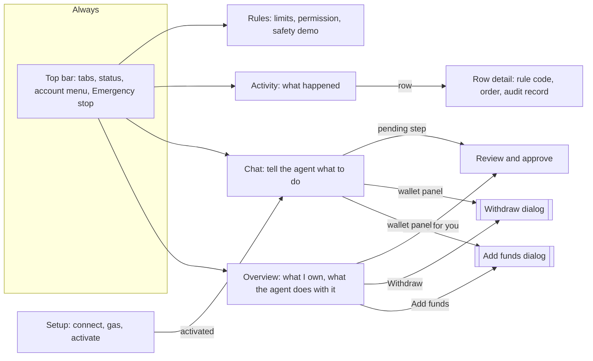
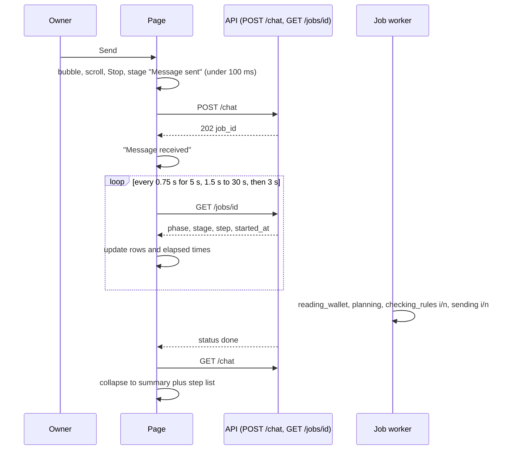
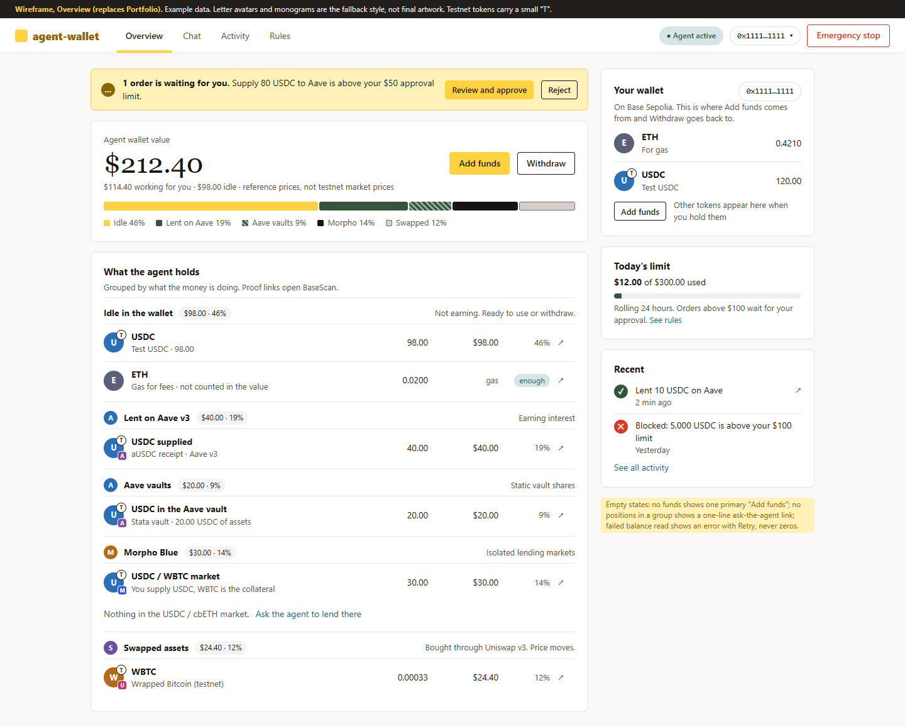
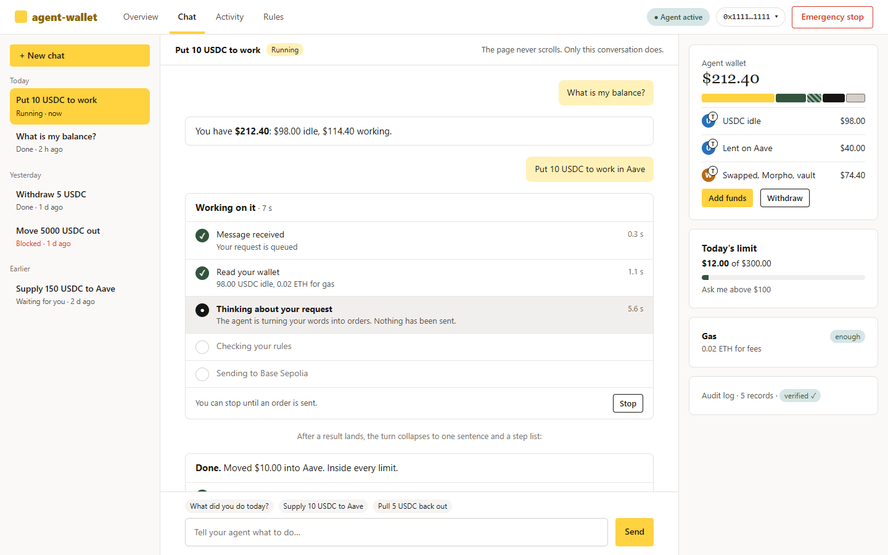
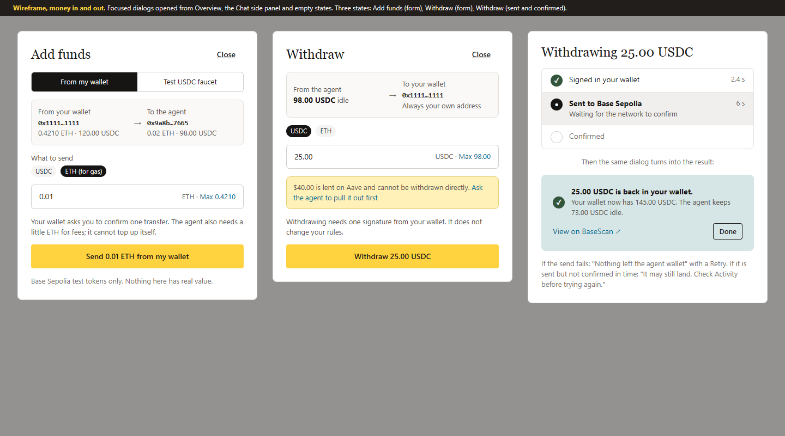
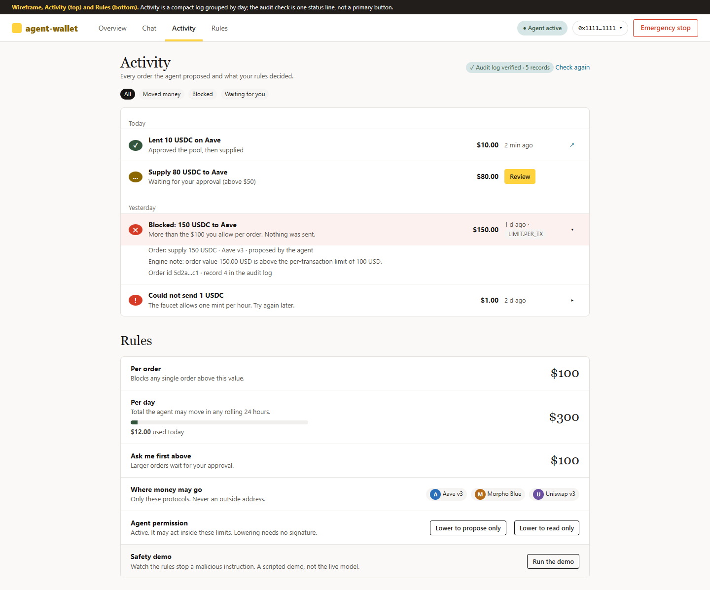
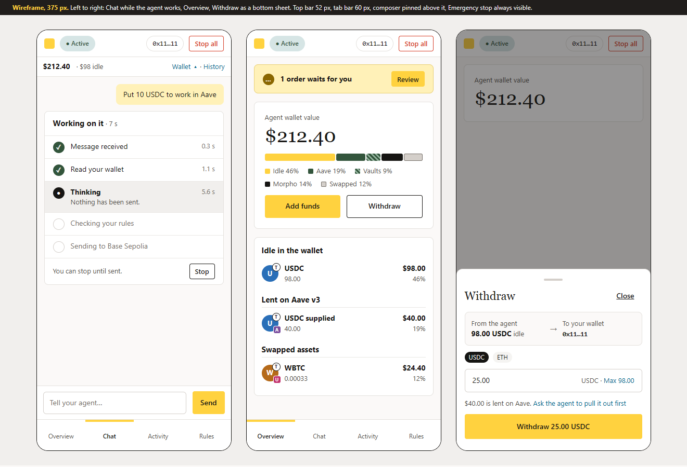
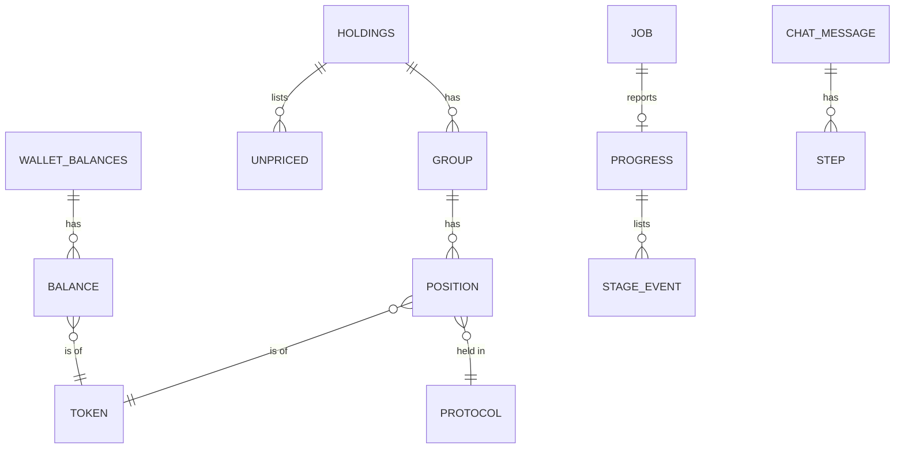

# UI v3 plan: audit, structure, progress model, data contract and delivery order

Status: **proposal for the owner. Nothing in this plan is built.** Written 2026-10-16 on branch `feat/ui-refactor`. The submission deadline is 2026-10-20 23:59 Beijing time, so section 9 orders the work as small PRs that can each be merged alone, with the most speculative one last.

What the owner asked for, in one sentence: the person using this wallet wants to know what the agent is doing with their money and to stay in control, so every screen has to serve that.

## Summary

1. **The app is quiet when it should talk and loud when it should be quiet.** After Send the acknowledgement is off screen in a long chat, the progress copy is wrong during the longest wait, and there is no elapsed time (D1). The chat does not fit the viewport: two scroll regions at 1280 and 1440 px, a composer below the fold on a phone, light scrollbars in dark mode (D2).
2. **The thing users care about is both thin and partly wrong.** Holdings shows three rows read from `/agent`. Two backend facts and one UI fact hide money: swapped assets (WETH, WBTC) are dropped from the portfolio total, the two Morpho markets collapse into one position, and the current total card would show Aave vault and Morpho money as "idle" (D3).
3. **Proposal:** four screens (Overview, Chat, Activity, Rules), money moves in two focused dialogs (Add funds, Withdraw), one pinned-composer chat with a staged progress card, grouped holdings with token and protocol icons, and the owner's own wallet next to the agent's.
4. **Most of it ships without any backend change** (sections 3 and 9, PRs 1 to 4). The backend contract in section 7 is additive, read-only, owner-scoped and droppable: the UI keeps working with fallbacks if it is not approved.
5. **Decisions needed from the owner** are in section 10. The two that block the most work: the new provenance label for the model's words (the approved UI contract says the opposite), and whether swapped assets may be added to the portfolio read model.

## 1. Audit (a)

### Method and limits
- Ran the app locally (`uvicorn api.main:app`, demo mode `?fixtures=1&demo=1`) and drove it in a real browser through `chrome-devtools-axi`, at 1280, 1440, 1920 and 375 px, light and dark: 5 screens x 4 widths x 2 themes = 40 captures, plus the journey states below. All screenshots are in [`docs/previews/ux-audit/`](../../previews/ux-audit/) and are of this app only.
- Journeys walked: first run (signed out, connect, add gas, activate), ask the agent to act, blocked order, order that needs approval (and Approve), emergency stop and resume, withdraw, switching threads, reading Activity and Rules. The 375 px captures cover chat, blocked, frozen, setup, drawer and stop dialog.
- Measured: page and element scroll sizes in the browser, a 250 ms timeline of a chat send, text sizes, tap-target sizes; an automated accessibility audit (score 96, two failures); `impeccable detect` on `ui/`; an offline probe of `PortfolioReader` with a stub RPC.
- **Not done:** the hosted app needs a wallet signature that a headless browser cannot give, so the live state is judged from code and from the owner's description. Fixture timings are not real latencies (fixtures fake 700 ms per poll and only pace orders that execute). The live silent window in D1 is therefore an estimate from the code path, not a measurement. The white scrollbar in dark mode cannot be captured in headless mode (overlay scrollbars), but its cause is verified from computed styles.
- The interactive journeys (blocked, approval, stop and resume, withdraw, thread switching) were walked at 1280 px light and, for chat, blocked, frozen, drawer and setup, at 375 px light. They were not repeated at 1440 or 1920 px or in dark mode; only the five main screens were captured in all eight width and theme combinations.
- Review method: single-context design review by the designer plus the deterministic checks above. No sub-agent critique was run because none was requested. Treat the scores as one reviewer's judgement.
- Browser tooling note: `chrome-devtools-axi 0.1.30` is incompatible with `chrome-devtools-mcp 1.11.0` (published 2026-10-15; every tool call fails with a missing `pageId`). I ran it against `chrome-devtools-mcp 1.7.0` fetched into the `npx` cache. Nothing was installed in the repo or globally.

### Measured layout (viewport height in brackets)
| Screen | 1280 (800) | 1440 (900) | 1920 (1080) | 375 (812) |
| :--- | :--- | :--- | :--- | :--- |
| Chat, empty | page 800, fits | 900, fits | 1080, fits | **page 1479 (1.8 screens)** |
| Chat, a conversation | **page 837 and inner scroller 609/395** | **page 937 and inner 609/495** | 1080, fits (short thread) | **page 1746 and inner 796/487** |
| Portfolio | **page 1921** | 1921 | 1921 | **page 2904 (3.6 screens)** |
| Activity | page 1054 | 1054 | 1080 | 1702 |
| Rules | 800 | 900 | 1080 | 973 |

No capture has horizontal overflow. The header takes 105 px at 1280 (two rows) and 175 px (22 percent of the screen) at 375.

### Measured feedback timeline (fixtures, a thread with messages, 1280 px; screenshots [03a](../../previews/ux-audit/03a-chat-0.6s-after-send-1280-light.png) and [03c](../../previews/ux-audit/03c-chat-working-card-scrolled-into-view-1280-light.png))
| t | What the owner sees |
| :--- | :--- |
| 1 ms | The owner bubble and "Agent is getting ready…" exist in the DOM but are **not visible**: the conversation is scrolled to 190 of 369 px and nothing scrolls it. |
| 250 ms to 3.2 s | The live card exists and names its stage, but **only 1 px of it is inside the conversation viewport for the whole run** (sampled every 250 ms): the owner must scroll to see any progress. The first visible reaction is the owner's own bubble. The fixture server answers instantly; the real one does not, so the real gap is longer. |
| 0.3 s to 4.4 s | "Getting ready" until about 1.5 s, "Checking your rules" until 2.8 s, "Sent" until 3.6 s, "Confirming" until 4.4 s. `confirming` is a fixture-only value: the backend never emits it. |
| 4.5 s | Result; only now does the list scroll to the bottom. |

Live estimate from `api/jobs.py` and `core/runner/runner.py`: after `POST /chat` returns, the worker does a gas check (two RPC calls), then a portfolio read (about ten sequential RPC calls across the registered protocol specs), then one planner LLM call (30 s timeout; on an LLM error the whole step is re-run with the rule-based fallback planner), then for each order a portfolio re-read plus the gateway call (rules, simulation, signing, receipt). All of that is reported as `rules_check`, which the UI renders as "Checking your rules · nothing has been sent yet". That sentence is false for the second order of a plan (the first is already on chain), and it hides the model wait entirely.

### Defects, ranked
Severity: P0 blocks the task or misleads about money; P1 causes real confusion; P2 annoyance with a workaround; P3 polish and design-system drift.

| ID | Sev | Defect | Evidence |
| :--- | :--- | :--- | :--- |
| D1 | P0 | **Silence and dishonest progress.** After Send the progress card is outside the visible conversation (1 px visible for the whole run in the measurement); the first visible change waits for the server; during planning the UI says "Checking your rules, nothing sent"; no elapsed time; no stage names beyond four coarse chips; poll cadence 2 s then 3, 4, 5 s adds up to 5 s of lag per change. | [03a-chat-0.6s-after-send-1280-light](../../previews/ux-audit/03a-chat-0.6s-after-send-1280-light.png) (the progress card is cut off below the conversation), [03c-chat-working-card-scrolled-into-view-1280-light](../../previews/ux-audit/03c-chat-working-card-scrolled-into-view-1280-light.png) (the card reads "Checking your rules, Running · nothing has been sent yet" while the "Rules checked" chip is highlighted as current); timeline above; `ui/views/chat.js` `submit`, `follow`; `ui/main.js` `pollDelay`; `ui/views/cards.js` `PHASE_WORDS` |
| D2 | P0 | **The shell does not fit the viewport.** Page and conversation both scroll (837/800 and 609/395 at 1280); composer is below the fold on a phone; `color-scheme` is unset so scrollbars and form controls are light in dark mode; at 1920 px the content is a 1280 px block with 320 px empty margins each side and a side column that ends at 740 of 1080 px. | [chat-long-1280-dark](../../previews/ux-audit/chat-long-1280-dark.png), [chat-long-1920-light](../../previews/ux-audit/chat-long-1920-light.png), [chat-long-375-dark](../../previews/ux-audit/chat-long-375-dark.png), [chat-empty-375-light](../../previews/ux-audit/chat-empty-375-light.png); computed `color-scheme: normal`, `scrollbar-color: auto` |
| D3 | P0 | **Holdings are thin and some money is invisible.** (a) The table is hard-coded to `/agent`: USDC, aUSDC, ETH. (b) The total card counts only `aave-v3` as "earning", so vault and Morpho money would show as idle. (c) Offline probe of `PortfolioReader` with 5 units of every token: positions returned USDC wallet, USDC and USDT on Aave, USDC and USDT in vaults, total 25.00. **WETH and WBTC are absent** (they are oracle-priced and `_make_raw_position` calls `price_usd(token)` without an RPC, so `PriceUnavailable` drops them), and **USDT idle in the wallet is never read**. (d) Both Morpho markets emit `("USDC", "morpho-blue")`, so they cannot be told apart. | [portfolio-full-1280-light](../../previews/ux-audit/portfolio-full-1280-light.png); `ui/views/portfolio.js` `holdings`, `totalCard`; `core/runner/portfolio.py:56`, `core/protocols/tokens.py` `unit_price_usd`; `core/protocols/morpho_blue.py:343` |
| D4 | P1 | **Portfolio is six jobs on one page.** Value, holdings, recent activity, approvals, Mint, Run (with "Try a hostile note"), Withdraw, lower-the-tier. 1921 px tall at 1280, 2904 at 375. The Holdings "Withdraw" button scrolls the page 1121 px to a form at the bottom. | [portfolio-full-1280-light](../../previews/ux-audit/portfolio-full-1280-light.png), [portfolio-full-375-light](../../previews/ux-audit/portfolio-full-375-light.png), [23-withdraw-focus-1280-light](../../previews/ux-audit/23-withdraw-focus-1280-light.png) |
| D5 | P1 | **No view of the owner's own wallet.** "Top up", "withdraw" and "how much is left" cannot be judged without knowing what the owner holds. | no route and no view; [portfolio-1280-light](../../previews/ux-audit/portfolio-1280-light.png) |
| D6 | P1 | **No token or protocol icons.** Tokens are plain text; protocols appear as `aave-v3`; derived tokens ("aUSDC") are unexplained. | every capture, for example [portfolio-1280-light](../../previews/ux-audit/portfolio-1280-light.png) (plain-text token names, `aave-v3` as text) |
| D7 | P1 | **Repeated boilerplate.** A blocked order says the same fact three times (agent sentence, card title, "Blocked:" sub-line). "No transaction was made." prefixes every non-action. An "Agent says" chip precedes the model's words. "Inside every limit of your rules" repeats on each done card. Strings come from `api/chat_compose.py` (`AGENT_SAYS`, line 17; "No transaction was made.", line 214). | [12-chat-blocked-order-1280-light](../../previews/ux-audit/12-chat-blocked-order-1280-light.png), [15-chat-balance-question-1280-light](../../previews/ux-audit/15-chat-balance-question-1280-light.png), [chat-long-1920-light](../../previews/ux-audit/chat-long-1920-light.png) |
| D8 | P1 | **Approval is a dead end.** The agent says the order "is waiting in Approvals", which is not a screen; the card is at the bottom half of Portfolio; Approve in Portfolio replaces the card with "Approved. The order was sent to the policy engine again." and never says whether it then executed or was blocked. | [13-chat-waiting-approval-1280-light](../../previews/ux-audit/13-chat-waiting-approval-1280-light.png); `api/chat_compose.py:143,230`; walked Approve in fixtures |
| D9 | P1 | **Withdraw gives no sense of where, how much, or what happened.** No destination is shown, no maximum, no balance after; the result is "Latest job: withdraw, Finished." with no amount or transaction link. The backend can only withdraw USDC and ETH, and money lent on Aave cannot be withdrawn without first asking the agent to pull it out; nothing says so. | [23-withdraw-focus-1280-light](../../previews/ux-audit/23-withdraw-focus-1280-light.png); `api/jobs.py` `WithdrawRequest` (`Literal["USDC","ETH"]`) |
| D10 | P1 | **Phone shell.** Header is three rows, the composer and the wallet cards are below the fold, the history is a drawer behind a button, Stop and Resume are in the top rows only. | [chat-empty-375-light](../../previews/ux-audit/chat-empty-375-light.png), [35-frozen-chat-375-light](../../previews/ux-audit/35-frozen-chat-375-light.png) |
| D11 | P2 | **Header clutter.** Up to seven items (fixtures chip, network chip, address, status, Emergency stop, Log out, plus tabs) wrap to two rows at 1280. | [chat-empty-1280-light](../../previews/ux-audit/chat-empty-1280-light.png) |
| D12 | P2 | **Setup.** Preset radios sit far from their labels and use browser-blue controls; gas explained as "2 x the current base fee x 500,000 gas"; the presets do not show which protocols and tokens they allow; the Activate card is below the fold on the gas step. | [11-setup-after-connect-1280-light](../../previews/ux-audit/11-setup-after-connect-1280-light.png), [33-setup-t0-full-375-light](../../previews/ux-audit/33-setup-t0-full-375-light.png) |
| D13 | P2 | **Activity is a wall.** Every decision is a full tinted card with engine notes and raw order text ("supply 80 USDC on aave-v3 (proposed by planner)"); no grouping by day, no filter; the primary yellow button is "Verify audit chain". | [activity-1280-dark](../../previews/ux-audit/activity-1280-dark.png) |
| D14 | P2 | **Rules** is an 880 px block centred under a left-aligned header, shows protocols as one text line, and the "agent permission" control lives on Portfolio instead. | [rules-1280-light](../../previews/ux-audit/rules-1280-light.png) |
| D15 | P2 | **Frozen state is easy to miss.** The in-view frozen card sits at the top of the conversation and scrolls away; the toast covers the composer line; on a phone the header grows to about 215 px. | [21-frozen-chat-1280-light](../../previews/ux-audit/21-frozen-chat-1280-light.png), [35-frozen-chat-375-light](../../previews/ux-audit/35-frozen-chat-375-light.png) |
| D16 | P2 | **Accessibility details.** Contrast failure on `.rail-meta.bad`: 12 px red "Blocked" text on the off-white ground is about 4.4:1, under the 4.5:1 minimum; 17 text nodes at 11 to 12 px; buttons 32 to 36 px tall (chips 32); `meta description` missing. Focus ring, skip link, live regions and reduced-motion are already good. | automated audit; DOM scan |
| D17 | P2 | **Internal status text shown to users:** "The current rate is not shown here: the API does not expose it yet." | [portfolio-1280-light](../../previews/ux-audit/portfolio-1280-light.png) |
| D18 | P3 | **Design-system drift.** Uppercase, letter-spaced labels (`.label`, `.state-word`, `.rail-group`) contradict `DESIGN.md` ("letter-spacing zero, no small-caps label"); card radius mixes 15 px (side cards) and 8 px, which `DESIGN.md` says not to do; a 6 px left border on the verdict card; dark-mode values exist only in CSS, not in `DESIGN.md`. | `ui/style.css`; `impeccable detect` |
| D19 | P3 | **Demo scaffolding in the product.** "Run the agent" and "Try a hostile note" sit beside real money controls; chat has replaced them. | [portfolio-full-1280-light](../../previews/ux-audit/portfolio-full-1280-light.png) |

### Heuristic score (one reviewer)
| # | Heuristic | Score | Key issue |
| :--- | :--- | :--- | :--- |
| 1 | Visibility of system status | 2 | Phases exist but the first moments are invisible and the copy is wrong (D1) |
| 2 | Match with the real world | 2 | "Approvals", "engine note", `aave-v3`, "2 x base fee x 500,000 gas" (D7, D8, D12) |
| 3 | User control and freedom | 3 | Stop, cancel, confirm-before-stop are good; frozen state is hard to see (D15) |
| 4 | Consistency and standards | 2 | One step-card vocabulary, but radii, labels and money controls drift (D18) |
| 5 | Error prevention | 3 | Limits shown at the point of blocking; withdraw gives no maximum (D9) |
| 6 | Recognition over recall | 2 | Approvals and withdraw are findable only by remembering (D4, D8) |
| 7 | Flexibility and efficiency | 2 | Enter sends; no shortcuts, no filters (D13) |
| 8 | Aesthetic and minimalist design | 1 | Walls of small grey text and repeated sentences (D4, D7, D13) |
| 9 | Error recovery | 3 | "Try 100 USDC" and "Why is this blocked?" are good; approval outcome is lost (D8) |
| 10 | Help and documentation | 2 | Plain-language rule explanations exist; no explanation of groups, testnet tokens or protocols |
| | **Total** | **22 / 40** | Acceptable (55 percent): significant improvement needed |

### What already works and must be kept
- The **step-card vocabulary** (state as icon, word and tint, never colour alone) and its sentences from `ui/explain.js`.
- **Honest Stop**: the 409 "Too late to stop" copy and the skipped cards after a cancel.
- **Quick fixes** on blocked cards ("Try 100 USDC", "Why is this blocked?") and the limit line "This order $X, per-order limit $Y, today $A of $B".
- **Frozen state** in the header (red rule, solid pill, "Resume (needs signature)") and the confirm-before-stop dialog with focus trap.
- Skeletons that match the final layout, `textContent`-only rendering, reduced-motion handling, skip link and visible focus.

### Persona red flags
- **Jordan, first-timer:** meets "tier T0", "preset", "2 x base fee x 500,000 gas" and `LIMIT.PER_TX` before understanding what the agent will do; the Activate card is below the fold on the gas step (D12).
- **Casey, one-handed on a phone:** the composer and the wallet cards are below the fold, the page and the chat both scroll, Stop is in the top rows (D2, D10).
- **Sam, keyboard and screen reader:** structure is good; the 11 to 12 px text and a contrast failure remain; stage changes are announced as one long string rather than per stage (D16).
- **Alex, power user:** cannot filter Activity, cannot approve from the chat, withdraw needs a 1100 px scroll (D4, D8, D13).

## 2. Information architecture (b)

Mode: operate (the person is in a task and the tool should disappear into it). The visual world stays the one in `DESIGN.md`; this plan changes structure, density and content, not the palette.



| Screen | Job | One primary action | Content |
| :--- | :--- | :--- | :--- |
| **Overview** (replaces Portfolio, `#/portfolio` stays as an alias) | Know what I own and what the agent does with it | **Add funds** when the agent holds nothing, otherwise **Ask the agent** | Value and allocation bar, "waiting for you" banner (only when something waits), holdings grouped by what the money is doing, the owner's own wallet, today's limit, three recent items |
| **Chat** (home, per the approved contract) | Tell the agent what to do and see it happen | **Send** | History rail, one conversation, pinned composer, staged progress card, inline Approve and Reject on a waiting step, wallet summary panel with Add funds and Withdraw |
| **Activity** | See what happened and prove it | none (it is a log); the audit check is a status line | Rows grouped by day, filter chips (All, Moved money, Blocked, Waiting for you), row detail on demand |
| **Rules** | See and adjust what the agent may do | none; the lower-permission buttons are secondary | Limits with live "used today", allowed protocols with icons, agent permission (moved here from Portfolio), safety demo (moved here from Portfolio) |
| **Setup** | First run: connect, add gas, activate | **Connect wallet**, then **Send gas**, then **Activate agent** | Same three steps; preset cards show protocols and tokens with icons; gas explained in one plain sentence |
| **Add funds** and **Withdraw** | Move money in or out | the single confirm button in each dialog | Section 4 and the wireframes |

### Shell rules
1. **The page never scrolls on Chat.** `body` is `100dvh`; the top bar is fixed height; the middle area is a grid whose columns scroll themselves. The conversation is the only scroll region of the chat column, the composer is pinned under it, the history rail and the wallet panel scroll only when their own content needs it.
2. **Widths.** 375 px: single column, 52 px top bar, 60 px bottom tab bar, composer pinned above it, history as a drawer, wallet summary as a bottom sheet opened from a one-line value strip. 900 to 1279 px: rail collapses to a drawer, conversation plus a 300 px wallet panel. 1280 to 1599 px: rail 240, conversation fluid with a 760 px reading lane, panel 320. 1600 px and wider: the same three columns capped at the `DESIGN.md` 1600 px context container, centred; surplus width goes to the margins, not to stretching lines.
3. **Top bar:** brand, four tabs, a status pill, an **account menu** (address, network, copy address, log out) and **Emergency stop** (always visible, never in a menu). The "Base Sepolia testnet" chip moves into the account menu and the footer line; the fixtures chip appears only in fixtures mode. Seven items become three controls.
4. **Frozen state** keeps the red rule and "Resume (needs signature)" in the top bar and adds a frozen strip pinned above the composer (not at the top of the scroll area), so it cannot scroll away.
5. **Landing screen:** Chat, as approved on 2026-10-15. The wallet panel keeps the money one glance away. This is open decision 1.

## 3. Chat progress model (c)

### Rules
- Under 100 ms: the owner's bubble is in the conversation, the list is scrolled to it, the composer is cleared and the Send button has become Stop. Optimistic, and it uses no server answer.
- Under 400 ms: an agent card with the first stage ("Message sent") is on screen.
- Under 1 s: "Message received" when `POST /chat` answers 202. If the POST has not answered after 2 s: "Waking up the server. Your message is safe." (the free-tier host can take about a minute after idle).
- Under 5 s: at least one **named, running stage with an elapsed counter**. Never a bare spinner.
- Every stage shows its elapsed time once it has run for 2 s. The whole card shows total time.
- Honest copy: a stage is named only if the backend can tell us it is running. Where it cannot, the card says "Working" and does not guess.

### Stages and where each comes from
| Stage (user words) | Today (no backend change) | Proposed (section 7, item 4) |
| :--- | :--- | :--- |
| Message sent | client only | client only |
| Message received | `POST /chat` returned 202, job `phase: queued` | same |
| Reading your wallet | not reported (inside `rules_check`) | `stage: reading_wallet`, set by the job worker around the gas check and the portfolio read |
| Thinking about your request | not reported (inside `rules_check`) | `stage: planning`, set around the planner call; "Nothing has been sent" is true here |
| Checking order i of n against your rules | `phase: rules_check` (coarse) | `stage: checking_rules` with `step: {index, total, label}` |
| Sending order i of n | `phase: sent` | `stage: sending` with `step`; one honest stage for simulate, sign and wait for the receipt, because the gateway does all three in one call and nothing outside it can see them. The copy says "Waiting for Base Sepolia to confirm" and shows the elapsed time |
| Done, blocked, needs you, stopped, failed | job `status` and `GET /chat` steps | same |

Today's mapping, used by PR 2 before any backend change: `queued` shows "Message received"; `rules_check` shows "Working on your request" (not "Checking your rules", which is false during planning and for later orders); `sent` shows "Sending to Base Sepolia, waiting for the network"; `confirming` is accepted if it ever arrives; any unknown phase shows "Working". The card is a list of rows (done, current, to come), not four chips.



### Timing, polling, long waits
- Poll an active job at 750 ms for the first 5 s, 1.5 s up to 30 s, then 3 s (today 2 s growing to 5 s). Only the one active job per owner is polled, so load stays small. A stream (`GET /jobs/{id}/events`) is possible later and is not part of this plan.
- 10 s: "Still working. The model can take up to 30 seconds." 30 s: "This is taking longer than usual. You can stop the request." 60 s: the card offers Stop and a link to Activity.
- The elapsed counter ticks once per second visually, but a screen reader hears stage changes only (`aria-live="polite"` on the stage list, not on the counter).
- Reduced motion: no pulsing marker; the current stage is marked by a filled dot and the word "now".

### Failure, cancel and edge states (all explicit)
| Situation | What the card says | Composer |
| :--- | :--- | :--- |
| Network error on POST | "Your message was not sent." Retry button | text restored |
| `409 job-in-progress` | "The agent is still finishing your last request." card follows that job | disabled until done |
| `429 rate-limited` | "Too many requests. You can try again in N seconds." with a live countdown | disabled with the countdown |
| Job fails before anything was sent | "Nothing was sent." plus the reason in one sentence | enabled |
| Job fails after `sent` | "It may still land. Check Activity before trying again." (existing copy) with an Open Activity button | enabled |
| Owner pressed Stop | "You stopped this request. N steps were skipped." Steps appear as skipped | enabled |
| Stop pressed too late | "Too late to stop: this order is already sent." (existing copy) | unchanged |
| Poll fails 3 times | "Lost connection. Retrying…" (not terminal) | stays disabled |
| Unknown phase or stage | "Working" | unchanged |

### Conversation content
- One agent turn is one card: a short summary sentence composed by code, then steps. A multi-step plan whose steps all succeeded collapses to one line ("Moved $10.00 into Aave") with the steps one click away.
- No "No transaction was made." prefix. A turn that moved no money simply does not say it moved money; a quiet "No money moved" label appears only on turns that were requests to act.
- The model's own words appear once, in a visually distinct "note" block, only when they add something the summary does not. The "Agent says" label is replaced by the block's own style and a small "From the agent" caption. This changes principle 5 of `ui-contract.md`, so it needs the owner's approval (open decision 4). Until the backend adds `summary` and `note`, the client parses the existing `Agent says: ` prefix exactly as it does now.
- A blocked order says the reason once; the rule code is a small secondary chip; "Try 100 USDC" and "Why is this blocked?" stay.
- A waiting step carries **Approve (needs signature)** and **Reject** inline, and after Approve the same step shows the outcome from the re-proposal (executed with a BaseScan link, blocked with its reason). The text "waiting in Approvals" disappears from the product (D8).

## 4. Holdings and wallet views (d)

### Overview, agent side
Groups, in this order, each with a header (icon, name, value, share) and rows:

| Group | What is in it | Source today | Source after section 7 |
| :--- | :--- | :--- | :--- |
| Idle in the wallet | USDC, USDT, ETH as gas (ETH is shown but not counted in the value) | `/agent` (USDC, ETH), `/portfolio` (USDC) | `/holdings` |
| Lent on Aave v3 | USDC and USDT supplied (aTokens) | `/portfolio` (`aave-v3`) | `/holdings` |
| Aave vaults | Stata vault shares as their USDC or USDT value | `/portfolio` (`aave-stata`) | `/holdings` |
| Morpho Blue | One row per market (USDC/WBTC, USDC/cbETH) | `/portfolio` (`morpho-blue`, markets not distinguishable, D3d) | `/holdings` with `market` |
| Swapped assets | WETH, WBTC bought through Uniswap v3, with a "price moves" note | **not available** (dropped by the reader, D3c) | `/holdings` |

Each row: token avatar with a protocol badge, plain name ("USDC supplied", "USDC / WBTC market"), amount, USD value, share of the total with a thin bar, and a BaseScan link (token page filtered to the agent, or the market contract). A group with nothing in it shows one line with an ask-the-agent link ("Ask the agent to lend there") instead of an empty table. Shares are of the priced total; a position that cannot be priced is shown with its amount and "no price" and has no share. The value and bar always carry the words "reference prices, not testnet market prices".

The allocation bar has five segments: idle (gold `primary`), lent (forest), vaults (forest with diagonal stripes), Morpho (ink), swapped (field grey with an outline). Pattern and legend text mean colour is never the only signal.

### Overview, owner side
A "Your wallet" card with the owner's address, ETH and the test USDC always shown, other supported tokens only when the balance is above zero. It sits next to the agent's holdings so the questions "can I top up", "how much can I withdraw" and "how much is left" are answered without arithmetic. It needs a new read (section 7, item 2); until then the card shows the address and the two buttons only, labelled "Balance unavailable".

### Moving money
- **Add funds** (dialog, two tabs). Tab 1, *From my wallet*: pick USDC or ETH, amount with Max, a from-to summary with both balances, one wallet confirmation, then the same staged progress as chat (Sign, Sent, Confirmed) and a result line with a BaseScan link. ETH uses the existing top-up flow; USDC is an ERC-20 transfer built in the page and signed by the owner's wallet (the wallet adapter gains a `data` field; no server route is needed because balances are read from the chain). Tab 2, *Test USDC faucet*: the existing mint, with its hourly limit stated up front.
- **Withdraw** (dialog). Asset (USDC or ETH, the two the backend supports), amount with Max set to what is idle, the destination shown and fixed as the owner's own address, one signature, staged progress, then a result with the new balances. If the owner asks for more than is idle, the dialog says what is lent or in vaults and offers "Ask the agent to pull it out first", which prefills the chat. Swapped assets cannot be withdrawn directly; the dialog says "Ask the agent to swap it back to USDC".
- Both dialogs are reachable from Overview, the Chat wallet panel and every empty state; focus is trapped, Escape closes, and on a phone they are bottom sheets.

### States for every view
Loading: skeletons with the final row structure. Empty: one primary action ("Add funds") and one sentence. Error: "Couldn't read balances from Base Sepolia" with Retry, never zeros (existing rule kept). Partial: show what loaded, mark what did not. Success: result line with proof link. Frozen: dialogs stay open but the confirm button is disabled with the reason.

## 5. Wireframes (e)

Static HTML in [`ui-v3/`](ui-v3/) (open the files in a browser), built with `DESIGN.md` tokens. Numbers are examples. Avatars are the fallback letter style, not final artwork.

| Screen | Image | Source |
| :--- | :--- | :--- |
| Overview, 1440 px |  | [`overview.html`](ui-v3/overview.html) |
| Chat with a running turn, 1440 px |  | [`chat.html`](ui-v3/chat.html) |
| Add funds, Withdraw, Withdraw in progress and done |  | [`dialogs.html`](ui-v3/dialogs.html) |
| Activity and Rules |  | [`activity.html`](ui-v3/activity.html) |
| 375 px: chat running, Overview, Withdraw sheet |  | [`mobile.html`](ui-v3/mobile.html) |

## 6. Design-system questions (f)

`DESIGN.md` is not touched by this plan. These are proposals that need the owner's OK; each is also tied to the PR that needs it.

| # | Question | Proposal |
| :--- | :--- | :--- |
| F1 | **Icon style** (token and protocol marks) | Token avatar: 32 px circle in rows, 22 px in group headers, 20 px in dense lists. Protocol badge: 15 px rounded-square at the bottom right. Testnet mark: 14 px circle with "T" at the top right, always present on testnet tokens. New components `token-avatar`, `protocol-badge`, `testnet-mark`. |
| F2 | **Chart colours** for the allocation bar | No new hue: gold (idle), forest (lent), forest with stripes (vaults), ink (Morpho), field grey with outline (swapped). Colour is never alone (stripes, legend with percentages). Alternative if the owner wants more separation: one extra teal. |
| F3 | **Density** for an app (not a marketing page) | A 56 px row for lists and tables, 14 px body text in the app shell (DESIGN.md `body` is 16 px), 12 px minimum for secondary text (today 11 px appears), 44 px touch targets on the phone. Needs an "app density" note in `DESIGN.md`. |
| F4 | **Top bar height** | `DESIGN.md` has an 85 px masthead and a 64 px sub-navigation. The app needs one 56 px bar (52 px on a phone). New component `masthead-app`. |
| F5 | **Progress stepper and bottom sheet** | New components built from existing tokens: rows on `canvas-warm` for the current stage, `band-forest` for done, hairline for to-come; a bottom sheet is `ex-modal-card` at the screen bottom with a top radius. No shadows, no new colours. |
| F6 | **Dark mode** | Formalise the dark values that exist only in `ui/style.css` into a `DESIGN.md` section, and declare `color-scheme` so scrollbars and controls follow the theme. |
| F7 | **Drift to fix without a change to `DESIGN.md`** | Sentence-case labels (drop uppercase and letter-spacing), one card radius (8 px), no 6 px side border. These make the UI follow `DESIGN.md`; they need no approval. |

## 7. Data contract (g)

All additions are **read-only, owner-scoped, additive and optional for the UI**. No route takes an owner or address parameter (the owner comes only from the session), money is a decimal or integer string (never a float), errors are RFC 7807 problems that never echo upstream text, an RPC failure is `503` with no detail, and every new route needs a cross-tenant test (session A never sees B's balances). None touches the gateway, signer, policy engine, tiers, protocol adapters or audit code. The existing `PortfolioReader`, which feeds the policy engine, is not changed: `/holdings` is a separate read model with its own function and schema, so `portfolio-state.schema.json` (`additionalProperties: false`) stays as it is.



### 7.1 `GET /holdings` (session)
The agent wallet grouped by what the money is doing. Computed with the token registry's `usd_value` **with an RPC reader**, so oracle-priced tokens (WETH, WBTC) are valued; a token whose price cannot be read is listed under `unpriced` instead of being dropped.
```json
{
  "schema_version": 1,
  "as_of": "2026-10-16T09:00:00Z",
  "price_source": "mainnet_reference",
  "total_value_usd": "212.40",
  "groups": [
    {"id": "idle", "label": "Idle in the wallet", "value_usd": "98.00", "share_bps": 4614,
     "positions": [
       {"id": "wallet:USDC", "protocol": "wallet", "market": null, "token": "USDC",
        "display_symbol": "USDC", "amount": {"value": "98000000", "decimals": 6},
        "price_usd": "1.00", "value_usd": "98.00", "share_bps": 4614,
        "explorer_url": "https://sepolia.basescan.org/token/0xba50...?a=0x9a8b...",
        "supply_apy_bps": null}
     ]},
    {"id": "lending", "label": "Lent on Aave v3", "value_usd": "40.00", "share_bps": 1883, "positions": []},
    {"id": "vaults", "label": "Aave vaults", "value_usd": "20.00", "share_bps": 942, "positions": []},
    {"id": "morpho", "label": "Morpho Blue", "value_usd": "30.00", "share_bps": 1412, "positions": []},
    {"id": "swapped", "label": "Swapped assets", "value_usd": "24.40", "share_bps": 1149, "positions": []}
  ],
  "gas": {"eth_wei": "20000000000000000", "floor_wei": "5000000000000000", "status": "ok"},
  "unpriced": [{"token": "WETH", "amount": {"value": "1000000000000000", "decimals": 18}, "reason": "price_unavailable"}]
}
```
Fields: `group.id` is one of `idle`, `lending`, `vaults`, `morpho`, `swapped` (unknown values are shown under a neutral group); `market` is the registry market id (`usdc-wbtc`, `usdc-cbeth`) or null; `display_symbol` is what the position token is called (`aUSDC`) and `token` is the underlying; `share_bps` sums to 10000 across priced positions; `supply_apy_bps` is optional and null when unknown (droppable, D17); `explorer_url` is a BaseScan link or null. Implementation: a new read module `api/holdings.py` that imports the registry's **data** (token addresses and decimals, vault addresses, Morpho market ids and labels) and makes its own read-only `eth_call`s, so each Morpho market is a separate position and idle USDT, WETH and WBTC are read. It values with `usd_value(..., rpc=...)`. It does not change `PortfolioReader`, any `ProtocolSpec` or any adapter file (the brief forbids touching adapters), at the price of repeating a few lines of read logic.

### 7.2 `GET /me/wallet` (session)
The signed-in owner's own balances on Base Sepolia. The address is the session address; there is no parameter.
```json
{
  "schema_version": 1,
  "as_of": "2026-10-16T09:00:00Z",
  "chain_id": 84532,
  "address": "0x1111...1111",
  "native": {"symbol": "ETH", "amount": {"value": "421000000000000000", "decimals": 18}},
  "tokens": [
    {"token": "USDC", "amount": {"value": "120000000", "decimals": 6}, "value_usd": "120.00"}
  ]
}
```
`tokens` lists the supported tokens with a non-zero balance (USDC always, even at zero). `value_usd` is null when the token cannot be priced. Test: two sessions, two stub RPCs keyed by address, each response contains only its own address and balances.

### 7.3 `GET /tokens` and `GET /protocols` additions (public metadata, like `/presets`)
Static, derived from the token and protocol registries plus a small display table.
```json
{
  "tokens": [
    {"symbol": "USDC", "name": "USD Coin (Aave testnet)", "decimals": 6,
     "address": "0xba50...", "testnet": true, "kind": "stable", "underlying": null, "icon": "usdc"},
    {"symbol": "aUSDC", "name": "USDC supplied on Aave v3", "decimals": 6,
     "address": "0x...", "testnet": true, "kind": "derivative", "underlying": "USDC", "icon": "usdc"}
  ],
  "protocols": [
    {"id": "aave-v3", "name": "Aave v3", "category": "lending", "icon": "aave",
     "markets": []},
    {"id": "morpho-blue", "name": "Morpho Blue", "category": "lending", "icon": "morpho",
     "markets": [{"id": "usdc-wbtc", "label": "USDC / WBTC"}, {"id": "usdc-cbeth", "label": "USDC / cbETH"}]}
  ]
}
```
`icon` is a stable key the page resolves to `ui/assets/tokens/<icon>.svg` or `ui/assets/protocols/<icon>.svg`; an unknown or missing key falls back to the deterministic letter avatar (section 8). The existing session-scoped `GET /protocols` gains `icon` and `markets` additively.

### 7.4 Job progress, additive on `GET /jobs/{id}`, `GET /jobs` and each agent message of `GET /chat`
`phase` stays exactly as documented in `api.md`. A new optional `progress` object:
```json
{
  "phase": "rules_check",
  "progress": {
    "stage": "planning",
    "stage_started_at": "2026-10-16T09:00:02Z",
    "started_at": "2026-10-16T09:00:01Z",
    "step": {"index": 2, "total": 3, "label": "Supply 10 USDC to Aave"},
    "history": [
      {"stage": "reading_wallet", "started_at": "2026-10-16T09:00:01Z", "ended_at": "2026-10-16T09:00:02Z"}
    ]
  }
}
```
`stage` is one of `queued`, `reading_wallet`, `planning`, `checking_rules`, `sending`, `recording`, `done`; `step` is null outside the per-order stages; clients treat unknown stages as "Working". The job worker sets the stage with thin wrappers around the portfolio reader, the planner and the cancel gate it already builds (`api/jobs.py`: `_runner`, `_CancelGate`); the gateway is not touched and simulate, sign and wait for the receipt stay one stage (`sending`). Stored only for the active job's lifetime and returned only to the job's owner. Test: stage order for a one-order and a two-order plan, `step` indices, foreign job is 404.

### 7.5 Chat message, additive on `GET /chat`
Alongside `text` (kept for compatibility): `summary` (the code-composed sentence, no "No transaction was made." prefix), `note` (the model's reply, or null), and `kind` (`moved`, `blocked`, `waiting`, `no_action`, `question`). The client uses these when present and falls back to parsing `text` otherwise. This removes string surgery in the page and lets the server own the copy.

### 7.6 Decisions endpoint for Activity
`api.md` states that in multi mode `GET /decisions` is the session owner's own audit chain, while `docs/architecture/ui.md` still says it is not per owner and the page therefore fans out to `/jobs` plus up to ten `/jobs/{id}` calls. If the api.md statement holds (there is a test named `test_decisions_are_the_session_owners_own`), Activity can read `/decisions?limit=` directly: a UI-only change that removes eleven requests. To be confirmed in PR 6 before relying on it.

### What each field replaces
| New | Replaces | If not approved |
| :--- | :--- | :--- |
| `/holdings` | three rows from `/agent` and the `aave-v3`-only split from `/portfolio` | group from `/portfolio` positions; Morpho markets merged; swapped assets absent (stated in the UI) |
| `/me/wallet` | nothing | the owner card shows address and buttons only |
| `/tokens`, protocol `icon` and `markets` | hard-coded names in the page | a static table in `ui/` generated from the same registry data at build time by hand |
| `progress` | `phase` only | generic "Working on your request" with elapsed time |
| `summary`, `note`, `kind` | `Agent says:` string parsing | existing parsing |

## 8. Icon sourcing (h)

Constraints from the brief: no external assets at runtime, so every icon is a small file committed under `ui/assets/` with its licence recorded in `docs/design/webapp/icons.md`; a deterministic fallback for anything without a file; testnet tokens get the real token's mark plus a "testnet" mark so nobody mistakes them for real assets; never copy artwork whose licence cannot be confirmed.

### What I checked (licence text fetched on 2026-10-16, not recalled)
| Source | Finding | Verdict |
| :--- | :--- | :--- |
| `cryptocurrency-icons` repository | `LICENSE.md` is CC0 1.0 Universal; the GitHub licence field reads `CC0-1.0`; not archived (last push 2024-08). Colour SVGs exist for `eth`, `usdc`, `usdt`, `wbtc`, `link`, `btc` (and others). No `weth` or `cbeth`. | **Use** for ETH, USDC, USDT, WBTC, LINK. CC0 covers the files, not the owners' trademark rights, so use them only to identify the token, and say so in `icons.md`. |
| Trust Wallet `assets` repository | The MIT licence covers the repository's scripts and documentation. The README does not grant a licence for the logo files themselves. | **Do not copy logos from it.** Not a basis we can cite. |
| Uniswap default token list | GPL-3.0 | **Avoid** (copyleft data and unclear logo terms). |
| CoinGecko API | Terms not read in this session. | **Skip**; we do not need it. |
| Aave, Morpho and Uniswap brand pages | The Aave brand page (aave.com/brand) refers to usage guidelines for its identity and the Morpho brand page links to a guidelines site (brand.morpho.org); I could not read the terms here, and the Uniswap brand page was not reachable. | **Default to a neutral monogram.** Use an official mark only after someone reads the terms and they allow reuse in a product UI; record the page and the date in `icons.md`. |

### Plan
1. **Token marks.** Copy `eth`, `usdc`, `usdt`, `wbtc`, `link` from the CC0 set (at most a few KB each) into `ui/assets/tokens/`. Record source URL, commit, licence and date in `icons.md`.
2. **Derived tokens** (aUSDC, stata shares, WETH) use the base token's mark plus a protocol badge or a letter; they never get their own artwork.
3. **Testnet mark.** Aave's test USDC is not Circle USDC. It gets the USDC mark plus the "T" mark and a tooltip "Test token on Base Sepolia. Not the real USDC." The same rule applies to every token on this chain.
4. **Protocol marks.** Monograms: a rounded square with the protocol's initial on a fixed colour from the same palette (Aave "A", Morpho "M", Uniswap "U"). They are replaced by official marks only through a separate PR after the terms are read.
5. **Deterministic fallback.** For any symbol without a file: a circle with the first letter of the symbol, the fill chosen by an FNV-1a hash of the symbol over a fixed palette of eight colours, each checked at 4.5:1 against white by a unit test. Same symbol, same colour, every time.
6. **Delivery.** `ui/icons.js` (pure helper: `tokenIcon(symbol)`, `protocolIcon(id)`, `fallbackAvatar(symbol)`), SVG files inline-referenced by relative path (no remote URL), alt text on every use, a test that no icon path leaves `ui/assets/`, and a test that the fallback colour is stable and passes contrast.

## 9. Delivery order (i)

Each PR is independently mergeable, has before and after screenshots, tests and updates to `docs/architecture/ui.md` and `docs/design/webapp/ui-contract.md`. PRs 1 to 6 change only `ui/`, docs and tests. Backend PRs (B1 to B4) wait for the owner's approval of section 7 and can be dropped without breaking the UI.

| Day | PR | Scope | Files (indicative) | Backend |
| :--- | :--- | :--- | :--- | :--- |
| Oct 17 | **1. Shell fits the viewport** | `100dvh` app shell, one scroll region in Chat, pinned composer, 1600 px cap, account menu, mobile tab bar, `color-scheme`, contrast and text-size fixes, drift fixes (F7) | `index.html`, `style.css`, `main.js`, `views/side.js`, `tests/ui/*` | none |
| Oct 17 | **2. Never silent** | Optimistic bubble and scroll, staged progress card from today's `phase`, elapsed times, 750 ms polling, long-wait copy, failure and cancel states | `views/chat.js`, `views/cards.js`, `main.js` (`pollDelay`), `api.js` (fixtures: pace every chat job, not only executed ones) | none |
| Oct 18 | **3. Chat copy and inline approval** | One summary per turn, remove duplicated sentences, collapse done steps, inline Approve and Reject with visible outcome | `views/chat.js`, `views/cards.js`, `views/approvals.js` | none (needs owner decision 4 for the label) |
| Oct 18 | **4. Overview and money dialogs** | Overview replaces Portfolio, grouped holdings from `/portfolio` positions, Add funds and Withdraw dialogs, Mint into the faucet tab, lower-permission and the safety demo into Rules, remove Run and the hostile button from the main flow | new `views/overview.js`, `views/funds.js`, `views/withdraw.js`, `views/rules.js`, `views/actions.js` (removed) | none |
| Oct 18 | **5. Icons** | `ui/assets/`, `ui/icons.js`, `docs/design/webapp/icons.md`, avatars in every list, testnet mark | assets, `icons.js`, views | none |
| Oct 19 | **B1 to B4 (backend, if approved)** | `/tokens` and protocol metadata, `/holdings`, `/me/wallet`, job `progress`, each with schema, tests and a cross-tenant test | `api/`, `contracts/openapi.yaml`, `tests/webapp/` | read-only |
| Oct 19 | **6. Activity and Rules polish, Setup fixes, wiring** | Grouped Activity with filters and row detail, `/decisions` if confirmed, Rules layout, Setup radios and plain gas copy, wire the new routes with fallbacks | `views/activity.js`, `views/rules.js`, `views/setup.js`, views | uses B1 to B4 |
| Oct 20 | buffer | Final screenshots, docs, merge; nothing new | | |

Ordering logic: 1 and 2 fix the two P0 defects the owner feels every minute, and need no decision. 4 is large but unblocked. 5 follows 4 so the new lists get icons once. Backend work comes last because it is the only part that needs approval and the only part the UI can do without. If time runs short, drop 6 first, then B3 and B4.

Test impact to plan for: `tests/ui/test_ui.py` asserts the four tabs, the header order, the chip, the pill and "Agent says" (among others) and must be rewritten with each PR; fixtures need `holdings.json`, `owner-wallet.json`, `tokens.json` and paced chat jobs; the node harnesses (`harness.mjs`, `flows.mjs`, `chat_flows.mjs`) keep running the real modules under a fake DOM and need the new views added.

## 10. Decisions for the owner

| # | Decision | Recommendation |
| :--- | :--- | :--- |
| 1 | Landing screen after activation: Chat (approved contract) or Overview | Keep **Chat**; the wallet panel keeps the money visible; Overview is one tab away |
| 2 | Rename Portfolio to Overview, and move Mint, lower-permission and Run out of it | Yes |
| 3 | The hostile-note demo: README and evidence refer to the hostile denial | Remove it from the money flow; keep a labelled **Safety demo** entry in Rules that runs the same scripted run; judges still reproduce it, nobody mistakes it for a feature |
| 4 | Replace the "Agent says" chip (`ui-contract.md` principle 5) with a "note" block that is visually distinct and captioned "From the agent" | Yes; the code summary is unlabelled because code wrote it, the model's words are always visibly the model's |
| 5 | The `DESIGN.md` proposals F1 to F6 | Approve F1 to F6; F7 is just compliance |
| 6 | Backend contract in section 7 | Approve 7.1 (`/holdings`) and 7.2 (`/me/wallet`) and 7.4 (`progress`) as the minimum; 7.3 and 7.5 are nice to have. 7.1 is built in a new `api/holdings.py` and does not touch adapter code |
| 7 | Icons: CC0 token set plus monograms for protocols | Yes |
| 8 | **Finding outside the UI scope that needs a decision.** `PortfolioReader` drops WETH and WBTC wallet balances (unpriced without an RPC) and never reads idle USDT. Traced: the tenant gateway builds its policy input from the same reader (`core/gateway/tenant.py`, `policy_inputs()` returns `portfolio.read(...).state`), and the engine's allocation checks sum `state["positions"]` to get the stable and per-asset weights (`core/policy/engine.py`, "ALLOC and RISK Rules"). A position the reader drops is absent from those weights and from the total, so after a swap the engine can see a smaller portfolio and a larger stable share than the wallet really holds. I have not changed or tested the engine; this is read from code and from an offline probe of the reader. | Escalate: decide whether the policy path should price oracle tokens. `/holdings` fixes only the display |
| 9 | Scope under the deadline | PRs 1 to 5 are the committed set; 6 and the backend items are droppable |
| 10 | `PRODUCT.md` for the design tooling does not exist | After this plan is agreed, record audience and tone in `PRODUCT.md` so later design passes start from it; I did not create it unasked |

## 11. Out of scope and noticed

- `docs/architecture/ui.md` says `GET /decisions` is not per owner; `docs/architecture/api.md` says it is in multi mode. One of them is stale (7.6).
- Fixture data is internally inconsistent (the side card shows 98 USDC idle and 2 earning while the balance thread says 90 and 10). Harmless in demos, worth one pass when fixtures are extended in PR 2 and 4.
- The `confirming` phase is documented but never emitted; the fixtures emit it, so the demo shows a stage the live app cannot.
- Withdraw supports USDC and ETH only. Letting the owner withdraw other tokens is a signer and gateway question, not a UI one.
